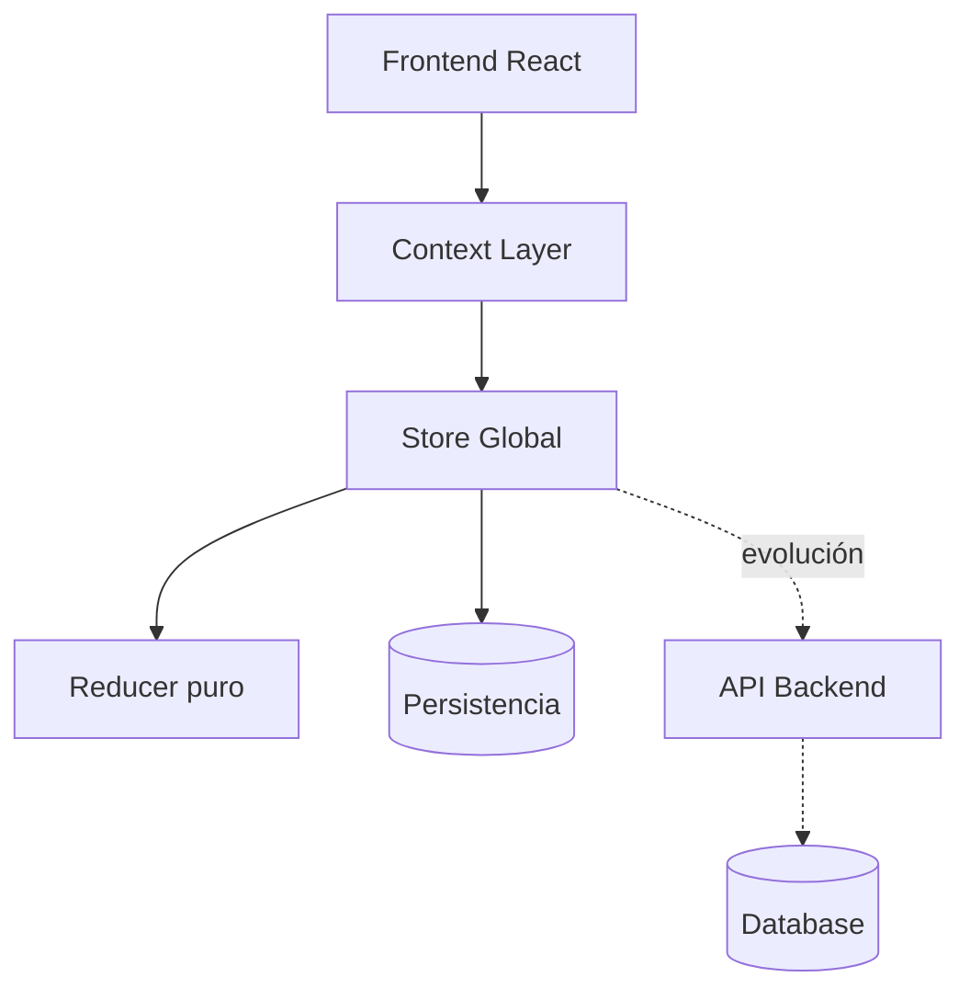

# ⚛️ TaskFlow — Sistema de Estado Frontend

> Sistema de gestión de tareas construido con React 19 y arquitectura de estado propia, diseñado como base de producto en fase seed listo para producción.

---

## 🧠 Qué es esto

TaskFlow es un **sistema frontend de estado tipo SaaS base**, no una Todo App.

Está diseñado como si fuera el núcleo de un producto real en producción:

- arquitectura escalable
- estado centralizado
- lógica de dominio pura
- infraestructura desacoplada
- testing automatizado
- despliegue continuo

---

## 🚀 Estado del proyecto

✔ Sistema funcional  
✔ Tests automatizados  
✔ Build en producción  
✔ Deploy continuo  
✔ Arquitectura estable

---

## 🏛️ Arquitectura

```text
UI (React)
   ↓
Context Layer
   ↓
Store (Single Source of Truth)
   ↓
Reducer (lógica de dominio)
   ↓
Persistencia (localStorage / futura API)
```

---

## 🧩 System Design



---

## 🧠 Decisiones clave

### ✔ Se implementó store propio porque:

- control total del estado
- eliminación de dependencias externas
- comprensión profunda del modelo Redux/Zustand

---

## 🧱 Principios de arquitectura

- Single Source of Truth
- Reducers puros
- Flujo de datos unidireccional
- UI desacoplada del estado
- Infraestructura intercambiable
- Diseño orientado a producto

---

## 🧪 Testing (nivel producción)

### Estrategia

- Unit tests → lógica de dominio
- Integration tests → store completo
- Component tests → UI React
- Hook tests → integración estado + React

### Estado

✔ 22 tests pasando  
✔ Sistema determinista  
✔ Flujo de estado validado

---

## ⚙️ CI/CD (Producción)

### Pipeline automático

```text
Push a main
   ↓
Instalación dependencias
   ↓
Ejecución tests (Vitest)
   ↓
Build de producción (Vite)
   ↓
Deploy automático (Vercel)
```

✔ Integración continua activa  
✔ Deploy automático en cada cambio  
✔ Build validado antes de producción

---

## 🌍 Deploy

- Entorno: Vercel
- URL: _(añadir aquí cuando esté desplegado)_

---

## 📊 Qué demuestra este proyecto

Este sistema demuestra capacidad para:

- Diseñar arquitectura frontend de nivel producto
- Construir sistemas de estado desde cero
- Pensar en escalabilidad real
- Diseñar pipelines de producción
- Aplicar testing profesional por capas
- Separar dominio, UI e infraestructura correctamente

---

## ⚖️ Trade-offs

### ✔ Ventajas

- control total del sistema
- arquitectura explícita
- alta mantenibilidad
- pipeline de producción real

### ❌ Costes

- mayor complejidad inicial
- escalabilidad manual
- disciplina arquitectónica necesaria

---

## 🚀 Evolución del producto

El sistema está preparado para:

- API REST / GraphQL real
- autenticación de usuarios
- multi-tenancy
- estado asíncrono
- middleware en el store
- observabilidad (logs de estado)
- métricas de uso

---

## 🧠 Filosofía

> “Un producto frontend serio no se define por sus componentes, sino por cómo gestiona su estado y su evolución.”

---

## 📦 Stack técnico

- React 19
- Vite
- Vitest
- Context API
- useSyncExternalStore
- JavaScript / TypeScript parcial
- Vercel (deploy)
- GitHub Actions (CI/CD)

---

## 📄 Licencia

MIT
