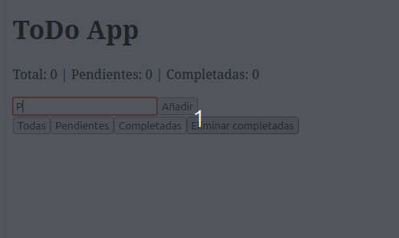

# React Todo App — Frontend Architecture Lab

> Aplicación de gestión de tareas desarrollada con React 19 enfocada en arquitectura frontend, gestión de estado desacoplada y testing avanzado.



---

## 📖 Descripción

Este proyecto comenzó como una aplicación ToDo tradicional y evolucionó hasta convertirse en un laboratorio práctico de arquitectura frontend.

El objetivo principal no ha sido únicamente crear una lista de tareas, sino aplicar conceptos utilizados en aplicaciones reales:

* separación de responsabilidades
* gestión de estado predecible
* desacoplamiento entre UI y lógica de negocio
* persistencia de datos
* testing automatizado

La aplicación implementa un **store propio inspirado en Redux**, utilizando reducers, acciones y una capa de Context para conectar React con la lógica de dominio.

El resultado es una aplicación mantenible, testeable y preparada para evolucionar.

---

## ✨ Funcionalidades

* ➕ Crear tareas
* ✏️ Editar tareas
* ✅ Marcar tareas como completadas o pendientes
* 🗑️ Eliminar tareas
* 🔍 Filtrar por:

  * Todas
  * Pendientes
  * Completadas
* 📊 Contadores dinámicos
* 🧹 Eliminación de tareas completadas
* 💾 Persistencia mediante Local Storage

---

## 🛠️ Tecnologías utilizadas

| Tecnología            | Uso                               |
| --------------------- | --------------------------------- |
| React 19              | Interfaz de usuario               |
| Vite                  | Entorno de desarrollo y build     |
| JavaScript ES Modules | Lenguaje principal                |
| Context API           | Integración con React             |
| External Store        | Gestión global del estado         |
| Reducer Pattern       | Actualizaciones predecibles       |
| Vitest                | Testing                           |
| React Testing Library | Pruebas de componentes            |
| ESLint                | Calidad y consistencia del código |

---

# 🏛️ Arquitectura

La aplicación sigue una arquitectura por capas inspirada en Redux y Clean Architecture.

```text
                 UI Components
                      │
                      ▼
              Tasks Context Layer
                      │
                      ▼
              Application Actions
                      │
                      ▼
              Domain Store
                      │
                      ▼
                 Tasks Reducer
                      │
                      ▼
               Application State
                      │
                      ▼
              Infrastructure Storage
```

Responsabilidades:

### UI

Componentes React responsables únicamente de la representación:

* TaskForm
* TaskList
* TaskItem

### Context Layer

Puente entre React y la lógica de aplicación.

Proporciona:

* estado
* acciones
* hooks personalizados

### Application Layer

Coordina operaciones relacionadas con tareas.

### Domain Layer

Contiene la lógica principal:

* acciones
* reducer
* store
* selectores

### Infrastructure Layer

Gestiona detalles externos:

* Local Storage
* persistencia de datos

---

# 📂 Estructura del proyecto

```text
src/
├── application/
│   └── tasks/
│
├── domain/
│   └── tasks/
│       ├── taskActions.js
│       ├── tasksReducer.js
│       ├── tasksSelectors.js
│       └── tasksStore.js
│
├── infrastructure/
│   └── tasksStorage.js
│
├── ui/
│   ├── components/
│   ├── context/
│   └── hooks/
│
├── hooks/
├── tests/
└── utils/
```

La estructura mantiene separadas la interfaz, la lógica de negocio y los servicios externos.

---

# 🧪 Testing

El proyecto cuenta con una suite completa de pruebas automatizadas.

Estado actual:

```
35 tests passing
0 failing
```

Incluye:

## Unit Tests

* Reducer
* Store
* Acciones
* Hooks
* Utilidades

## Component Tests

* TaskForm
* TaskItem
* TaskList

## Integration Tests

* Creación de tareas
* Edición
* Eliminación
* Filtrado
* Persistencia

---

# 🚀 Instalación

Clonar el repositorio:

```bash
git clone https://github.com/enrisan1/mi-app.git
```

Entrar en el proyecto:

```bash
cd mi-app
```

Instalar dependencias:

```bash
npm install
```

Ejecutar en desarrollo:

```bash
npm run dev
```

---

# 📜 Scripts disponibles

```bash
npm run dev
```

Servidor de desarrollo.

```bash
npm run build
```

Compilación para producción.

```bash
npm run preview
```

Previsualización del build.

```bash
npm run test
```

Ejecuta los tests.

```bash
npm run lint
```

Analiza el código con ESLint.

---

# 💡 Decisiones de diseño

Durante el desarrollo se tomaron decisiones orientadas a comprender la arquitectura interna de aplicaciones React:

* Implementación de un store propio sin Redux Toolkit.
* Uso de reducers puros.
* Separación entre dominio y presentación.
* Acciones centralizadas.
* Estado externo conectado mediante `useSyncExternalStore`.
* Testing independiente por capas.

---

# 📚 Aprendizajes

Este proyecto permitió profundizar en:

* Arquitectura frontend moderna.
* Gestión avanzada del estado.
* Patrones Redux.
* Context API.
* Hooks personalizados.
* Testing de componentes.
* Persistencia local.
* Organización de proyectos React escalables.

---

# 🔮 Próximas mejoras

* Drag & Drop para ordenar tareas.
* Categorías.
* Prioridades.
* Fechas límite.
* Sincronización con API REST.
* Autenticación.
* Tema oscuro.
* Internacionalización.

---

## 📄 Licencia

MIT License.
