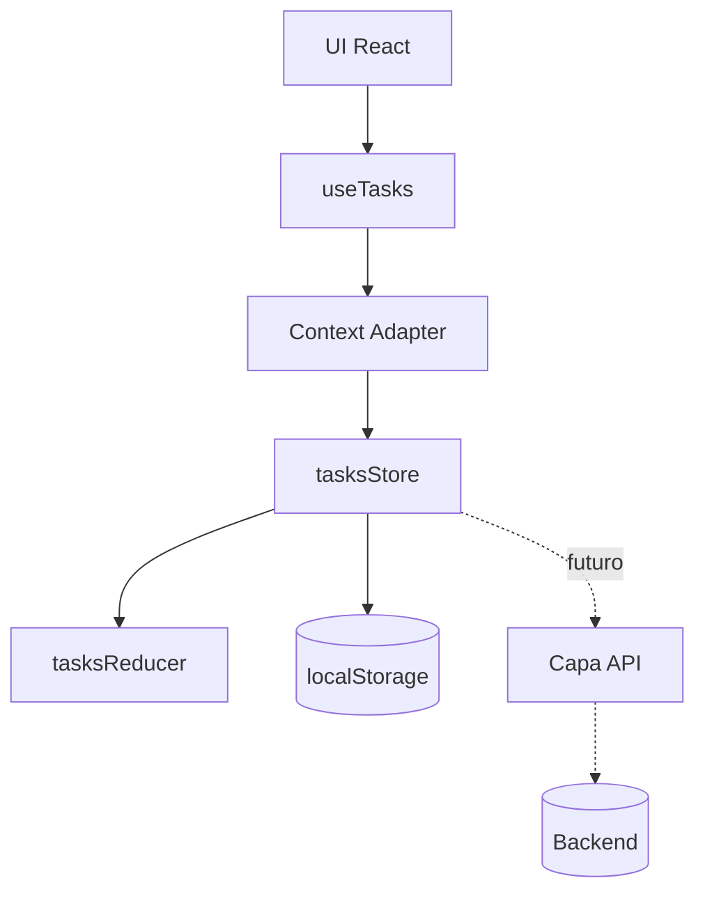

# ⚛️ React Todo — Laboratorio de Arquitectura Frontend

> Experimento de arquitectura frontend construido con React 19, enfocado en diseño de sistemas de estado, separación de responsabilidades y testing por capas sin librerías externas como Redux o Zustand.

---

## 🚀 Visión general

Este proyecto no es una Todo App convencional.

Es un **laboratorio de arquitectura frontend** diseñado para entender cómo construir sistemas escalables de estado en React desde cero.

Se centra en:

- Diseño de un store propio (tipo Redux interno)
- Lógica de dominio basada en reducers puros
- React como capa de presentación únicamente
- Persistencia aislada de la infraestructura
- Estrategias de testing por capas

---

## 🧠 Idea principal

> React no es el sistema de estado. Es solo la capa de UI.

---

## 🏛️ Arquitectura del sistema

```text
UI (Componentes React)
   ↓
Context Adapter (puente React ↔ sistema)
   ↓
Store personalizado (Single Source of Truth)
   ↓
Reducer puro (lógica de negocio)
   ↓
Capa de persistencia (localStorage)
```

---

## 🧩 System Design



---

## 🧱 Principios de diseño

- Fuente única de verdad (Single Source of Truth)
- Funciones puras para cambios de estado
- Separación total entre UI y lógica de negocio
- Infraestructura aislada del dominio
- Eliminación de sobreingeniería

---

## 🧪 Estrategia de testing

El sistema está diseñado para ser testeable por capas:

- Tests unitarios → reducers
- Tests de store → orquestación del estado
- Tests de hooks → integración con React
- Tests de componentes → comportamiento UI
- Tests de integración → flujos completos

✔ 22 tests pasando  
✔ Sistema de estado determinista  
✔ Lógica completamente aislada

---

## 🧠 Decisiones de ingeniería

### ❌ Eliminado intencionalmente

- Redux / Zustand
- Patrón Repository
- Factory de store
- Selectores innecesarios
- Capa de servicios artificial

### ✔ Conservado como núcleo

- Store personalizado
- Reducer puro
- Context como adaptador
- Persistencia en localStorage

---

## 📊 Modelo mental

```text
React → UI
Store → Motor de estado
Reducer → Lógica de negocio
Context → Capa puente
Storage → Persistencia
```

---

## 🚀 Qué demuestra este proyecto

Este proyecto demuestra comprensión de:

- Cómo funcionan internamente sistemas tipo Redux
- Diseño de arquitecturas frontend escalables
- Separación real de responsabilidades
- Estrategias de testing en frontend moderno
- Cuándo NO usar abstracciones

---

## ⚖️ Trade-offs

### ✔ Ventajas

- Arquitectura clara y predecible
- Alta testabilidad
- Sin dependencias externas de estado
- Flujo de datos controlado

### ❌ Desventajas

- Escalabilidad manual
- Sin middleware integrado
- Requiere disciplina arquitectónica

---

## 📈 Evolución futura

- Migración a API REST / GraphQL
- Estado asíncrono
- Middleware en el store
- Undo / Redo de acciones
- Migración completa a TypeScript
- Modularización por dominio

---

## 🧭 Filosofía

> “La buena arquitectura no consiste en añadir capas, sino en eliminar las innecesarias.”

---

## 📄 Licencia

MIT
