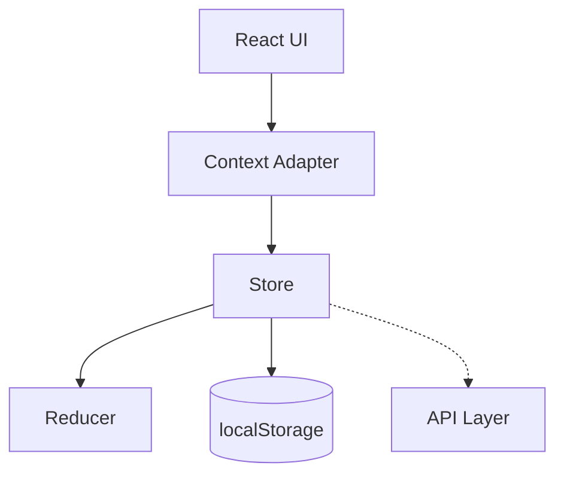

# 🧠 System Design

## Arquitectura



---

## Modelo mental

```text
React = UI
Store = Estado
Reducer = Lógica
Context = Bridge
Storage = Persistencia
```

---

## Principio clave

> El estado no vive en React. React lo consume.
