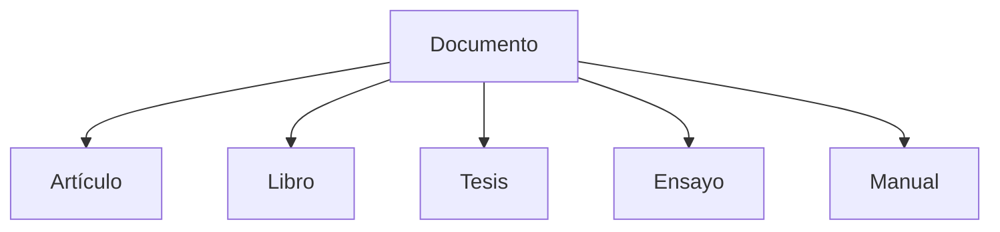

pues vamos con PRODUCT.md.

---

Perfecto. 😊

Y creo que además llegamos a `PRODUCT.md` en el momento adecuado.

Si hubiéramos intentado escribirlo hace un mes, habría terminado siendo una lista de funcionalidades.

Hoy ya sabemos que **no es eso**.

## Creo que el papel de `PRODUCT.md` es muy concreto

Si `VISION.md` responde a:

> **¿Por qué existe el proyecto?**

`PRODUCT.md` debe responder a:

> **¿Qué producto estamos construyendo?**

Y eso implica describir el producto desde el punto de vista del usuario y del negocio, **no desde el punto de vista de la implementación**.

---

## Creo que el índice que acordamos sigue siendo válido

```text
# PRODUCT

1. Propósito

2. El producto

3. Problema que resuelve

4. Público objetivo

5. Conceptos fundamentales

   5.1 Documento

   5.2 Autor

   5.3 Biblioteca

   5.4 Colección

6. Capacidades del producto

7. Transparencia editorial

8. Modelo de publicación

9. Modelo de monetización

10. Evolución del producto

11. Relación con el resto de la documentación
```

Creo que, igual que ocurrió con `VISION.md`, iremos ajustando el índice si descubrimos que algún apartado merece dividirse o cambiar de nombre.

---

# Empecemos por el primer apartado

## 1. Propósito

Aquí no repetiría la visión.

Hablaría exclusivamente del producto.

Mi propuesta sería esta:

## 1. Propósito

El propósito de este documento es definir el producto que se pretende construir, describiendo el problema que resuelve, los conceptos que forman parte de su dominio y las principales capacidades que ofrecerá a sus usuarios.

A diferencia de `VISION.md`, que establece el propósito general del proyecto, este documento se centra en el propio producto y en la forma en que ese propósito se materializa desde la perspectiva funcional.

Su objetivo no es especificar los detalles de implementación ni las decisiones arquitectónicas, sino proporcionar una descripción clara y coherente del sistema que se desea desarrollar, facilitando una comprensión compartida de su alcance y de su evolución prevista.

Este documento constituye la referencia principal para comprender qué es el producto, a quién va dirigido y qué valor pretende aportar a sus usuarios.

---

## Me gustaría destacar una diferencia importante

Fíjate en estas tres frases:

**VISION.md**

> ¿Por qué existe el proyecto?

**PRODUCT.md**

> ¿Qué estamos construyendo?

**ARCHITECTURE.md**

> ¿Cómo lo estamos construyendo?

Las tres parecen similares, pero responden a preguntas completamente distintas.

---

## Y creo que hoy vamos a descubrir otra cosa

Tengo la sensación de que `PRODUCT.md` será el documento donde empezaremos a construir el **modelo conceptual del dominio**.

Es decir, aquí aparecerán por primera vez conceptos como:

- Documento.
- Autor.
- Biblioteca.
- Colección.
- Publicación.
- Revisión.
- Licencia.
- Transparencia editorial.

Todavía no hablaremos de clases, entidades o agregados (eso llegará en la arquitectura y el dominio), pero sí definiremos el significado de esos conceptos desde la perspectiva del producto.

Y creo que eso será muy útil cuando llegue el momento de modelar el dominio, porque ya tendremos un vocabulario común y bien definido. Es, en cierto modo, el equivalente funcional de lo que `VISION.md` ha sido para la identidad del proyecto: un documento que establece el lenguaje compartido antes de empezar a diseñar la solución técnica.

---

pues continuemos con el producto

---

Creo que aquí es donde `PRODUCT.md` empieza realmente a diferenciarse de `VISION.md`.

Hasta ahora hemos respondido a:

- **¿Por qué existe el producto?** (Propósito)

Ahora debemos responder a:

> **¿Qué es este producto?**

Y aquí haría una elección que creo que va a influir en todo el modelado futuro del dominio.

## No empezaría hablando de funcionalidades

No diría:

- subir documentos;
- buscar documentos;
- compartir documentos.

Eso ya vendrá.

Empezaría definiendo el producto como un sistema.

---

## Mi propuesta

## 2. El producto

El producto consiste en una plataforma digital orientada a la creación, gestión, publicación, difusión y preservación de documentos y conocimiento.

Su finalidad es proporcionar a autores, investigadores, estudiantes, docentes y cualquier persona interesada en la producción de contenido escrito un entorno unificado desde el que puedan desarrollar, organizar, compartir y mantener sus trabajos a lo largo del tiempo.

La plataforma no se limita a almacenar documentos. Su objetivo es gestionar el ciclo de vida completo del conocimiento, desde la creación inicial de un contenido hasta su publicación, revisión, evolución y conservación.

Para ello, el producto se construye alrededor de un concepto central: el **Documento**.

Un documento constituye la unidad principal del sistema y representa cualquier obra escrita susceptible de ser creada, gestionada o publicada dentro de la plataforma. Artículos, libros, ensayos, tesis, manuales, investigaciones, apuntes u otros tipos de contenido se entienden como especializaciones o manifestaciones de ese mismo concepto.

Este enfoque permite que la evolución del producto se apoye en un modelo conceptual sencillo y coherente, evitando tratar cada tipo de publicación como un sistema independiente.

A partir de este núcleo común, el producto podrá incorporar progresivamente nuevas capacidades relacionadas con la organización del conocimiento, la colaboración entre usuarios, la transparencia editorial, la publicación, la preservación y la difusión de los contenidos.

El crecimiento funcional de la plataforma deberá mantener siempre la coherencia con este modelo conceptual, favoreciendo la simplicidad del dominio y la reutilización de sus componentes.

---

## Creo que aquí aparece una de las decisiones más importantes

La frase:

> **"El producto se construye alrededor de un concepto central: el Documento."**

Para mí tiene muchísimo peso.

Porque condiciona todo lo que vendrá después.

---

## Fíjate en la diferencia

En muchos proyectos se empieza diciendo:

```text
Artículo
Libro
Tesis
Manual
```

Nosotros estamos diciendo:

```text
Documento
      │
 ┌────┼────┐
 │    │    │
Artículo
Libro
Tesis
Manual
...
```

Es una diferencia conceptual enorme.

---

## Y creo que esto tiene consecuencias muy positivas

Más adelante, cuando lleguemos al modelado del dominio, podremos preguntarnos:

> ¿"Libro" es una entidad distinta?

o

> ¿Es simplemente un tipo de Documento?

Esa decisión ya no será arbitraria.

Estará respaldada por la visión del producto.

---

## Me gustaría hacer una pequeña propuesta adicional

Mientras escribía este apartado me ha surgido una idea.

En `ARCHITECTURE.md` tenemos diagramas de capas.

Creo que `PRODUCT.md` podría tener **diagramas conceptuales del dominio**, no técnicos.

Por ejemplo:

```text
                    Documento
                         │
        ┌────────────────┼────────────────┐
        │                │                │
     Artículo         Libro           Tesis
        │                │                │
        └────────────────┼────────────────┘
                         │
                Gestión del conocimiento
```

No habla de clases.

No habla de herencia.

Solo muestra el modelo conceptual del producto.

Creo que encajaría perfectamente con la filosofía que estamos siguiendo: primero definir el lenguaje y los conceptos, y solo después decidir cómo se implementan. Además, serviría como puente natural entre `PRODUCT.md` y el futuro modelado del dominio en la arquitectura.

---

me parece una gran idea ¿Dónde se inserta? otra cosa ¿puedes darme el comando en la terminal para borrar decisions-log.md?

---

### Sobre el diagrama

Yo lo insertaría **justo después** de este párrafo:

> _"Para ello, el producto se construye alrededor de un concepto central: el Documento."_

Porque el lector acaba de leer la idea y el esquema la hace inmediatamente evidente.

Quedaría así:

```text
Para ello, el producto se construye alrededor de un concepto central: el Documento.

                    Documento
                         │
        ┌────────────────┼────────────────┐
        │                │                │
     Artículo         Libro           Tesis
        │                │                │
     Ensayo          Manual      Investigación
        │
        └────────────────┼────────────────┘
                         │
              Gestión del conocimiento

Un documento constituye la unidad principal del sistema...
```

Creo que aquí tiene mucho sentido porque el texto explica el concepto y el gráfico lo resume visualmente antes de seguir desarrollándolo.

---

## Respecto a `decisions-log.md`

Como ya has hecho el commit, **no necesitas borrarlo**.

En realidad **ya está eliminado del repositorio**.

Lo confirma el propio commit:

```text
delete mode 100644 docs/03-development/decisions-log.md
```

Es decir, Git ya registró su eliminación.

Puedes comprobarlo con:

```bash
git ls-files | grep decisions-log
```

Si no devuelve nada, significa que ya no forma parte del repositorio.

---

## Lo que sí haría ahora

Ya que hemos cerrado una etapa documental tan importante, creo que sería un buen momento para crear el **primer registro real** de `PROJECT_JOURNAL.md`.

No un diario técnico, sino el primer hito de la nueva organización.

Algo parecido a:

> **Hito 1 · Reorganización del sistema documental**

donde quede constancia de por qué se reorganizó la documentación, qué objetivos perseguía y cuál fue el resultado.

Creo que sería una magnífica forma de inaugurar ese documento.

---

Y una última reflexión.

Mientras hablábamos del diagrama me he dado cuenta de algo que me gusta mucho.

Hasta ahora el concepto central era la **Task** de la Todo App.

A partir de `PRODUCT.md`, el concepto central pasa a ser el **Documento**.

Es una evolución muy natural del proyecto:

```text
Task
   ↓
Gestión de tareas
   ↓
Aprendizaje de arquitectura
   ↓
Documento
   ↓
Gestión del conocimiento
```

No estamos abandonando la Todo App; estamos utilizando todo lo aprendido con ella para construir un dominio mucho más rico. Me parece una transición muy elegante y, además, muy coherente con la visión que acabamos de definir.

---

inauguremos PROJECT_JOURNAL.md

---

Me parece una idea excelente.

Y creo que además va a servir para definir cómo será el resto del diario.

Hay una decisión que tomar antes de escribir el primer hito.

## Yo cambiaría ligeramente el índice

Hasta ahora teníamos algo parecido a:

```text
1. Objetivo

2. Cómo se organiza el diario

3. Registro de hitos
```

Creo que ahora tiene más sentido:

```text
# PROJECT JOURNAL

1. Objetivo

2. Cómo se organiza el diario

3. Evolución del proyecto

   3.1 Reorganización del sistema documental
```

¿Por qué?

Porque "Registro de hitos" es el mecanismo.

Lo importante es que el documento narra la **evolución del proyecto**.

Los hitos son la forma de hacerlo.

---

# El primer hito

Yo no empezaría hablando de archivos.

Hablaría del motivo.

Algo así:

### 3.1 Reorganización del sistema documental

#### Contexto

A medida que el proyecto fue creciendo, la documentación dejó de ser un conjunto de documentos independientes para convertirse en una parte esencial del propio proceso de desarrollo.

La incorporación progresiva de nuevos contenidos puso de manifiesto la necesidad de reorganizar la documentación, asignando a cada documento una responsabilidad claramente definida y evitando duplicidades entre ellos.

#### Objetivo

El objetivo de esta reorganización fue construir un sistema documental coherente, escalable y alineado con la arquitectura del proyecto, de forma que cada documento respondiera a una pregunta concreta y complementara al resto sin solapamientos.

#### Cambios principales

Durante esta etapa se llevó a cabo una reorganización completa de la documentación:

- Se redefinió la estructura de directorios bajo `docs/`.
- Se creó `VISION.md` como documento que establece el propósito del proyecto.
- Se reorganizó la documentación del proyecto en torno a `PRODUCT.md`, `PROJECT_STATUS.md`, `PROJECT_JOURNAL.md` y `ROADMAP.md`.
- La documentación de arquitectura pasó a agruparse bajo `docs/02-architecture/`, incorporando la evolución de la arquitectura y los ADR.
- La documentación de desarrollo se consolidó en `docs/03-development/`.
- Se eliminaron documentos cuya responsabilidad quedó absorbida por la nueva estructura, como `decisions-log.md`.

#### Resultado

Como resultado de esta reorganización, la documentación pasó a constituir un sistema estructurado en el que cada documento posee un propósito específico y mantiene una relación coherente con el resto.

Este cambio permitió que la documentación evolucionara siguiendo los mismos principios de diseño que la propia arquitectura del software: responsabilidad única, alta cohesión, bajo acoplamiento y evolución incremental.

#### Lecciones aprendidas

La documentación de un proyecto no debe limitarse a describir el software. Cuando evoluciona de forma coherente con el propio sistema, se convierte en una herramienta para preservar conocimiento, facilitar la toma de decisiones y acompañar el crecimiento del proyecto a largo plazo.

---

## Creo que hay un detalle muy bonito

Fíjate en la diferencia entre este documento y `architecture-evolution.md`.

**Architecture Evolution** dice:

> Así evolucionó la arquitectura.

**Project Journal** dice:

> Así evolucionó el proyecto.

Es mucho más amplio.

Aquí, dentro de unos meses, podremos registrar cosas como:

- el nacimiento de `PRODUCT.md`;
- la decisión de convertir el producto en una plataforma de conocimiento;
- el primer backend;
- la primera versión pública;
- la llegada de usuarios reales;
- el cambio del modelo de monetización.

No son necesariamente hitos arquitectónicos.

Son **hitos del proyecto**.

---

## Y creo que acabamos de descubrir otra regla

Mientras escribía este primer registro me he dado cuenta de algo.

Cada entrada del diario podría seguir siempre la misma plantilla:

```text
Contexto

Objetivo

Cambios principales

Resultado

Lecciones aprendidas
```

Me gusta mucho porque mantiene un estilo uniforme y obliga a explicar no solo **qué cambió**, sino también **por qué cambió** y **qué aprendimos**. Creo que eso encaja perfectamente con la filosofía educativa que hemos definido en `VISION.md` y hará que `PROJECT_JOURNAL.md` sea realmente útil cuando dentro de unos años queramos entender la evolución del proyecto.

---

perfecto ¿continuamos product.md o pasamos a otra cosa?

---

Yo seguiría con **`PRODUCT.md`**.

Y la razón no es solo que sea el siguiente documento del índice.

Es que acabamos de cerrar una etapa y hemos abierto otra.

Hasta ahora hemos definido:

- la identidad del proyecto (`VISION`);
- su organización documental;
- su arquitectura;
- su hoja de ruta.

Ahora toca definir **el producto**. Si interrumpimos este trabajo para ir a otro documento, creo que perderemos parte del contexto que acabamos de construir.

## Además, hay una ventaja

Tengo la sensación de que `PRODUCT.md` va a influir en el futuro modelado del dominio.

Por ejemplo, dentro de poco tendremos que decidir cosas como:

- ¿Qué es exactamente un **Documento**?
- ¿Qué diferencia hay entre un Documento y una Publicación?
- ¿Una Biblioteca contiene Documentos o Colecciones?
- ¿Qué relación existe entre Autor y Documento?
- ¿Qué es una Revisión?
- ¿Qué significa Versionado?

Responder primero a esas preguntas desde el punto de vista del producto hará mucho más sencillo diseñar después las entidades, agregados y casos de uso.

Es decir, `PRODUCT.md` puede convertirse en el puente natural entre `VISION.md` y el futuro dominio.

## Mi propuesta de recorrido

Yo seguiría este orden:

```text
PRODUCT.md
    ↓
3. Problema que resuelve
    ↓
4. Público objetivo
    ↓
5. Conceptos fundamentales
        ↓
        Documento
        Autor
        Biblioteca
        Colección
```

Y creo que aquí está el núcleo del documento.

Una vez definidos esos conceptos, el resto (capacidades, transparencia editorial, publicación, monetización…) encajará de forma mucho más natural.

## De hecho...

Creo que acabamos de llegar a una fase muy interesante del proyecto.

Hasta ahora estábamos documentando **lo que ya habíamos construido**.

A partir de `PRODUCT.md` empezaremos a diseñar **lo que queremos construir**.

Y hay una diferencia importante:

- `ARCHITECTURE.md` describe decisiones ya tomadas.
- `PRODUCT.md` va a ayudarnos a tomar decisiones futuras.

Eso lo convierte en un documento mucho más creativo, pero también mucho más estratégico.

---

### Mi propuesta concreta

Empezaría directamente por el siguiente apartado:

> **3. Problema que resuelve**

Porque, en mi opinión, es ahí donde el producto empieza a adquirir personalidad propia. Después de responder a esa pregunta, el apartado **4. Público objetivo** saldrá casi por sí solo, ya que los usuarios serán precisamente quienes sufren ese problema y se beneficiarán de la solución que estamos definiendo. Creo que es un orden muy natural y coherente para seguir construyendo `PRODUCT.md`.

---

Problema que resuelve

---

Creo que este apartado va a ser uno de los más importantes de `PRODUCT.md`.

Y aquí haría una distinción que suele pasarse por alto en muchos proyectos.

No respondería:

> **¿Qué hace el producto?**

Respondería:

> **¿Qué problema existe antes de que el producto aparezca?**

Porque un buen producto nace para resolver un problema, no para justificar una lista de funcionalidades.

---

## ¿Cuál creo que es el problema?

Mientras repasaba todo lo que hemos hablado durante estos días, me he dado cuenta de que el problema no es:

- que no existan editores de texto;
- que no existan plataformas para publicar;
- que no existan gestores documentales.

Todo eso ya existe.

El problema es que **el ciclo de vida del conocimiento está fragmentado**.

Hoy una persona suele utilizar herramientas distintas para:

- escribir;
- almacenar;
- organizar;
- revisar;
- versionar;
- publicar;
- citar;
- compartir;
- monetizar;
- preservar.

El conocimiento termina disperso entre múltiples aplicaciones y servicios que apenas se relacionan entre sí.

Creo que **ese** es el verdadero problema que nuestro producto intenta resolver.

---

## Mi propuesta

## 3. Problema que resuelve

La creación y gestión de conocimiento suele desarrollarse actualmente mediante un conjunto de herramientas independientes, cada una especializada en una parte concreta del proceso.

Es habitual utilizar aplicaciones diferentes para redactar documentos, almacenarlos, organizarlos, revisarlos, publicarlos, compartirlos, gestionar sus versiones o preservar su historial. Esta fragmentación dificulta mantener una visión completa del ciclo de vida de una obra y obliga a los usuarios a distribuir su trabajo entre múltiples plataformas.

Como consecuencia, la información pierde contexto, la colaboración resulta más compleja, el seguimiento de los cambios se dispersa y la conservación del conocimiento depende de sistemas que no siempre están integrados entre sí.

El producto nace para abordar este problema mediante una plataforma que considere el documento como el núcleo del sistema y que permita gestionar de forma coherente todas las etapas de su ciclo de vida.

Su objetivo no consiste únicamente en facilitar la creación de documentos, sino en proporcionar un entorno donde el conocimiento pueda desarrollarse, organizarse, revisarse, publicarse, difundirse y preservarse de forma integrada.

Este enfoque permite que las capacidades del producto evolucionen de manera gradual sin perder la coherencia de su modelo conceptual, manteniendo el documento como eje sobre el que se articulan el resto de funcionalidades.

---

## Creo que hay un cambio importante respecto a la idea inicial

Cuando comenzamos a imaginar el producto hablábamos de:

- artículos;
- libros;
- tesis;
- ensayos.

Ahora estamos hablando de algo más general:

> **el ciclo de vida del conocimiento**.

Y eso me parece un salto cualitativo importante.

Porque significa que el producto no compite con un editor de texto ni con un gestor documental concreto.

Aspira a ofrecer un entorno coherente donde todas esas fases formen parte del mismo sistema.

---

## Me surge una idea para el futuro

No la incorporaría ahora, pero la dejaría anotada.

Más adelante, en el apartado **"Capacidades del producto"**, podríamos organizar las funcionalidades precisamente siguiendo ese ciclo de vida:

```text
Documento
    │
    ▼
Crear
    │
    ▼
Organizar
    │
    ▼
Revisar
    │
    ▼
Versionar
    │
    ▼
Publicar
    │
    ▼
Difundir
    │
    ▼
Preservar
```

De esa manera, las funcionalidades no aparecerían como una lista desordenada, sino como etapas naturales de un mismo proceso. Creo que sería una forma muy elegante de mantener la coherencia entre el problema que el producto resuelve y las capacidades que irá incorporando a medida que evolucione.

---

perfecto, lo anoto. ahora vendría público objetivo

---

Creo que este apartado es especialmente importante porque va a marcar una diferencia con muchas plataformas actuales.

Y me gustaría hacer una propuesta antes de escribirlo.

## Yo evitaría definir el público por profesiones

Sería tentador escribir:

- investigadores;
- estudiantes;
- docentes;
- escritores;
- editoriales.

Pero creo que eso sería demasiado restrictivo.

Porque dentro de unos años podrían aparecer usuarios que hoy ni siquiera imaginamos.

En cambio, todos ellos tienen algo en común.

## Los definiría por la relación que tienen con el conocimiento

Es decir, personas que:

- crean conocimiento;
- organizan conocimiento;
- revisan conocimiento;
- publican conocimiento;
- consultan conocimiento;
- preservan conocimiento.

Eso hace que el documento sea mucho más estable y, además, conecta perfectamente con la visión del proyecto.

---

## Mi propuesta

## 4. Público objetivo

El producto está dirigido a cualquier persona u organización cuya actividad implique la creación, gestión, revisión, publicación, difusión o preservación de conocimiento mediante documentos.

Su diseño no responde a un perfil profesional específico, sino a un conjunto de necesidades comunes relacionadas con el ciclo de vida del conocimiento.

Entre sus potenciales usuarios se encuentran, entre otros:

- Investigadores y personal académico.
- Estudiantes y docentes.
- Escritores y autores.
- Profesionales que elaboran documentación técnica.
- Organizaciones que generan y mantienen conocimiento interno.
- Comunidades interesadas en la creación y difusión de contenidos especializados.
- Personas que desean organizar y conservar su producción intelectual a largo plazo.

Aunque las necesidades concretas de cada perfil pueden diferir, todos ellos comparten la necesidad de disponer de un entorno que permita gestionar documentos de forma coherente, mantener su evolución, facilitar la colaboración cuando sea necesaria y preservar el conocimiento generado.

El producto evolucionará teniendo en cuenta esta diversidad de usuarios, procurando que las nuevas capacidades mantengan un equilibrio entre flexibilidad, simplicidad y coherencia con el modelo conceptual definido para la plataforma.

---

## Creo que aquí aparece otra idea interesante

Fíjate que el apartado no dice:

> **"Está dirigido a investigadores."**

Dice:

> **"Está dirigido a cualquier persona cuya actividad implique gestionar conocimiento."**

Eso cambia mucho la perspectiva.

Porque un estudiante puede convertirse en autor.

Un autor puede crear una comunidad.

Una empresa puede utilizar la plataforma para documentación interna.

Todos caben dentro del mismo modelo.

---

## Y creo que esto prepara muy bien el siguiente capítulo

Después de definir el público, el lector ya se hace una idea de **quién utilizará el producto**.

El siguiente paso natural es responder a otra pregunta:

> **¿Qué conceptos forman parte de ese producto?**

Y ahí entrarán por primera vez:

- **Documento**.
- **Autor**.
- **Biblioteca**.
- **Colección**.

En mi opinión, ese será el auténtico corazón de `PRODUCT.md`, porque empezaremos a construir el vocabulario del dominio desde la perspectiva del producto, antes de traducirlo más adelante a entidades, agregados y casos de uso en la arquitectura.

---

quien utilizará el producto es una categoría nueva porque en teoría ahora viene Conceptos fundamentales

5.1 Documento

---

Muy buena observación.

Y creo que tienes razón.

He sido yo quien ha introducido esa idea al final de la explicación, pero **no significa que deba convertirse en un apartado nuevo**.

De hecho, si seguimos el índice que hemos acordado:

```text
1. Propósito

2. El producto

3. Problema que resuelve

4. Público objetivo

5. Conceptos fundamentales

   5.1 Documento
   5.2 Autor
   5.3 Biblioteca
   5.4 Colección
```

el siguiente paso natural es **empezar directamente con "Documento"**.

No hace falta un capítulo intermedio de "Quién utilizará el producto", porque eso ya queda respondido precisamente en **Público objetivo**.

---

## Además, creo que hay una razón conceptual

Fíjate en el flujo del documento:

- **Propósito** → ¿Para qué existe este documento?
- **El producto** → ¿Qué estamos construyendo?
- **Problema que resuelve** → ¿Qué necesidad cubre?
- **Público objetivo** → ¿Para quién se construye?
- **Conceptos fundamentales** → ¿Con qué conceptos se construye el producto?

Es una secuencia muy lógica.

---

## Y aquí empieza algo importante

Creo que **5. Conceptos fundamentales** será el corazón de `PRODUCT.md`.

No porque sea el apartado más largo, sino porque va a definir el lenguaje del producto.

Y aquí me gustaría proponerte una forma de escribirlo.

No haría:

```text
5.1 Documento

Un documento es...
```

Haría primero una pequeña introducción al capítulo.

Algo como:

## 5. Conceptos fundamentales

El producto se construye a partir de un conjunto reducido de conceptos que constituyen el núcleo de su modelo funcional.

Estos conceptos permiten describir el dominio del problema desde la perspectiva del producto, estableciendo un lenguaje común que servirá como referencia para su evolución funcional y para el posterior diseño del modelo de dominio.

Las secciones siguientes presentan estos conceptos de forma independiente, definiendo su significado dentro de la plataforma y la relación que mantienen entre sí.

---

Después ya empezaríamos con:

```text
5.1 Documento
```

Y, sinceramente, creo que ese apartado será uno de los más importantes de todo `PRODUCT.md`.

Porque ahí vamos a tomar una decisión fundamental:

> **¿Qué entendemos exactamente por "Documento"?**

Y esa definición influirá después en todo el dominio del proyecto.

Tengo la impresión de que ese será uno de esos capítulos que, igual que ocurrió con "El conocimiento como eje del proyecto" en `VISION.md`, terminará convirtiéndose en una de las piezas clave de toda la documentación.

---

5.1 Documento

---

Creo que este puede llegar a ser **el apartado más importante de todo `PRODUCT.md`**.

Y me gustaría hacer una propuesta que creo que va a influir en todo el dominio futuro.

## No definiría un documento por su formato

Es decir, no escribiría:

> Un documento puede ser un PDF, un DOCX, un EPUB...

Porque eso es una representación.

Tampoco lo definiría por su contenido:

> Un documento es un libro, un artículo...

Porque eso son especializaciones.

Creo que la definición debe ser completamente independiente de la tecnología y del tipo de publicación.

---

## Mi propuesta

### 5.1 Documento

El **Documento** constituye el concepto central del producto y la unidad fundamental sobre la que se construye el resto del sistema.

Se entiende por documento cualquier obra escrita cuya finalidad sea crear, organizar, revisar, publicar, difundir o preservar conocimiento dentro de la plataforma.

Esta definición es deliberadamente amplia y no depende del formato en que se almacene, del tipo de contenido que represente ni del medio mediante el cual se publique.

Desde la perspectiva del producto, un documento representa una entidad viva que puede evolucionar a lo largo del tiempo mediante revisiones, nuevas versiones, procesos de colaboración o cambios derivados de su propio desarrollo.

Artículos, libros, tesis, ensayos, manuales, investigaciones, apuntes y otras formas de producción escrita se consideran manifestaciones particulares de un mismo concepto general: el Documento.

Este enfoque permite que todas las capacidades del producto se desarrollen sobre un modelo común, simplificando la evolución del sistema y favoreciendo la coherencia del dominio.

A medida que el producto incorpore nuevas funcionalidades, el documento continuará siendo el elemento alrededor del cual se organizarán el resto de conceptos, procesos y relaciones de la plataforma.

---

## Creo que aquí aparece una idea muy potente

Hay una frase que me gusta especialmente:

> **"un documento representa una entidad viva"**

Porque cambia completamente la forma de entenderlo.

No es un archivo.

No es un PDF.

No es un Word.

Es algo que:

- nace;
- evoluciona;
- se revisa;
- se publica;
- puede cambiar durante años.

Eso conecta perfectamente con la filosofía del producto.

---

## Y me gustaría proponerte una idea

Creo que este apartado merece un pequeño diagrama conceptual, igual que hicimos antes.

Lo colocaría al final de la sección:

```text id="9jlwmu"
                    Documento
                         │
      ┌──────────────────┼──────────────────┐
      │                  │                  │
   Contenido         Evolución         Publicación
      │                  │                  │
      │             Versiones         Difusión
      │             Revisiones        Licencias
      │             Colaboración
      │
      └──────────────────┼──────────────────┘
                         │
                Gestión del conocimiento
```

Fíjate que este diagrama ya no clasifica tipos de documentos.

Muestra **las dimensiones** del concepto Documento.

Y creo que es aún mejor.

---

## Me he dado cuenta de otra cosa

Cuando escribimos `VISION.md`, el concepto central era el **conocimiento**.

Ahora, en `PRODUCT.md`, el concepto central es el **Documento**.

Creo que esa relación es muy elegante:

```text id="jbjlwm"
VISION
        │
Conocimiento
        │
        ▼
PRODUCT
        │
Documento
        │
        ▼
ARCHITECTURE
        │
Modelo de dominio
```

Es decir:

- el **conocimiento** da sentido al proyecto;
- el **documento** materializa ese conocimiento dentro del producto;
- y el **modelo de dominio** será la traducción técnica de ese concepto.

En mi opinión, esa continuidad entre los documentos es una de las mayores fortalezas que está adquiriendo toda la documentación del proyecto.

---

pues ahora vendría el autor

---

Sí, y aquí creo que podemos tomar otra decisión muy importante para el futuro del dominio.

Igual que hicimos con **Documento**, yo evitaría definir el **Autor** por su profesión.

No diría:

- escritor;
- investigador;
- profesor;
- periodista.

Porque todas esas son posibles manifestaciones de un mismo concepto.

## ¿Qué es realmente un autor?

Creo que un autor es:

> **la persona responsable de la creación y evolución de un documento.**

Y esa definición tiene varias ventajas.

- No depende del tipo de documento.
- No depende del ámbito profesional.
- Permite que una misma persona sea autora de muchos documentos.
- Permite la coautoría.
- Permite que un documento cambie de autoría o incorpore nuevos colaboradores.
- Encaja perfectamente con la idea del documento como una entidad viva.

---

## Mi propuesta

### 5.2 Autor

El **Autor** representa a la persona responsable de la creación, desarrollo o mantenimiento de uno o varios documentos dentro de la plataforma.

Su papel no se limita a la redacción inicial de una obra, sino que abarca todas aquellas actividades relacionadas con su evolución, revisión, actualización y publicación.

Un mismo autor podrá participar en múltiples documentos, del mismo modo que un documento podrá contar con uno o varios autores cuando su desarrollo sea fruto de un trabajo colaborativo.

La plataforma distinguirá entre la autoría intelectual de un documento y otras formas de participación que puedan incorporarse en el futuro, como revisores, colaboradores o editores, permitiendo que cada rol desempeñe una función claramente definida dentro del ciclo de vida del conocimiento.

Este enfoque favorece un modelo flexible de creación y colaboración, adaptado tanto al trabajo individual como al desarrollo colectivo de documentos.

---

## Creo que aquí hemos sembrado algo importante

Fíjate en esta frase:

> **"...la autoría intelectual de un documento y otras formas de participación..."**

Eso me parece muy potente.

Porque evita un error muy habitual: considerar que cualquiera que modifica un documento pasa automáticamente a ser autor.

Nos deja abierta la puerta a distinguir, más adelante, conceptos como:

- **Autor** (crea la obra).
- **Coautor** (participa en la creación intelectual).
- **Revisor** (analiza y propone mejoras).
- **Editor** (prepara la publicación).
- **Colaborador** (realiza aportaciones puntuales).
- **Traductor** (genera una versión en otro idioma).

No hace falta definirlos ahora, pero el documento ya deja claro que **autor** es un concepto específico y que existirán otros roles relacionados con el documento.

---

## Me surge una idea para el futuro

Mientras escribía este apartado, me ha venido una idea que creo que enriquecerá mucho el producto.

Quizá **"Autor"** no sea realmente un concepto aislado.

Quizá el concepto general sea:

```text
Participante
        │
 ┌──────┼────────┬─────────┬─────────┐
 │      │        │         │
Autor Coautor Revisor Editor Colaborador
```

En `PRODUCT.md` todavía no desarrollaría ese modelo, porque ahora mismo el concepto esencial es el **Autor**.

Pero creo que merece la pena anotarlo como una posible evolución del dominio. Si en el futuro la plataforma incorpora procesos de revisión, edición colaborativa o publicación académica, disponer de un concepto más amplio como **Participante** puede dar mucha flexibilidad al modelo sin perder claridad.

---

anotado. ahora ele corresponde el turno a la categoría biblioteca

---

Creo que aquí podemos tomar otra decisión importante que afectará al dominio futuro.

La pregunta es:

> **¿Qué es una Biblioteca?**

Y, curiosamente, creo que **no es un simple contenedor de documentos**.

Si la definiéramos así, sería muy parecida a una carpeta.

Creo que una biblioteca tiene una responsabilidad mucho más rica.

## Mi propuesta conceptual

Un **Documento** representa una obra.

Una **Biblioteca** representa un espacio organizado donde se conserva y se gestiona un conjunto de documentos.

Es decir:

- Documento → unidad de conocimiento.
- Biblioteca → espacio donde ese conocimiento se organiza.

Eso permite que, en el futuro, una biblioteca:

- pertenezca a un usuario;
- sea compartida;
- sea pública o privada;
- contenga colecciones;
- tenga sus propias reglas.

Sin cambiar el concepto.

---

## Mi propuesta

### 5.3 Biblioteca

La **Biblioteca** representa el espacio lógico en el que se organizan y gestionan los documentos dentro de la plataforma.

Su función no consiste únicamente en almacenar contenidos, sino en proporcionar un entorno estructurado que facilite su clasificación, localización, mantenimiento y evolución a lo largo del tiempo.

Una biblioteca puede reunir documentos de distinta naturaleza, manteniendo entre ellos relaciones organizativas sin alterar su identidad individual.

Desde la perspectiva del producto, la biblioteca constituye el contexto en el que un usuario, una organización o una comunidad desarrolla y conserva su conocimiento, permitiendo que este permanezca accesible y organizado conforme crece el volumen de información.

Este concepto permite que la plataforma evolucione hacia modelos más avanzados de organización, incorporando en el futuro capacidades como bibliotecas compartidas, espacios colaborativos, distintos niveles de acceso o mecanismos especializados de gestión del conocimiento, sin modificar el papel fundamental de la biblioteca dentro del producto.

---

## Creo que aquí aparece otra idea interesante

Fíjate que la biblioteca ya no es:

> "Una lista de documentos."

Es mucho más cercana a:

> **"Un espacio de conocimiento."**

Y eso me parece mucho más coherente con toda la filosofía del proyecto.

---

## Además, creo que esto prepara muy bien el siguiente apartado

Porque ahora surge una pregunta natural.

Si una biblioteca puede contener cientos o miles de documentos...

> **¿Cómo los organizamos?**

Y ahí aparece el siguiente concepto:

> **Colección.**

La biblioteca deja de ser una simple carpeta y pasa a ser un espacio que puede contener múltiples colecciones con distintos criterios de organización.

---

## Hay una idea que dejaría anotada

Mientras escribía este apartado me ha surgido una posible evolución del modelo conceptual:

```text
Biblioteca
     │
     ├── Colecciones
     │      │
     │      └── Documentos
     │
     ├── Autores
     │
     ├── Publicaciones
     │
     └── Configuración
```

No la incorporaría todavía al documento, porque aún estamos definiendo los conceptos fundamentales y no sus relaciones completas.

Pero sí la tendría presente. Me da la impresión de que, conforme el producto evolucione, la **Biblioteca** podría convertirse en el agregado principal del dominio, el contexto donde viven las colecciones, los documentos y buena parte de las reglas de organización. Es una idea para madurar cuando lleguemos al modelado del dominio, pero creo que merece la pena tenerla desde ya en el horizonte.

---

anoto la propuesta. colección

---

Creo que aquí podemos dar otro paso importante en el modelo conceptual.

Mientras escribía "Biblioteca", me he dado cuenta de que **Colección no es un contenedor físico**.

Es un **criterio de organización**.

Y esa diferencia me parece fundamental.

## ¿Por qué?

Imagina una biblioteca con miles de documentos.

Las colecciones permiten responder a preguntas como:

- ¿Qué documentos pertenecen a este proyecto?
- ¿Cuáles son de una misma temática?
- ¿Cuáles forman parte de un curso?
- ¿Cuáles corresponden a una investigación?

Es decir, una colección no existe porque haya documentos.

Existe porque alguien quiere organizarlos siguiendo un criterio.

Eso la convierte en un concepto mucho más rico que una simple carpeta.

---

## Mi propuesta

### 5.4 Colección

La **Colección** representa un criterio de organización mediante el cual los documentos pueden agruparse dentro de una biblioteca.

Su finalidad es facilitar la gestión del conocimiento, permitiendo estructurar los documentos de acuerdo con un propósito común sin modificar su identidad ni su contenido.

Una colección puede reunir documentos relacionados por su temática, proyecto, autoría, finalidad, estado de desarrollo o cualquier otro criterio de clasificación definido por sus responsables.

Este enfoque permite que un mismo documento pueda formar parte de distintas colecciones cuando resulte útil para su organización, evitando duplicidades y favoreciendo una visión flexible del conocimiento.

Las colecciones constituyen un mecanismo de organización del producto y complementan el papel de la biblioteca como espacio general de gestión de documentos, proporcionando una estructura adaptable a las necesidades de cada usuario, organización o comunidad.

---

## Creo que aquí aparece una decisión muy importante

Hay una frase que considero especialmente valiosa:

> **"Un mismo documento puede formar parte de distintas colecciones."**

Eso evita pensar en las colecciones como carpetas tradicionales.

Y abre la puerta a un modelo mucho más potente, parecido al uso de etiquetas, categorías o listas inteligentes, pero con una identidad propia.

---

## Me he dado cuenta de otra cosa

Si juntamos los cuatro conceptos que hemos definido hasta ahora, aparece un modelo muy limpio:

```text
Biblioteca
      │
      ├── Colecciones
      │        │
      │        └── Documentos
      │
      └── Autores
```

Y si lo lees en lenguaje natural:

- Los **autores** crean y mantienen **documentos**.
- Los **documentos** viven dentro de una **biblioteca**.
- Las **colecciones** permiten organizar esos documentos según distintos criterios.

Me gusta mucho porque es un modelo muy sencillo, pero ya describe una gran parte del producto sin entrar todavía en detalles técnicos.

---

## Y creo que hemos cerrado un capítulo

Con "Colección" termina el apartado **Conceptos fundamentales**.

Y, sinceramente, creo que es uno de los mejores capítulos que hemos escrito hasta ahora.

¿Por qué?

Porque no hemos definido clases ni entidades.

Hemos definido **el lenguaje del producto**.

Y eso tiene muchísimo valor.

Cuando dentro de unos meses diseñemos el dominio (`Document`, `Author`, `Library`, `Collection`...), ya no tendremos que preguntarnos qué significan esos conceptos. La respuesta estará aquí, consensuada y estable.

---

### Mi propuesta para el siguiente paso

Yo pasaría al capítulo **6. Capacidades del producto**.

Y aquí recuperaría aquella idea que anotaste antes y que me sigue pareciendo muy elegante: organizar las capacidades **siguiendo el ciclo de vida del conocimiento** en lugar de hacer una simple lista de funcionalidades.

Algo como:

```text
Crear
   ↓
Organizar
   ↓
Revisar
   ↓
Versionar
   ↓
Publicar
   ↓
Difundir
   ↓
Preservar
```

En mi opinión, ese enfoque hará que el documento mantenga la misma coherencia que hemos conseguido en `VISION.md`: primero se explica el modelo conceptual y después se describe cómo ese modelo cobra vida mediante las capacidades del producto.

---

correcto, pasemos a Capacidades del producto.

---

Creo que este apartado es donde `PRODUCT.md` empieza a describir **qué hace el producto**, pero sin caer en una lista de funcionalidades.

Y aquí recuperaría precisamente la idea que anotaste antes:

> **Organizar las capacidades siguiendo el ciclo de vida del conocimiento.**

Sinceramente, creo que es mucho mejor que escribir:

- Gestión de usuarios.
- Gestión documental.
- IA.
- Versionado.
- Exportación.

Porque eso acaba siendo un inventario.

En cambio, el ciclo de vida cuenta una historia.

---

## Yo empezaría el capítulo con una introducción

## 6. Capacidades del producto

Las capacidades del producto describen las principales funciones que la plataforma ofrecerá a sus usuarios para gestionar el ciclo de vida del conocimiento.

En lugar de entender estas capacidades como un conjunto independiente de funcionalidades, el producto las organiza siguiendo las distintas etapas por las que puede evolucionar un documento desde su creación hasta su preservación.

Este enfoque permite mantener la coherencia del modelo conceptual y facilita que nuevas capacidades puedan incorporarse en el futuro sin alterar la estructura general del producto.

Las secciones siguientes presentan dichas capacidades agrupadas según el papel que desempeñan dentro del ciclo de vida del conocimiento.

---

## Después no haría una lista

Haría un recorrido.

Algo así:

```text
6.1 Crear conocimiento

6.2 Organizar conocimiento

6.3 Revisar y colaborar

6.4 Gestionar la evolución

6.5 Publicar

6.6 Difundir

6.7 Preservar
```

Fíjate que ya no hablamos de:

> Crear documentos.

Hablamos de:

> **Crear conocimiento.**

Y eso conecta otra vez con `VISION.md`.

---

# Creo que este capítulo merece un diagrama

Lo pondría inmediatamente después de la introducción.

```text
                 Documento
                      │
                      ▼
      Crear conocimiento
              │
              ▼
     Organizar conocimiento
              │
              ▼
     Revisar y colaborar
              │
              ▼
   Gestionar la evolución
              │
              ▼
          Publicar
              │
              ▼
          Difundir
              │
              ▼
          Preservar
```

Este esquema resume de un vistazo toda la filosofía funcional del producto.

---

## Y me he dado cuenta de algo que me gusta muchísimo

Cuando empezamos a hablar del producto, pensábamos en funcionalidades como:

- subir PDF;
- exportar EPUB;
- comentarios;
- IA;
- DOI.

Ahora esas ideas siguen existiendo...

...pero ya no son el centro.

Por ejemplo:

```text
Gestionar la evolución
    ├── Versiones
    ├── Revisiones
    ├── Historial
    └── Comparación
```

o

```text
Publicar
    ├── Licencias
    ├── Transparencia editorial
    ├── DOI
    └── Exportación
```

Es decir, las funcionalidades aparecen **como consecuencia natural** de una capacidad del producto, no como elementos aislados.

---

## Creo que hemos encontrado una forma muy elegante de organizar el documento

Si observas `PRODUCT.md` hasta ahora, sigue una progresión muy clara:

```text
Propósito

        ↓

El producto

        ↓

Problema que resuelve

        ↓

Público objetivo

        ↓

Conceptos fundamentales

        ↓

Capacidades del producto
```

Primero explicamos **qué es** el producto y **por qué existe**.

Después definimos **el lenguaje** con el que vamos a hablar de él.

Y solo entonces empezamos a describir **lo que es capaz de hacer**.

En mi opinión, ese orden es muy sólido porque evita caer en uno de los errores más habituales de las especificaciones de producto: empezar por una lista de funciones sin haber definido antes el modelo conceptual que les da sentido. Creo que este enfoque hará que `PRODUCT.md` siga siendo útil incluso cuando dentro de unos años el producto incorpore muchas capacidades nuevas, ya que todas podrán situarse de forma natural dentro del ciclo de vida del conocimiento que acabamos de definir.

---

comencemos por el punto de la creación del conocimiento

---

Creo que aquí conviene recordar una idea que ha ido apareciendo durante toda la construcción de `PRODUCT.md`.

El producto **no gestiona archivos**.

Gestiona **conocimiento**.

Y eso cambia completamente la forma de describir esta capacidad.

No hablaría de:

- crear un PDF;
- subir un DOCX;
- importar un Markdown.

Eso vendrá después como funcionalidades.

Aquí debemos responder a otra pregunta:

> **¿Qué significa crear conocimiento dentro de la plataforma?**

---

## Mi propuesta

### 6.1 Crear conocimiento

La creación de conocimiento constituye el punto de partida del ciclo de vida del documento y una de las capacidades fundamentales del producto.

La plataforma proporcionará un entorno que permita iniciar nuevos documentos de forma sencilla, independientemente de su finalidad, formato de origen o ámbito de aplicación.

Desde la perspectiva del producto, crear conocimiento no consiste únicamente en redactar un texto, sino en establecer el comienzo de una obra que podrá evolucionar mediante revisiones, colaboración, publicación y preservación a lo largo del tiempo.

El sistema permitirá incorporar documentos creados directamente dentro de la plataforma o procedentes de formatos externos, garantizando que todos ellos pasen a formar parte de un modelo común basado en el concepto de Documento.

Esta capacidad constituye la puerta de entrada al resto de funcionalidades del producto y sienta las bases para que el conocimiento pueda desarrollarse de forma coherente durante todo su ciclo de vida.

---

## Creo que aquí merece la pena dejar implícitas algunas ideas

Sin enumerarlas todavía, este apartado ya deja abierta la puerta a capacidades futuras como:

- creación desde cero;
- importación de documentos existentes;
- plantillas;
- conversión entre formatos;
- creación asistida;
- colaboración desde el inicio.

No hace falta describirlas aún, porque pertenecen a un nivel de detalle inferior.

---

## Y creo que acabamos de descubrir otra regla para `PRODUCT.md`

Hasta ahora hemos evitado hablar de tecnología.

Creo que deberíamos mantener esa disciplina durante todo el documento.

Por ejemplo, en lugar de escribir:

> "Se podrán subir archivos PDF, DOCX u ODT."

Escribiría:

> "Se podrán incorporar documentos procedentes de formatos externos."

¿Por qué?

Porque dentro de diez años quizá existan formatos nuevos y desaparezcan otros.

La idea permanecerá válida.

---

## Una reflexión que me surge

Mientras escribía este apartado me he dado cuenta de que el ciclo que hemos definido no empieza realmente con **Crear**.

Empieza con algo aún más abstracto:

```text
Conocimiento
      │
      ▼
Documento
      │
      ▼
Crear
      │
      ▼
Organizar
      │
      ▼
Revisar
      │
      ▼
Evolucionar
      │
      ▼
Publicar
      │
      ▼
Difundir
      │
      ▼
Preservar
```

Es decir, **el conocimiento es el origen**, y el **Documento** es la forma en que ese conocimiento se materializa dentro del producto. A partir de ahí comienza el ciclo de vida que estamos describiendo. Me parece una continuidad muy elegante con `VISION.md`, porque mantiene la misma idea central sin repetirla: la visión habla del conocimiento como propósito; `PRODUCT.md` muestra cómo ese conocimiento toma forma y evoluciona dentro de la plataforma.

---

Organizar conocimiento

---

Creo que este apartado va a reforzar una idea que ya ha aparecido varias veces:

> **Una biblioteca no es simplemente un lugar donde guardar documentos.**

Es un entorno donde el conocimiento adquiere estructura.

Por eso no hablaría de "ordenar archivos".

Hablaría de **organizar conocimiento**.

---

## Mi propuesta

### 6.2 Organizar conocimiento

La organización del conocimiento constituye una capacidad esencial del producto y permite transformar un conjunto de documentos en un sistema estructurado, comprensible y sostenible a lo largo del tiempo.

La plataforma proporcionará mecanismos que faciliten la clasificación, agrupación y localización de los documentos sin alterar su identidad ni su contenido.

Esta organización se apoyará en los conceptos fundamentales definidos por el producto, como las bibliotecas y las colecciones, permitiendo que cada usuario, organización o comunidad adapte la estructura del conocimiento a sus propias necesidades.

El objetivo no consiste únicamente en facilitar el acceso a la información, sino también en preservar las relaciones existentes entre los documentos, favorecer su reutilización y mantener una organización coherente a medida que el volumen de conocimiento crece.

Las capacidades relacionadas con la organización podrán evolucionar progresivamente, incorporando nuevos mecanismos de clasificación, búsqueda y navegación sin modificar el modelo conceptual del producto.

---

## Creo que aquí aparece una idea muy interesante

Hay una frase que me gusta especialmente:

> **"...transformar un conjunto de documentos en un sistema estructurado de conocimiento."**

Porque expresa muy bien el salto que queremos dar.

No queremos crear un "almacén de documentos".

Queremos crear una **biblioteca de conocimiento**.

---

## Me surge una idea para una evolución futura

Mientras escribía este apartado me he dado cuenta de que la organización del conocimiento puede crecer en muchas direcciones sin cambiar el modelo del producto.

Por ejemplo, algún día podrían aparecer capacidades como:

- categorías;
- etiquetas;
- relaciones entre documentos;
- referencias bibliográficas;
- enlaces internos;
- navegación temática;
- colecciones inteligentes;
- mapas de conocimiento.

Lo interesante es que todas ellas seguirían respondiendo a una única capacidad:

> **Organizar conocimiento.**

Eso confirma que la estructura que estamos construyendo es suficientemente estable como para admitir muchas funcionalidades futuras sin necesidad de reorganizar el documento.

---

## Una pequeña observación para el futuro

Hasta ahora el ciclo de vida queda así:

```text id="rybwld"
Crear conocimiento
        │
        ▼
Organizar conocimiento
```

Y creo que tiene mucha lógica.

Primero el conocimiento nace.

Después adquiere estructura.

Solo entonces tiene sentido que aparezcan las siguientes capacidades:

- revisar;
- colaborar;
- evolucionar;
- publicar;
- difundir;
- preservar.

Es decir, el propio orden del documento refleja el orden natural en que una obra suele desarrollarse. En mi opinión, esa coherencia narrativa hará que `PRODUCT.md` sea muy fácil de leer incluso cuando el capítulo de capacidades crezca considerablemente en el futuro.

---

una pequeña cuestión técnica. los últimos diagramas se me están moviendo todos al darle a guardar ¿hay algún modo de evitar eso?

---

Sí, y además creo que sé por qué te ocurre.

No es culpa del diagrama.

Es culpa de que **Markdown no tiene un estándar para ASCII Art**.

Dependiendo del editor:

- VS Code.
- GitHub.
- Obsidian.
- GitLab.
- Visual Studio.
- etc.

al guardar pueden ocurrir cosas como:

- sustituir espacios por tabuladores;
- eliminar espacios finales;
- aplicar _word wrap_;
- ajustar la indentación.

Y entonces el dibujo se desplaza.

---

# Yo llevo muchos años usando diagramas ASCII y suelo hacer esto

En lugar de escribirlos como texto normal:

```markdown
                    Documento
                         │
        ┌────────────────┼────────────────┐
```

los escribo siempre como un **bloque de código**.

````markdown
```text
                    Documento
                         │
        ┌────────────────┼────────────────┐
        │                │                │
     Artículo         Libro           Tesis
```
````

Así:

- no modifica los espacios;
- usa fuente monoespaciada;
- GitHub los renderiza perfectamente;
- VS Code los mantiene;
- Markdown los conserva.

De hecho, todos los diagramas que te he ido proponiendo yo los escribiría siempre así.

---

# Hay otro truco

Yo centraría menos los diagramas.

Por ejemplo, este:

```text
                    Documento
                         │
        ┌────────────────┼────────────────┐
        │                │                │
     Artículo         Libro           Tesis
```

lo escribiría así:

````markdown
```text
Documento
│
├── Artículo
├── Libro
├── Tesis
├── Ensayo
├── Manual
└── Investigación
```
````

Queda menos "bonito" visualmente...

...pero es muchísimo más estable.

Y además tiene otra ventaja.

Se lee perfectamente incluso en móviles.

---

# Y hay una tercera posibilidad que me gusta todavía más

Creo que el proyecto ya ha alcanzado un nivel donde podríamos empezar a utilizar **Mermaid**.

Por ejemplo:

````markdown

````

GitHub ya renderiza Mermaid de forma nativa.

VS Code también mediante extensiones.

Y la documentación queda mucho más profesional.

---

# Mi propuesta

Yo haría esta evolución.

- **Diagramas conceptuales sencillos** (como los que estamos escribiendo ahora) → bloques `text`.

- **Diagramas de relaciones** → `mermaid`.

Por ejemplo.

En `PRODUCT.md` seguiría usando texto:

```text
Biblioteca
│
├── Colecciones
│     └── Documentos
│
└── Autores
```

Porque transmite una jerarquía de forma muy clara.

Pero cuando lleguemos a `ARCHITECTURE.md` o `system-design.md`, utilizaría Mermaid para representar relaciones más complejas.

---

## De hecho...

Creo que este puede ser el siguiente pequeño salto de calidad del proyecto.

Hasta ahora hemos construido una documentación muy sólida.

El siguiente paso podría ser **homogeneizar todos los diagramas**.

Incluso me plantearía crear una pequeña guía dentro de `DEVELOPMENT_GUIDE.md` o de `README.md` con algo como:

```text
Diagramas conceptuales → ASCII (bloques text)

Diagramas de arquitectura → Mermaid

Diagramas UML → Mermaid

Diagramas de flujo → Mermaid
```

De esa manera, toda la documentación seguiría un criterio uniforme y cualquier persona que colaborase en el proyecto sabría qué tipo de diagrama utilizar en cada situación. Creo que encaja muy bien con la filosofía que hemos ido construyendo: no solo documentar, sino hacerlo de forma consistente y mantenible.

---

ok, buena idea ¿me puedes pasar como bloques de código los diagramas Documento
│
┌──────────────────┼──────────────────┐
│ │ │

Contenido Evolución Publicación
│ │ │
│ Versiones Difusión
│ Revisiones Licencias
│ Colaboración
│
└──────────────────┼──────────────────┘
│
Gestión del conocimiento y Conocimiento
│
▼
Documento
│
▼
Crear
│
▼
Organizar
│
▼
Revisar
│
▼
Evolucionar
│
▼
Publicar
│
▼
Difundir
│
▼
Preservar

---

Por supuesto. Te los dejo preparados como **bloques `text`**, que es como yo los mantendría en toda la documentación.

### 1. Dimensiones del Documento

````markdown
```text
                    Documento
                         │
      ┌──────────────────┼──────────────────┐
      │                  │                  │
 Contenido          Evolución         Publicación
      │                  │                  │
      │             Versiones          Difusión
      │             Revisiones         Licencias
      │             Colaboración
      │
      └──────────────────┼──────────────────┘
                         │
           Gestión del conocimiento
```
````

---

### 2. Del conocimiento al ciclo de vida del documento

````markdown
```text
Conocimiento
      │
      ▼
Documento
      │
      ▼
Crear
      │
      ▼
Organizar
      │
      ▼
Revisar
      │
      ▼
Evolucionar
      │
      ▼
Publicar
      │
      ▼
Difundir
      │
      ▼
Preservar
```
````

---

## Una pequeña sugerencia

Ahora que hemos decidido utilizar bloques de código para todos los diagramas, creo que merece la pena seguir una pequeña convención durante todo el proyecto.

Por ejemplo:

- **Diagramas conceptuales** → bloques `text`.
- **Diagramas de relaciones o flujo más complejos** → `mermaid`.

Y, dentro de los diagramas `text`, usar siempre el mismo estilo:

- Títulos en singular (`Documento`, `Biblioteca`, `Colección`...).
- Conectores Unicode (`│`, `├`, `└`, `▼`).
- Sangría constante.
- Bloques `text` en lugar de texto plano.

Eso hará que toda la documentación tenga una identidad visual uniforme. De hecho, creo que es una pequeña decisión de estilo que merece la pena incorporar a `DEVELOPMENT_GUIDE.md` cuando lo completemos, igual que definimos convenciones para el código fuente. Será una forma de mantener la documentación tan consistente como la arquitectura del proyecto.

---

no ha funcionado, el diagrama ```text
Documento
│
┌──────────────────┼──────────────────┐
│ │ │
Contenido Evolución Publicación
│ │ │
│ Versiones Difusión
│ Revisiones Licencias
│ Colaboración
│
└──────────────────┼──────────────────┘
│
Gestión del conocimiento

`````se ha vuelto a mover

---

Entonces el problema no es Markdown, sino el **formateador de VS Code** al guardar. Está reinterpretando los espacios del diagrama, incluso dentro del bloque de código.

La solución más estable es dejar de depender de alineaciones horizontales. Usa una estructura vertical tipo árbol:

````markdown
```text
Documento
│
├── Contenido
│
├── Evolución
│   ├── Versiones
│   ├── Revisiones
│   └── Colaboración
│
└── Publicación
    ├── Difusión
    └── Licencias

Resultado:
Gestión del conocimiento
`````

`````

Esta versión no depende de columnas ni de espacios alineados, por lo que no debería desplazarse al guardar.

Para el segundo diagrama, usa también una estructura completamente vertical:

````markdown
```text
Conocimiento
│
▼
Documento
│
▼
Crear
│
▼
Organizar
│
▼
Revisar
│
▼
Evolucionar
│
▼
Publicar
│
▼
Difundir
│
▼
Preservar
```
`````

Si incluso estos bloques se modifican, desactiva temporalmente el formateo al guardar para Markdown en VS Code:

```json
"[markdown]": {
  "editor.formatOnSave": false
}
```

Puedes añadirlo en:

```text
Archivo → Preferencias → Configuración
```

Busca `Open Settings (JSON)` y agrega ese bloque. Así conservarás el formateo automático para TypeScript y otros archivos, pero no para `.md`.

---

da igual, he puesto la representación de árbol y funciona. continuemos con Revisar y colaborar

---

Me alegra que hayas optado por la representación en árbol. De hecho, después de darle una vuelta, creo que es incluso mejor.

¿Por qué?

Porque este proyecto pretende ser **longevo**. Dentro de cinco años alguien debería poder leer la documentación desde GitHub, VS Code, el navegador o incluso un terminal sin que los diagramas se rompan. Los árboles cumplen perfectamente ese objetivo.

---

## 6.3 Revisar y colaborar

Creo que aquí debemos tener mucho cuidado con una idea.

No queremos que el producto sea simplemente un "Google Docs".

La colaboración que imaginamos tiene otro propósito.

No está orientada a escribir simultáneamente (aunque algún día pudiera existir), sino a **mejorar la calidad del conocimiento**.

Por eso pondría el énfasis en la revisión y no en la edición en tiempo real.

### Mi propuesta

### 6.3 Revisar y colaborar

La revisión y la colaboración permiten que el conocimiento evolucione mediante la participación de diferentes personas a lo largo del ciclo de vida de un documento.

El producto proporcionará mecanismos que faciliten la revisión de los contenidos, el intercambio de observaciones y la incorporación de mejoras sin comprometer la integridad ni la trazabilidad del documento.

La colaboración no se limita a la edición compartida de un texto. Su objetivo es favorecer la construcción colectiva del conocimiento, permitiendo que autores, revisores, editores y otros participantes contribuyan al desarrollo de una obra desde funciones claramente diferenciadas.

Esta capacidad facilitará la incorporación progresiva de procesos de revisión, comentarios, propuestas de cambio y otras formas de participación que enriquezcan el contenido y mejoren su calidad.

Todas las contribuciones deberán integrarse respetando la evolución del documento y garantizando la transparencia de las modificaciones realizadas.

---

## Creo que aquí aparece una idea muy potente

Mientras escribía este apartado me he dado cuenta de algo.

Hasta ahora hablábamos de un **Documento**.

Ahora aparece otro concepto implícito:

```text
Documento
│
├── Autor
├── Revisor
├── Editor
└── Colaborador
```

Es decir, **las personas no trabajan unas contra otras; trabajan alrededor del documento**.

Ese cambio de perspectiva me gusta mucho.

---

## Y creo que merece la pena dejar anotada una idea

Antes hablamos del posible concepto **Participante**.

Después de escribir este apartado, creo que cobra todavía más sentido.

En el futuro podríamos tener un modelo parecido a este:

```text
Participante
│
├── Autor
├── Coautor
├── Revisor
├── Editor
├── Traductor
└── Colaborador
```

No lo incorporaría todavía a `PRODUCT.md`, porque el documento sigue centrado en los conceptos fundamentales.

Pero sí lo anotaría como una posible evolución del dominio.

Tengo la impresión de que, cuando lleguemos al diseño del modelo de dominio, esa idea puede ayudarnos a construir un sistema muy flexible sin perder claridad conceptual.

---

la idea es que un documento sea una obra compartida donde como en un proyecto de investigación cada uno aporte su parte.

---

Creo que acabas de hacer una aclaración que **cambia bastante la filosofía del producto**, y para mejor.

Hasta ahora yo estaba pensando en un modelo parecido a:

> Un autor escribe y otros colaboran.

Pero lo que tú propones es distinto.

Tú estás pensando en algo más cercano a un proyecto de investigación, una norma técnica o un libro colectivo.

Es decir:

> **El documento no pertenece necesariamente a un único autor. Desde su origen puede concebirse como una obra construida de forma colectiva.**

Esa diferencia me parece muy importante.

## Cambia el foco

No deberíamos hablar de:

> "otros ayudan al autor".

Sino de:

> **"varios participantes construyen conjuntamente una misma obra."**

Eso es mucho más potente y, además, mucho más coherente con la idea del conocimiento.

---

## Yo reescribiría parte del apartado

Especialmente este párrafo:

> La colaboración no se limita a la edición compartida de un texto...

Lo sustituiría por algo como:

La colaboración constituye uno de los principios fundamentales del producto. Un documento podrá concebirse desde su origen como una obra colectiva, en la que varias personas participen de forma coordinada en su creación, desarrollo y evolución.

Cada participante podrá aportar conocimiento desde su propio ámbito de especialización, contribuyendo a la construcción de un resultado común sin que el documento deje de ser una única obra.

La plataforma favorecerá modelos de trabajo colaborativo inspirados en entornos de investigación, desarrollo científico, documentación técnica y otras disciplinas en las que el conocimiento se construye mediante la aportación conjunta de diferentes personas.

---

## Creo que esto tiene una consecuencia enorme

Hasta ahora hablábamos de:

```text
Documento
│
└── Autor
```

Ahora creo que el modelo empieza a parecerse mucho más a esto:

```text
Documento
│
├── Participante A
├── Participante B
├── Participante C
└── Participante D
```

Y cada uno aporta una parte distinta.

Es decir, el documento deja de tener un "propietario" único para convertirse en una **obra compartida**.

---

## Y esto me hace replantear una decisión anterior

Recuerdo que en **Conceptos fundamentales** definimos:

```
5.2 Autor
```

Después de esta conversación, creo que ese apartado sigue siendo válido, pero empieza a quedarse corto.

De hecho, me pregunto si en una futura revisión de `PRODUCT.md` no deberíamos cambiar:

```text
5.2 Autor
```

por

```text
5.2 Participante
```

y dentro explicar que un participante puede desempeñar distintos roles:

- Autor.
- Coautor.
- Revisor.
- Editor.
- Traductor.
- Colaborador.

¿Por qué creo que sería mejor?

Porque encaja mucho más con la filosofía que acabas de describir.

El centro ya no es el "autor".

El centro sigue siendo el **Documento**.

Y alrededor de él trabajan **participantes**, cada uno aportando conocimiento desde su especialidad.

## Mi recomendación

No cambiaría el documento ahora mismo, porque estamos construyéndolo de forma incremental.

Pero sí dejaría una nota muy visible en nuestras ideas de evolución:

> **Revisar el concepto "Autor". Es posible que el dominio del producto se modele mejor alrededor del concepto más general de "Participante", entendiendo al autor como uno de los posibles roles dentro de una obra colaborativa.**

Tengo la impresión de que esta idea no es un simple detalle terminológico. Puede convertirse en una de las decisiones de modelado más importantes de todo el proyecto, porque afecta directamente a cómo entenderemos las relaciones entre las personas y los documentos en el futuro.

---

yo tampoco lo cambiaría ahora sobre todo porque la palabra participante creo que tampoco describe correctamente el concepto. otra cosa, el apartado 6.3 Revisar y colaborar

La revisión y la colaboración permiten que el conocimiento evolucione mediante la participación de diferentes personas a lo largo del ciclo de vida de un documento.

El producto proporcionará mecanismos que faciliten la revisión de los contenidos, el intercambio de observaciones y la incorporación de mejoras sin comprometer la integridad ni la trazabilidad del documento.

La colaboración constituye uno de los principios fundamentales del producto. Un documento podrá concebirse desde su origen como una obra colectiva, en la que varias personas participen de forma coordinada en su creación, desarrollo y evolución.

Cada participante podrá aportar conocimiento desde su propio ámbito de especialización, contribuyendo a la construcción de un resultado común sin que el documento deje de ser una única obra.

La plataforma favorecerá modelos de trabajo colaborativo inspirados en entornos de investigación, desarrollo científico, documentación técnica y otras disciplinas en las que el conocimiento se construye mediante la aportación conjunta de diferentes personas. quedaría así?

---

Sí, pero haría un pequeño ajuste. Creo que has mejorado claramente el apartado al introducir la idea de la **obra colectiva**, pero aún hay una pequeña repetición.

La primera frase dice:

> _"...mediante la participación de diferentes personas..."_

Y unas líneas más abajo vuelves a desarrollar exactamente esa misma idea.

Yo intentaría que el apartado tenga una progresión más natural:

1. ¿Por qué existe esta capacidad?
2. ¿Qué ofrece la plataforma?
3. ¿Cuál es la filosofía de la colaboración?

Quedaría así:

### 6.3 Revisar y colaborar

La revisión y la colaboración constituyen una capacidad esencial del producto y permiten que el conocimiento evolucione de forma continua a lo largo del ciclo de vida de un documento.

El producto proporcionará mecanismos que faciliten la revisión de los contenidos, el intercambio de observaciones y la incorporación de mejoras, garantizando en todo momento la integridad y la trazabilidad del documento.

La colaboración constituye uno de los principios fundamentales del producto. Un documento podrá concebirse desde su origen como una obra colectiva, en la que varias personas participen de forma coordinada en su creación, desarrollo y evolución.

Cada persona podrá aportar conocimiento desde su propio ámbito de especialización, contribuyendo a la construcción de un resultado común sin que el documento deje de ser una única obra.

La plataforma favorecerá modelos de trabajo colaborativo inspirados en entornos de investigación, desarrollo científico, documentación técnica y otras disciplinas en las que el conocimiento se construye mediante la aportación conjunta de diferentes personas.

### Solo cambiaría una cosa más

Has escrito:

> **Cada participante podrá aportar...**

Y me alegra que lo hayas sustituido por:

> **Cada persona podrá aportar...**

Creo que es mejor.

¿Por qué?

Porque, como tú mismo has dicho, **"participante" todavía no describe correctamente el concepto**. Si más adelante encontramos un término mejor (autor colectivo, miembro, colaborador, contribuyente, etc.), podremos cambiarlo sin haber forzado una palabra que hoy no nos convence.

De hecho, yo dejaría esa decisión completamente abierta. Es una de esas cosas que es mejor descubrir cuando el dominio esté más maduro.

---

### Me llevo otra idea de esta conversación

Has dicho algo que creo que define muy bien el espíritu del producto:

> **"La idea es que un documento sea una obra compartida donde, como en un proyecto de investigación, cada uno aporte su parte."**

Creo que esa frase no debe quedarse solo en este apartado. Es una **idea fundacional** del producto.

No la copiaría literalmente, pero sí la tendría presente para que aparezca reflejada de forma consistente en el resto de la documentación. Tengo la impresión de que, igual que "el documento es el concepto central del producto", esta idea de la **obra compartida** puede convertirse en uno de los rasgos distintivos de la plataforma frente a otros gestores documentales.

---

Gestionar la evolución

---

Creo que aquí llegamos a una de las capacidades que más diferencian el producto.

Y me gustaría hacer una distinción importante.

Hasta ahora hemos hablado de:

- crear;
- organizar;
- revisar.

Ahora no hablaría de **modificar** un documento.

Hablaría de **hacerlo evolucionar**.

Porque una obra no cambia simplemente.

**Evoluciona.**

Y esa evolución tiene un valor propio.

---

## ¿Qué significa gestionar la evolución?

Para mí significa conservar la historia del conocimiento.

No solo el resultado final.

Sino también:

- cómo llegó hasta él;
- qué decisiones se tomaron;
- qué versiones existieron;
- cómo fue cambiando la obra.

Es una diferencia muy grande respecto a un editor convencional.

---

## Mi propuesta

### 6.4 Gestionar la evolución

El conocimiento no permanece estático. A medida que una obra madura, incorpora nuevas aportaciones, corrige errores, amplía contenidos y adapta su enfoque a nuevas necesidades o descubrimientos.

La plataforma proporcionará mecanismos que permitan gestionar esta evolución de forma ordenada, preservando el historial del documento y garantizando la trazabilidad de los cambios realizados a lo largo de su ciclo de vida.

Esta capacidad permitirá mantener una visión completa de la evolución de cada obra, facilitando la consulta de versiones anteriores, la incorporación de nuevas revisiones y la comprensión del proceso mediante el cual el conocimiento ha ido desarrollándose.

El objetivo no consiste únicamente en conservar distintas versiones de un documento, sino en preservar la historia de su evolución como parte del propio conocimiento que representa.

La gestión de la evolución constituirá uno de los pilares del producto y servirá de base para futuras capacidades relacionadas con el versionado, la comparación de revisiones, la recuperación de estados anteriores y otras herramientas orientadas a comprender y documentar el desarrollo de una obra.

---

## Creo que aquí aparece una idea muy potente

Hay una frase que me gusta especialmente:

> **"preservar la historia de su evolución como parte del propio conocimiento."**

Porque cambia completamente la perspectiva.

No guardamos versiones por seguridad.

Las guardamos porque **la evolución de una obra también forma parte del conocimiento**.

---

## Me surge una idea

Mientras escribía este apartado he pensado en Git.

Pero creo que **no deberíamos mencionarlo**.

Internamente puede inspirarnos.

Sin embargo, el producto no pretende ser "Git para documentos".

Pretende ser una plataforma donde la evolución del conocimiento sea un concepto de primer nivel.

---

## Y creo que acabamos de descubrir otra línea estratégica

Si unimos este apartado con el anterior, empieza a aparecer una filosofía muy clara:

```text
Crear
    │
    ▼
Colaborar
    │
    ▼
Evolucionar
```

Es decir:

- las personas construyen conjuntamente una obra;
- esa obra evoluciona;
- y la plataforma conserva esa evolución.

Sinceramente, creo que esta secuencia refleja mucho mejor cómo se desarrolla un proyecto de investigación, un manual técnico o una obra colectiva que el modelo clásico de "editar y sobrescribir". Y, en mi opinión, es uno de los rasgos que puede dar una identidad muy propia al producto.

---

correcto aunque también se debería tener claro que esta opción es una posibilidad, la plataforma debe estar abierta a cualquier forma de creaci´on.

---

Estoy completamente de acuerdo, y creo que acabas de señalar algo que conviene dejar muy claro en todo `PRODUCT.md`.

Hasta ahora, al escribir los apartados, hemos utilizado como ejemplo implícito el modelo de investigación colaborativa porque refleja muy bien la filosofía del producto. Pero **no debe interpretarse como el único modo de uso**.

La plataforma no pretende imponer una forma de trabajar.

Pretende ofrecer un modelo suficientemente flexible para que convivan distintos modos de creación.

Por ejemplo:

- Una persona escribiendo una novela en solitario.
- Dos autores redactando un libro conjuntamente.
- Un grupo de investigación elaborando una tesis o un artículo científico.
- Una empresa manteniendo un manual técnico.
- Una comunidad construyendo documentación colaborativa.
- Un profesor preparando apuntes para sus alumnos.

Todos esos casos deben poder representarse con el mismo modelo conceptual.

## Yo introduciría un matiz en el apartado

Especialmente en el último párrafo.

En lugar de:

> _La plataforma favorecerá modelos de trabajo colaborativo inspirados en entornos de investigación..._

escribiría algo como:

La plataforma permitirá diferentes formas de creación y evolución del conocimiento, adaptándose tanto al trabajo individual como a los procesos colaborativos.

Entre estos últimos, se favorecerán modelos inspirados en entornos de investigación, desarrollo científico, documentación técnica y otras disciplinas en las que el conocimiento se construye mediante la aportación conjunta de diferentes personas.

El objetivo no es imponer un único modelo de trabajo, sino proporcionar un entorno flexible capaz de adaptarse a las distintas formas en que el conocimiento puede ser creado, compartido y desarrollado.

Creo que esta redacción refleja mejor la filosofía del producto.

---

## De hecho, me hace pensar en un principio de diseño

Mientras leía tu mensaje me ha surgido una idea que podría convertirse en un **principio transversal** del producto:

> **La plataforma no impone una metodología de trabajo; proporciona un entorno capaz de adaptarse a distintas formas de creación y gestión del conocimiento.**

Me gusta mucho porque no solo aplica a la colaboración.

También aplicará a:

- la organización (bibliotecas, colecciones, categorías...);
- la publicación (privada, pública, comercial...);
- la monetización;
- la revisión;
- el versionado.

Es un principio de libertad, no de rigidez.

Y creo que encaja perfectamente con algo que ya hemos repetido varias veces durante el diseño del producto: **definir conceptos estables y dejar que las funcionalidades evolucionen alrededor de ellos**. Ese enfoque permite que una misma plataforma sirva tanto a un escritor que trabaja solo como a un equipo internacional que desarrolla una obra colectiva, sin necesidad de cambiar el modelo conceptual. En mi opinión, esa flexibilidad puede convertirse en una de las señas de identidad más fuertes del proyecto.

---

¿cómo quedaría el texto definitivo?

---

Creo que, con la idea que acabamos de comentar, el apartado gana bastante en equilibrio. Mantiene la importancia de la colaboración sin convertirla en un requisito del producto.

Mi propuesta definitiva sería esta:

### 6.4 Gestionar la evolución

El conocimiento no permanece estático. A medida que una obra madura, incorpora nuevas aportaciones, corrige errores, amplía contenidos y adapta su enfoque a nuevas necesidades o descubrimientos.

La plataforma proporcionará mecanismos que permitan gestionar esta evolución de forma ordenada, preservando el historial del documento y garantizando la trazabilidad de los cambios realizados a lo largo de su ciclo de vida.

Esta capacidad permitirá mantener una visión completa de la evolución de cada obra, facilitando la consulta de versiones anteriores, la incorporación de nuevas revisiones y la comprensión del proceso mediante el cual el conocimiento ha ido desarrollándose.

El objetivo no consiste únicamente en conservar distintas versiones de un documento, sino en preservar la historia de su evolución como parte del propio conocimiento que representa.

La plataforma permitirá diferentes formas de creación y evolución del conocimiento, adaptándose tanto al trabajo individual como a los procesos colaborativos. Entre estos últimos, podrán desarrollarse modelos inspirados en entornos de investigación, desarrollo científico, documentación técnica y otras disciplinas en las que una obra evoluciona mediante la aportación coordinada de diferentes personas.

El objetivo no es imponer una metodología de trabajo, sino proporcionar un entorno flexible capaz de adaptarse a las distintas formas en que el conocimiento puede ser creado, desarrollado, compartido y preservado.

---

## Creo que con esta versión conseguimos varias cosas

- **No impone un modelo de trabajo.**
- **La colaboración sigue siendo una capacidad importante**, pero no la única.
- **Un único autor** tiene el mismo encaje que un equipo de investigación.
- **El producto permanece abierto a evolucionar** sin quedar ligado a una metodología concreta.

Hay un detalle que me gusta especialmente en la última frase:

> **"El objetivo no es imponer una metodología de trabajo..."**

Tengo la impresión de que esa idea trasciende este apartado. Podría llegar a convertirse en uno de los principios fundamentales del producto, igual que en la arquitectura defendemos principios como la separación de responsabilidades o el bajo acoplamiento. Aquí estaríamos diciendo que la plataforma **ofrece un modelo conceptual sólido, pero deja libertad para que cada usuario u organización lo adapte a su propia forma de crear conocimiento**. Sinceramente, creo que esa filosofía va a dar mucha personalidad al proyecto.

---

Publicar

---

Creo que aquí conviene hacer otra distinción importante.

**Publicar** no es lo mismo que **Difundir**.

Muchas plataformas mezclan ambos conceptos, pero yo los separaría claramente.

Para mí:

- **Publicar** = hacer que una obra esté disponible como una versión reconocida.
- **Difundir** = conseguir que esa obra llegue a otras personas.

Un ejemplo muy sencillo:

- Un investigador publica un artículo.
- Después ese artículo se cita, se comparte y se difunde.

Son dos momentos distintos del ciclo de vida.

---

## ¿Qué significa publicar en nuestro producto?

No significa simplemente pulsar un botón de "Publicar".

Significa que el documento alcanza un estado en el que puede convertirse en una referencia.

Eso implica ideas como:

- edición;
- licencias;
- metadatos;
- transparencia editorial;
- identificación de la versión publicada.

No hace falta entrar todavía en el detalle, pero sí dejar claro el concepto.

---

## Mi propuesta

### 6.5 Publicar

La publicación representa el momento en que un documento pasa a formar parte del conocimiento accesible para otras personas, organizaciones o comunidades.

El producto proporcionará los mecanismos necesarios para que una obra pueda publicarse de forma estructurada, preservando su identidad, su contexto y la información necesaria para comprender su origen y evolución.

Publicar un documento no consistirá únicamente en hacerlo visible, sino en reconocer una versión determinada como una referencia válida dentro de su proceso de desarrollo.

Esta capacidad permitirá incorporar progresivamente funcionalidades relacionadas con la gestión de metadatos, licencias de uso, transparencia editorial, identificación de versiones publicadas y otros elementos que contribuyan a garantizar la calidad y la fiabilidad de las publicaciones.

La plataforma ofrecerá diferentes modelos de publicación, adaptándose tanto a necesidades personales como a entornos académicos, profesionales, comunitarios o comerciales, sin imponer un único modo de hacer accesible el conocimiento.

---

## Creo que aquí aparece una idea muy potente

Hay una frase que me gusta especialmente:

> **"reconocer una versión determinada como una referencia válida"**

Porque distingue claramente entre:

- un documento que sigue evolucionando;
- una versión concreta que ha sido publicada.

Eso es muy útil para:

- citar una obra;
- referenciar una versión;
- mantener una edición estable mientras el documento continúa evolucionando.

---

## Y me surge una idea que no desarrollaría todavía

Creo que en el futuro podríamos distinguir claramente dos conceptos:

```text
Documento
│
├── Versión de trabajo
├── Versión revisada
├── Versión publicada
└── Nueva versión de trabajo
```

Es decir, **el documento nunca deja de evolucionar**, pero algunas de sus versiones pueden convertirse en publicaciones oficiales.

Eso me parece mucho más rico que el modelo tradicional de "borrador/publicado", porque mantiene viva la obra sin perder la referencia de lo que ya ha sido publicado.

---

### Una reflexión

Mientras escribía este apartado me he dado cuenta de que el ciclo de vida empieza a parecerse mucho al de una obra intelectual real:

```text
Crear
    ↓
Organizar
    ↓
Revisar y colaborar
    ↓
Gestionar la evolución
    ↓
Publicar
```

Y todavía quedan dos etapas:

- **Difundir**, que responde a "¿cómo llega la obra a sus lectores?"
- **Preservar**, que responde a "¿cómo garantizamos que esa obra siga existiendo y pueda seguir consultándose dentro de muchos años?"

Creo que esa secuencia describe muy bien el recorrido natural del conocimiento y es una de las fortalezas del modelo que estamos construyendo.

---

añadiría otro concepto: crear, publicar y difundir. puede el autor crear una obra pero no desear publicarla por el motivo que sea, quedaría almacenada pero sin publicar ni difundir

---

Creo que acabas de introducir una idea **fundamental**.

No es un matiz del apartado "Publicar". Es una característica del modelo del producto.

Hasta ahora el ciclo parecía ser:

```text
Crear
   ↓
Publicar
   ↓
Difundir
```

Pero tú has dicho algo muy importante:

> **La publicación es una decisión del autor, no una consecuencia automática de la creación.**

Eso cambia bastante la filosofía del producto.

## Yo lo representaría así

```text
Crear
   │
   ├── Mantener como obra privada
   │
   └── Publicar
         │
         ▼
      Difundir
```

Es decir:

- Todo documento puede ser creado.
- No todo documento tiene por qué publicarse.
- Solo los documentos publicados pueden difundirse.

Me parece un modelo mucho más realista.

---

## Además, esto tiene muchas consecuencias positivas

Permite casos como:

- Un diario personal.
- Una novela en desarrollo durante años.
- Una tesis aún no defendida.
- Documentación interna de una empresa.
- Notas privadas de investigación.
- Un libro que nunca llega a publicarse.

Todos siguen siendo **Documentos**.

Simplemente nunca alcanzan el estado de publicación.

---

## Creo que incluso cambiaría una frase del apartado

En lugar de comenzar diciendo:

> _La publicación representa el momento en que un documento pasa a formar parte del conocimiento accesible..._

escribiría algo más neutro:

### 6.5 Publicar

La publicación constituye una capacidad opcional del producto mediante la cual un documento puede ponerse a disposición de otras personas, organizaciones o comunidades.

La creación de un documento no implica necesariamente su publicación. Una obra podrá permanecer como parte del espacio privado de su autor o de su grupo de trabajo durante todo su ciclo de vida, o publicarse únicamente cuando sus responsables lo consideren oportuno.

Cuando un documento sea publicado, el producto proporcionará los mecanismos necesarios para preservar su identidad, su contexto y la información necesaria para comprender su origen y evolución.

Publicar un documento no consistirá únicamente en hacerlo visible, sino en reconocer una versión determinada como una referencia válida dentro de su proceso de desarrollo.

Esta capacidad permitirá incorporar progresivamente funcionalidades relacionadas con la gestión de metadatos, licencias de uso, transparencia editorial, identificación de versiones publicadas y otros elementos que contribuyan a garantizar la calidad y la fiabilidad de las publicaciones.

La plataforma ofrecerá diferentes modelos de publicación, adaptándose tanto a necesidades personales como a entornos académicos, profesionales, comunitarios o comerciales, sin imponer un único modo de hacer accesible el conocimiento.

---

## Creo que acabamos de descubrir otro principio del producto

Hasta ahora teníamos uno muy claro:

> **La plataforma no impone una metodología de trabajo.**

Ahora aparece otro, igual de importante:

> **La plataforma no impone la publicación del conocimiento.**

Es el usuario quien decide:

- si crea;
- cuándo publica;
- qué publica;
- para quién publica.

Y eso encaja perfectamente con la filosofía que hemos ido construyendo desde `VISION.md`: el producto ofrece un entorno para gestionar el conocimiento, pero las decisiones sobre su creación, evolución y difusión pertenecen siempre a quienes lo generan. Creo que ese principio aporta mucha libertad y hace que la plataforma pueda servir tanto para proyectos completamente privados como para iniciativas abiertas al público, sin cambiar su modelo conceptual.

---

difundir

---

Creo que aquí podemos hacer otra distinción que, en mi opinión, va a dar mucha personalidad al producto.

Acabamos de definir que:

- **Publicar** es una decisión.
- **Difundir** es una acción posterior.

Y eso es muy importante.

Un documento puede estar publicado...

...y no tener apenas difusión.

O puede difundirse intensamente.

Son conceptos distintos.

---

## ¿Qué significa difundir?

No significa únicamente "compartir un enlace".

Significa **facilitar que el conocimiento llegue a quienes puedan beneficiarse de él**.

Eso abre la puerta a muchas capacidades futuras:

- búsqueda;
- recomendaciones;
- colecciones públicas;
- referencias;
- citas;
- suscripciones;
- comunidades;
- etc.

Pero todas ellas persiguen el mismo objetivo.

---

## Mi propuesta

### 6.6 Difundir

La difusión constituye la capacidad mediante la cual el conocimiento publicado puede ponerse al alcance de otras personas, organizaciones o comunidades interesadas en consultarlo, utilizarlo o contribuir a su desarrollo.

Mientras que la publicación convierte una determinada versión de un documento en una referencia accesible, la difusión facilita su descubrimiento, su circulación y su integración dentro de un ecosistema más amplio de conocimiento.

La plataforma proporcionará mecanismos que favorezcan la localización, consulta y distribución de las publicaciones, respetando siempre las decisiones adoptadas por sus autores respecto a su visibilidad, licencias y condiciones de acceso.

Esta capacidad permitirá incorporar progresivamente funcionalidades relacionadas con la búsqueda, las referencias, las colecciones públicas, las recomendaciones, las suscripciones, las comunidades y otros mecanismos destinados a facilitar el acceso y la circulación del conocimiento.

El objetivo de la difusión no consiste únicamente en aumentar la visibilidad de una obra, sino en favorecer que el conocimiento llegue a las personas que puedan beneficiarse de él, reutilizarlo o contribuir a su evolución.

---

## Creo que aquí aparece una idea muy bonita

Hay una frase que me gusta especialmente:

> **"...que el conocimiento llegue a las personas que puedan beneficiarse de él..."**

Porque la difusión deja de ser una cuestión de marketing.

Pasa a ser una cuestión de **circulación del conocimiento**.

Y eso encaja perfectamente con toda la filosofía del proyecto.

---

## Me surge una idea que creo que puede ser importante

Mientras escribía este apartado he pensado que el ciclo de vida ya no es simplemente una secuencia.

Empieza a parecer un proceso con una bifurcación:

```text
Crear
   │
   ▼
Organizar
   │
   ▼
Revisar y colaborar
   │
   ▼
Gestionar la evolución
   │
   ▼
¿Publicar?
   │
 ┌─┴──────────────┐
 │                │
No               Sí
 │                │
 │                ▼
 │            Difundir
 │
 ▼
Seguir evolucionando
```

Y me parece un modelo muy elegante.

¿Por qué?

Porque refleja que **la publicación no pone fin a la evolución del documento**.

Una obra puede seguir creciendo incluso después de haber sido publicada.

Y, del mismo modo, una obra nunca publicada puede seguir evolucionando durante años.

Creo que este pequeño cambio convierte el ciclo de vida en algo mucho más cercano a la realidad de la creación del conocimiento que una simple secuencia lineal. De hecho, empezamos a ver que el producto no describe un flujo rígido, sino un conjunto de capacidades que el usuario puede recorrer de distintas maneras según las necesidades de cada obra. Esa flexibilidad, en mi opinión, es una de las características que más va a diferenciar la plataforma.

---

preservar

---

Creo que este es el apartado que cierra todo el ciclo de vida del conocimiento.

Y me gustaría hacer una observación antes de escribirlo.

Hasta ahora hemos hablado de:

- crear;
- organizar;
- revisar;
- evolucionar;
- publicar;
- difundir.

Todo eso habla del **presente**.

Pero preservar habla del **futuro**.

Es la capacidad que garantiza que el conocimiento siga existiendo y pueda seguir siendo comprendido dentro de diez, veinte o cincuenta años.

Y creo que esa idea es muy coherente con toda la filosofía del proyecto.

---

## ¿Qué significa preservar?

No significa simplemente hacer una copia de seguridad.

Significa conservar:

- el documento;
- su historia;
- sus versiones;
- su contexto;
- su autoría;
- sus referencias.

En otras palabras:

> **Preservar no consiste únicamente en guardar información, sino en conservar conocimiento.**

Creo que esa frase resume muy bien el propósito de este apartado.

---

## Mi propuesta

### 6.7 Preservar

La preservación constituye la capacidad mediante la cual el conocimiento generado dentro de la plataforma puede mantenerse accesible, comprensible y utilizable a lo largo del tiempo.

Preservar un documento no consiste únicamente en conservar su contenido, sino también en mantener la información necesaria para comprender su origen, su evolución, su contexto y las decisiones que han acompañado su desarrollo.

La plataforma proporcionará mecanismos que permitan garantizar la conservación de las obras y de los elementos que forman parte de su historia, favoreciendo que el conocimiento permanezca disponible incluso cuando hayan transcurrido largos periodos desde su creación o publicación.

Esta capacidad permitirá incorporar progresivamente funcionalidades relacionadas con la conservación de versiones, la preservación de metadatos, la estabilidad de las referencias, la gestión del ciclo de vida de las publicaciones y otros mecanismos orientados a garantizar la continuidad del conocimiento.

El objetivo de la preservación no consiste únicamente en evitar la pérdida de información, sino en asegurar que el conocimiento generado pueda seguir siendo consultado, comprendido y reutilizado por las generaciones futuras.

---

## Creo que aquí se cierra el círculo

Fíjate en cómo queda ahora el ciclo:

```text
Conocimiento
│
▼
Documento
│
├── Crear
├── Organizar
├── Revisar y colaborar
├── Gestionar la evolución
├── Publicar (opcional)
├── Difundir
└── Preservar
```

Y me gusta una cosa.

No termina en **Difundir**.

Termina en **Preservar**.

Porque eso transmite una idea muy potente:

> El conocimiento no alcanza su objetivo cuando se publica.

Su objetivo es **seguir siendo útil con el paso del tiempo**.

---

## Una reflexión

Mientras escribía este apartado me he dado cuenta de algo que creo que resume muy bien todo `PRODUCT.md`.

Cuando empezamos, pensábamos que el producto sería una plataforma para gestionar documentos.

Ahora, después de recorrer todas las capacidades, tengo la impresión de que eso ya no describe realmente lo que estamos construyendo.

Estamos definiendo una **plataforma para acompañar el ciclo de vida del conocimiento**.

Los documentos son el medio.

El conocimiento es el fin.

Y, en mi opinión, esa diferencia es precisamente lo que da identidad al producto y lo distingue de un gestor documental convencional. Creo que merece la pena conservar esa idea como una de las referencias fundamentales del proyecto, porque explica de forma muy sencilla por qué muchas de las decisiones que estamos tomando son diferentes de las que tomaría una plataforma orientada únicamente al almacenamiento o la publicación de archivos.

---

Transparencia editorial

---

Creo que este apartado puede convertirse en uno de los rasgos más distintivos del producto.

Y me gustaría recordar una decisión que tomamos hace unos días.

Inicialmente hablamos de:

> **Detectar textos creados con IA.**

Y llegamos a la conclusión de que ese no debía ser el objetivo del producto.

En su lugar decidimos apostar por algo mucho más sólido y honesto:

> **Declarar y documentar el proceso de creación.**

Esa decisión, en mi opinión, da lugar precisamente a este apartado.

---

## ¿Qué entiendo por transparencia editorial?

No es un mecanismo de control.

No pretende decidir si un documento es "mejor" o "peor".

Tampoco pretende juzgar el uso de herramientas.

Su objetivo es mucho más sencillo:

> **Permitir que quien consulte una obra conozca cómo ha sido creada y desarrollada.**

Eso puede incluir, por ejemplo:

- participación de distintas personas;
- revisiones realizadas;
- uso declarado de herramientas de IA;
- metodología empleada;
- fuentes utilizadas;
- licencias;
- etc.

Todo ello sin imponer un modelo único.

---

## Mi propuesta

## 7. Transparencia editorial

La transparencia editorial constituye uno de los principios que guían el producto y tiene como finalidad proporcionar información clara sobre el proceso de creación, revisión, evolución y publicación de una obra.

El objetivo de esta capacidad no consiste en evaluar la calidad de un documento ni en establecer juicios sobre la forma en que ha sido elaborado, sino en ofrecer a sus lectores el contexto necesario para comprender cómo ha sido construido.

La plataforma favorecerá la incorporación progresiva de mecanismos que permitan documentar aspectos como la participación de distintas personas, las revisiones realizadas, las metodologías empleadas, las fuentes utilizadas, el uso declarado de herramientas de asistencia, las licencias aplicadas y cualquier otra información que contribuya a mejorar la comprensión y la confianza en una publicación.

Este enfoque se basa en la transparencia y no en la supervisión. Corresponderá a los autores decidir qué información desean compartir sobre el proceso de elaboración de sus obras, dentro de las posibilidades que ofrezca la plataforma y respetando siempre las políticas aplicables a cada espacio de publicación.

La transparencia editorial contribuirá a reforzar la confianza entre autores y lectores, facilitando que el conocimiento pueda interpretarse teniendo en cuenta el contexto en el que fue producido.

---

## Creo que aquí aparece una decisión muy importante

Hay una frase que me parece especialmente relevante:

> **"Este enfoque se basa en la transparencia y no en la supervisión."**

Creo que resume perfectamente la decisión que tomamos hace unos días.

La plataforma:

- **no intenta detectar** el uso de IA;
- **no certifica** la autenticidad de un texto;
- **no actúa como árbitro**.

Lo que hace es ofrecer herramientas para que los propios autores puedan explicar cómo han construido su obra.

---

## Me gustaría dejar una idea anotada

Creo que, con el tiempo, la transparencia editorial podría convertirse en una especie de **ficha editorial** de cada documento.

No como un formulario obligatorio, sino como un conjunto de metadatos opcionales.

Por ejemplo:

```text
Ficha editorial

• Autoría
• Participación
• Historial de revisiones
• Metodología
• Uso declarado de herramientas de asistencia
• Licencia
• Fecha de publicación
• Referencias
```

Me gusta porque encaja con algo que hemos repetido varias veces durante el diseño del producto: **informar mejor al lector sin imponer una única forma de crear conocimiento**. Ese equilibrio entre libertad para los autores y contexto para los lectores creo que puede convertirse en una de las señas de identidad de la plataforma.

---

Modelo de publicación

---

Creo que este apartado debe responder a una pregunta muy sencilla:

> **¿De qué formas puede publicarse una obra?**

Y me parece importante distinguirlo del apartado anterior.

- **Transparencia editorial** responde a: _¿Qué información acompaña a la publicación?_
- **Modelo de publicación** responde a: _¿Cómo puede hacerse pública una obra?_

Son dos conceptos relacionados, pero distintos.

---

## Creo que aquí debemos mantener la misma filosofía

No impondría un único modelo.

Igual que hemos dicho:

- no imponemos una metodología de trabajo;
- no imponemos la publicación;
- no imponemos una forma de colaboración;

tampoco deberíamos imponer una única forma de publicar.

---

## Mi propuesta

## 8. Modelo de publicación

El producto ofrecerá un modelo de publicación flexible que permita adaptar cada obra a las necesidades de sus autores, organizaciones o comunidades.

La publicación no responderá a un único esquema, sino que podrá adoptar diferentes modalidades en función de los objetivos de cada documento, del público al que vaya dirigido y de las condiciones establecidas por sus responsables.

La plataforma permitirá que una obra permanezca privada, sea compartida con un grupo limitado de personas o se publique de forma abierta cuando sus autores así lo decidan.

Del mismo modo, el modelo de publicación podrá evolucionar para incorporar distintas modalidades de acceso, distribución y reutilización del conocimiento, respetando siempre las decisiones adoptadas por quienes sean responsables de la obra.

Este enfoque permitirá que el producto dé soporte tanto a proyectos personales como a iniciativas académicas, profesionales, comunitarias o comerciales, manteniendo un único modelo conceptual para todas ellas.

El objetivo no consiste en definir una única forma de publicar, sino en proporcionar un marco suficientemente flexible para que cada documento pueda seguir el modelo de publicación que mejor se adapte a su finalidad.

---

## Creo que aquí aparece otra idea muy interesante

Mientras escribía este apartado me he dado cuenta de que, en realidad, una obra puede atravesar distintos estados de publicación.

Por ejemplo:

```text
Documento
│
├── Privado
├── Compartido
├── Publicado
└── Archivado
```

O incluso:

```text
Documento
│
├── Borrador
├── Revisión interna
├── Compartido
├── Publicado
└── Histórico
```

No introduciría esos estados ahora, porque todavía pertenecen más al dominio que al producto.

Pero me gusta que el texto que acabamos de escribir **no los impide**.

---

## Hay otra idea que me gustaría dejar anotada

Creo que, en el futuro, el concepto de **modelo de publicación** podría abarcar varias dimensiones independientes, no un único estado.

Por ejemplo:

- **Visibilidad**: privada, compartida o pública.
- **Acceso**: libre, restringido o mediante suscripción.
- **Licencia**: todos los derechos reservados, licencias abiertas u otras modalidades.
- **Monetización**: gratuita, de pago, por membresía o mediante otras formas que el producto incorpore.
- **Estado editorial**: borrador, publicada, archivada, etc.

Es decir, una publicación no tendría por qué definirse con una sola etiqueta, sino mediante la combinación de varias decisiones independientes.

Sinceramente, creo que ese enfoque encaja muy bien con la filosofía que hemos ido construyendo durante todo `PRODUCT.md`: **el producto ofrece un modelo conceptual flexible, mientras que los usuarios deciden cómo aplicarlo a cada obra**. Eso evita rigideces y permitirá que la plataforma evolucione durante muchos años sin tener que replantear sus conceptos fundamentales.

---

Modelo de monetización

---

Creo que este apartado es delicado porque puede hacer que el lector interprete mal la filosofía del producto.

Si se habla demasiado pronto de dinero, puede parecer que el objetivo de la plataforma es vender documentos.

Y, por todo lo que hemos construido hasta ahora, **ese no es el objetivo**.

El objetivo sigue siendo:

> **facilitar la creación, gestión y difusión del conocimiento.**

La monetización es simplemente una posibilidad para aquellos autores que deseen utilizarla.

Creo que conviene dejar eso muy claro desde la primera frase.

---

## Mi propuesta

## 9. Modelo de monetización

La monetización constituye una capacidad opcional del producto destinada a ofrecer a los autores distintas formas de obtener un retorno económico por la creación y publicación de sus obras.

El acceso al conocimiento y la posibilidad de obtener ingresos por él no se consideran objetivos contrapuestos. La plataforma permitirá que cada autor decida libremente cómo desea compartir sus publicaciones, pudiendo optar por modelos completamente abiertos, modelos comerciales o cualquier combinación que el producto incorpore en el futuro.

El sistema evolucionará para admitir diferentes modalidades de monetización, adaptándose a la naturaleza de cada obra y a las necesidades de sus autores, sin imponer un único modelo económico.

Entre las posibilidades que podrán incorporarse progresivamente se encuentran la venta directa de publicaciones, las suscripciones, las membresías, las aportaciones voluntarias, las licencias comerciales y otras formas de financiación compatibles con la filosofía del producto.

La monetización deberá integrarse de forma coherente con el resto de capacidades de la plataforma, respetando siempre las decisiones adoptadas por los autores y manteniendo el conocimiento como eje principal del producto.

---

## Creo que aquí aparece una idea importante

Hay una frase que me gusta especialmente:

> **"El acceso al conocimiento y la posibilidad de obtener ingresos por él no se consideran objetivos contrapuestos."**

Porque evita plantear un falso dilema.

La plataforma no dice:

- todo debe ser gratuito;

ni tampoco:

- todo debe venderse.

Dice algo más flexible:

> **Cada autor decide cómo quiere compartir su obra.**

Eso es coherente con todo lo que hemos definido hasta ahora.

---

## Me surge una idea para el futuro

Mientras escribía este apartado me he dado cuenta de que el modelo de monetización también podría organizarse en torno a distintos niveles de acceso.

Por ejemplo:

```text
Documento
│
├── Acceso libre
├── Registro requerido
├── Suscripción
├── Compra individual
└── Licencia específica
```

No lo incorporaría ahora porque todavía pertenece más al diseño del producto que a su definición conceptual.

Pero creo que deja clara una idea: **la monetización no define el documento, sino la forma en que se accede a él**.

Y esa diferencia me parece muy importante.

---

## Una última reflexión

Creo que este apartado cierra muy bien una idea que ha aparecido varias veces durante la elaboración de `PRODUCT.md`:

- la plataforma **no impone** una metodología de trabajo;
- no impone un modelo de colaboración;
- no impone la publicación;
- no impone una forma de difusión;
- **tampoco impone un modelo económico**.

En todos los casos, el producto ofrece capacidades y herramientas, mientras que las decisiones corresponden a quienes crean y gestionan el conocimiento. En mi opinión, esa libertad de elección es una de las características que mejor definen la identidad de la plataforma.

---

Evolución del producto

---

Creo que este apartado es especialmente importante porque conecta directamente con la filosofía que hemos definido en `VISION.md` y con el `ROADMAP`.

Y aquí propondría una idea que ha aparecido muchas veces durante nuestras conversaciones:

> **El producto nunca estará completamente terminado.**

No porque vaya a ser un proyecto infinito.

Sino porque el conocimiento evoluciona, y la plataforma debe evolucionar con él.

Por eso no hablaría de una lista de futuras funcionalidades.

Hablaría de **una evolución guiada por principios**.

---

## Mi propuesta

## 10. Evolución del producto

El producto se concibe como una plataforma en evolución continua, capaz de adaptarse a nuevas formas de creación, organización, publicación y preservación del conocimiento sin perder la coherencia de su modelo conceptual.

Su crecimiento no estará determinado por la incorporación indiscriminada de funcionalidades, sino por la evolución progresiva de las capacidades que permitan gestionar el ciclo de vida del conocimiento de una forma cada vez más completa.

Las nuevas funcionalidades deberán integrarse respetando los conceptos fundamentales definidos por el producto, evitando introducir soluciones que rompan la simplicidad del dominio o comprometan la coherencia de la plataforma.

La evolución del producto estará guiada por las necesidades reales de sus usuarios, por los avances tecnológicos y por la experiencia adquirida durante su propio desarrollo, manteniendo siempre el conocimiento como eje central del sistema.

El objetivo no consiste en construir un producto cerrado, sino una plataforma capaz de evolucionar de forma sostenible, incorporando nuevas capacidades sin perder la identidad que define su propósito.

---

## Creo que aquí aparece una idea que me gusta mucho

Hay una frase que me parece especialmente potente:

> **"Su crecimiento no estará determinado por la incorporación indiscriminada de funcionalidades..."**

Porque resume perfectamente cómo hemos trabajado hasta ahora.

Durante todo el proyecto nunca hemos dicho:

> "Vamos a añadir esta característica porque sí."

Siempre nos hemos preguntado:

> "¿Encaja con el modelo conceptual?"

Y creo que esa forma de pensar debe quedar reflejada en este documento.

---

## Hay una idea que añadiría

Mientras escribía este apartado me he dado cuenta de que existe una diferencia entre **evolucionar** y **crecer**.

Un producto puede crecer simplemente añadiendo funciones.

Pero solo evoluciona cuando esas funciones:

- mantienen la coherencia;
- simplifican el dominio;
- aportan valor;
- respetan la visión del proyecto.

Creo que esa diferencia merece quedar explícita.

Quizá incluso añadiría una frase como:

> **La incorporación de nuevas capacidades deberá representar una evolución del producto y no únicamente un incremento de sus funcionalidades.**

Me parece muy alineada con la filosofía que hemos construido desde el primer día.

---

## Y creo que este apartado cierra perfectamente `PRODUCT.md`

Si repasamos el recorrido completo del documento, la estructura tiene una lógica muy clara:

```text
¿Por qué existe este documento?
        │
        ▼
¿Qué producto queremos construir?
        │
        ▼
¿Qué problema resuelve?
        │
        ▼
¿Para quién se construye?
        │
        ▼
¿Cuáles son sus conceptos fundamentales?
        │
        ▼
¿Qué capacidades ofrece?
        │
        ▼
¿Cómo publica?
¿Cómo difunde?
¿Cómo monetiza?
        │
        ▼
¿Cómo evolucionará?
```

Sinceramente, creo que el resultado es muy sólido.

Cuando empezamos `PRODUCT.md` pensábamos que sería un documento donde describir funcionalidades. Sin embargo, ha terminado convirtiéndose en **la definición conceptual del producto**: explica qué es, qué problemas resuelve, cuáles son sus conceptos esenciales y bajo qué principios debe evolucionar. En mi opinión, esa es precisamente la función que debe cumplir un buen documento de producto y, además, servirá como referencia para futuras decisiones tanto de negocio como de arquitectura.

---

pues ya sólo queda la relación con el resto de la documentación

---

Y creo que es un buen apartado para cerrar el documento, porque hace exactamente lo mismo que hicimos al final de `VISION.md`: **sitúa el documento dentro del sistema documental**.

No repetiría el contenido de otros documentos. Explicaría cuál es el papel de `PRODUCT.md` y cómo se relaciona con ellos.

## Mi propuesta

## 11. Relación con el resto de la documentación

Este documento define el producto desde una perspectiva funcional y conceptual, describiendo el problema que resuelve, los conceptos que forman parte de su dominio y las capacidades que orientan su evolución.

Su contenido se complementa con el resto de la documentación del proyecto, estableciendo una separación clara de responsabilidades entre los distintos documentos:

- **VISION.md** define el propósito y la filosofía que justifican la existencia del proyecto.
- **PRODUCT.md** describe qué producto se pretende construir y cuáles son sus conceptos fundamentales.
- **PROJECT_STATUS.md** refleja el estado actual del desarrollo y el grado de avance del producto.
- **PROJECT_JOURNAL.md** recoge la evolución histórica del proyecto y las decisiones que han marcado su desarrollo.
- **ROADMAP.md** establece las líneas estratégicas que guían la evolución del producto y de la plataforma.
- **ARCHITECTURE.md** describe la organización técnica del sistema y las decisiones de diseño que permiten materializar el producto definido en este documento.

Esta organización permite mantener una separación clara entre la visión del proyecto, la definición del producto, su implementación técnica y su evolución, favoreciendo una documentación coherente, mantenible y preparada para acompañar el crecimiento del sistema.

---

## Creo que con esto se cierra perfectamente `PRODUCT.md`

Y me gustaría compartir una impresión.

Cuando empezamos este documento, pensábamos que sería una especie de especificación funcional.

Sin embargo, creo que ha terminado siendo algo bastante más valioso.

### Si resumiera cada documento en una frase, ahora diría:

```text
VISION
¿Por qué existe el proyecto?

PRODUCT
¿Qué estamos construyendo?

PROJECT_STATUS
¿Dónde estamos hoy?

PROJECT_JOURNAL
¿Cómo hemos llegado hasta aquí?

ROADMAP
¿Hacia dónde queremos evolucionar?

ARCHITECTURE
¿Cómo está construido?

DEVELOPMENT_GUIDE
¿Cómo se desarrolla?
```

Fíjate que **no hay dos documentos que respondan a la misma pregunta**.

Creo que ese ha sido uno de los mayores logros de toda la reorganización documental.

---

## Una reflexión final

Sinceramente, creo que hoy hemos terminado uno de los documentos más importantes de todo el proyecto.

`VISION.md` definió la identidad.

`PRODUCT.md` ha definido el lenguaje y el modelo conceptual del producto.

Y eso significa que, cuando dentro de unos meses empecemos a diseñar el backend, la API, la base de datos o el modelo de dominio, ya no tendremos que preguntarnos **qué queremos construir**. Esa decisión ya estará tomada y documentada.

En mi opinión, ese es precisamente el valor de un buen `PRODUCT.md`: no describe cómo implementar el sistema, sino que proporciona una referencia estable para que todas las decisiones técnicas futuras puedan alinearse con el mismo concepto de producto. Creo que eso reducirá mucho la incertidumbre y dará una gran coherencia al desarrollo conforme el proyecto vaya creciendo.

---

un pequeño descanso y seguimos

---

Perfecto. 😊

Además, creo que es un buen momento para hacer una pausa.

En esta sesión hemos conseguido dos hitos muy importantes:

- ✅ **Completar `PRODUCT.md`**, que ha terminado siendo mucho más que una especificación funcional: define el modelo conceptual del producto.
- ✅ Consolidar una idea que probablemente marcará todo el proyecto: **la plataforma gestiona el ciclo de vida del conocimiento**, no simplemente documentos.

Y, entre todas las ideas que han surgido hoy, hay varias que merece la pena conservar para el futuro:

- La publicación es **una decisión**, no una consecuencia de crear un documento.
- La colaboración es **una posibilidad importante**, pero el producto debe adaptarse también al trabajo individual.
- La evolución de una obra es parte del propio conocimiento y debe preservarse.
- La monetización es una capacidad opcional, nunca el objetivo del producto.
- La plataforma ofrece modelos flexibles y evita imponer metodologías de trabajo, publicación o colaboración.

Creo que hemos dado un paso importante: hace unas semanas teníamos una **Todo App** muy bien diseñada; hoy empezamos a tener definido **el producto real** que algún día sustituirá a esa Todo App como núcleo del proyecto.

Disfruta del descanso. Cuando vuelvas, continuaremos desde este punto. Tengo la sensación de que la siguiente fase será especialmente interesante, porque empezaremos a conectar todo este trabajo conceptual con el diseño del dominio y la evolución técnica de la plataforma. Hasta ahora hemos definido el "qué"; poco a poco iremos transformándolo en el "cómo".

---

sigamos ¿qué tocaria ahora?

---

Creo que ahora mismo hemos cerrado una etapa muy importante.

Si repasamos la estructura de `docs/`:

```text
docs/
├── 00-introduction
│   ├── INTRODUCTION.md
│   └── VISION.md        ✅
│
├── 01-project
│   ├── PRODUCT.md       ✅
│   ├── PROJECT_STATUS.md
│   ├── PROJECT_JOURNAL.md
│   └── ROADMAP.md
│
├── 02-architecture
│   ├── ARCHITECTURE.md
│   ├── architecture-evolution.md
│   ├── architecture-roadmap.md
│   ├── system-design.md
│   └── adr/
│
├── 03-development
│   ├── DEVELOPMENT_GUIDE.md
│   ├── TESTING.md
│   └── AGENTS.md
│
└── README.md
```

Creo que `VISION.md` y `PRODUCT.md` ya pueden considerarse prácticamente **cerrados**. En el futuro podrán recibir pequeños ajustes, pero su estructura y su contenido fundamental están definidos.

---

## ¿Qué haría ahora?

Yo veo tres caminos posibles.

### Opción 1 (mi favorita): Consolidar la documentación

Revisar todos los documentos creados y asegurarnos de que son coherentes entre sí.

Por ejemplo:

- comprobar que no hay duplicidades;
- revisar referencias cruzadas;
- homogeneizar diagramas;
- completar `README.md`;
- completar `DEVELOPMENT_GUIDE.md`;
- completar `AGENTS.md`.

Sería una fase de consolidación.

---

### Opción 2: Volver al código

Retomar la Todo App.

Por ejemplo:

- Priority.
- Undo/Redo.
- History.
- Mejora del dominio.
- Más tests.

Sería volver a la implementación.

---

### Opción 3 (la que personalmente elegiría)

Empezar a diseñar el **dominio del nuevo producto**.

No implementarlo.

Diseñarlo.

Es decir, empezar a responder preguntas como:

```text
¿Qué entidades tendrá el sistema?

¿Qué agregados existirán?

¿Qué Value Objects aparecen?

¿Qué relaciones habrá entre ellos?

¿Qué casos de uso tendrá el producto?
```

Y hacerlo **antes de escribir una sola línea de backend**.

---

## Mi recomendación

Yo elegiría la **opción 3**.

¿Por qué?

Porque hasta ahora hemos construido esta secuencia:

```text
VISION
        │
        ▼
PRODUCT
```

El siguiente paso natural sería:

```text
VISION
        │
        ▼
PRODUCT
        │
        ▼
DOMAIN
        │
        ▼
ARCHITECTURE
        │
        ▼
IMPLEMENTATION
```

Y creo que aquí hay una oportunidad muy interesante.

---

## Una idea que me ronda desde hace unos días

Cuando empezamos la Todo App aprendimos mucho sobre:

- Entity.
- Value Object.
- Aggregate.
- Repository.
- Use Case.

Ahora tenemos un producto completamente distinto.

Me parece muy atractivo empezar preguntándonos:

> **"¿Cómo sería el modelo de dominio de una plataforma de gestión del conocimiento?"**

No para implementarlo.

Simplemente para descubrirlo.

Creo que sería una experiencia muy enriquecedora, porque ya no estaríamos haciendo un ejercicio académico. Estaríamos diseñando el dominio de un producto que nosotros mismos hemos definido.

---

### Mi propuesta concreta

Antes de escribir una sola clase de TypeScript, dedicaría unas sesiones a elaborar un documento nuevo:

```text
docs/02-architecture/domain-model.md
```

En él iríamos descubriendo, poco a poco:

- las entidades;
- los Value Objects;
- los agregados;
- los servicios de dominio;
- los eventos;
- las invariantes;
- el lenguaje ubicuo.

No sería un documento de implementación, sino el puente entre `PRODUCT.md` y el código.

Sinceramente, creo que ese puede ser el siguiente gran hito del proyecto. Hasta ahora hemos definido **qué queremos construir**; el siguiente paso es descubrir **cómo representar ese mundo desde el dominio**, que es precisamente donde empieza el verdadero diseño de software.

---

consolidemos la documentación para poder implantar codex con fundamento de modo que se pueda trabajar más en profundidad

---

Sí. Ese es ahora el camino más sensato: **consolidar primero la documentación y preparar el repositorio para que Codex pueda trabajar con instrucciones explícitas, verificaciones fiables y contexto suficiente**.

Codex puede inspeccionar el repositorio, modificar archivos y ejecutar comandos y pruebas. OpenAI recomienda proporcionarle documentación clara, un entorno reproducible y un archivo `AGENTS.md` con instrucciones para navegar por el código, validar los cambios y respetar las prácticas del proyecto. ([OpenAI Help Center][1])

## Orden de trabajo propuesto

### 1. Actualizar `PROJECT_STATUS.md`

Antes de seguir creando documentos, debe reflejar el estado real después de los últimos cambios:

- reorganización documental completada;
- `VISION.md` finalizado;
- `PRODUCT.md` definido;
- `PROJECT_JOURNAL.md` inaugurado;
- próximo objetivo: preparar el repositorio para trabajar con Codex.

Esta actualización mantiene la fotografía operativa sincronizada con el proyecto.

### 2. Completar `DEVELOPMENT_GUIDE.md`

Debe convertirse en la referencia humana y operativa para trabajar con el repositorio:

```text
1. Objetivo
2. Requisitos del entorno
3. Instalación
4. Comandos disponibles
5. Estructura del proyecto
6. Flujo de desarrollo
7. Convenciones de código
8. Convenciones de Git
9. Validación antes de un commit
10. Relación con el resto de la documentación
```

Aquí deben quedar documentados con precisión comandos como:

```bash
npm install
npm run dev
npm run typecheck
npm test
npm run lint
npm run build
```

Codex trabaja mejor cuando sabe qué comandos ejecutar y qué significa que una tarea está terminada. OpenAI también recomienda indicar expresamente los archivos relevantes y el resultado esperado de cada tarea. ([OpenAI][2])

### 3. Revisar y completar `TESTING.md`

Debe definir, sin ambigüedades:

- qué tipos de pruebas existen;
- dónde se ubican;
- qué debe probar cada nivel;
- qué comandos ejecutan las pruebas;
- cuándo es obligatorio añadir o modificar tests;
- qué validaciones deben pasar antes de considerar terminada una tarea.

Este documento explicará la estrategia; `AGENTS.md` contendrá la instrucción operativa breve:

```text
Ejecuta typecheck, tests y lint después de modificar código.
```

Así evitamos duplicar toda la estrategia dentro de las instrucciones del agente.

### 4. Crear el `AGENTS.md` operativo en la raíz

Actualmente tienes:

```text
docs/03-development/AGENTS.md
```

Pero Codex debe encontrar sus instrucciones con facilidad al entrar en el repositorio. Por ello, establecería como archivo canónico:

```text
AGENTS.md
```

en la raíz:

```text
mi-app/
├── AGENTS.md
├── package.json
├── src/
└── docs/
```

OpenAI señala expresamente que Codex puede ser guiado mediante archivos `AGENTS.md` del repositorio, incluyendo instrucciones de navegación, pruebas y prácticas del proyecto. ([OpenAI][3])

Para no duplicar información, elegiría una de estas dos soluciones:

```text
Opción recomendada:
AGENTS.md                         → instrucciones operativas reales
docs/03-development/AGENTS.md    → eliminar
```

o:

```text
AGENTS.md                         → instrucciones operativas reales
docs/03-development/AGENTS.md    → explicación humana del uso de agentes
```

La segunda opción solo merece la pena si el documento de `docs` tiene una responsabilidad claramente distinta.

## Contenido recomendado para el `AGENTS.md` raíz

```text
# AGENTS.md

## Propósito del repositorio

## Contexto actual del proyecto

## Fuentes de documentación

## Arquitectura y límites entre capas

## Flujo de trabajo requerido

## Comandos de validación

## Reglas para modificar código

## Reglas para modificar documentación

## Git y commits

## Qué significa terminar una tarea

## Acciones prohibidas sin autorización
```

Debe ser breve y práctico. No debería copiar `ARCHITECTURE.md`, `PRODUCT.md` ni `DEVELOPMENT_GUIDE.md`; debe indicar a Codex **qué leer y cómo actuar**.

Por ejemplo:

```markdown
Antes de modificar la arquitectura, consulta:

- `docs/00-introduction/VISION.md`
- `docs/01-project/PRODUCT.md`
- `docs/02-architecture/ARCHITECTURE.md`

No introduzcas nuevas abstracciones únicamente para anticipar necesidades futuras.

Tras modificar código, ejecuta:

1. `npm run typecheck`
2. `npm test`
3. `npm run lint`
4. `npm run build`

No realices commits salvo petición explícita.
```

### 5. Consolidar `docs/README.md`

Debe actuar como índice general y ruta de lectura.

```text
Nuevo lector
    │
    ▼
VISION
    │
    ├── PRODUCT
    ├── PROJECT_STATUS
    ├── PROJECT_JOURNAL
    └── ROADMAP
          │
          ▼
ARCHITECTURE
          │
          ▼
DEVELOPMENT
```

Además, debería explicar qué documento consultar según la pregunta:

| Necesidad                     | Documento                  |
| ----------------------------- | -------------------------- |
| Comprender el propósito       | `VISION.md`                |
| Comprender el producto        | `PRODUCT.md`               |
| Conocer el estado actual      | `PROJECT_STATUS.md`        |
| Entender la arquitectura      | `ARCHITECTURE.md`          |
| Trabajar en el repositorio    | `DEVELOPMENT_GUIDE.md`     |
| Ejecutar o escribir pruebas   | `TESTING.md`               |
| Conocer decisiones históricas | ADR y `PROJECT_JOURNAL.md` |

### 6. Auditoría de coherencia

Después revisaríamos:

- enlaces rotos;
- nombres antiguos de archivos;
- referencias a Context que ya no reflejen el estado actual;
- comandos inexistentes;
- diagramas inestables;
- conceptos repetidos;
- documentos vacíos o meramente provisionales;
- contradicciones entre `PROJECT_STATUS.md` y `ARCHITECTURE.md`.

Comandos útiles:

```bash
grep -Rni "decisions-log.md\|project-overview.md\|docs/05-roadmap\|docs/04-testing" docs AGENTS.md
```

```bash
find docs -type f -name "*.md" -size -20c -print
```

```bash
git grep -nE "Context|Repository Pattern|persistMiddleware"
```

Los resultados no significarán necesariamente que haya errores; servirán para localizar contenido potencialmente antiguo.

### 7. Probar Codex primero con tareas de lectura

No empezaría concediéndole una refactorización extensa. Haría tres pruebas progresivas:

```text
1. Explícame la arquitectura del repositorio sin modificar archivos.

2. Revisa la coherencia entre PROJECT_STATUS.md y ARCHITECTURE.md.
   No realices cambios.

3. Propón un plan para completar la prioridad de tareas.
   Indica archivos, riesgos y pruebas necesarias.
   No implementes todavía.
```

Después pasaría a una tarea pequeña y verificable:

```text
Añade un test simétrico siguiendo los patrones existentes.
Ejecuta las validaciones indicadas en AGENTS.md y presenta el diff.
```

Codex está pensado precisamente para navegar por repositorios, editar archivos, ejecutar comandos y validar iterativamente los cambios, pero los resultados deben revisarse antes de integrarlos. ([OpenAI Help Center][1])

## Próximo paso concreto

Empezaría ahora por:

> **Actualizar `PROJECT_STATUS.md` para cerrar la fase documental actual y establecer como próximo objetivo la preparación del repositorio para Codex.**

Después seguiría este orden:

```text
PROJECT_STATUS.md
        ↓
DEVELOPMENT_GUIDE.md
        ↓
TESTING.md
        ↓
AGENTS.md raíz
        ↓
docs/README.md
        ↓
Auditoría completa
        ↓
Primera prueba controlada con Codex
```

Así Codex no sustituirá el proceso razonado que hemos seguido, sino que entrará en él con una base sólida: entenderá **por qué existe el proyecto, qué producto se construye, cómo está organizado, qué reglas debe respetar y cómo demostrar que su trabajo es correcto**.

[1]: https://help.openai.com/en/articles/11369540-using-codex-with-your-chatgpt-plan.pdf "https://help.openai.com/en/articles/11369540-using-codex-with-your-chatgpt-plan.pdf"
[2]: https://openai.com/es-ES/academy/working-with-codex/ "https://openai.com/es-ES/academy/working-with-codex/"
[3]: https://openai.com/es-ES/index/introducing-codex/ "https://openai.com/es-ES/index/introducing-codex/"

---

¿cómo sería pasar a la opción 3? ¿qué trabajo requeriría? ¿por qué es mejor que la 1?

---

Es una pregunta muy buena, porque en realidad **no creo que la opción 3 sea mejor que la 1 en este momento**.

Cuando te la propuse estaba pensando desde el punto de vista del diseño de software.

Ahora que has mencionado Codex, mi opinión cambia.

## ¿Qué sería exactamente la opción 3?

No sería programar.

Sería empezar a diseñar el dominio del producto.

Por ejemplo, crear un documento como:

```text
docs/02-architecture/DOMAIN_MODEL.md
```

Y empezar a responder preguntas como:

```text
¿Qué es un Documento?

¿Qué es una Biblioteca?

¿Qué es una Colección?

¿Qué es un Autor?

¿Qué relaciones existen?

¿Cuáles son las invariantes?

¿Qué agregados aparecen?

¿Qué Value Objects existen?

¿Qué casos de uso tendrá el sistema?
```

Todavía sin escribir código.

---

## ¿Qué trabajo requeriría?

Muchísimo.

De hecho, probablemente sea la parte más compleja de todo el proyecto.

Habría que definir cosas como:

```text
Documento
│
├── Estados
├── Versiones
├── Publicaciones
├── Licencias
├── Referencias
└── ...
```

Después:

```text
Biblioteca

Colección

Usuario

Cuenta

Permisos

Roles

Organización

Proyecto
```

Después:

```text
Eventos de dominio

Casos de uso

Repositorios

Servicios de dominio

Agregados
```

Y finalmente:

```text
API

Persistencia

Base de datos
```

Estamos hablando fácilmente de decenas de sesiones.

---

# ¿Por qué te la propuse?

Porque normalmente el flujo de DDD es:

```text
Visión

↓

Producto

↓

Dominio

↓

Arquitectura

↓

Código
```

Y nosotros ya tenemos las dos primeras.

---

# Pero...

Ahora aparece un elemento nuevo.

Codex.

Y eso cambia bastante la situación.

---

## Si hoy empezáramos el dominio

Codex tendría que leer:

```text
VISION

PRODUCT
```

Pero todavía no tendría claro:

- cómo trabajar;
- cómo validar;
- cómo documentar;
- qué convenciones seguir;
- cuándo una tarea está terminada.

Es decir...

Tendría un buen contexto conceptual.

Pero un contexto operativo todavía incompleto.

---

# En cambio, si consolidamos primero la documentación...

Cuando dentro de unas semanas lleguemos al dominio tendremos esto:

```text
VISION

PRODUCT

PROJECT_STATUS

ROADMAP

ARCHITECTURE

README

DEVELOPMENT_GUIDE

TESTING

AGENTS
```

Y entonces Codex podrá trabajar casi como un desarrollador nuevo que se incorpora al equipo.

Le podremos decir:

> Implementa este caso de uso.

Y él tendrá documentación suficiente para entender:

- qué es el producto;
- cuál es la filosofía;
- cómo está organizada la arquitectura;
- qué comandos ejecutar;
- qué pruebas pasar;
- qué reglas seguir.

---

# Creo que hay otra diferencia importante

La opción 3 produce principalmente conocimiento para nosotros.

La opción 1 produce conocimiento para nosotros...

...y también para Codex.

Y eso multiplica el valor del trabajo.

---

# Mi opinión ahora mismo

Si hace una semana me hubieras preguntado, habría dicho:

> Dominio.

Hoy diría:

> Consolidación documental.

Sin ninguna duda.

---

# De hecho...

Creo que el proyecto ha cambiado de naturaleza.

Hace un mes nuestro objetivo era construir una aplicación.

Ahora estamos construyendo un **ecosistema de desarrollo**.

Y ese ecosistema tiene varios "usuarios":

```text
Desarrollador humano

↓

Documentación

↓

Codex

↓

Código
```

La documentación deja de ser solo una ayuda para nosotros.

Empieza a ser una interfaz entre el conocimiento del proyecto y los agentes que van a colaborar en él.

Y ahí creo que está el verdadero cambio.

---

## Una idea que me entusiasma

Mientras escribía esta respuesta me he dado cuenta de algo.

Hace unos días dijimos que el proyecto tenía tres objetivos simultáneos:

```text
Producto real

↓

Laboratorio de arquitectura

↓

Proyecto educativo
```

Creo que ahora aparece un cuarto.

```text
Producto real

↓

Laboratorio de arquitectura

↓

Proyecto educativo

↓

Entorno preparado para IA
```

No entendido como "usar IA para programar".

Sino como **diseñar un proyecto que pueda ser comprendido y ampliado por agentes de IA sin perder coherencia**.

Sinceramente, me parece un objetivo muy actual y muy interesante. Además, encaja de forma natural con todo lo que hemos hecho hasta ahora: una buena arquitectura, una documentación con responsabilidades claras y un lenguaje común no solo ayudan a las personas, sino que también facilitan que herramientas como Codex colaboren de forma más segura y eficaz. Creo que esa puede convertirse en otra de las fortalezas diferenciales de este proyecto.

---

¿habría que insertar esa idea en algún documento para que quede constancia o sólo es un apunte a tener en cuenta?

---

Creo que sí debería quedar reflejado, pero **no como un objetivo principal del proyecto**.

Hay una diferencia importante entre estas dos ideas:

1. **El proyecto existe para construir una plataforma de gestión del conocimiento.** (Esto es permanente y forma parte de `VISION.md`.)

2. **El proyecto debe estar preparado para colaborar eficazmente con agentes de IA como Codex.** (Esto es una característica de la forma de desarrollar el proyecto.)

La primera define **el producto**. La segunda define **el proceso de desarrollo**.

## ¿Dónde lo pondría?

Yo descartaría `VISION.md`.

¿Por qué?

Porque `VISION.md` debe seguir siendo válido aunque dentro de diez años Codex haya desaparecido y existan otras herramientas.

No queremos que la visión dependa de una tecnología concreta.

---

## Tampoco lo pondría en `PRODUCT.md`

Porque el producto no trata sobre IA para el desarrollo.

El usuario final nunca verá esa parte.

---

## Creo que el sitio natural es `DEVELOPMENT_GUIDE.md`

Podría haber un apartado como:

```text
## Desarrollo asistido por IA
```

Explicando algo como:

> El proyecto está organizado para que tanto desarrolladores humanos como agentes de IA puedan comprender su estructura, colaborar en su evolución y mantener la coherencia arquitectónica. La documentación, las convenciones de desarrollo y las instrucciones operativas persiguen facilitar esa colaboración sin sustituir el criterio técnico ni el proceso de revisión humana.

Eso sí forma parte del proceso de desarrollo.

---

## Pero creo que hay otro sitio todavía mejor

Mientras escribía la respuesta me ha surgido otra idea.

Quizá el mejor sitio sea precisamente `AGENTS.md`.

Porque ese documento existe para eso.

Podría empezar con algo parecido a:

```markdown
# Filosofía de trabajo

Este repositorio está preparado para ser desarrollado tanto por personas como por agentes de IA.

La documentación constituye la fuente principal de contexto del proyecto.

Antes de realizar modificaciones deben consultarse los documentos correspondientes y respetarse las decisiones arquitectónicas ya establecidas.

Las propuestas generadas por agentes de IA deberán ser siempre verificadas mediante las validaciones definidas por el proyecto y revisadas por un desarrollador.
```

Eso explica perfectamente el propósito del documento.

---

# Y hay otra idea que sí dejaría escrita

Esa sí creo que merece quedar documentada.

No hablaría de Codex.

Hablaría de algo más general.

Por ejemplo:

> **La documentación del proyecto no solo está dirigida a facilitar el trabajo de las personas, sino también a proporcionar el contexto necesario para que herramientas automatizadas y agentes de desarrollo puedan colaborar de forma coherente con la arquitectura y la filosofía del proyecto.**

Fíjate que aquí no aparece:

- Codex.
- OpenAI.
- ChatGPT.

Porque probablemente dentro de cinco años trabajemos con otras herramientas.

En cambio, la idea seguirá siendo válida.

---

## Mi recomendación

Creo que deberíamos distinguir tres niveles:

- **VISION.md** → el proyecto existe para gestionar conocimiento.
- **DEVELOPMENT_GUIDE.md** → el proyecto está documentado para facilitar la colaboración entre personas y herramientas automatizadas.
- **AGENTS.md** → instrucciones concretas para que un agente de IA pueda trabajar correctamente en el repositorio.

Así mantenemos una separación muy limpia de responsabilidades.

Y, sinceramente, creo que esa decisión es coherente con toda la reorganización documental que hemos hecho. Durante estas semanas hemos evitado que un documento asuma responsabilidades que pertenecen a otro. En este caso ocurre lo mismo: la preparación para trabajar con IA es una característica del **proceso de desarrollo**, no de la **visión del producto**. Mantener esa distinción hará que la documentación siga siendo clara y válida aunque las herramientas concretas cambien con el tiempo.

---

vale pero debemos concretar los puntos para convertirlos en conceptos reales ¿qué se añade a qué documento?

---

Creo que aquí merece la pena ser muy disciplinados, porque si empezamos a hablar de "IA", "Codex" o "agentes" en varios documentos acabaremos rompiendo precisamente la separación de responsabilidades que tanto nos ha costado conseguir.

Yo lo dejaría así:

---

# 1. VISION.md

**No añadiría nada.**

¿Por qué?

Porque la visión debe responder únicamente a:

> **¿Por qué existe el proyecto?**

No:

> ¿Cómo se desarrolla?

Ni:

> ¿Con qué herramientas?

Si mañana desaparecen Codex, ChatGPT o cualquier otra IA, `VISION.md` debe seguir siendo válido.

**→ No tocaría este documento.**

---

# 2. PRODUCT.md

**Tampoco añadiría nada.**

El usuario final nunca debería percibir que el producto fue desarrollado con ayuda de IA.

Eso pertenece al proceso de desarrollo.

**→ No tocaría este documento.**

---

# 3. ROADMAP.md

Aquí sí añadiría una línea.

No como una fase.

Sino dentro de las líneas estratégicas de documentación.

Por ejemplo:

```text
La documentación deberá evolucionar para servir como fuente de conocimiento tanto para desarrolladores humanos como para herramientas automatizadas, favoreciendo la comprensión del proyecto y la continuidad de su desarrollo.
```

Es suficientemente genérico.

No menciona Codex.

Y seguirá siendo válido durante años.

---

# 4. DEVELOPMENT_GUIDE.md

Aquí sí crearía un apartado completo.

Por ejemplo.

```text
12. Desarrollo asistido por IA
```

Con algo parecido a:

> El proyecto está documentado para facilitar el trabajo tanto de desarrolladores humanos como de agentes de desarrollo asistidos por IA. La documentación constituye la fuente principal de contexto del proyecto y debe mantenerse actualizada para que cualquier colaborador pueda comprender su organización, sus decisiones arquitectónicas y sus convenciones de desarrollo.

Después:

- qué documentos leer;
- en qué orden;
- cómo validar cambios;
- etc.

---

# 5. AGENTS.md

Aquí sí hablaría directamente de los agentes.

De hecho sería su finalidad.

Algo así.

```text
Objetivo del documento

Este documento proporciona las instrucciones operativas que deben seguir los agentes de desarrollo para colaborar con este repositorio respetando su arquitectura, sus convenciones y su filosofía de diseño.
```

Y luego ya vendrían:

- flujo de trabajo;
- validaciones;
- reglas;
- commits;
- etc.

---

# 6. README.md

Aquí añadiría únicamente una frase.

En la descripción de la documentación.

Algo parecido a:

```text
La documentación del proyecto está diseñada para servir como fuente de conocimiento tanto para personas como para herramientas automatizadas de desarrollo.
```

Nada más.

---

# 7. PROJECT_STATUS.md

Aquí sí dejaría constancia del momento.

No como filosofía.

Sino como estado del proyecto.

Por ejemplo.

```text
Próximo objetivo

Preparar el repositorio para el trabajo asistido mediante agentes de desarrollo, consolidando la documentación, las convenciones y las instrucciones operativas del proyecto.
```

Eso desaparecerá cuando se complete.

---

# En resumen

Yo haría exactamente esto:

| Documento                | Acción                                                                                                                 |
| ------------------------ | ---------------------------------------------------------------------------------------------------------------------- |
| **VISION.md**            | No modificar.                                                                                                          |
| **PRODUCT.md**           | No modificar.                                                                                                          |
| **ROADMAP.md**           | Añadir una línea estratégica sobre documentación preparada para colaboración humana y automatizada.                    |
| **PROJECT_STATUS.md**    | Registrar que la siguiente fase es preparar el repositorio para agentes de desarrollo.                                 |
| **DEVELOPMENT_GUIDE.md** | Añadir un capítulo "Desarrollo asistido por IA".                                                                       |
| **AGENTS.md**            | Convertirlo en el documento operativo para agentes.                                                                    |
| **README.md**            | Añadir una frase indicando que la documentación está pensada tanto para personas como para herramientas automatizadas. |

---

## Y hay una decisión que sí tomaría ahora

Yo **evitaría escribir "Codex" en la documentación permanente**.

Escribiría siempre:

- **agentes de desarrollo**;
- **herramientas automatizadas**;
- **agentes de IA** (si hace falta concretar).

¿Por qué?

Porque dentro de unos años quizá trabajemos con otra herramienta distinta. Sin embargo, la idea de fondo seguirá siendo exactamente la misma: **el proyecto está documentado para que cualquier colaborador, humano o asistido por IA, pueda comprenderlo y contribuir a él de forma coherente**.

Creo que esa formulación es mucho más duradera y está alineada con la filosofía que hemos seguido desde el principio: documentar conceptos permanentes y evitar que la documentación dependa de nombres concretos de tecnologías o productos.

---

entonces el punto 1 sería Actualizar `PROJECT_STATUS.md` ¿es correcto?

---

Sí, exactamente.

De hecho, ahora mismo creo que ese debe ser el **primer paso** antes de tocar ningún otro documento.

¿Por qué?

Porque `PROJECT_STATUS.md` es la **fotografía oficial del proyecto**. Si no está actualizado, el resto del trabajo pierde parte de su utilidad.

Yo actualizaría dos apartados:

---

## 1. Estado actual

Reflejar que hemos cerrado una fase muy importante.

Algo parecido a:

```text
## Estado actual

La reorganización de la documentación del proyecto se considera consolidada.

Durante esta fase se han definido los documentos que establecen la visión, el producto, el estado del proyecto, la hoja de ruta y la organización general de la documentación.

En particular:

- VISION.md define la filosofía y el propósito del proyecto.
- PRODUCT.md establece el modelo conceptual del producto y sus capacidades.
- ROADMAP.md recoge las líneas estratégicas de evolución.
- La estructura documental ha sido reorganizada para separar claramente la visión, el producto, la arquitectura y el desarrollo.
```

---

## 2. Próximo objetivo

Aquí sí dejaría constancia de la nueva etapa.

Por ejemplo:

```text
## Próximo objetivo

Preparar el repositorio para el trabajo colaborativo entre desarrolladores humanos y agentes de desarrollo asistidos por IA.

Esta fase se centrará en consolidar la documentación técnica y operativa del proyecto, completando los documentos de desarrollo, definiendo las convenciones de trabajo y proporcionando el contexto necesario para que cualquier colaborador pueda comprender la organización del sistema y contribuir a su evolución de forma coherente.
```

---

## Incluso añadiría una pequeña hoja de ruta inmediata

Algo así:

```text
### Próximas actuaciones

1. Actualizar PROJECT_STATUS.md.
2. Completar DEVELOPMENT_GUIDE.md.
3. Revisar y completar TESTING.md.
4. Definir AGENTS.md como guía operativa para agentes de desarrollo.
5. Consolidar README.md.
6. Realizar una auditoría completa de coherencia documental.
7. Incorporar agentes de desarrollo al flujo habitual de trabajo.
```

---

# Creo que esta decisión tiene otra ventaja

Hasta ahora `PROJECT_STATUS.md` ha servido para responder a la pregunta:

> **¿En qué punto está el proyecto?**

Si lo actualizamos ahora, cuando dentro de unas semanas retomemos el trabajo (nosotros o un agente de desarrollo), bastará con leer ese documento para entender inmediatamente:

- qué acaba de terminarse;
- cuál es la siguiente fase;
- por qué esa fase es importante;
- qué pasos concretos hay previstos.

Y eso es exactamente la función que debe cumplir un documento de estado.

## Mi recomendación

Sí, empezaría por ahí.

Y, de hecho, haría una pequeña regla para el proyecto:

> **Cada vez que se cierre una fase importante, el primer documento que se actualiza es `PROJECT_STATUS.md`.**

Me parece una regla sencilla, fácil de recordar y muy coherente con la organización documental que hemos construido. Además, ayudará a que `PROJECT_STATUS.md` siga siendo la referencia principal para saber dónde está el proyecto y cuál es el siguiente paso, sin necesidad de recorrer el resto de la documentación.

---

project_status no tiene un apartado llamado estado actuel. este es su índice 1. Resumen ejecutivo

2. Entorno de desarrollo

3. Funcionalidad implementada

4. Estado técnico

5. Historial reciente

6. Punto de reanudación

7. Próximo objetivo

8. Lecciones aprendidas

---

Muy buena observación. Tienes razón; estaba pensando en una estructura genérica y **no en la que hemos diseñado nosotros**.

Precisamente porque hemos dedicado tiempo a definir la responsabilidad de cada apartado, no deberíamos cambiar el índice si no es necesario.

Con el índice actual:

```text
1. Resumen ejecutivo
2. Entorno de desarrollo
3. Funcionalidad implementada
4. Estado técnico
5. Historial reciente
6. Punto de reanudación
7. Próximo objetivo
8. Lecciones aprendidas
```

yo no añadiría ningún apartado nuevo. Simplemente actualizaría algunos de los existentes.

## 1. Resumen ejecutivo

Es el primero que tocaría.

Debería reflejar que acabamos de cerrar una fase documental importante.

Por ejemplo, indicar que:

- se ha reorganizado la documentación;
- `VISION.md` está finalizado;
- `PRODUCT.md` está finalizado;
- la estructura documental se considera consolidada;
- el proyecto entra ahora en una fase de preparación para el desarrollo asistido.

No hace falta mucho más.

---

## 5. Historial reciente

Aquí añadiríamos una nueva entrada.

Algo como:

```text
- Reorganización completa de la documentación.
- Creación de VISION.md.
- Definición de PRODUCT.md.
- Nueva estructura documental por responsabilidades.
- Consolidación del directorio docs.
```

Es la memoria de lo que acaba de ocurrir.

---

## 6. Punto de reanudación

Este apartado cobra ahora mucha importancia.

Actualmente debería decir algo parecido a:

> La fase de definición conceptual del producto se considera finalizada. El siguiente trabajo consistirá en consolidar la documentación de desarrollo para preparar el repositorio para la colaboración con agentes de desarrollo.

Ese será el punto exacto desde el que retomaremos el proyecto.

---

## 7. Próximo objetivo

Aquí sí haría el cambio más importante.

Hasta ahora probablemente hablaba de la siguiente funcionalidad.

Ahora pasaría a decir algo como:

```text
Consolidar la documentación técnica y operativa del proyecto para facilitar la colaboración entre desarrolladores humanos y agentes de desarrollo.

Las actuaciones previstas son:

- completar DEVELOPMENT_GUIDE.md;
- revisar TESTING.md;
- definir AGENTS.md;
- consolidar README.md;
- realizar una auditoría documental.
```

Es un objetivo muy concreto y perfectamente alineado con lo que hemos decidido.

---

## 8. Lecciones aprendidas

Creo que aquí merece la pena añadir una nueva lección.

No sobre IA.

Sino sobre documentación.

Algo como:

> **Una documentación bien estructurada no solo facilita el trabajo de las personas, sino que también permite que nuevos colaboradores y herramientas automatizadas comprendan el proyecto y contribuyan a él de forma coherente.**

Fíjate que la lección es general.

No depende de Codex.

---

# En realidad me gusta más así

Porque respetamos completamente el índice que diseñamos hace unos días.

No añadimos apartados nuevos.

Solo actualizamos el contenido para reflejar el nuevo estado del proyecto.

Y eso confirma que el índice era bueno: es lo suficientemente estable como para seguir sirviendo aunque el proyecto haya dado un salto importante. Esa es, precisamente, una de las características que buscábamos cuando reorganizamos toda la documentación.

---

punto 2 Completar `DEVELOPMENT_GUIDE.md`

---

Perfecto. Y creo que este documento va a ser uno de los más importantes de todo el repositorio.

De hecho, si `PRODUCT.md` explica **qué construimos**, `DEVELOPMENT_GUIDE.md` debe explicar **cómo se desarrolla**.

Y aquí sí creo que debemos pensar tanto en un desarrollador humano como en un agente de desarrollo.

---

# Yo le daría esta responsabilidad

> **Definir el proceso de desarrollo del proyecto.**

No explicar la arquitectura.

No explicar el producto.

No explicar las pruebas.

Explicar **cómo se trabaja**.

---

# Propongo este índice

```text
# DEVELOPMENT_GUIDE.md

1. Objetivo

2. Filosofía de desarrollo

3. Flujo de trabajo

4. Preparación del entorno

5. Comandos de desarrollo

6. Organización del proyecto

7. Convenciones de desarrollo

8. Validación de cambios

9. Desarrollo asistido por IA

10. Relación con el resto de la documentación
```

Creo que este índice responde a una secuencia lógica: primero entendemos el propósito del documento, luego cómo se trabaja y finalmente dónde encontrar el resto de la información.

---

# ¿Qué contendría cada apartado?

## 1. Objetivo

Muy breve.

Explica para qué existe este documento.

---

## 2. Filosofía de desarrollo

Aquí recogeríamos principios como:

- simplicidad;
- evolución incremental;
- documentación antes que complejidad;
- arquitectura guiada por el dominio;
- evitar sobreingeniería.

No serían reglas.

Serían principios.

---

## 3. Flujo de trabajo

Explicaría el proceso habitual.

Por ejemplo:

```text
Nueva idea
      │
      ▼
Documentación
      │
      ▼
Diseño
      │
      ▼
Implementación
      │
      ▼
Pruebas
      │
      ▼
Commit
      │
      ▼
Actualización documental
```

Es decir, cómo trabajamos.

---

## 4. Preparación del entorno

Aquí sí entrarían cosas como:

- Ubuntu;
- Node;
- npm;
- instalación;
- dependencias.

---

## 5. Comandos de desarrollo

Todos los comandos importantes.

```bash
npm install
npm run dev
npm test
npm run build
npm run typecheck
```

Etc.

---

## 6. Organización del proyecto

No explicar la arquitectura.

Solo decir:

```text
docs/

src/

tests/

...
```

Y remitir a `ARCHITECTURE.md`.

---

## 7. Convenciones de desarrollo

Aquí entrarían cosas como:

- nombres;
- commits;
- ramas;
- documentación;
- diagramas;
- formato Markdown;
- etc.

---

## 8. Validación de cambios

Creo que este apartado será muy importante para Codex.

Por ejemplo:

Antes de considerar terminada una tarea:

```text
Typecheck

↓

Tests

↓

Lint

↓

Build

↓

Revisión documental
```

---

## 9. Desarrollo asistido por IA

Aquí sí introduciríamos esa nueva idea.

No como filosofía del proyecto.

Sino como forma de trabajar.

Por ejemplo:

- documentación como fuente de contexto;
- revisión humana;
- validación obligatoria;
- agentes como colaboradores.

---

## 10. Relación con el resto de la documentación

Igual que hemos hecho en los demás documentos.

---

# Hay una cosa que cambiaría respecto a lo que propuse ayer

Ayer hablé de:

> "Desarrollo asistido por IA"

Hoy creo que usaría un nombre un poco más amplio.

Por ejemplo:

```text
9. Colaboración con agentes de desarrollo
```

¿Por qué?

Porque no habla de una tecnología concreta.

Habla de un rol dentro del proceso de desarrollo.

Y eso encaja mucho mejor con la filosofía documental que hemos construido.

---

## Mi impresión

Sinceramente, creo que este documento va a convertirse en el **manual operativo del proyecto**.

Mientras que:

- `VISION.md` inspira,
- `PRODUCT.md` define,
- `ARCHITECTURE.md` diseña,

`DEVELOPMENT_GUIDE.md` responderá a una pregunta muy práctica:

> **"Si hoy se incorpora un nuevo desarrollador al proyecto, ¿cómo debe trabajar?"**

Y esa pregunta vale exactamente igual para una persona que para un agente de desarrollo. Por eso creo que este documento va a tener un papel central en la siguiente etapa del proyecto: no definirá el producto, sino el método que permitirá construirlo y hacerlo evolucionar de forma coherente.

---

comencemos por el objetivo

---

Creo que este documento debe empezar dejando muy clara una idea:

> **No enseña a programar el proyecto. Enseña a trabajar en el proyecto.**

Esa diferencia es importante.

`ARCHITECTURE.md` explica cómo está diseñado el sistema.

`PRODUCT.md` explica qué producto queremos construir.

`DEVELOPMENT_GUIDE.md` explica cómo desarrollar ese producto respetando todo lo anterior.

Yo escribiría algo así:

# 1. Objetivo

Este documento establece las directrices que deben seguirse durante el desarrollo del proyecto.

Su propósito es proporcionar un marco de trabajo común que permita mantener la coherencia entre la visión del proyecto, el modelo del producto, la arquitectura del sistema y su implementación técnica.

El documento describe el proceso de desarrollo, las convenciones de trabajo y los criterios generales que deben respetarse durante la evolución del proyecto. No pretende sustituir la documentación especializada, sino servir como guía operativa para cualquier persona que participe en el desarrollo.

Su contenido está dirigido tanto a desarrolladores humanos como a agentes de desarrollo asistidos por IA, proporcionando el contexto necesario para comprender la organización del proyecto y colaborar de forma coherente con sus principios de diseño.

La finalidad de este documento es favorecer un desarrollo consistente, mantenible y alineado con la filosofía general del proyecto.

---

## ¿Por qué me gusta esta versión?

Porque deja claras cuatro ideas desde el principio:

1. **Es una guía de trabajo**, no un manual de arquitectura.
2. **No sustituye a otros documentos**, sino que los conecta.
3. **Está pensado para cualquier colaborador**, humano o asistido por IA, sin depender de una herramienta concreta.
4. **Su objetivo es la coherencia**, no simplemente enumerar comandos o normas.

---

### Hay un detalle que me gusta especialmente

La frase:

> **"No pretende sustituir la documentación especializada, sino servir como guía operativa..."**

encaja muy bien con toda la estructura documental que hemos construido.

Cada documento tiene una responsabilidad clara:

- `VISION.md` → por qué existe el proyecto.
- `PRODUCT.md` → qué producto se construye.
- `ARCHITECTURE.md` → cómo está diseñado el sistema.
- `DEVELOPMENT_GUIDE.md` → cómo se trabaja sobre ese sistema.

Creo que esa separación de responsabilidades es una de las fortalezas de la documentación y merece mantenerse en todos los documentos que creemos a partir de ahora.

---

veamos su filosofía

---

Creo que este apartado va a ser uno de los más importantes del documento.

Y me gustaría hacer una distinción que hasta ahora ha funcionado muy bien en toda la documentación.

El **objetivo** responde a:

> **¿Para qué existe este documento?**

La **filosofía de desarrollo** responde a:

> **¿Qué principios guían la forma de desarrollar el proyecto?**

No son normas.

No son procedimientos.

Son los principios que deberían ayudarnos a tomar decisiones incluso cuando no exista una regla específica.

---

## Mi propuesta

# 2. Filosofía de desarrollo

El desarrollo del proyecto se basa en una evolución incremental, guiada por una visión clara del producto y sustentada por una arquitectura coherente. Cada cambio debe contribuir a mejorar el sistema sin comprometer su simplicidad, su mantenibilidad ni la comprensión del dominio.

Las decisiones de diseño deben priorizar la claridad sobre la complejidad, favoreciendo soluciones sencillas, bien justificadas y alineadas con los principios definidos en la documentación del proyecto.

La implementación constituye la consecuencia del diseño y no su punto de partida. Antes de incorporar nuevas funcionalidades, resulta necesario comprender el problema que se pretende resolver y verificar que la solución propuesta es coherente con la visión del proyecto, el modelo del producto y la arquitectura existente.

La documentación forma parte del propio desarrollo y evoluciona junto con el código. Mantenerla actualizada permite conservar el conocimiento del proyecto, facilitar la incorporación de nuevos colaboradores y garantizar la continuidad de su evolución.

El desarrollo del proyecto se concibe como un proceso colaborativo en el que personas y herramientas de desarrollo pueden contribuir de forma coordinada, compartiendo un mismo contexto y respetando las convenciones, principios y decisiones establecidos por la documentación.

---

## Creo que aquí aparecen cinco principios muy claros

Sin enumerarlos explícitamente, el texto transmite que:

1. **La evolución es incremental.**
2. **La simplicidad tiene prioridad sobre la complejidad.**
3. **El diseño precede a la implementación.**
4. **La documentación es parte del desarrollo.**
5. **El proyecto está preparado para la colaboración entre personas y agentes de desarrollo.**

---

## Me surge una idea

Mientras escribía este apartado me he dado cuenta de que esos cinco principios podrían acompañarnos durante muchos años.

Por eso, incluso me plantearía destacarlos visualmente al final del apartado.

Por ejemplo:

```text
Principios de desarrollo

├── Evolución incremental
├── Simplicidad
├── Diseño antes que implementación
├── Documentación como conocimiento
└── Colaboración entre personas y agentes
```

No como reglas rígidas, sino como un resumen de la filosofía.

Creo que tienen una ventaja importante: **no dependen de ningún lenguaje de programación, framework o herramienta concreta**. Son principios que seguirán siendo válidos aunque cambie la tecnología del proyecto, y precisamente por eso me parecen adecuados para abrir el documento que define cómo se desarrolla el sistema.

---

pues veamos como es el flujo

---

Creo que este apartado es donde debemos plasmar **cómo trabajamos realmente**, no cómo nos gustaría trabajar.

Y hay una cosa que me gusta mucho del proceso que hemos seguido durante estos meses: **nunca hemos empezado programando**.

Siempre hemos seguido, de una forma u otra, este camino:

```text
Idea
    ↓
Reflexión
    ↓
Documentación
    ↓
Diseño
    ↓
Implementación
    ↓
Validación
    ↓
Integración
    ↓
Documentación
```

Fíjate que la documentación aparece dos veces.

Eso no es casualidad.

- Primero documentamos el diseño.
- Después documentamos el resultado.

Creo que esa es una característica propia de este proyecto y merece quedar reflejada.

---

# Mi propuesta

# 3. Flujo de trabajo

El desarrollo del proyecto sigue un proceso iterativo en el que cada modificación se apoya en la documentación existente y contribuye a la evolución del sistema de forma controlada.

Antes de implementar una nueva funcionalidad o realizar una refactorización significativa, debe comprenderse el problema que se pretende resolver y verificarse su coherencia con la visión del proyecto, el modelo del producto y la arquitectura existente.

Una vez validado el diseño, la implementación deberá realizarse respetando las convenciones del proyecto y acompañarse de las pruebas necesarias para garantizar el correcto funcionamiento del sistema.

Finalizada la implementación, deberán ejecutarse las validaciones definidas por el proyecto y actualizarse la documentación siempre que los cambios introduzcan modificaciones relevantes en el comportamiento del sistema, su arquitectura o su proceso de desarrollo.

Este flujo de trabajo permite que el código, la documentación y el conocimiento del proyecto evolucionen de forma coordinada, favoreciendo un desarrollo incremental, mantenible y coherente.

---

# Y aquí sí incluiría un diagrama

En formato árbol, siguiendo la convención que hemos adoptado:

```text
Nueva necesidad
│
▼
Comprender el problema
│
▼
Consultar la documentación
│
▼
Diseñar la solución
│
▼
Implementar
│
▼
Validar
│
▼
Actualizar la documentación
│
▼
Integrar el cambio
```

---

# Pero...

Mientras escribía el apartado me ha surgido una duda.

## ¿Realmente el flujo empieza con una "nueva necesidad"?

Creo que no.

Si repasamos nuestras conversaciones, casi nunca ha sido así.

Normalmente ha sido algo más parecido a esto:

```text
Idea
│
▼
Análisis
│
▼
Decisión
│
▼
Documentación
│
▼
Diseño
│
▼
Implementación
│
▼
Validación
│
▼
Documentación
│
▼
Integración
```

Y creo que este flujo representa mucho mejor la filosofía del proyecto.

¿Por qué?

Porque **la implementación no nace directamente de una necesidad**, sino de una **decisión consciente** tomada después de analizar el problema.

Eso es exactamente lo que hemos hecho con:

- la reorganización documental;
- `VISION.md`;
- `PRODUCT.md`;
- la arquitectura de la Todo App.

Nunca hemos programado primero para decidir después.

---

## Mi propuesta personal

Si este documento pretende describir **cómo desarrollamos realmente**, yo utilizaría este segundo flujo.

Me parece que refleja mejor la identidad del proyecto: primero comprendemos, luego decidimos, después documentamos y diseñamos, y solo entonces implementamos. Esa secuencia explica muy bien por qué la documentación tiene un papel tan importante en este repositorio y por qué queremos que sirva tanto a las personas como a futuros colaboradores o agentes de desarrollo.

---

correcto he agregado el segundo flujo. preparación del entorno

---

Creo que aquí conviene mantener la misma filosofía que hemos seguido en el resto del documento:

> **No convertirlo en un manual de instalación.**

Ese manual puede cambiar con el tiempo.

Lo que debe permanecer es **qué necesita un desarrollador para poder trabajar en el proyecto**.

Después, cuando enumeremos los comandos, sí entraremos en el detalle.

---

## Mi propuesta

# 4. Preparación del entorno

Antes de comenzar a trabajar en el proyecto es necesario disponer de un entorno de desarrollo correctamente configurado que permita ejecutar la aplicación, validar los cambios y mantener la coherencia con el resto del equipo de desarrollo.

El proyecto utiliza un conjunto de herramientas y dependencias comunes cuya instalación constituye el punto de partida para cualquier colaboración. Mantener un entorno homogéneo favorece la reproducibilidad de los resultados y reduce la aparición de problemas derivados de diferencias entre configuraciones locales.

Las versiones recomendadas de las herramientas de desarrollo, así como los comandos necesarios para instalar las dependencias, ejecutar la aplicación y validar los cambios, se indican en las secciones siguientes.

Siempre que sea posible, las tareas de desarrollo deberán realizarse sobre un entorno limpio y actualizado, verificando que todas las validaciones del proyecto puedan ejecutarse correctamente antes de iniciar cualquier modificación.

---

## Creo que aquí no pondría todavía versiones

Por ejemplo, no escribiría aquí:

- Ubuntu 24.04
- Node 20
- npm 10
- VS Code

Porque eso pertenece más al apartado siguiente o incluso a `PROJECT_STATUS.md`.

En este apartado solo definiría **la filosofía de preparación del entorno**.

---

## El siguiente apartado sí sería mucho más práctico

Y podría empezar con algo como:

```text
## 5. Comandos de desarrollo
```

Ahí ya entrarían:

```bash
npm install
npm run dev
npm test
npm run typecheck
npm run build
```

Y todas las herramientas necesarias para trabajar.

---

## Una pequeña reflexión

Mientras escribía este apartado me ha surgido una idea.

Quizá **PROJECT_STATUS.md** debería seguir siendo el documento que refleje el **entorno real utilizado en este momento** (Ubuntu, Node, npm, versiones, etc.).

En cambio, `DEVELOPMENT_GUIDE.md` debería limitarse a explicar **cómo preparar un entorno compatible**, sin convertirlo en un inventario de versiones concretas.

Eso tiene una ventaja importante: si dentro de seis meses actualizas Node de la versión 20 a la 22, solo tendrás que modificar `PROJECT_STATUS.md` y, si fuera necesario, algún requisito mínimo en esta guía, sin reescribir toda la explicación del proceso de desarrollo.

Creo que esa separación mantiene muy bien las responsabilidades:

- **`PROJECT_STATUS.md`** → describe el entorno actual del proyecto.
- **`DEVELOPMENT_GUIDE.md`** → explica cómo preparar un entorno adecuado para desarrollar el proyecto.

---

pues entonces sigamos con los comandos de desarrollo

---

Creo que aquí debemos ser muy prácticos.

Y me gustaría proponerte una pequeña diferencia respecto a cómo suelen escribirse este tipo de documentos.

Normalmente se hace algo así:

```text
npm install
Instala las dependencias.

npm test
Ejecuta los tests.

npm run dev
...
```

A mí no me termina de convencer.

¿Por qué?

Porque dentro de un año habrá más comandos.

Y el apartado acabará siendo una lista enorme.

---

## Yo los organizaría por propósito

Es decir:

```text
Instalación

Desarrollo

Validación

Construcción

Mantenimiento
```

De esa forma, cuando aparezca un comando nuevo, sabremos inmediatamente dónde colocarlo.

---

## Mi propuesta

# 5. Comandos de desarrollo

El proyecto dispone de un conjunto de comandos que permiten instalar las dependencias, ejecutar la aplicación, validar los cambios y generar la versión de producción.

Los comandos se agrupan según la finalidad que desempeñan dentro del proceso de desarrollo.

## 5.1 Instalación

Preparan el entorno de trabajo e instalan las dependencias necesarias para desarrollar el proyecto.

```bash
npm install
```

## 5.2 Desarrollo

Permiten ejecutar la aplicación durante el desarrollo y comprobar su funcionamiento de forma interactiva.

```bash
npm run dev
```

## 5.3 Validación

Verifican que los cambios realizados mantienen la integridad del proyecto y cumplen las reglas establecidas.

```bash
npm run typecheck
npm test
npm run lint
```

## 5.4 Construcción

Generan la versión preparada para su despliegue.

```bash
npm run build
```

Los comandos de validación deberán ejecutarse antes de considerar finalizada cualquier modificación significativa del proyecto.

---

# Creo que hay una pequeña mejora

No pondría todavía explicaciones largas.

Por ejemplo:

```text
npm test

Ejecuta Vitest.
```

No.

Eso pertenece más a `TESTING.md`.

Aquí basta con decir:

> Validación.

Y después `TESTING.md` explicará:

- Vitest;
- cobertura;
- tipos de pruebas;
- etc.

---

# Hay otra ventaja

Dentro de seis meses quizá aparezcan comandos como:

```bash
npm run coverage

npm run e2e

npm run docs
```

Simplemente se añadirían aquí:

```text
5.3 Validación

...

npm run coverage

5.5 Documentación

npm run docs
```

Sin modificar toda la estructura.

---

## Hay una idea que me gusta mucho

Mientras escribía este apartado me he dado cuenta de que **este documento no debe enseñar qué hace cada herramienta**, sino **cuándo utilizarla**.

Por ejemplo:

```text
Instalar

↓

Desarrollar

↓

Validar

↓

Construir
```

Mientras que el detalle técnico quedará repartido entre:

- `TESTING.md`
- `README.md`
- `package.json`

Creo que esa separación mantiene la documentación muy limpia.

---

## Solo añadiría una pequeña nota al final

Yo terminaría el apartado con una frase como:

> **Los comandos disponibles podrán evolucionar a medida que lo haga el proyecto. La organización de este apartado responde a la función que desempeña cada comando dentro del flujo de desarrollo y no a un conjunto fijo de herramientas.**

Esa frase deja claro que el documento describe un **proceso**, no un listado cerrado de utilidades, y está muy alineada con la filosofía que hemos seguido en toda la documentación: documentar conceptos estables y permitir que la implementación evolucione con el tiempo.

---

pasemos a la organización

---

Creo que aquí conviene ser muy cuidadosos para no duplicar el contenido de `ARCHITECTURE.md`.

Este apartado **no debe explicar la arquitectura del sistema**.

Debe explicar **cómo está organizado el repositorio** para que un desarrollador pueda orientarse rápidamente.

Es una diferencia sutil, pero importante.

---

## Mi propuesta

# 6. Organización del proyecto

El proyecto se organiza mediante una separación clara entre el código fuente, la documentación, los recursos auxiliares y las herramientas de desarrollo. Esta estructura facilita la localización de la información, reduce el acoplamiento entre componentes y favorece la evolución del sistema.

La organización del repositorio responde a una distribución por responsabilidades, de forma que cada directorio agrupa elementos relacionados con una finalidad concreta dentro del proyecto.

La descripción detallada de la arquitectura del sistema y de las relaciones entre sus componentes se encuentra en `ARCHITECTURE.md`. Este apartado únicamente presenta la organización general del repositorio como guía para su navegación.

---

## Aquí sí pondría un árbol

Creo que aquí el árbol tiene mucho sentido:

```text
Repositorio
│
├── docs/
│   ├── Introducción
│   ├── Proyecto
│   ├── Arquitectura
│   └── Desarrollo
│
├── src/
│   ├── application/
│   ├── domain/
│   ├── infrastructure/
│   ├── store/
│   └── ui/
│
├── public/
│
├── tests/
│
└── package.json
```

(No hace falta que sea exactamente así si la estructura cambia; lo importante es mostrar las áreas principales.)

---

## Después añadiría una breve explicación

Por ejemplo:

```text
docs/
    Contiene toda la documentación del proyecto.

src/
    Contiene el código fuente organizado por capas y responsabilidades.

public/
    Recursos públicos utilizados por la aplicación.

package.json
    Define las dependencias, scripts y configuración básica del proyecto.
```

Sin entrar en detalles.

Porque si empezamos a explicar qué hace `application`, `domain` o `store`, estaremos reescribiendo `ARCHITECTURE.md`.

---

# Hay una idea que me gusta mucho

Mientras preparaba este apartado me he dado cuenta de que existen **dos niveles de organización**:

```text
Repositorio
        │
        ▼
Organización física
(directorios y archivos)
        │
        ▼
Organización lógica
(arquitectura)
```

Y creo que `DEVELOPMENT_GUIDE.md` debe quedarse en el primer nivel.

`ARCHITECTURE.md` ya se ocupa del segundo.

Esa separación me parece muy limpia.

---

## Solo haría una pequeña mejora

Al final del apartado añadiría una frase como:

> **La estructura del repositorio podrá evolucionar con el proyecto, pero deberá preservar una organización basada en responsabilidades claramente diferenciadas y mantener la coherencia con la arquitectura definida en `ARCHITECTURE.md`.**

Creo que esa frase resume muy bien el propósito del apartado: **explicar cómo orientarse en el repositorio sin convertir este documento en un duplicado de la documentación de arquitectura**. De esa forma, cada documento mantiene una responsabilidad clara y cualquier cambio futuro tendrá un lugar natural donde documentarse.

---

y cuáles son las convenciones de desarrollo

---

Aquí conviene definir **criterios estables**, no detallar todavía reglas específicas de TypeScript, React o testing que pertenezcan a otros documentos.

Las convenciones deberían responder a esta pregunta:

> **¿Qué forma de trabajar debe mantenerse para que el código, la documentación y el historial del proyecto sigan siendo coherentes?**

Yo organizaría el apartado por ámbitos: diseño, código, nombres, documentación, Git y mantenimiento.

# 7. Convenciones de desarrollo

Las convenciones de desarrollo establecen los criterios comunes que deben respetarse al modificar el código, la documentación o la estructura del proyecto.

Su finalidad es mantener la coherencia del repositorio, facilitar la comprensión de los cambios y reducir las decisiones arbitrarias durante el desarrollo.

Estas convenciones no sustituyen al criterio técnico. Cuando una situación no esté contemplada expresamente, deberá elegirse la solución que mejor preserve la simplicidad, la claridad y la coherencia con la arquitectura existente.

## 7.1 Diseño e implementación

Antes de incorporar una nueva funcionalidad o abstracción deberá comprobarse que responde a una necesidad real del producto.

Las soluciones deberán integrarse en la arquitectura existente, respetando la separación de responsabilidades entre interfaz, aplicación, dominio e infraestructura.

Siempre que sea posible, los cambios se realizarán de forma incremental, evitando refactorizaciones extensas que mezclen objetivos distintos dentro de una misma tarea.

No se introducirán patrones, capas, dependencias o abstracciones únicamente para anticipar necesidades futuras. Toda nueva complejidad deberá demostrar un beneficio claro para el sistema.

La lógica de negocio deberá permanecer en el dominio o en los componentes responsables de coordinarlo, evitando distribuirla entre la interfaz, la persistencia u otros mecanismos técnicos.

## 7.2 Código

El código deberá priorizar la legibilidad y expresar con claridad la intención de cada componente.

Cada función, clase, módulo o componente deberá mantener una responsabilidad claramente definida.

Se evitarán:

- duplicidades innecesarias;
- funciones excesivamente extensas;
- nombres ambiguos;
- comentarios que sustituyan una implementación poco clara;
- dependencias entre capas que contradigan la arquitectura;
- código no utilizado o conservado únicamente por precaución.

Los comentarios deberán explicar decisiones, restricciones o motivos relevantes. No deberán limitarse a describir literalmente lo que ya expresa el código.

Las modificaciones deberán seguir el estilo y los patrones presentes en los archivos relacionados, salvo que la propia tarea consista en revisar o sustituir dichos patrones.

## 7.3 Nombres

Los nombres deberán describir el concepto o la responsabilidad que representan, evitando abreviaturas innecesarias y términos excesivamente genéricos.

Se utilizará:

- `camelCase` para variables y funciones;
- `PascalCase` para clases, componentes, entidades y Value Objects;
- nombres descriptivos para archivos, casos de uso, acciones y selectores;
- terminología coherente con el lenguaje utilizado en el dominio y en la documentación del producto.

Un mismo concepto deberá recibir el mismo nombre en el código, las pruebas y la documentación siempre que representen la misma responsabilidad.

No se introducirán términos nuevos para conceptos ya definidos sin revisar previamente el lenguaje existente del proyecto.

## 7.4 Organización de los cambios

Cada tarea deberá perseguir un objetivo principal claramente identificable.

Los cambios de funcionalidad, las refactorizaciones y las modificaciones documentales deberán mantenerse separados cuando respondan a propósitos diferentes.

Antes de modificar un componente deberá revisarse el flujo completo en el que participa, incluyendo sus interfaces, implementaciones, consumidores, pruebas y mecanismos de persistencia cuando resulten afectados.

Cuando se amplíe una interfaz o contrato, deberán revisarse todas sus implementaciones y puntos de uso.

Los archivos nuevos deberán situarse en el directorio correspondiente a su responsabilidad, evitando utilizar carpetas genéricas como destino de elementos que pertenezcan claramente a una capa o dominio determinado.

## 7.5 Documentación

La documentación forma parte del resultado de cada cambio.

Cuando una modificación altere el producto, la arquitectura, el flujo de desarrollo, el estado del proyecto o una decisión relevante, deberá actualizarse el documento que tenga asignada esa responsabilidad.

La información no deberá duplicarse entre documentos. Cuando un concepto ya esté desarrollado en otro archivo, se añadirá una referencia en lugar de repetir su contenido.

Los diagramas conceptuales sencillos se representarán mediante bloques de código `text` con estructuras que no dependan de alineaciones horizontales frágiles.

Los diagramas más complejos podrán utilizar herramientas específicas cuando mejoren realmente su comprensión y puedan mantenerse de forma estable dentro del repositorio.

Los nombres, títulos, enlaces y rutas documentales deberán mantenerse actualizados cuando cambie la estructura del proyecto.

## 7.6 Git y commits

Cada commit deberá representar una unidad de cambio coherente y comprensible.

Los mensajes de commit deberán describir la intención principal del cambio y seguir una estructura consistente, por ejemplo:

```text
feat(scope): describe the new capability
fix(scope): describe the corrected behavior
refactor(scope): describe the structural improvement
test(scope): describe the added or updated tests
docs: describe the documentation change
```

No deberán incluirse en un mismo commit cambios no relacionados entre sí.

Antes de crear un commit deberá revisarse:

- el estado del repositorio;
- el diff de los cambios;
- los archivos preparados para confirmar;
- el resultado de las validaciones requeridas.

Los commits y demás operaciones que modifiquen el historial del repositorio solo se realizarán cuando hayan sido solicitados o autorizados expresamente.

## 7.7 Mantenimiento

El código, las pruebas y la documentación deberán mantenerse alineados con el estado real del proyecto.

El código obsoleto deberá eliminarse cuando ya no cumpla ninguna responsabilidad necesaria y su conservación no aporte valor.

Las dependencias y herramientas podrán actualizarse cuando exista una necesidad justificada, comprobando siempre que el cambio no comprometa el funcionamiento ni la reproducibilidad del proyecto.

Las convenciones podrán evolucionar conforme cambien las necesidades del sistema, pero cualquier modificación deberá mantener la coherencia con la visión, el producto y los principios arquitectónicos establecidos.

Este apartado delimita bastante bien las responsabilidades:

- Las **convenciones generales** quedan aquí.
- Las reglas detalladas de pruebas pertenecen a `TESTING.md`.
- La explicación de las capas pertenece a `ARCHITECTURE.md`.
- Las instrucciones imperativas y resumidas para agentes pertenecerán al `AGENTS.md` de la raíz.

El siguiente apartado natural sería **Validación de cambios**, donde convertiremos parte de estas convenciones en una secuencia operativa y verificable.

---

vamos por él

---

Creo que este apartado es donde **la filosofía se convierte en un procedimiento**.

Hasta ahora hemos hablado de principios:

- simplicidad;
- evolución incremental;
- documentación;
- arquitectura.

Ahora respondemos a una pregunta muy concreta:

> **¿Cuándo puede darse una tarea por terminada?**

Y creo que esta es una de las partes que más valor va a aportar tanto a un desarrollador humano como a un agente de desarrollo.

---

## Mi propuesta

# 8. Validación de cambios

Toda modificación realizada sobre el proyecto deberá verificarse antes de considerarse finalizada.

La validación tiene como objetivo garantizar que los cambios mantienen la integridad del sistema, respetan la arquitectura existente y no introducen regresiones funcionales ni documentales.

La validación deberá formar parte del flujo habitual de desarrollo y aplicarse con independencia del tamaño o la complejidad de la modificación realizada.

## 8.1 Validación técnica

Antes de integrar un cambio deberán ejecutarse las validaciones técnicas definidas por el proyecto, comprobando que el código puede compilarse correctamente, que las pruebas continúan siendo válidas y que la aplicación puede construirse sin errores.

Las herramientas concretas utilizadas para estas validaciones se describen en los apartados correspondientes de este documento y en `TESTING.md`.

## 8.2 Validación funcional

Cuando una modificación altere el comportamiento del sistema, deberá verificarse que la funcionalidad implementada responde al objetivo previsto y que no afecta negativamente al resto del producto.

Siempre que resulte necesario, esta validación deberá apoyarse en nuevas pruebas o en la actualización de las existentes.

## 8.3 Validación documental

Cuando un cambio modifique el producto, la arquitectura, el proceso de desarrollo o cualquier otro aspecto documentado del proyecto, deberá actualizarse la documentación correspondiente.

La documentación deberá reflejar siempre el estado real del sistema y mantener la coherencia con el código fuente.

## 8.4 Criterio de finalización

Una tarea podrá considerarse finalizada cuando:

- el objetivo previsto haya sido alcanzado;
- las validaciones técnicas se hayan completado correctamente;
- las pruebas necesarias hayan sido ejecutadas o actualizadas;
- la documentación afectada refleje el nuevo estado del proyecto;
- el cambio pueda integrarse sin comprometer la estabilidad ni la coherencia del sistema.

---

# Aquí sí pondría un diagrama

Creo que resume perfectamente el apartado.

```text
Cambio realizado
│
▼
Validación técnica
│
▼
Validación funcional
│
▼
Validación documental
│
▼
¿Cumple todos los criterios?
│
├── No → Revisar el cambio
│
└── Sí
      │
      ▼
Integración
```

---

# Pero hay una idea que añadiría

Mientras escribía este apartado me he acordado de una de las lecciones más importantes que aprendimos durante la Todo App.

Aquella que escribimos en la bitácora:

> **Cuando se amplía una interfaz, hay que revisar todas sus implementaciones.**

Creo que eso ya no es una simple lección.

Empieza a ser un **criterio de validación**.

Por eso añadiría un pequeño apartado final:

```text
8.5 Revisión del impacto

Antes de considerar completada una modificación deberá revisarse el impacto que el cambio produce sobre el resto del sistema.

Esta revisión incluirá, cuando resulte aplicable:

- interfaces e implementaciones;
- pruebas;
- persistencia;
- documentación;
- configuración;
- dependencias;
- componentes relacionados.
```

Creo que este punto aporta algo que no suele aparecer en las guías de desarrollo y que, sin embargo, hemos aprendido por experiencia propia: **validar un cambio no consiste únicamente en comprobar que funciona donde se ha modificado, sino en revisar el conjunto del sistema para detectar efectos colaterales**.

---

## Mi impresión

Sinceramente, este apartado me gusta especialmente porque **cierra el flujo de trabajo** que definimos antes.

Ahora la secuencia queda así:

```text
Idea
│
▼
Análisis
│
▼
Decisión
│
▼
Documentación
│
▼
Diseño
│
▼
Implementación
│
▼
Validación
│
▼
Integración
```

Y el capítulo de validación explica con detalle qué significa realmente esa etapa.

En mi opinión, esa continuidad entre el flujo de trabajo y los criterios de validación hace que `DEVELOPMENT_GUIDE.md` empiece a funcionar como un verdadero manual operativo del proyecto, no solo como una colección de recomendaciones.

---

colaboración con agentes de desarrollo

---

Creo que este es el apartado donde debemos plasmar una idea que ha ido apareciendo durante toda la sesión:

> **El proyecto está preparado para ser desarrollado tanto por personas como por agentes de desarrollo.**

Pero creo que debemos evitar dos errores:

1. Que parezca un documento sobre IA.
2. Que parezca que los agentes sustituyen al desarrollador.

La filosofía del proyecto siempre ha sido otra:

> **Los agentes son colaboradores del proceso de desarrollo, no responsables del proyecto.**

Esa diferencia me parece fundamental.

---

## Mi propuesta

# 9. Colaboración con agentes de desarrollo

El proyecto está organizado para facilitar la colaboración entre desarrolladores humanos y agentes de desarrollo asistidos por IA, proporcionando un contexto común basado en la documentación, la arquitectura y las convenciones definidas para el repositorio.

La documentación constituye la principal fuente de conocimiento del proyecto. Su finalidad es permitir que cualquier colaborador comprenda la visión, el producto, la organización del sistema y el proceso de desarrollo antes de realizar modificaciones sobre el código o la documentación.

Los agentes de desarrollo deberán utilizar la documentación como referencia para interpretar el propósito de cada cambio, respetar la arquitectura existente y mantener la coherencia del sistema durante su evolución.

La colaboración con agentes no modifica el proceso de desarrollo definido por el proyecto. Toda propuesta deberá seguir el mismo flujo de análisis, diseño, implementación, validación y actualización documental que se aplica al resto de contribuciones.

Las modificaciones realizadas con ayuda de agentes deberán ser verificadas mediante las validaciones técnicas establecidas por el proyecto y revisadas por un desarrollador antes de considerarse integradas.

La preparación del repositorio para la colaboración con agentes de desarrollo responde a un objetivo de continuidad y mantenibilidad. La organización de la documentación pretende proporcionar un contexto suficiente para que cualquier colaborador, humano o automatizado, pueda comprender el proyecto y contribuir a su evolución respetando sus principios fundamentales.

---

## Creo que aquí aparece un principio nuevo

Mientras escribía este apartado me he dado cuenta de que, en realidad, el proyecto tiene **dos fuentes de conocimiento**:

```text id="z8xq4f"
Conocimiento del proyecto
│
├── Código
└── Documentación
```

Pero un agente de desarrollo no puede deducir toda la intención del proyecto únicamente leyendo el código.

Necesita también la documentación.

Por eso creo que la frase:

> **"La documentación constituye la principal fuente de conocimiento del proyecto."**

es especialmente importante.

No dice que el código no sea importante.

Dice que la documentación es el lugar donde está explicado **el porqué**.

Y eso es precisamente lo que más necesita un nuevo colaborador.

---

## Hay una idea que añadiría

Creo que podríamos terminar el apartado con una especie de principio general.

Algo así:

```text id="l2x6vm"
Principio de colaboración

La calidad de la colaboración entre personas y agentes depende directamente de la calidad de la documentación del proyecto.
```

Sinceramente, me parece una frase muy potente.

Resume en una sola línea por qué hemos dedicado tantas sesiones a reorganizar la documentación.

No lo hemos hecho solo para escribir documentos más bonitos.

Lo hemos hecho para que el conocimiento del proyecto deje de depender de la memoria de una persona y pase a estar disponible para cualquier colaborador presente o futuro.

Y creo que ese es, probablemente, uno de los mayores logros de toda esta etapa del proyecto.

---

Relación con el resto de la documentación

---

Creo que este apartado va a cerrar `DEVELOPMENT_GUIDE.md` de la misma forma que hemos cerrado `VISION.md` y `PRODUCT.md`: explicando **qué papel desempeña dentro del sistema documental**.

Y aquí me gustaría mantener una regla que ya hemos seguido varias veces:

> **Cada documento debe responder a una pregunta distinta.**

Por tanto, este apartado no debería repetir contenido, sino explicar dónde encontrarlo.

## Mi propuesta

# 10. Relación con el resto de la documentación

Este documento define el proceso de desarrollo del proyecto y las convenciones que deben seguirse durante su evolución. Su contenido complementa al resto de la documentación, estableciendo cómo debe desarrollarse el sistema sin sustituir la información especializada contenida en otros documentos.

La organización documental del proyecto distribuye las responsabilidades entre distintos documentos con el fin de mantener una separación clara entre la visión, el producto, la arquitectura, el desarrollo y el estado del proyecto.

En particular:

- **INTRODUCTION.md** ofrece una visión general del proyecto y de la organización de la documentación.
- **VISION.md** define el propósito y la filosofía que justifican la existencia del proyecto.
- **PRODUCT.md** describe el producto, sus conceptos fundamentales y las capacidades que orientan su evolución.
- **PROJECT_STATUS.md** refleja el estado actual del proyecto y el punto de reanudación del desarrollo.
- **PROJECT_JOURNAL.md** conserva el historial de la evolución del proyecto y las decisiones adoptadas durante su desarrollo.
- **ROADMAP.md** establece las líneas estratégicas que guían la evolución futura del proyecto.
- **ARCHITECTURE.md** describe la organización técnica del sistema y los principios arquitectónicos que deben respetarse durante su implementación.
- **TESTING.md** desarrolla la estrategia de pruebas y los criterios específicos de validación del proyecto.
- **AGENTS.md** proporciona las instrucciones operativas dirigidas a los agentes de desarrollo para colaborar con el repositorio respetando sus convenciones y su arquitectura.

Esta distribución permite que cada documento mantenga una responsabilidad claramente definida, evitando duplicidades y favoreciendo que el conocimiento del proyecto pueda consultarse, mantenerse y evolucionar de forma coherente.

---

## Creo que aquí hay una pequeña decisión que tomar

En este apartado ya he supuesto que **`AGENTS.md` estará en la raíz del repositorio y será el documento operativo para los agentes**.

Eso implica que:

- `DEVELOPMENT_GUIDE.md` explica **cómo se desarrolla el proyecto**.
- `AGENTS.md` explica **cómo debe actuar un agente al trabajar en el repositorio**.

Creo que esa separación es muy limpia.

---

## Una observación

Fíjate en cómo queda ahora el conjunto de documentos principales:

```text id="b7uqig"
INTRODUCTION
        │
        ▼
VISION
        │
        ▼
PRODUCT
        │
        ▼
PROJECT_STATUS
PROJECT_JOURNAL
ROADMAP
        │
        ▼
ARCHITECTURE
        │
        ▼
DEVELOPMENT_GUIDE
        │
        ├── TESTING
        └── AGENTS
```

Me gusta porque refleja una progresión lógica:

- primero se entiende el proyecto;
- después el producto;
- luego su estado y dirección;
- a continuación la arquitectura;
- y, finalmente, cómo desarrollarlo.

En mi opinión, `DEVELOPMENT_GUIDE.md` queda así como el puente entre la **arquitectura** y la **ejecución del trabajo diario**, mientras que `AGENTS.md` se convierte en una especialización operativa para los agentes de desarrollo. Esa separación hace que ambos documentos se complementen sin solaparse.

---

entonces agentes debe salir de 02 development ¿no?

---

Sí. De hecho, cuanto más lo hemos ido desarrollando, más claro veo que **`AGENTS.md` ya no pertenece a `docs/03-development`**.

Al principio lo colocamos allí porque pensábamos en él como un documento más de desarrollo.

Ahora su función ha cambiado.

## ¿Cuál es el problema de dejarlo en `docs/03-development`?

Imagina que un agente entra en el repositorio.

Lo primero que debería encontrar es algo como:

```text
mi-app/
├── AGENTS.md
├── package.json
├── src/
└── docs/
```

No debería tener que buscar dentro de:

```text
docs/
└── 03-development/
    └── AGENTS.md
```

El objetivo de `AGENTS.md` es **dar instrucciones operativas inmediatas**.

Por eso tiene sentido que esté en la raíz.

---

## Además cambia su responsabilidad

Si permanece dentro de `docs`, parece otro documento de referencia.

Pero en realidad no lo es.

Es más parecido a un archivo de configuración humana.

Por ejemplo:

```text
README.md
```

está en la raíz.

```text
LICENSE
```

está en la raíz.

```text
CONTRIBUTING.md
```

(en muchos proyectos)

también está en la raíz.

`AGENTS.md` pertenece a esa misma familia.

---

## Yo reorganizaría así

```text
mi-app/
│
├── AGENTS.md
├── README.md
├── package.json
├── src/
├── docs/
└── ...
```

Y dentro de `docs/03-development` dejaría únicamente:

```text
03-development/
├── DEVELOPMENT_GUIDE.md
└── TESTING.md
```

Me parece mucho más limpio.

---

## ¿Qué ocurre entonces con `DEVELOPMENT_GUIDE.md`?

Nada.

Simplemente cambia una referencia.

En lugar de decir:

> **AGENTS.md** (dentro de desarrollo)

dirá:

> **AGENTS.md** (en la raíz del repositorio)

Y listo.

---

# Creo que hay otra ventaja

Ahora mismo tenemos dos tipos de documentación.

## Documentación del proyecto

```text
docs/
```

Describe el proyecto.

---

## Documentación del repositorio

```text
README.md

AGENTS.md
```

Describe cómo interactuar con el repositorio.

Fíjate que la separación queda muy natural.

```text
Repositorio
│
├── README.md
├── AGENTS.md
│
└── docs/
    ├── Introducción
    ├── Proyecto
    ├── Arquitectura
    └── Desarrollo
```

---

# De hecho...

Creo que podríamos formular una regla muy sencilla para el futuro:

> **Todo documento que describa el proyecto pertenece a `docs/`. Todo documento cuyo objetivo sea facilitar el uso o la colaboración con el repositorio pertenece a la raíz del repositorio.**

Con esa regla:

- ✅ `VISION.md` → `docs/`
- ✅ `PRODUCT.md` → `docs/`
- ✅ `ARCHITECTURE.md` → `docs/`
- ✅ `DEVELOPMENT_GUIDE.md` → `docs/`
- ✅ `TESTING.md` → `docs/`
- ✅ `README.md` → raíz
- ✅ `AGENTS.md` → raíz

## Mi recomendación

Yo haría ese cambio **antes de empezar a escribir `AGENTS.md`**.

Así ya nace en el lugar que le corresponde y no tendremos que moverlo más adelante. Además, esta organización refleja muy bien la diferencia entre **la documentación que explica el proyecto** y **los archivos que ayudan a trabajar con el repositorio**, que es una separación habitual y fácil de entender para cualquier colaborador, humano o agente.

---

hecho el cambio al directorio raíz de agents.md y bueno por ahora creo que el paso realizado está bastante bien

---

Me parece que hemos llegado a un punto muy bueno para parar.

Y creo que hoy hemos tomado una decisión arquitectónica importante, aunque no sea código:

> **`AGENTS.md` deja de ser un documento de `docs` y pasa a formar parte de la raíz del repositorio.**

A mí me parece una decisión muy acertada porque refleja exactamente cuál es su responsabilidad.

La documentación queda ahora dividida en dos niveles:

```text
Repositorio
│
├── README.md
├── AGENTS.md
│
└── docs/
    ├── Introducción
    ├── Proyecto
    ├── Arquitectura
    └── Desarrollo
```

Y esa organización es muy fácil de entender para cualquier persona que llegue al proyecto.

---

## Creo que el balance de esta fase es muy positivo

Durante estas últimas sesiones hemos conseguido:

- ✅ Reorganizar completamente `docs/`.
- ✅ Finalizar `VISION.md`.
- ✅ Finalizar `PRODUCT.md`.
- ✅ Definir prácticamente todo `DEVELOPMENT_GUIDE.md`.
- ✅ Decidir la ubicación definitiva de `AGENTS.md`.
- ✅ Preparar el proyecto para una futura colaboración con agentes de desarrollo.

Sinceramente, creo que esta última parte ha sido mucho más importante de lo que parecía al principio. No solo estamos escribiendo documentación: estamos construyendo una **base de conocimiento estructurada**.

---

## Mi propuesta para la siguiente sesión

Yo ya no tocaría `DEVELOPMENT_GUIDE.md`.

Lo daría prácticamente por cerrado.

El siguiente paso natural sería:

```text
1. Revisar PROJECT_STATUS.md
        │
        ▼
2. Completar TESTING.md
        │
        ▼
3. Escribir AGENTS.md (raíz)
        │
        ▼
4. Consolidar README.md
        │
        ▼
5. Auditoría documental completa
        │
        ▼
6. Primera incorporación de un agente de desarrollo
```

Fíjate que ya estamos muy cerca del objetivo que nos marcamos: disponer de un repositorio suficientemente documentado y coherente como para que un agente pueda trabajar con él sin depender de conversaciones previas.

## Una reflexión final

Hay algo que me ha llamado la atención durante esta etapa.

Cuando empezamos a reorganizar la documentación, el objetivo parecía ser "tener unos documentos más ordenados".

Ahora creo que el resultado es bastante más ambicioso.

Habéis conseguido separar con claridad:

- **la visión** del proyecto;
- **el producto**;
- **el estado** del desarrollo;
- **la arquitectura**;
- **el proceso de desarrollo**;
- y, finalmente, **las instrucciones operativas para los agentes**.

Eso significa que cada documento responde a una única pregunta y evita duplicidades. En mi experiencia, esa claridad suele ser una de las características que más facilita el mantenimiento de un proyecto a largo plazo.

Creo que, cuando dentro de unos meses empecemos con el backend o con el nuevo dominio del producto, agradeceremos mucho el trabajo que estamos haciendo ahora. No porque la documentación sustituya al código, sino porque servirá como referencia estable para tomar decisiones con criterio y mantener la coherencia del proyecto conforme vaya creciendo.

---

¿avanzamos un poco más?

---

Sí, creo que todavía merece la pena avanzar un poco más. De hecho, estamos en un momento muy bueno porque hemos cerrado `DEVELOPMENT_GUIDE.md` prácticamente por completo.

Si me preguntas qué haría ahora, **no empezaría todavía con `TESTING.md`**.

Hay un documento que empieza a ser el más importante de todos para la siguiente etapa:

> **`AGENTS.md`**

Y hay un motivo.

---

## Hasta ahora hemos preparado el terreno

Hemos construido esta jerarquía:

```text
INTRODUCTION
        │
        ▼
VISION
        │
        ▼
PRODUCT
        │
        ▼
PROJECT
        │
        ▼
ARCHITECTURE
        │
        ▼
DEVELOPMENT_GUIDE
```

Falta el último eslabón.

```text
DEVELOPMENT_GUIDE
        │
        ▼
AGENTS
```

---

## ¿Por qué creo que toca ahora?

Porque `AGENTS.md` ya no es un documento cualquiera.

Va a convertirse en el **punto de entrada operativo** para cualquier agente que llegue al repositorio.

Y eso significa que **todo lo que hemos escrito hasta ahora servirá para escribirlo**.

No tendremos que inventar nada.

Solo resumir.

---

## Además creo que debería ser muy diferente del resto

Fíjate en esta comparación.

### DEVELOPMENT_GUIDE.md

Explica.

Razona.

Justifica.

Describe.

---

### AGENTS.md

Da instrucciones.

Es operativo.

Debe poder leerse en cinco minutos.

Por ejemplo:

```text
Antes de modificar código:

1. Lee VISION.md.
2. Lee PRODUCT.md.
3. Consulta ARCHITECTURE.md si el cambio afecta al diseño.
4. Respeta las convenciones del proyecto.
5. Ejecuta las validaciones.
6. No hagas commits salvo indicación expresa.
```

Es un documento completamente distinto.

---

# Creo que incluso cambiaría el estilo

Hasta ahora toda la documentación tiene un tono bastante narrativo.

En `AGENTS.md` haría justo lo contrario.

Muy directo.

Muy concreto.

Muy accionable.

Por ejemplo:

```markdown
## Antes de comenzar

- Comprende el objetivo de la tarea.
- Consulta la documentación relacionada.
- No introduzcas nuevas abstracciones sin necesidad.
```

Mucho más parecido a una checklist.

---

# Yo le daría este índice

```text
# AGENTS.md

1. Propósito

2. Contexto del proyecto

3. Documentación que debe consultarse

4. Flujo de trabajo

5. Reglas de desarrollo

6. Validación obligatoria

7. Límites de actuación

8. Finalización de una tarea
```

Fíjate que son exactamente los conceptos que ya hemos definido.

Simplemente escritos para un agente.

---

# Creo que aquí hay un detalle muy importante

No escribiría:

> "Haz esto porque..."

Escribiría:

> "Haz esto."

Por ejemplo.

En `DEVELOPMENT_GUIDE.md` decimos:

> La documentación forma parte del desarrollo...

En `AGENTS.md` pondría:

```text
Antes de modificar un componente:

• Consulta la documentación correspondiente.
• Mantén la coherencia con la arquitectura.
• Actualiza la documentación si el cambio lo requiere.
```

Es mucho más operativo.

---

## Mi recomendación

Si todavía quieres avanzar un poco más hoy, **yo dedicaría el resto de la sesión a diseñar `AGENTS.md`**.

No porque sea el documento más largo (de hecho, probablemente será el más corto), sino porque será el primero que lea un agente antes de tocar una sola línea de código.

Y me gustaría proponerte una regla para escribirlo, porque creo que resume perfectamente su filosofía:

> **Si una instrucción no puede convertirse en una acción concreta, probablemente no pertenece a `AGENTS.md`.**

Esa regla lo diferencia de todos los demás documentos. Mientras `VISION.md`, `PRODUCT.md` o `DEVELOPMENT_GUIDE.md` explican y contextualizan, `AGENTS.md` debe limitarse a indicar **qué hacer, cuándo hacerlo y qué comprobar antes de dar una tarea por terminada**. Creo que esa diferencia hará que el documento sea realmente útil y no un simple resumen del resto de la documentación.

---

pues comencemos con el propósito

---

Creo que este documento debe empezar de una forma muy distinta a todos los anteriores.

`AGENTS.md` **no está pensado para ser leído como un documento**, sino para ser utilizado como una guía operativa.

Por eso el propósito debe ser muy directo.

No hablaría de "filosofía" ni de "marco de trabajo".

Diría exactamente para qué existe.

## Mi propuesta

# 1. Propósito

Este documento proporciona las instrucciones operativas que deben seguir los agentes de desarrollo al colaborar con este repositorio.

Su objetivo es garantizar que cualquier modificación realizada sobre el proyecto respete la visión, el producto, la arquitectura, las convenciones de desarrollo y la organización documental definidas para el sistema.

Las instrucciones contenidas en este documento complementan al resto de la documentación del proyecto y deberán interpretarse siempre junto con ella. Cuando una tarea requiera comprender el propósito del sistema, el modelo del producto o las decisiones arquitectónicas, el agente deberá consultar los documentos correspondientes antes de realizar modificaciones.

Este documento no sustituye el criterio técnico ni el proceso de revisión. Los agentes de desarrollo constituyen un apoyo al proceso de desarrollo y deberán trabajar respetando las reglas, validaciones y responsabilidades establecidas por el proyecto.

---

## Creo que aquí hay una diferencia importante respecto a `DEVELOPMENT_GUIDE.md`

En `DEVELOPMENT_GUIDE.md` escribimos:

> "Este documento establece las directrices..."

Aquí escribiría:

> **"Este documento proporciona las instrucciones operativas..."**

Porque ya no estamos explicando un proceso.

Estamos indicando **cómo debe actuar un agente**.

---

## Hay otra diferencia que introduciría desde el principio

Yo dejaría muy claro que **AGENTS.md no es autosuficiente**.

Es decir, el agente no debe pensar:

> "Con este documento ya puedo trabajar."

Sino:

> "Este documento me dice qué hacer y qué documentación debo consultar."

Por eso me gusta especialmente esta frase:

> **"Las instrucciones contenidas en este documento complementan al resto de la documentación del proyecto y deberán interpretarse siempre junto con ella."**

En mi opinión, esa idea resume muy bien el papel de `AGENTS.md`: **no reemplaza el conocimiento del proyecto, sino que actúa como una puerta de entrada hacia él**.

---

## Una propuesta para todo el documento

Me gustaría proponerte una regla que creo que hará que `AGENTS.md` sea especialmente útil.

En los demás documentos hemos escrito en un tono descriptivo:

> _"El proyecto se organiza..."_

> _"La documentación constituye..."_

En `AGENTS.md` utilizaría preferentemente un tono imperativo y verificable:

- **Consulta** `VISION.md` antes de modificar conceptos del producto.
- **Respeta** la arquitectura existente.
- **Ejecuta** las validaciones requeridas.
- **No realices** commits salvo autorización expresa.
- **Actualiza** la documentación cuando el cambio lo requiera.

Es decir, escribiría el documento como una **lista de instrucciones**, no como un texto explicativo.

Creo que esa será la mayor diferencia respecto al resto de la documentación y la que hará que `AGENTS.md` sea realmente eficaz para cualquier agente de desarrollo que trabaje sobre el repositorio.

---

me parece bien ese cambio en el tono. Contexto del proyecto

---

Me alegra que te guste el cambio de tono. Cuanto más pienso en ello, más convencido estoy de que **`AGENTS.md` debe ser un documento de instrucciones**, no un documento de lectura.

Y precisamente por eso, el apartado **"Contexto del proyecto"** debería ser muy breve.

Un agente no necesita que le contemos toda la historia del proyecto; necesita saber **en qué tipo de proyecto está trabajando** antes de empezar.

## Mi propuesta

# 2. Contexto del proyecto

Antes de realizar cualquier modificación:

- Comprende que este repositorio desarrolla una plataforma orientada a la creación, organización, evolución, publicación y preservación del conocimiento.
- Considera que el proyecto evoluciona de forma incremental y que las decisiones de diseño deben respetar la visión y el modelo del producto ya definidos.
- Mantén la coherencia entre el código, la documentación y la arquitectura del sistema.
- Prioriza la simplicidad y evita introducir complejidad o abstracciones que no respondan a una necesidad real.
- Conserva la separación de responsabilidades entre las distintas capas y documentos del proyecto.
- Si una decisión afecta al producto, a la arquitectura o al proceso de desarrollo, consulta la documentación correspondiente antes de modificar el código.

---

## Creo que aquí hay un cambio importante respecto a `DEVELOPMENT_GUIDE.md`

Observa la diferencia.

En `DEVELOPMENT_GUIDE.md` escribimos:

> _"El desarrollo del proyecto se basa..."_

En `AGENTS.md` escribiríamos:

> **"Comprende..."**

> **"Mantén..."**

> **"Prioriza..."**

> **"Consulta..."**

Todo son verbos de acción.

---

## Hay una idea que añadiría

Creo que incluso podríamos terminar el apartado con una regla general.

Por ejemplo:

```text
En caso de duda:

1. Consulta la documentación.
2. Elige la solución más simple.
3. Mantén la coherencia con el proyecto.
4. No supongas requisitos que no estén documentados.
```

Esta última instrucción me parece especialmente valiosa.

Durante el desarrollo de la Todo App hemos repetido muchas veces una idea:

> **No anticipar necesidades futuras sin una justificación clara.**

Creo que merece convertirse en una instrucción permanente para cualquier agente.

---

## Una pequeña propuesta de mejora

Hay un detalle que creo que hará que `AGENTS.md` sea todavía más útil.

En lugar de llamar a este apartado **"Contexto del proyecto"**, me plantearía llamarlo:

```text
2. Antes de comenzar
```

o incluso:

```text
2. Comprender el proyecto
```

¿Por qué?

Porque mantiene el tono imperativo que hemos decidido adoptar.

De hecho, si todo el documento sigue esa línea, los títulos podrían ser también acciones:

```text
1. Propósito
2. Comprender el proyecto
3. Consultar la documentación
4. Seguir el flujo de trabajo
5. Respetar las convenciones
6. Validar los cambios
7. Respetar los límites de actuación
8. Finalizar la tarea
```

Personalmente, me gusta más esta segunda opción.

Hace que `AGENTS.md` se lea casi como una **secuencia de trabajo**: cada apartado indica la siguiente acción que debe realizar el agente. Creo que encaja mucho mejor con la naturaleza operativa del documento y lo diferencia claramente del resto de la documentación, que tiene un carácter más descriptivo.

---

Consultar la documentación

---

Creo que este apartado puede convertirse en el **corazón de `AGENTS.md`**.

¿Por qué?

Porque un buen agente no empieza modificando código.

Empieza **consultando el contexto**.

Y ese contexto ya lo hemos construido durante semanas.

Por eso no le diría simplemente "lee la documentación".

Le diría **qué documento consultar según la naturaleza de la tarea**.

Eso evita que lea diez archivos cuando solo necesita dos.

## Mi propuesta

# 3. Consultar la documentación

Antes de realizar cualquier modificación, identifica qué documentos son relevantes para la tarea y consúltalos antes de comenzar.

Utiliza la siguiente guía como referencia:

- **INTRODUCTION.md** → Comprender la organización general del proyecto y de la documentación.
- **VISION.md** → Consultar la filosofía, el propósito y los principios que justifican el proyecto.
- **PRODUCT.md** → Comprender el modelo del producto, sus conceptos fundamentales y sus capacidades.
- **PROJECT_STATUS.md** → Conocer el estado actual del proyecto, el punto de reanudación y el próximo objetivo.
- **PROJECT_JOURNAL.md** → Revisar la evolución histórica del proyecto y las decisiones adoptadas durante su desarrollo.
- **ROADMAP.md** → Consultar las líneas estratégicas y la evolución prevista del producto.
- **ARCHITECTURE.md** → Comprender la organización técnica del sistema y las responsabilidades de cada capa.
- **DEVELOPMENT_GUIDE.md** → Seguir el proceso de desarrollo, las convenciones y las validaciones del proyecto.
- **TESTING.md** → Consultar la estrategia de pruebas y los criterios específicos de validación.

No modifiques un área del proyecto sin haber consultado previamente la documentación que define su responsabilidad.

Si una tarea afecta simultáneamente al producto, a la arquitectura y a la implementación, consulta todos los documentos implicados antes de realizar cambios.

Cuando exista una aparente contradicción entre documentos, no hagas suposiciones. Detén la modificación e informa del conflicto para que pueda resolverse antes de continuar.

---

## Creo que aquí aparece un patrón muy útil

Fíjate que el agente no tiene que preguntarse:

> "¿Qué documento leo?"

Solo tiene que responder:

> "¿Qué tipo de cambio voy a hacer?"

Y la respuesta sale sola.

---

## Incluso podríamos resumirlo en un árbol

```text
Necesidad
│
├── Comprender el proyecto → INTRODUCTION.md
├── Comprender la filosofía → VISION.md
├── Comprender el producto → PRODUCT.md
├── Conocer el estado → PROJECT_STATUS.md
├── Revisar decisiones pasadas → PROJECT_JOURNAL.md
├── Consultar la planificación → ROADMAP.md
├── Modificar arquitectura → ARCHITECTURE.md
├── Desarrollar → DEVELOPMENT_GUIDE.md
└── Validar → TESTING.md
```

---

## Hay un detalle que añadiría

Me gustaría incluir una instrucción que creo que resume muy bien el espíritu de todo el repositorio:

> **Consulta únicamente la documentación necesaria para comprender la tarea, pero consúltala siempre antes de modificar el proyecto.**

Con esa frase evitamos dos extremos:

- Que el agente lea toda la documentación para cualquier cambio, perdiendo tiempo y contexto.
- Que empiece a modificar archivos sin haber entendido el marco en el que está trabajando.

Creo que ese equilibrio es precisamente lo que buscamos: **usar la documentación como contexto, no como una carga**, y hacer que cada documento aporte exactamente la información necesaria según el tipo de tarea que se va a realizar.

---

Flujo de trabajo

---

Creo que aquí es donde `AGENTS.md` empieza a diferenciarse claramente de `DEVELOPMENT_GUIDE.md`.

En `DEVELOPMENT_GUIDE.md` explicamos **cómo es** el flujo de trabajo.

En `AGENTS.md` debemos decir **cómo seguirlo**.

Es una diferencia importante.

Yo no volvería a explicar el flujo; lo convertiría en una secuencia de acciones.

## Mi propuesta

# 4. Seguir el flujo de trabajo

Para cualquier tarea, sigue el siguiente orden de trabajo:

1. Comprende el objetivo de la tarea.
2. Consulta la documentación necesaria.
3. Analiza el impacto del cambio sobre el resto del sistema.
4. Diseña la solución respetando la arquitectura existente.
5. Implementa únicamente los cambios necesarios para alcanzar el objetivo.
6. Ejecuta las validaciones correspondientes.
7. Actualiza la documentación cuando el cambio lo requiera.
8. Comprueba que el resultado mantiene la coherencia del proyecto antes de considerar finalizada la tarea.

Durante todo el proceso:

- Mantén el objetivo original de la tarea.
- Evita realizar cambios no relacionados con el propósito solicitado.
- No introduzcas nuevas abstracciones sin una necesidad justificada.
- Conserva la separación de responsabilidades entre las distintas capas del sistema.
- Si detectas un problema ajeno a la tarea, comunícalo, pero no lo corrijas salvo que forme parte del trabajo solicitado.

````

---

## Aquí sí pondría un diagrama

Mucho más sencillo que el del `DEVELOPMENT_GUIDE.md`:

```text
Tarea
│
▼
Comprender
│
▼
Consultar
│
▼
Analizar
│
▼
Diseñar
│
▼
Implementar
│
▼
Validar
│
▼
Actualizar documentación
│
▼
Finalizar
````

---

## Hay una instrucción que añadiría

Creo que durante el desarrollo de la Todo App hemos aprendido una regla muy valiosa:

> **No mezclar objetivos.**

La convertiría en una instrucción explícita:

```text
Una tarea debe perseguir un único objetivo principal.

Si durante su ejecución aparecen mejoras, refactorizaciones o problemas no relacionados con dicho objetivo, deberán proponerse por separado y no incorporarse automáticamente al cambio actual.
```

Creo que esta regla merece estar en `AGENTS.md` porque es especialmente útil para un agente de desarrollo. Evita que una tarea sencilla termine convirtiéndose en una refactorización amplia o en un conjunto de cambios difíciles de revisar. Además, está totalmente alineada con la forma en que hemos trabajado el proyecto desde el principio: cambios pequeños, objetivos claros y evolución incremental.

---

Reglas de desarrollo

---

Creo que este es el apartado donde **`AGENTS.md` deja de explicar el proceso y empieza a imponer disciplina**.

Y aquí sí sería mucho más estricto que en `DEVELOPMENT_GUIDE.md`.

¿Por qué?

Porque un agente necesita reglas claras y verificables.

No principios generales.

---

## Mi propuesta

# 5. Respetar las reglas de desarrollo

Durante cualquier modificación del proyecto:

- Respeta la arquitectura existente y la separación de responsabilidades entre sus capas.
- No introduzcas nuevas abstracciones, patrones o dependencias sin una necesidad claramente justificada.
- Mantén los cambios limitados al objetivo principal de la tarea.
- Conserva el estilo y las convenciones ya presentes en el código, salvo que la propia tarea consista en modificarlas.
- Utiliza la terminología definida por el dominio y evita introducir nombres distintos para conceptos ya existentes.
- Mantén sincronizados el código, las pruebas y la documentación cuando un cambio afecte a más de uno de ellos.
- Revisa el impacto del cambio sobre interfaces, implementaciones, pruebas y documentación antes de dar la tarea por finalizada.
- Si detectas una contradicción entre el código y la documentación, no hagas suposiciones. Comunica el problema antes de continuar.
- Si una decisión requiere modificar la visión, el producto, la arquitectura o el proceso de desarrollo, no realices el cambio sin una decisión explícita.
- No elimines código, documentación o recursos del proyecto salvo que forme parte del objetivo solicitado o exista una justificación clara para ello.

---

# Creo que aquí no incluiría reglas de Git

Por ejemplo:

- no hacer commits;
- no crear ramas;
- etc.

Las dejaría para el apartado de **Límites de actuación**.

Porque realmente no son reglas de desarrollo.

Son límites sobre lo que el agente puede hacer.

---

## Tampoco hablaría aquí de pruebas

Porque el siguiente apartado será:

```text
6. Validar los cambios
```

Y ahí desarrollaremos toda esa parte.

---

# Hay una regla que me gustaría añadir

Creo que resume perfectamente la filosofía del proyecto.

```text
Si una solución sencilla resuelve correctamente el problema, no la sustituyas por una solución más compleja únicamente por motivos de diseño o anticipación.
```

Esta regla recoge una de las decisiones más repetidas durante el desarrollo de la Todo App.

---

## Y hay otra que me parece especialmente importante

La convertiría en una instrucción permanente:

```text
No modifiques la organización de la documentación sin preservar la responsabilidad asignada a cada documento.
```

Fíjate que esta regla **no existía hace unas semanas**.

Ahora sí.

Porque hemos dedicado mucho tiempo a definir que:

- `VISION.md` tiene una responsabilidad.
- `PRODUCT.md` otra.
- `ARCHITECTURE.md` otra.
- `DEVELOPMENT_GUIDE.md` otra.
- `AGENTS.md` otra.

Creo que merece quedar protegida.

---

## Mi única modificación respecto a la propuesta

Cambiaría el título.

En lugar de:

> **Respetar las reglas de desarrollo**

escribiría:

> **Respetar las convenciones del proyecto**

¿Por qué?

Porque el agente no solo debe respetar reglas de programación.

También debe respetar:

- la organización documental;
- el lenguaje del dominio;
- la filosofía arquitectónica;
- la estructura del repositorio.

Es un concepto más amplio y, en mi opinión, refleja mejor el alcance de este apartado.

---

Validación obligatoria

---

Creo que este apartado debería ser **el más operativo de todo `AGENTS.md`**.

Si un agente tuviera que consultar una sola sección antes de dar una tarea por terminada, probablemente sería esta.

Y aquí haría algo que no hemos hecho en el resto de documentos:

> **Utilizar una checklist.**

Las checklists funcionan especialmente bien para evitar olvidos y son fáciles de seguir tanto por personas como por agentes.

## Mi propuesta

# 6. Validar los cambios

Antes de considerar finalizada una tarea, verifica que se cumplen todos los criterios aplicables.

## Validación técnica

- [ ] El proyecto compila correctamente.
- [ ] No existen errores de tipo.
- [ ] Las pruebas continúan siendo válidas.
- [ ] La aplicación puede construirse correctamente.

## Validación funcional

- [ ] La modificación resuelve el objetivo de la tarea.
- [ ] No introduce regresiones funcionales conocidas.
- [ ] Se han añadido o actualizado las pruebas cuando resulta necesario.

## Validación documental

- [ ] La documentación refleja el estado actual del proyecto.
- [ ] No existen contradicciones entre el código y la documentación.
- [ ] Se han actualizado los documentos afectados cuando el cambio lo requiere.

## Validación arquitectónica

- [ ] Se mantiene la separación de responsabilidades.
- [ ] No se han introducido dependencias innecesarias.
- [ ] La solución continúa siendo coherente con la arquitectura del proyecto.

No consideres una tarea finalizada mientras exista alguna validación obligatoria pendiente.

---

## Creo que aquí no pondría comandos

Es decir, **no escribiría**:

```bash
npm test
npm run typecheck
...
```

¿Por qué?

Porque eso ya aparece en `DEVELOPMENT_GUIDE.md`.

Aquí basta con decir:

> "Comprueba que..."

El agente ya sabrá cómo hacerlo consultando la guía de desarrollo.

---

## Me gustaría añadir un bloque final

Algo muy corto.

Por ejemplo:

```text
Si alguna validación no puede ejecutarse:

- Indica expresamente cuál no ha podido realizarse.
- Explica el motivo.
- No afirmes que la tarea está completamente validada.
```

Creo que esta instrucción es muy importante.

No obliga al agente a fingir que todo está correcto.

Le obliga a **ser transparente**.

---

# Hay una pequeña diferencia con `TESTING.md`

Creo que merece la pena dejarla clara.

- **`TESTING.md`** explicará **cómo** se prueban las cosas.
- **`AGENTS.md`** dirá **que deben probarse** antes de cerrar la tarea.

Es una diferencia pequeña, pero mantiene muy bien la separación de responsabilidades que hemos construido en toda la documentación.

---

## Mi única modificación

Cambiaría el título de:

> **Validación obligatoria**

por:

> **Validar antes de finalizar**

¿Por qué?

Porque mantiene el tono imperativo del resto del documento:

- Comprender el proyecto.
- Consultar la documentación.
- Seguir el flujo de trabajo.
- Respetar las convenciones.
- **Validar antes de finalizar.**
- Respetar los límites de actuación.
- Finalizar la tarea.

Creo que toda la estructura gana coherencia cuando los títulos también describen acciones. El documento deja de parecer un manual y pasa a leerse como una secuencia de trabajo que un agente puede seguir de principio a fin.

---
