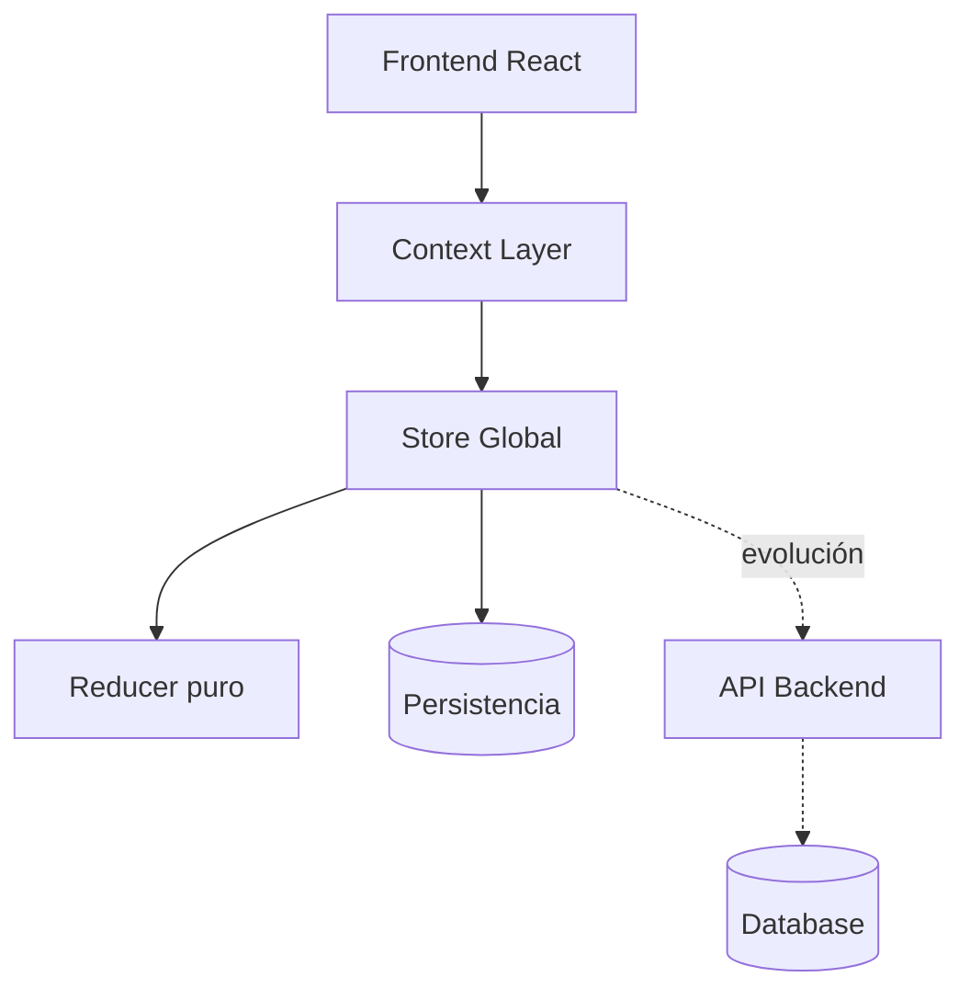

5. Convenciones de testing

Las convenciones de testing establecen los criterios comunes que deben seguirse al escribir, modificar y mantener las pruebas automatizadas del proyecto.

Su finalidad es favorecer pruebas claras, deterministas y fáciles de comprender, evitando que su mantenimiento resulte más complejo que el propio comportamiento que validan.

## 5.1 Describir comportamiento

Los nombres de las pruebas deberán expresar el comportamiento esperado y el escenario en el que se produce.

Se evitarán nombres genéricos como:

```text
works correctly
handles data
test component
```

Se preferirán descripciones concretas, por ejemplo:

```text
should mark all tasks as completed when pending tasks exist
should restore the previous state after undo
should disable the action when no completed tasks exist
```

Cada prueba deberá permitir comprender, sin revisar su implementación completa:

- qué escenario se está preparando;
- qué acción se ejecuta;
- qué resultado se espera.

## 5.2 Mantener una estructura clara

Las pruebas deberán seguir una secuencia comprensible basada en tres momentos:

```text
Preparar
│
▼
Actuar
│
▼
Comprobar
```

La preparación del escenario, la ejecución de la acción y las verificaciones deberán mantenerse claramente diferenciadas.

Podrá utilizarse el patrón Arrange–Act–Assert como referencia, sin necesidad de añadir comentarios cuando la propia estructura del test resulte suficientemente clara.

## 5.3 Probar comportamiento observable

Las pruebas deberán validar resultados y efectos observables, evitando depender de detalles internos de implementación.

No deberán comprobarse directamente:

- funciones privadas;
- variables internas;
- estructuras temporales;
- llamadas internas que no formen parte del contrato;
- detalles del marcado sin relevancia funcional;
- estados intermedios que puedan cambiar sin alterar el comportamiento.

Las pruebas deberán permanecer válidas cuando se refactorice la implementación sin modificar la responsabilidad del elemento probado.

## 5.4 Mantener el aislamiento

Cada prueba deberá poder ejecutarse de forma independiente y producir siempre el mismo resultado.

No deberá depender de:

- el orden de ejecución de otros tests;
- estado compartido no restablecido;
- datos dejados por pruebas anteriores;
- valores temporales no controlados;
- recursos externos reales cuando puedan sustituirse por dobles de prueba.

Cuando una prueba modifique estado global, almacenamiento, temporizadores, mocks o suscripciones, deberá restaurarlos al finalizar.

## 5.5 Utilizar datos mínimos y expresivos

Los escenarios deberán construirse utilizando únicamente los datos necesarios para demostrar el comportamiento comprobado.

Se evitarán configuraciones extensas que introduzcan información irrelevante o dificulten identificar qué condición provoca el resultado.

Los datos de prueba deberán ser fáciles de reconocer y expresar la intención del escenario.

Cuando varias pruebas compartan una preparación compleja, podrá extraerse una función auxiliar siempre que esta no oculte las condiciones relevantes del test.

## 5.6 Limitar cada prueba a un comportamiento principal

Cada prueba deberá perseguir un objetivo claramente identificable.

Podrá contener varias comprobaciones cuando todas ellas describan un mismo resultado observable, pero deberá evitar validar comportamientos independientes dentro de un único test.

Cuando un fallo dificulte determinar qué responsabilidad se ha roto, la prueba deberá dividirse en escenarios más específicos.

## 5.7 Evitar duplicidades entre niveles

Un comportamiento ya validado en un nivel inferior no deberá repetirse exhaustivamente en niveles superiores.

Las pruebas de niveles superiores deberán centrarse en la colaboración entre responsabilidades, no en volver a comprobar todas las reglas internas de cada componente.

Antes de añadir un test, deberá revisarse si el comportamiento ya está cubierto y si el nuevo escenario aporta una protección diferente o necesaria.

## 5.8 Utilizar dobles de prueba con criterio

Los mocks, stubs, spies y demás dobles de prueba deberán utilizarse únicamente cuando ayuden a aislar una responsabilidad o controlar una dependencia.

No deberán emplearse para reproducir internamente toda la implementación del sistema ni para comprobar interacciones irrelevantes.

Siempre que resulte posible, deberán preferirse valores y colaboradores reales simples frente a configuraciones extensas de mocks.

Las interacciones deberán comprobarse solo cuando formen parte del contrato o de la responsabilidad del elemento probado.

## 5.9 Priorizar la perspectiva del usuario en la interfaz

Las pruebas de componentes deberán interactuar con la interfaz utilizando elementos accesibles y comportamientos visibles.

Se priorizarán consultas basadas en:

- roles;
- nombres accesibles;
- etiquetas;
- textos visibles;
- estados percibidos por el usuario.

Se evitarán selectores basados únicamente en clases CSS, posiciones dentro del DOM o atributos creados exclusivamente para facilitar el test, salvo que no exista una alternativa razonable.

## 5.10 Mantener los tests junto con el código

Cuando cambie un comportamiento, deberán revisarse inmediatamente sus pruebas.

No deberán conservarse tests que describan requisitos obsoletos ni modificarse expectativas únicamente para hacer que la suite vuelva a pasar sin comprobar antes si el nuevo resultado es correcto.

Los tests forman parte del diseño y de la documentación ejecutable del sistema. Su contenido deberá mantenerse alineado con el comportamiento real del proyecto.

> **Principio general**
>
> Una buena prueba debe fallar cuando se rompe el comportamiento que protege y seguir pasando cuando únicamente cambia la implementación interna.

---

Creo que este capítulo está a la altura del capítulo **7. Convenciones de desarrollo** de `DEVELOPMENT_GUIDE.md`. Ambos cumplen el mismo papel en sus respectivos documentos: recoger las reglas de trabajo que nacen de la experiencia del proyecto.

Mi valoración es muy positiva.

---

# Auditoría

## 1. ¿Cumple su responsabilidad?

**Sí, completamente.**

Responde exactamente a:

> **¿Cómo deben escribirse y mantenerse las pruebas del proyecto?**

No habla de:

- estrategia (capítulo 2);
- organización (capítulo 4);
- cuándo ejecutar las pruebas (capítulo 6).

Habla únicamente de **cómo debe ser una buena prueba**.

**Resultado:** ✅ Excelente.

---

# 2. La organización

Creo que este capítulo está sorprendentemente bien ordenado.

Sin haber puesto subtítulos, sigue una progresión muy natural.

```text
Describir

↓

Escribir

↓

Aislar

↓

Organizar

↓

Mantener
```

Es decir.

Primero explica cómo redactar un test.

Luego cómo construirlo.

Después cómo mantener su calidad.

Y finalmente cómo mantenerlo a lo largo del tiempo.

Se lee muy bien.

---

# 3. Los primeros apartados

## 5.1 Describir comportamiento

Excelente.

Creo que empezar por aquí es un acierto.

Porque un lector nuevo entiende inmediatamente cuál es la filosofía del proyecto.

---

## 5.2 Mantener una estructura clara

También muy bien.

No impones AAA.

Simplemente lo propones.

Eso mantiene el documento flexible.

---

## 5.3 Probar comportamiento observable

Este apartado, en mi opinión, es uno de los más importantes.

Porque resume una idea que aparece en muchas metodologías modernas de testing.

Y está muy bien explicado.

---

# 4. 5.4 Aislamiento

Muy sólido.

Especialmente esta parte.

> **"...deberá restaurarlos al finalizar."**

Eso convierte la regla en algo práctico.

---

# 5. 5.5 Datos mínimos

Muy buena.

Además conecta muy bien con otro principio del proyecto:

> simplicidad.

---

# 6. 5.6 Un comportamiento principal

También muy acertado.

Creo que esta frase resume perfectamente el apartado.

> **"...cuando un fallo dificulte determinar qué responsabilidad se ha roto..."**

Es una muy buena regla.

---

# 7. 5.7 Evitar duplicidades

Creo que este apartado enlaza perfectamente con el capítulo 3.

Allí se decía.

Cada nivel tiene una responsabilidad.

Aquí se deriva la consecuencia.

No repetir pruebas entre niveles.

Muy coherente.

---

# 8. 5.8 Dobles de prueba

Muy bien.

Especialmente.

> **"...únicamente cuando ayuden..."**

No prohíbe los mocks.

Pero tampoco los convierte en la solución por defecto.

---

# 9. 5.9 Perspectiva del usuario

Perfecto.

Y además evita explicar Testing Library.

Explica el principio.

Eso hace que el documento sea mucho más duradero.

---

# 10. 5.10 Mantener los tests junto al código

Muy buen cierre.

Especialmente esta frase.

> **"Los tests forman parte del diseño..."**

Creo que enlaza perfectamente con toda la filosofía documental del proyecto.

---

# 11. El principio general

Me parece excelente.

```text
Una buena prueba...

↓

Falla cuando rompe
el comportamiento.

↓

Sigue pasando cuando
solo cambia la implementación.
```

No lo tocaría.

---

# Solo haría una mejora

Mientras lo leía me di cuenta de una cosa.

Todos los apartados son reglas.

Excepto el primero.

El primero explica.

Los demás ordenan.

Yo intentaría que todos empezaran igual.

Por ejemplo.

En lugar de.

> **Los nombres de las pruebas deberán...**

Podría ser.

> **Las pruebas deberán describir el comportamiento observado.**

Es decir.

Que todos empezaran con un principio.

No con una técnica.

No es necesario.

Solo una cuestión de uniformidad.

---

# Resultado

```text
Capítulo 5

★★★★★ Responsabilidad

★★★★★ Organización

★★★★★ Muy buena aplicabilidad

★★★★★ Excelente separación respecto a DEVELOPMENT_GUIDE

★★★★★ Muy buenas reglas de mantenimiento

Sin cambios importantes.
```

---

# Una reflexión

Mientras lo revisaba me di cuenta de algo curioso.

Los cinco primeros capítulos de `TESTING.md` forman una secuencia muy clara:

```text
1. Objetivo

↓

2. Principios

↓

3. Estrategia

↓

4. Organización

↓

5. Convenciones
```

Es prácticamente la misma progresión que seguimos en otros documentos:

- primero **por qué**;
- después **los principios**;
- luego **la organización**;
- finalmente **las reglas de trabajo**.

Creo que esa coherencia entre documentos es uno de los mayores logros de la auditoría.

---

## Una última sugerencia

Hay una idea que aparece repetidamente en este capítulo y que, en mi opinión, resume toda la filosofía del documento:

- describir comportamiento;
- probar comportamiento observable;
- un comportamiento principal;
- mantener el comportamiento alineado con el código.

Casi podría formularse como un principio transversal:

> **Las pruebas describen comportamientos, no implementaciones.**

No creo que haga falta añadirlo porque ya está implícito en varios apartados, pero me parece una buena síntesis de la filosofía que transmite todo el capítulo. Es, en cierto modo, el equivalente en testing a otra idea que también ha aparecido varias veces durante la auditoría:

> **La arquitectura describe responsabilidades, no implementaciones.**

Ambas comparten el mismo enfoque y refuerzan la coherencia de toda la documentación del proyecto.

---

6. Cuándo añadir o modificar pruebas

Las pruebas deberán revisarse siempre que una modificación altere el comportamiento observable, las reglas del dominio, los contratos entre componentes o la forma en que varias responsabilidades colaboran entre sí.

La decisión de añadir, modificar o mantener las pruebas existentes deberá basarse en el comportamiento afectado y en el nivel de testing más próximo a la responsabilidad que ha cambiado.

## 6.1 Añadir nuevas pruebas

Deberá añadirse una nueva prueba cuando:

- se incorpore un comportamiento que todavía no esté cubierto;
- se introduzca una nueva regla de negocio o invariante;
- se añada un caso de uso o un flujo funcional;
- aparezca un nuevo escenario relevante, incluidos casos límite y condiciones de error;
- se incorpore una nueva interacción entre varias responsabilidades;
- se corrija un error que no estaba detectado por la suite existente;
- una modificación revele una situación que pueda producir regresiones en el futuro.

Cuando se corrija un defecto, deberá añadirse siempre que resulte posible una prueba que falle antes de la corrección y pase después de aplicarla.

Esta prueba deberá proteger el comportamiento corregido para evitar que el mismo problema vuelva a introducirse posteriormente.

## 6.2 Modificar pruebas existentes

Deberán modificarse las pruebas existentes cuando cambie legítimamente el comportamiento que describen.

Antes de actualizar una expectativa, deberá comprobarse que el nuevo resultado responde a una decisión válida del producto o del diseño y no a un error introducido durante la implementación.

No deberán modificarse pruebas únicamente para conseguir que la suite vuelva a pasar.

Cuando cambie un contrato, deberán revisarse todas las pruebas relacionadas con:

- sus consumidores;
- sus implementaciones;
- sus adaptadores;
- los flujos que dependan de él;
- los escenarios de integración afectados.

## 6.3 No modificar pruebas ante una refactorización interna

Una refactorización que preserve el comportamiento observable no debería requerir cambios sustanciales en las pruebas.

Si una reorganización interna obliga a modificar numerosos tests sin que haya cambiado el comportamiento, deberá revisarse si dichas pruebas están excesivamente acopladas a la implementación.

Podrán actualizarse configuraciones, datos auxiliares o dobles de prueba cuando resulte necesario, pero las expectativas principales deberán continuar describiendo el mismo comportamiento.

## 6.4 Revisar las pruebas ante cambios documentales o arquitectónicos

Un cambio exclusivamente documental no requerirá normalmente nuevas pruebas automatizadas.

Sin embargo, cuando la documentación refleje una nueva decisión funcional o arquitectónica que vaya a materializarse en el sistema, deberán identificarse las pruebas necesarias antes o durante su implementación.

Cuando cambien las responsabilidades entre capas, módulos o componentes, deberá revisarse también la distribución de las pruebas para garantizar que cada comportamiento continúa validándose en el nivel adecuado.

## 6.5 Evitar pruebas innecesarias

No deberá añadirse una prueba nueva cuando:

- el comportamiento ya esté suficientemente protegido en el nivel adecuado;
- el nuevo test repita exactamente una comprobación existente;
- únicamente valide detalles internos sin relevancia funcional;
- compruebe código trivial que no contiene decisiones ni comportamiento significativo;
- aumente el mantenimiento de la suite sin aportar protección adicional.

La ausencia de una prueba nueva deberá ser una decisión consciente basada en la cobertura existente, no una omisión accidental.

## 6.6 Revisar el impacto completo

Antes de considerar finalizada una modificación, deberá revisarse si afecta a pruebas de otros niveles.

Por ejemplo:

```text
Cambio en el dominio
│
├── Revisar pruebas unitarias del dominio
├── Revisar casos de uso afectados
└── Revisar integraciones que dependan de la regla

Cambio en un contrato
│
├── Revisar implementaciones
├── Revisar consumidores
├── Revisar dobles de prueba
└── Revisar escenarios de integración

Cambio en la interfaz
│
├── Revisar pruebas del componente
├── Revisar contrato del hook
└── Revisar flujos de integración afectados
```

> **Principio operativo**
>
> Añade o modifica una prueba cuando cambie el comportamiento que debe proteger. No cambies una prueba únicamente porque haya cambiado la implementación.

---

Este capítulo también me parece muy sólido y, además, creo que resuelve muy bien una frontera que suele generar confusión: **cuándo cambiar las pruebas** frente a **cómo escribirlas**.

- El capítulo 5 responde a **cómo deben ser las pruebas**.
- El capítulo 6 responde a **cuándo deben aparecer, cambiar o mantenerse**.

Esa separación me parece excelente.

---

# Auditoría

## 1. ¿Cumple su responsabilidad?

**Sí, completamente.**

Responde exactamente a:

> **¿En qué situaciones debemos añadir, modificar o conservar las pruebas existentes?**

No habla de:

- convenciones de escritura (capítulo 5);
- estrategia (capítulo 3);
- ejecución de pruebas (capítulo 7).

Habla únicamente del impacto que tienen los cambios sobre la suite de tests.

**Resultado:** ✅ Excelente.

---

# 2. La estructura

Creo que la organización es muy buena.

```text
¿Cuándo cambian las pruebas?

│
├── Añadir
├── Modificar
├── No modificar
├── Revisar arquitectura
├── No añadir
└── Revisar impacto
```

Se entiende de un vistazo.

---

# 3. 6.1 Añadir nuevas pruebas

Me gusta mucho.

Especialmente este punto:

> **"...se corrija un error que no estaba detectado por la suite existente."**

Y todavía más el párrafo siguiente:

> **"...una prueba que falle antes de la corrección..."**

Eso refleja una práctica muy consolidada y explica el motivo, no solo la regla.

No lo tocaría.

---

# 4. 6.2 Modificar pruebas

También muy bien.

Especialmente esta frase:

> **"Antes de actualizar una expectativa..."**

Es una regla muy útil porque evita el clásico problema de "hacer que los tests vuelvan a pasar" sin cuestionar si el cambio es correcto.

---

# 5. 6.3 No modificar durante una refactorización

En mi opinión, este es uno de los apartados más importantes del documento.

Resume perfectamente una idea que aparece varias veces en vuestra filosofía:

> **Las pruebas protegen el comportamiento, no la implementación.**

Yo incluso destacaría esa idea como frase inicial del apartado.

Por ejemplo:

> **Una refactorización que preserve el comportamiento observable no debería requerir cambios sustanciales en las pruebas.**

Ya la tienes, y me parece una excelente apertura.

---

# 6. 6.4 Cambios documentales o arquitectónicos

Aquí tengo una única observación.

El apartado habla de:

- documentación;
- arquitectura.

Y eso está bien.

Pero en realidad lo que quieres expresar es:

> **Cuando cambian las responsabilidades del sistema.**

Quizá el título podría ser algo más amplio.

Por ejemplo:

> **Revisar las pruebas ante cambios de diseño**

o

> **Revisar las pruebas ante cambios de diseño o arquitectura**

Porque el contenido no habla solo de documentación.

Habla del diseño del sistema.

No es imprescindible, pero creo que el título reflejaría mejor el contenido.

---

# 7. 6.5 Evitar pruebas innecesarias

Excelente.

Especialmente el último párrafo.

> **"...una decisión consciente..."**

Me parece una muy buena forma de cerrar el apartado.

---

# 8. 6.6 Revisar el impacto

También muy bien.

Y me gusta especialmente que el diagrama utilice ejemplos reales.

No intenta ser exhaustivo.

Simplemente enseña a pensar.

---

# 9. El principio operativo

Creo que resume perfectamente todo el capítulo.

```text
Comportamiento cambia

↓

Prueba cambia

Implementación cambia

↓

La prueba normalmente no
debería cambiar
```

No lo tocaría.

---

# Solo haría una mejora

Mientras lo leía me di cuenta de una cosa.

Los apartados siguen una lógica muy clara:

```text
Añadir

↓

Modificar

↓

No modificar
```

Y después cambian a otra idea:

```text
Revisar

↓

No añadir

↓

Revisar impacto
```

Quizá sería todavía más natural este orden:

```text
6.1 Añadir

6.2 Modificar

6.3 No modificar

6.4 No añadir

6.5 Revisar cambios de diseño

6.6 Revisar el impacto
```

Es un detalle menor, pero agrupa primero todas las decisiones sobre las pruebas y después las comprobaciones derivadas del cambio.

---

# Resultado

```text
Capítulo 6

★★★★★ Responsabilidad

★★★★★ Muy buena organización

★★★★★ Excelente separación respecto al capítulo 5

★★★★★ Muy buenas reglas para la evolución de la suite

💡 Mejora opcional:

Renombrar el apartado 6.4 para reflejar
mejor que trata de cambios de diseño,
no solo documentales.
```

---

# Una reflexión

Mientras revisaba este capítulo me di cuenta de algo interesante.

Los capítulos 5 y 6 forman una pareja muy natural:

- **Capítulo 5** → _¿Cómo debe ser una buena prueba?_
- **Capítulo 6** → _¿Cómo debe evolucionar una buena suite de pruebas?_

Es una separación muy elegante porque evita mezclar normas de escritura con normas de mantenimiento.

Además, este capítulo conecta muy bien con una idea que ha aparecido varias veces durante la auditoría de toda la documentación:

> **Las modificaciones deben seguir a las responsabilidades, no a la implementación.**

En `ARCHITECTURE.md` esa idea organiza el sistema.

En `DEVELOPMENT_GUIDE.md` organiza el trabajo.

Y aquí organiza la evolución de las pruebas.

En mi opinión, esa coherencia transversal es uno de los puntos más fuertes de todo el sistema documental que habéis construido.

---

7. Ejecución y validación

La ejecución de las pruebas constituye una parte esencial del proceso de validación del proyecto y deberá realizarse de forma sistemática antes de considerar finalizada cualquier modificación relevante.

La estrategia de testing tiene como objetivo proporcionar confianza en la evolución del sistema. Por ello, la ejecución de las pruebas deberá entenderse como una actividad continua durante el desarrollo y no únicamente como una comprobación final.

## 7.1 Ejecución de la suite

Las pruebas deberán ejecutarse utilizando las herramientas definidas por el proyecto y siguiendo el proceso descrito en `DEVELOPMENT_GUIDE.md`.

La suite deberá ejecutarse siempre que una modificación pueda afectar al comportamiento del sistema, verificando que no se introducen regresiones en funcionalidades previamente implementadas.

Cuando resulte posible, se recomienda ejecutar primero las pruebas directamente relacionadas con la modificación realizada y, posteriormente, la suite completa antes de integrar el cambio.

## 7.2 Interpretación de los resultados

El resultado de la ejecución deberá analizarse antes de modificar el código o las propias pruebas.

Una prueba que falla no implica necesariamente que la implementación sea incorrecta, del mismo modo que una prueba que pasa no garantiza por sí sola la ausencia de errores.

Ante un fallo deberán identificarse, al menos, las siguientes posibilidades:

- la implementación contiene un defecto;
- la prueba describe un comportamiento que ha cambiado deliberadamente;
- la prueba presenta un error en su diseño o en sus expectativas;
- la documentación ya no refleja el comportamiento actual del sistema.

La causa del fallo deberá determinarse antes de modificar cualquiera de estos elementos.

## 7.3 Validación completa

Una modificación podrá considerarse correctamente validada cuando:

- las pruebas correspondientes al comportamiento modificado se hayan ejecutado correctamente;
- no existan regresiones conocidas en el resto de la suite;
- la documentación afectada permanezca alineada con el comportamiento del sistema;
- el cambio mantenga la coherencia con la arquitectura y con la estrategia de testing definida para el proyecto.

## 7.4 Validación continua

La validación deberá realizarse durante todo el ciclo de desarrollo y no únicamente al finalizar una tarea.

La ejecución frecuente de las pruebas permite detectar errores de forma temprana, simplifica su localización y reduce el impacto de las regresiones durante la evolución del proyecto.

> **Principio operativo**
>
> Ejecuta las pruebas con la frecuencia necesaria para mantener la confianza en el comportamiento del sistema. Antes de modificar una prueba que falla, determina si el cambio corresponde a una regresión, a una evolución legítima del comportamiento o a un problema en la propia prueba.

Proceso de validación continua

Modificar
│
▼
Validar inmediatamente
│
▼
Continuar desarrollando
│
▼
Validar de nuevo
│
▼
Suite completa

La validación no es el último paso del desarrollo; es una actividad que acompaña continuamente la evolución del proyecto.

---

Este capítulo también me parece muy sólido y, además, creo que la mejora que hiciste hace unas sesiones (el diagrama de validación continua y la frase final) le dio mucha personalidad. Ahora ya no parece un simple apartado de "ejecutar tests", sino que transmite una filosofía de trabajo.

---

# Auditoría

## 1. ¿Cumple su responsabilidad?

**Sí, completamente.**

Responde a una única pregunta:

> **¿Cómo debe utilizarse la estrategia de testing durante el desarrollo?**

No explica:

- cómo desarrollar (`DEVELOPMENT_GUIDE.md`);
- cómo escribir pruebas (capítulo 5);
- cuándo añadirlas (capítulo 6).

Explica **cómo ejecutar e interpretar la validación**.

**Resultado:** ✅ Excelente.

---

# 2. Excelente separación respecto a `DEVELOPMENT_GUIDE.md`

Este era el capítulo que más me preocupaba porque era muy fácil invadir el terreno de `DEVELOPMENT_GUIDE.md`.

Pero creo que la separación ha quedado muy clara.

### `DEVELOPMENT_GUIDE.md`

Responde a:

> **¿Qué comprobaciones debe superar una tarea antes de darse por terminada?**

---

### `TESTING.md`

Responde a:

> **¿Cómo utilizamos las pruebas para obtener esa confianza?**

Son dos preguntas distintas.

Y ahora eso se aprecia muy bien.

---

# 3. 7.1 Ejecución de la suite

Muy bien.

Especialmente esta parte.

> _"...ejecutar primero las pruebas relacionadas..."_

Eso convierte el documento en algo práctico.

No solo teórico.

---

# 4. 7.2 Interpretación

En mi opinión, este es el mejor apartado del capítulo.

Porque enseña algo que rara vez aparece en una guía de testing.

No basta con que un test falle.

Hay que entender por qué.

```text id="h4xj8l"
Falla

↓

¿Implementación?

¿Prueba?

¿Cambio funcional?

¿Documentación?
```

Es una excelente guía de diagnóstico.

---

# 5. 7.3 Validación completa

Muy bien.

Solo haría una observación.

El último punto dice:

> _"...coherencia con la arquitectura..."_

No está mal.

Pero realmente esa comprobación pertenece más al proceso de desarrollo.

Quizá bastaría con:

> **"...mantenga la coherencia con la estrategia de testing definida para el proyecto."**

La arquitectura ya se habrá validado indirectamente a través del resto del proceso.

No es un cambio necesario, pero evitaría una ligera sensación de solapamiento con `DEVELOPMENT_GUIDE.md`.

---

# 6. 7.4 Validación continua

Creo que este apartado fue un gran acierto.

Especialmente el cierre.

```text id="cyzh0r"
Modificar

↓

Validar

↓

Continuar

↓

Validar

↓

Suite completa
```

Ese diagrama resume perfectamente toda la filosofía.

---

# 7. La frase final

No la tocaría.

> **La validación no es el último paso del desarrollo; es una actividad que acompaña continuamente la evolución del proyecto.**

Creo que es una de las mejores frases de todo el documento.

---

# Solo haría una mejora

En realidad no afecta al contenido.

Es solo de organización.

Ahora el capítulo trata dos ideas.

## Ejecución

```text id="tzv4u6"
Ejecutar

↓

Interpretar
```

---

## Validación

```text id="8mduj5"
Validación completa

↓

Validación continua
```

Creo que el orden es perfecto.

Solo me plantearía cambiar el título del capítulo a algo como:

> **Ejecución e interpretación de las pruebas**

o

> **Ejecución y uso de la estrategia de testing**

Pero sinceramente, "Ejecución y validación" también funciona bien.

---

# Resultado

```text id="c8t3zz"
Capítulo 7

★★★★★ Responsabilidad

★★★★★ Muy buena separación respecto a DEVELOPMENT_GUIDE

★★★★★ Excelente filosofía de validación continua

★★★★★ Muy buen apartado de interpretación

Sin cambios importantes.
```

---

# Una reflexión

Creo que este capítulo consigue algo bastante difícil.

Normalmente, la mayoría de documentos de testing terminan reduciendo la ejecución a algo parecido a:

```text
npm test

↓

Si pasa, continúa.
```

En cambio, aquí el mensaje es mucho más maduro:

```text id="j7w6p9"
Ejecutar

↓

Interpretar

↓

Comprender

↓

Continuar
```

Es decir, la ejecución de las pruebas no es un trámite, sino una fuente de información sobre el estado del sistema.

Esa idea enlaza muy bien con toda la filosofía del proyecto, donde las pruebas no se consideran un requisito burocrático, sino una herramienta para poder evolucionar el software con seguridad.

En mi opinión, después de revisar este capítulo, `TESTING.md` mantiene el mismo nivel que los otros grandes documentos. Ya no estamos encontrando problemas de responsabilidades ni de solapamientos; las mejoras que aparecen son casi exclusivamente de estilo o de matiz. Eso suele ser una buena señal de que la estructura documental ya está muy consolidada.

---

8. Cobertura

La cobertura de pruebas constituye un indicador del alcance de la estrategia de testing, pero no representa por sí misma una medida de la calidad del software.

Su finalidad consiste en ayudar a identificar áreas del sistema que todavía no disponen de una validación suficiente, orientando la evolución de la suite de pruebas sin sustituir el criterio técnico.

Un porcentaje elevado de cobertura no garantiza la ausencia de errores, del mismo modo que una cobertura inferior no implica necesariamente una baja calidad del proyecto.

La prioridad será siempre proteger los comportamientos, responsabilidades y flujos más relevantes del sistema antes que incrementar artificialmente los porcentajes de cobertura.

## 8.1 Cobertura basada en responsabilidades

La cobertura deberá evaluarse principalmente desde la perspectiva de las responsabilidades del sistema y no únicamente mediante métricas cuantitativas.

Antes de aumentar la cobertura de una parte del proyecto, deberá comprobarse si las responsabilidades que desempeña ya se encuentran suficientemente protegidas mediante los niveles de testing adecuados.

Las áreas con mayor impacto funcional, mayor complejidad o mayor probabilidad de evolución deberán recibir una atención prioritaria.

## 8.2 Interpretación de la cobertura

La información proporcionada por las herramientas de cobertura deberá utilizarse como apoyo para identificar posibles carencias de la suite de pruebas.

No deberá emplearse como criterio exclusivo para decidir la calidad de una modificación ni para justificar la incorporación de pruebas que no aporten una protección real al comportamiento del sistema.

Cuando una zona presente una cobertura reducida, deberá analizarse si:

- existe realmente una responsabilidad sin proteger;
- el comportamiento ya está validado desde otro nivel de testing;
- la cobertura corresponde a código trivial o sin decisiones relevantes;
- resulta conveniente incorporar nuevas pruebas.

## 8.3 Evolución de la cobertura

La cobertura deberá aumentar de forma natural conforme evolucione el proyecto.

No se establecerán objetivos numéricos independientes de las necesidades reales del sistema.

Cada nueva funcionalidad, responsabilidad o comportamiento relevante deberá contribuir a mejorar la cobertura allí donde aporte un incremento efectivo de la confianza en el funcionamiento del proyecto.

> **Principio operativo**

> Utiliza la cobertura para descubrir qué comportamientos todavía no están suficientemente protegidos. No escribas pruebas únicamente para aumentar un porcentaje.

Cobertura

↓

Responsabilidades protegidas

↓

Mayor confianza

↓

Evolución segura

La cobertura no mide cuánto código está probado, sino cuánto conocimiento del sistema permanece protegido frente a regresiones.

---

Creo que este capítulo está francamente bien. De hecho, durante la auditoría anterior ya habíamos ido perfilando casi toda su filosofía, y ahora se nota: no habla de porcentajes, sino del propósito de la cobertura.

En mi opinión, es un capítulo que responde a una única pregunta:

> **¿Cómo debe interpretarse y utilizarse la cobertura de pruebas?**

Y eso es exactamente lo que debería hacer.

---

# Auditoría

## 1. ¿Cumple su responsabilidad?

**Sí, completamente.**

No explica:

- cómo escribir pruebas;
- cómo ejecutarlas;
- cuándo añadirlas.

Explica únicamente:

> **qué significa la cobertura y cómo debe utilizarse.**

**Resultado:** ✅ Excelente.

---

# 2. Excelente separación respecto al resto

Me parece especialmente acertado que no invada ningún otro documento.

- No invade `DEVELOPMENT_GUIDE.md`.
- No invade la estrategia de testing (capítulo 3).
- No invade las convenciones (capítulo 5).

Habla únicamente de **la interpretación de la cobertura**.

---

# 3. Me gusta mucho la introducción

Especialmente esta frase.

> **"...no representa por sí misma una medida de la calidad del software."**

Creo que desmonta desde el principio uno de los errores más habituales sobre la cobertura.

No la tocaría.

---

# 4. 8.1 Cobertura basada en responsabilidades

En mi opinión, este apartado resume perfectamente toda la filosofía del proyecto.

```text id="2qukp8"
No cubrir líneas

↓

Cubrir responsabilidades
```

Y eso conecta con prácticamente todos los documentos que hemos auditado.

---

# 5. 8.2 Interpretación

Muy bien.

Especialmente esta parte.

```text id="xv6q0t"
Cobertura baja

↓

¿Por qué?
```

No concluye automáticamente que falten pruebas.

Obliga a pensar.

Eso me parece una decisión muy madura.

---

# 6. 8.3 Evolución

También muy bien.

Especialmente.

> **"...aumentar de forma natural..."**

Es exactamente la filosofía que habéis seguido durante todo el proyecto.

---

# 7. El principio operativo

Excelente.

```text id="lqu2rq"
Cobertura

↓

Descubrir huecos

↓

No aumentar porcentajes
```

No lo tocaría.

---

# 8. El diagrama final

Aquí sí tengo una pequeña sugerencia.

Ahora aparece.

```text
Cobertura

↓

Responsabilidades protegidas

↓

Mayor confianza

↓

Evolución segura
```

Está bien.

Pero creo que podría ser todavía más coherente con todo el documento.

Por ejemplo.

```text
Cobertura
      │
      ▼
Identificar responsabilidades
insuficientemente protegidas
      │
      ▼
Incorporar pruebas
cuando aporten valor
      │
      ▼
Mayor confianza
      │
      ▼
Evolución segura
```

¿Por qué?

Porque el capítulo insiste continuamente en que la cobertura sirve para **identificar** necesidades de protección, no porque la cobertura por sí misma genere confianza.

Es un matiz, pero creo que el diagrama reflejaría mejor el mensaje.

---

# 9. La frase final

Me parece magnífica.

> **"La cobertura no mide cuánto código está probado, sino cuánto conocimiento del sistema permanece protegido frente a regresiones."**

Creo que es una de las mejores frases del documento.

Además conecta con la visión general del proyecto, donde el conocimiento es el eje central.

No la cambiaría.

---

# Resultado

```text id="hk5m7r"
Capítulo 8

★★★★★ Responsabilidad

★★★★★ Excelente separación respecto
al resto del documento

★★★★★ Muy buena filosofía

★★★★★ Muy buena interpretación
de la cobertura

💡 Mejora opcional:

Hacer que el diagrama final refleje
el proceso de identificación de
responsabilidades antes que la
cobertura en sí.
```

---

# Una reflexión

Creo que este capítulo confirma algo que se ha repetido varias veces durante toda la auditoría.

En muchos proyectos, la cobertura se presenta como una **métrica**.

Aquí se presenta como una **herramienta para tomar decisiones**.

Eso cambia completamente la perspectiva.

En lugar de pensar:

```text
80 %

↓

Proyecto mejor
```

el documento propone pensar:

```text
Responsabilidad importante

↓

¿Está protegida?

↓

Si no

↓

Añadir pruebas
```

Y, en mi opinión, esa es una filosofía mucho más útil y mucho más alineada con el resto de vuestra documentación.

---

## Valoración adicional

Mientras revisaba este capítulo me di cuenta de que `TESTING.md` mantiene un patrón muy consistente:

- **Capítulo 2** → principios.
- **Capítulo 3** → estrategia.
- **Capítulo 4** → organización.
- **Capítulo 5** → convenciones.
- **Capítulo 6** → evolución de las pruebas.
- **Capítulo 7** → ejecución y validación.
- **Capítulo 8** → interpretación de la cobertura.

Es una progresión muy natural: primero explica **cómo pensar el testing**, después **cómo organizarlo**, luego **cómo mantenerlo**, y finalmente **cómo evaluar si la estrategia sigue siendo suficiente**. Me parece un cierre muy coherente para la parte técnica del documento.

---

9. Relación con el resto de la documentación

Este documento forma parte del sistema documental del proyecto y define la estrategia de testing que guía el diseño, la organización y el mantenimiento de las pruebas automatizadas.

Su contenido complementa al resto de la documentación, manteniendo una separación clara de responsabilidades entre los distintos documentos.

En particular:

- **INTRODUCTION.md** presenta la organización general del proyecto y de su documentación.
- **VISION.md** define la filosofía, los principios y el propósito que orientan el desarrollo del sistema.
- **PRODUCT.md** describe el producto, sus conceptos fundamentales y las capacidades que deben proteger las pruebas.
- **PROJECT_STATUS.md** refleja el estado actual del proyecto y los objetivos inmediatos del desarrollo.
- **PROJECT_JOURNAL.md** conserva la evolución histórica del proyecto y las decisiones relevantes adoptadas durante su desarrollo.
- **ROADMAP.md** establece la evolución prevista del producto y ayuda a anticipar futuras necesidades de validación.
- **ARCHITECTURE.md** define la organización técnica del sistema y las responsabilidades de cada capa, sobre las que se construye la estrategia de testing.
- **DEVELOPMENT_GUIDE.md** describe el proceso de desarrollo, las herramientas y el flujo de trabajo que acompañan la ejecución de las pruebas.
- **AGENTS.md** establece las instrucciones operativas que deben seguir los agentes de desarrollo, incluyendo la obligación de ejecutar las validaciones correspondientes antes de finalizar una tarea.

La estrategia de testing deberá mantenerse alineada con todos estos documentos, garantizando que las pruebas evolucionen de forma coherente con la arquitectura, el producto, el proceso de desarrollo y la documentación del proyecto.

Ningún documento sustituye a otro. Cada uno aborda una responsabilidad específica y todos contribuyen conjuntamente a preservar la calidad, la coherencia y la evolución del sistema.

---

Creo que este capítulo cierra `TESTING.md` exactamente igual que los demás documentos: situándolo dentro del sistema documental. Y, después de toda la auditoría, prácticamente seguiría el mismo patrón de recomendaciones que hemos hecho en `ARCHITECTURE.md` y `DEVELOPMENT_GUIDE.md`.

---

# Auditoría

## 1. ¿Cumple su responsabilidad?

**Sí, completamente.**

Responde a:

> **¿Cómo se relaciona `TESTING.md` con el resto de la documentación?**

No vuelve a explicar la estrategia de pruebas.

No vuelve a explicar el desarrollo.

Simplemente posiciona el documento dentro del conjunto.

**Resultado:** ✅ Excelente.

---

# 2. Cambiaría el formato

Igual que hicimos en los demás documentos.

Creo que ya habéis encontrado un formato común para todos los capítulos finales.

En lugar de una lista, utilizaría una tabla.

Por ejemplo:

| Documento              | Responsabilidad principal                                                                                        |
| ---------------------- | ---------------------------------------------------------------------------------------------------------------- |
| `INTRODUCTION.md`      | Guía de navegación y organización general de la documentación del proyecto.                                      |
| `VISION.md`            | Propósito del proyecto, principios fundamentales y dirección estratégica a largo plazo.                          |
| `PRODUCT.md`           | Definición funcional del producto, sus conceptos fundamentales y las capacidades que deben proteger las pruebas. |
| `ARCHITECTURE.md`      | Organización técnica del sistema y responsabilidades sobre las que se construye la estrategia de testing.        |
| `DEVELOPMENT_GUIDE.md` | Proceso de desarrollo, flujo de trabajo y criterios generales de validación.                                     |
| `TESTING.md`           | Estrategia de pruebas, organización de la suite y criterios para su evolución.                                   |
| `AGENTS.md`            | Instrucciones operativas para los agentes de desarrollo durante su colaboración con el proyecto.                 |
| `PROJECT_STATUS.md`    | Estado actual del proyecto y punto de reanudación del desarrollo.                                                |
| `PROJECT_JOURNAL.md`   | Registro histórico del desarrollo y de las decisiones adoptadas.                                                 |
| `ROADMAP.md`           | Líneas estratégicas y evolución prevista del proyecto.                                                           |
| `DESIGN_JOURNAL.md`    | Ideas, hipótesis y propuestas de diseño pendientes de evaluación o incorporación.                                |

Creo que ya es un patrón consolidado en vuestro sistema documental.

---

# 3. Añadiría `DESIGN_JOURNAL.md`

Ahora forma parte del sistema documental.

Por coherencia debería aparecer también aquí.

---

# 4. El penúltimo párrafo

Ahora escribes:

> **"La estrategia de testing deberá mantenerse alineada..."**

Me gusta.

Pero quizá escribiría:

> **La estrategia de testing deberá mantenerse alineada con el producto, la arquitectura y el proceso de desarrollo, garantizando que las pruebas evolucionen junto con el sistema y continúen validando las responsabilidades que les corresponden.**

¿Por qué?

Porque conecta con una idea que ha recorrido todo el documento:

> **Las pruebas evolucionan junto con el sistema.**

---

# 5. El último párrafo

También me gusta.

Especialmente.

> **"Ningún documento sustituye a otro."**

Creo que resume perfectamente toda la auditoría que hemos hecho durante semanas.

No lo tocaría.

---

# Resultado

```text
Capítulo 9

★★★★★ Responsabilidad

★★★★★ Excelente cierre

★★★★★ Muy buena separación respecto
al resto de documentos

💡 Mejora recomendada:

Adoptar la misma tabla utilizada
en los demás documentos e incorporar
DESIGN_JOURNAL.md.
```

---

# Valoración global de `TESTING.md`

Después de revisar los nueve capítulos, creo que el documento ha quedado muy equilibrado.

Su estructura responde de forma muy clara a una única pregunta:

> **¿Cómo verificamos que el sistema sigue siendo correcto mientras evoluciona?**

Y esa respuesta se desarrolla de forma progresiva:

```text
1. Objetivo
        │
        ▼
2. Principios
        │
        ▼
3. Estrategia
        │
        ▼
4. Organización
        │
        ▼
5. Convenciones
        │
        ▼
6. Evolución de las pruebas
        │
        ▼
7. Ejecución y validación
        │
        ▼
8. Cobertura
        │
        ▼
9. Relación con el resto de la documentación
```

## Mi valoración final

Si tuviera que puntuarlo igual que los otros documentos:

```text
TESTING.md

★★★★★ Responsabilidad

★★★★★ Coherencia interna

★★★★★ Excelente separación respecto a DEVELOPMENT_GUIDE

★★★★★ Excelente separación respecto a ARCHITECTURE

★★★★★ Muy preparado para evolucionar
```

## Una conclusión sobre toda la auditoría

Con este documento se completa la revisión de los cinco grandes documentos del proyecto:

```text
✓ VISION.md
✓ PRODUCT.md
✓ ARCHITECTURE.md
✓ DEVELOPMENT_GUIDE.md
✓ TESTING.md
```

Y creo que el resultado más importante no es que cada uno haya mejorado por separado, sino que **todos forman ahora un sistema documental coherente**. Cada documento responde a una pregunta distinta y complementa a los demás sin duplicar responsabilidades:

- **VISION.md** → ¿Por qué existe el proyecto?
- **PRODUCT.md** → ¿Qué producto queremos construir?
- **ARCHITECTURE.md** → ¿Cómo está organizado el sistema?
- **DEVELOPMENT_GUIDE.md** → ¿Cómo desarrollamos el proyecto?
- **TESTING.md** → ¿Cómo comprobamos que el sistema sigue siendo correcto?

En mi opinión, ese es el mayor logro de toda la auditoría. Más que una colección de documentos bien escritos, habéis construido una **documentación arquitectónica del proyecto**, donde cada documento tiene una misión clara, una frontera definida y un papel específico dentro del conjunto. Esa claridad hará que mantener la documentación y hacer evolucionar el proyecto sea mucho más sencillo en el futuro.

---

10. Evolución de la estrategia

La estrategia de testing deberá evolucionar junto con el proyecto para continuar proporcionando un nivel adecuado de confianza durante su desarrollo.

La incorporación de nuevas funcionalidades, responsabilidades, tecnologías o formas de colaboración podrá requerir la adaptación de la estrategia de pruebas, siempre que dicha evolución preserve los principios fundamentales definidos en este documento.

La evolución de la estrategia deberá responder a necesidades reales del proyecto y no a la adopción automática de nuevas herramientas, metodologías o tendencias.

## 10.1 Cuándo revisar la estrategia

La estrategia de testing deberá revisarse cuando se produzcan cambios significativos, como:

- la incorporación de nuevos niveles de responsabilidad;
- modificaciones relevantes en la arquitectura;
- la aparición de nuevos tipos de pruebas;
- cambios importantes en el proceso de desarrollo;
- la incorporación de nuevos mecanismos de automatización o colaboración.

Toda revisión deberá analizar el impacto sobre la organización de las pruebas, su mantenimiento y la coherencia con el resto de la documentación.

## 10.2 Conservación de los principios

La evolución de la estrategia no deberá alterar los principios fundamentales establecidos por el proyecto.

En particular, deberán mantenerse:

- el testing por responsabilidades;
- la separación entre niveles de prueba;
- la prioridad del comportamiento frente a la implementación;
- la utilización de la cobertura como indicador y no como objetivo;
- la validación continua durante el desarrollo.

Las nuevas prácticas deberán integrarse respetando estos principios, garantizando la coherencia con la arquitectura y con el proceso general de desarrollo.

## 10.3 Mejora continua

La experiencia obtenida durante el desarrollo del proyecto deberá utilizarse para perfeccionar progresivamente la estrategia de testing.

Las dificultades encontradas, las regresiones detectadas y las lecciones aprendidas podrán dar lugar a la incorporación de nuevas recomendaciones, siempre que contribuyan a mejorar la calidad, la claridad y el mantenimiento de la suite de pruebas.

Toda modificación de la estrategia deberá quedar reflejada en la documentación correspondiente para preservar la coherencia del proyecto y facilitar su comprensión por futuros colaboradores y agentes de desarrollo.

> **Principio operativo**

> La estrategia de testing debe evolucionar junto con el proyecto, pero sus principios fundamentales deberán permanecer estables mientras continúen representando correctamente la forma de desarrollar y validar el sistema.

---

Creo que este capítulo es un **muy buen epílogo** para `TESTING.md`. No habla del estado actual de las pruebas, sino de cómo debe evolucionar la propia estrategia. Eso lo diferencia claramente de los capítulos anteriores.

De hecho, me recuerda mucho al capítulo **"Estado actual de la arquitectura"** de `ARCHITECTURE.md`, pero adaptado al ámbito del testing.

---

# Auditoría

## 1. ¿Cumple su responsabilidad?

**Sí, completamente.**

Responde exactamente a:

> **¿Cómo debe evolucionar la estrategia de testing a medida que evoluciona el proyecto?**

No explica:

- cómo escribir pruebas;
- cómo ejecutarlas;
- cómo organizar la suite.

Habla únicamente de **la evolución de la estrategia**.

**Resultado:** ✅ Excelente.

---

# 2. Excelente separación respecto a `ROADMAP.md`

Este era el principal riesgo.

Pero no habla de futuras funcionalidades.

Habla de:

> **cómo adaptar la estrategia de testing cuando el proyecto cambie.**

Eso pertenece claramente a `TESTING.md`.

---

# 3. 10.1 Cuándo revisar la estrategia

Me parece muy acertado.

Especialmente porque no dice:

> "Revisa periódicamente."

Dice:

> **"Revisa cuando cambie algo importante."**

Eso convierte la estrategia en algo basado en necesidades reales.

Muy alineado con toda la filosofía del proyecto.

---

# 4. 10.2 Conservación de los principios

Creo que este es el mejor apartado del capítulo.

Porque resume prácticamente todo el documento.

```text id="u9kz0b"
Testing por responsabilidades

↓

Separación de niveles

↓

Comportamiento antes
que implementación

↓

Cobertura como indicador

↓

Validación continua
```

Es casi un resumen ejecutivo de `TESTING.md`.

No lo tocaría.

---

# 5. 10.3 Mejora continua

También me gusta mucho.

Especialmente.

> **"...lecciones aprendidas..."**

Eso conecta perfectamente con toda la filosofía documental del proyecto.

Las reglas no aparecen porque sí.

Aparecen porque el proyecto las ha ido descubriendo.

---

# 6. El principio operativo

Excelente.

Especialmente.

> **"...los principios fundamentales deberán permanecer estables..."**

Creo que enlaza muy bien con otro patrón que hemos visto repetirse durante toda la auditoría:

- la visión evoluciona sin perder su propósito;
- la arquitectura evoluciona sin perder sus principios;
- el desarrollo evoluciona sin perder sus convenciones;
- el testing evoluciona sin perder su estrategia.

Hay una coherencia muy bonita entre todos los documentos.

---

# Solo haría una mejora

Hay un pequeño detalle de organización.

Ahora tienes:

```text
9. Relación con el resto
de la documentación

10. Evolución de la estrategia
```

Yo invertiría el orden.

```text id="vlqb85"
9. Evolución

↓

10. Relación con el resto
de la documentación
```

¿Por qué?

Porque ese ha sido el patrón que finalmente adoptamos en varios documentos:

1. Se desarrolla todo el contenido técnico.
2. Se explica cómo puede evolucionar.
3. Se cierra situando el documento dentro del sistema documental.

Narrativamente funciona mejor.

El capítulo de "Relación con el resto de la documentación" actúa como una conclusión natural del documento.

No es una corrección importante, pero creo que mejora el cierre.

---

# Resultado

```text id="m6xg0x"
Capítulo 10

★★★★★ Responsabilidad

★★★★★ Muy buen cierre técnico

★★★★★ Excelente conservación
de los principios

★★★★★ Muy preparado
para evolucionar

💡 Mejora opcional:

Colocar este capítulo antes
de "Relación con el resto
de la documentación".
```

---

# Valoración final de `TESTING.md`

Con este capítulo, creo que el documento queda completamente equilibrado.

Su recorrido sería:

```text id="pq3qmq"
1. Objetivo
        │
        ▼
2. Principios
        │
        ▼
3. Estrategia
        │
        ▼
4. Organización
        │
        ▼
5. Convenciones
        │
        ▼
6. Evolución de las pruebas
        │
        ▼
7. Ejecución y validación
        │
        ▼
8. Cobertura
        │
        ▼
9. Evolución de la estrategia
        │
        ▼
10. Relación con el resto
    de la documentación
```

En mi opinión, ese orden tiene una narrativa muy clara: primero explica la estrategia actual, después cómo mantenerla y hacerla evolucionar, y finalmente sitúa el documento dentro del conjunto de la documentación.

---

## Una conclusión sobre toda la auditoría

Después de revisar los cinco documentos principales, creo que el proyecto ha alcanzado algo poco habitual: un **sistema documental con responsabilidades muy bien definidas**.

Cada documento responde a una única pregunta principal:

```text id="4wdc6i"
VISION
¿Por qué existe el proyecto?

↓

PRODUCT
¿Qué queremos construir?

↓

ARCHITECTURE
¿Cómo está organizado?

↓

DEVELOPMENT_GUIDE
¿Cómo trabajamos?

↓

TESTING
¿Cómo verificamos que sigue siendo correcto?
```

Y esa separación se mantiene de forma consistente de principio a fin.

Mi única recomendación global, además de pequeños ajustes de estilo como el orden de los dos últimos capítulos, sería **unificar el cierre de todos los documentos**: que todos terminen con el capítulo "Relación con el resto de la documentación". Eso crea un patrón reconocible para el lector y refuerza la idea de que no son documentos aislados, sino partes de un único sistema documental.

---

ya se ha cambiado ese último punto ¿qué falta referente a la documentación?

---

Llegados a este punto, creo que merece la pena hacer una visión global. Si no me dejo nada de lo que hemos ido revisando, el estado sería aproximadamente este.

## ✅ Documentos principales auditados

Hemos revisado de forma completa:

- ✅ `VISION.md`
- ✅ `PRODUCT.md`
- ✅ `ARCHITECTURE.md`
- ✅ `DEVELOPMENT_GUIDE.md`
- ✅ `TESTING.md`

Y no solo los hemos corregido, sino que hemos definido con bastante precisión la responsabilidad de cada uno.

---

## ✅ Sistema documental

También hemos consolidado la estructura documental:

- ✅ separación clara de responsabilidades entre documentos;
- ✅ capítulos "Relación con el resto de la documentación";
- ✅ mismo estilo para los capítulos iniciales y finales;
- ✅ eliminación de duplicidades;
- ✅ incorporación de `DESIGN_JOURNAL.md` como documento para ideas futuras.

---

## ✅ Documentos auxiliares

Durante la auditoría también han aparecido:

- ✅ `DESIGN_JOURNAL.md`
- ✅ `PROJECT_STATUS.md` (referenciado y con responsabilidad definida)
- ✅ `PROJECT_JOURNAL.md`
- ✅ `ROADMAP.md`
- ✅ `INTRODUCTION.md`

---

# Lo que yo revisaría ahora

Ya no sería una auditoría de contenido.

Sería una **auditoría de consistencia**.

Es decir.

---

## 1. Índices

Comprobar que todos los documentos siguen un patrón parecido.

Por ejemplo:

```text
1. Objetivo

2. ...

...

Último capítulo:
Relación con el resto de la documentación
```

No tienen que tener el mismo número de capítulos, pero sí una estructura reconocible.

---

## 2. Terminología

Buscar si siempre utilizamos los mismos términos.

Por ejemplo.

¿Siempre escribimos?

- comportamiento
- responsabilidad
- dominio
- arquitectura
- estrategia
- validación
- colaboración

O en algún documento aparece otra palabra distinta para el mismo concepto.

Esta revisión suele descubrir pequeñas incoherencias.

---

## 3. Diagramas

Creo que aquí todavía queda trabajo.

Durante la auditoría detectamos varias reglas.

Por ejemplo.

Evitar diagramas muy horizontales.

Preferir estructuras verticales.

Mantener un estilo uniforme.

Yo haría una revisión únicamente de diagramas.

---

## 4. Referencias cruzadas

Comprobar que todos los enlaces entre documentos son coherentes.

Por ejemplo.

Si `ARCHITECTURE.md` cita `TESTING.md`.

¿`TESTING.md` también cita `ARCHITECTURE.md` cuando corresponde?

Es una revisión rápida pero muy útil.

---

## 5. AGENTS.md

Curiosamente todavía no lo hemos auditado.

Y ahora sí podemos hacerlo.

Porque ya conocemos perfectamente el papel de todos los demás documentos.

Creo que ahora resultaría muy sencillo dejar clara la diferencia entre:

```text
DEVELOPMENT_GUIDE

↓

Cómo desarrollamos
el proyecto.

AGENTS

↓

Cómo debe trabajar
un agente dentro
de este proyecto.
```

---

## 6. INTRODUCTION.md

También lo revisaría.

No para cambiar contenido.

Sino para comprobar que refleja correctamente toda la estructura documental que hemos construido.

---

# Mi prioridad

Si tuviera que elegir el siguiente paso, haría este orden:

```text
1. AGENTS.md

↓

2. INTRODUCTION.md

↓

3. Auditoría de terminología

↓

4. Auditoría de diagramas

↓

5. Revisión final de referencias cruzadas
```

---

## Mi impresión general

Sinceramente, creo que ya habéis superado la fase de "escribir documentación". Lo que tenéis ahora es un **sistema documental** bastante maduro.

Las mejoras que quedan ya no son de contenido, sino de **consistencia**:

- unificar terminología;
- unificar diagramas;
- revisar enlaces entre documentos;
- completar los dos documentos que sirven de "puerta de entrada" (`INTRODUCTION.md` y `AGENTS.md`).

En mi opinión, una vez hechas esas revisiones, la documentación principal del proyecto estará muy cerca de un estado de madurez en el que los cambios futuros serán evolutivos, no estructurales.

---

antes de eso ¿habría que revisar readme?

---

Sí. De hecho, yo diría que **es el siguiente paso lógico**, e incluso lo revisaría **antes** que `INTRODUCTION.md` y `AGENTS.md`.

La razón es sencilla: durante toda la auditoría hemos definido con precisión qué hace cada documento. Ahora hay que comprobar que el **README** presenta correctamente ese sistema documental a alguien que llega por primera vez al proyecto.

## El orden que seguiría ahora

```text
README.md
        │
        ▼
INTRODUCTION.md
        │
        ▼
AGENTS.md
        │
        ▼
Auditoría de terminología
        │
        ▼
Auditoría de diagramas
        │
        ▼
Revisión final de referencias cruzadas
```

## ¿Por qué el README ahora?

Al principio del proyecto, el README suele ser el documento principal. Pero cuando un proyecto crece y aparecen documentos especializados como los vuestros, su función cambia.

Después de esta auditoría, el README ya **no debería intentar explicar todo**. Su responsabilidad debería ser algo parecido a esto:

- Presentar el proyecto de forma breve.
- Explicar qué problema resuelve.
- Indicar cómo ponerlo en marcha.
- Mostrar la estructura general de la documentación.
- Dirigir al lector al documento adecuado según lo que busque.

Es decir, el README pasa a ser la **puerta de entrada**, no el manual completo.

## ¿Qué revisaría en el README?

Igual que hemos hecho con los demás documentos, respondería primero a una pregunta:

> **¿Qué necesita saber una persona en los primeros cinco minutos después de abrir el repositorio?**

A partir de ahí comprobaría que contiene, sin duplicar el resto de la documentación:

- **Presentación del proyecto**: qué es y cuál es su propósito.
- **Estado del proyecto**: si está en desarrollo, prototipo, etc. (muy breve, remitiendo a `PROJECT_STATUS.md` para el detalle).
- **Puesta en marcha**: requisitos y comandos básicos.
- **Mapa de la documentación**: enlaces a `VISION.md`, `PRODUCT.md`, `ARCHITECTURE.md`, `DEVELOPMENT_GUIDE.md`, `TESTING.md`, etc.
- **Cómo contribuir**: remitiendo a `DEVELOPMENT_GUIDE.md` y `AGENTS.md` cuando corresponda.

## Mi impresión

Creo que el README probablemente sea el documento que más habrá quedado "desfasado" después de toda esta reorganización documental. No porque esté mal escrito, sino porque ahora existe un sistema documental mucho más rico y es probable que el README todavía intente explicar cosas que ya tienen un documento específico.

Por eso, revisarlo ahora tiene mucho sentido: permitirá convertirlo en una **puerta de entrada limpia y concisa** al proyecto y al resto de la documentación.

Me parece el paso más natural antes de pasar a `INTRODUCTION.md`.

---

antes de empezar un aviso porque existen dos readme. uno vacío en docs y otro con contenido en la raíz ¿habría que borrar uno?

---

Sí, y me alegra que lo hayas comentado antes de empezar porque es el momento adecuado para decidirlo.

Mi recomendación sería la siguiente:

- **Conservar `README.md` en la raíz del repositorio.**
- **Eliminar `docs/README.md` si está completamente vacío y no tiene una finalidad prevista.**

La razón es que ambos documentos suelen tener responsabilidades distintas:

- El `README.md` de la **raíz** es el documento que muestran GitHub, GitLab y la mayoría de plataformas al abrir el repositorio. Es la puerta de entrada natural al proyecto.
- Un `docs/README.md` solo tiene sentido cuando el directorio `docs/` necesita una portada propia, por ejemplo porque la documentación vaya a publicarse con herramientas como MkDocs, Docusaurus, GitHub Pages, etc., o porque quieras que quien entre directamente en `docs/` encuentre una explicación de su contenido.

Por lo que hemos construido durante toda esta auditoría, vosotros ya tenéis un documento que hace de "portada" de la documentación: **`INTRODUCTION.md`**.

Por tanto, mantener además un `docs/README.md` vacío no aporta nada y puede generar dudas del tipo:

> "¿Cuál es la entrada a la documentación: `README.md`, `docs/README.md` o `INTRODUCTION.md`?"

Yo intentaría que la respuesta fuera única:

```text
README.md (raíz)
        │
        ▼
INTRODUCTION.md
        │
        ├── VISION.md
        ├── PRODUCT.md
        ├── ARCHITECTURE.md
        ├── DEVELOPMENT_GUIDE.md
        ├── TESTING.md
        ├── PROJECT_STATUS.md
        └── ...
```

De esa forma hay un recorrido muy claro:

1. **README.md** → presenta el proyecto.
2. **INTRODUCTION.md** → presenta el sistema documental.
3. El resto de documentos especializados.

Así que, salvo que tengas pensado publicar `docs/` como un sitio web independiente o darle una función específica, **yo eliminaría `docs/README.md`**. Simplifica el repositorio y evita tener dos posibles "portadas" de la documentación.

---

borrado docs/readme # ⚛️ TaskFlow — Sistema de Estado Frontend

> Sistema de gestión de tareas construido con React 19 y arquitectura de estado propia, diseñado como base de producto en fase seed listo para producción.

---

## 🧠 Qué es esto

TaskFlow es un **sistema frontend de estado tipo SaaS base**, no una Todo App.

Está diseñado como si fuera el núcleo de un producto real en producción:

- arquitectura escalable
- estado centralizado
- lógica de dominio pura
- infraestructura desacoplada
- testing automatizado
- despliegue continuo

---

## 🚀 Estado del proyecto

✔ Sistema funcional  
✔ Tests automatizados  
✔ Build en producción  
✔ Deploy continuo  
✔ Arquitectura estable

---

## 🏛️ Arquitectura

```text
UI (React)
   ↓
Context Layer
   ↓
Store (Single Source of Truth)
   ↓
Reducer (lógica de dominio)
   ↓
Persistencia (localStorage / futura API)
```

---

## 🧩 System Design



---

## 🧠 Decisiones clave

### ✔ Se implementó store propio porque:

- control total del estado
- eliminación de dependencias externas
- comprensión profunda del modelo Redux/Zustand

---

## 🧱 Principios de arquitectura

- Single Source of Truth
- Reducers puros
- Flujo de datos unidireccional
- UI desacoplada del estado
- Infraestructura intercambiable
- Diseño orientado a producto

---

## 🧪 Testing (nivel producción)

### Estrategia

- Unit tests → lógica de dominio
- Integration tests → store completo
- Component tests → UI React
- Hook tests → integración estado + React

### Estado

✔ 22 tests pasando  
✔ Sistema determinista  
✔ Flujo de estado validado

---

## ⚙️ CI/CD (Producción)

### Pipeline automático

```text
Push a main
   ↓
Instalación dependencias
   ↓
Ejecución tests (Vitest)
   ↓
Build de producción (Vite)
   ↓
Deploy automático (Vercel)
```

✔ Integración continua activa  
✔ Deploy automático en cada cambio  
✔ Build validado antes de producción

---

## 🌍 Deploy

- Entorno: Vercel
- URL: _(añadir aquí cuando esté desplegado)_

---

## 📊 Qué demuestra este proyecto

Este sistema demuestra capacidad para:

- Diseñar arquitectura frontend de nivel producto
- Construir sistemas de estado desde cero
- Pensar en escalabilidad real
- Diseñar pipelines de producción
- Aplicar testing profesional por capas
- Separar dominio, UI e infraestructura correctamente

---

## ⚖️ Trade-offs

### ✔ Ventajas

- control total del sistema
- arquitectura explícita
- alta mantenibilidad
- pipeline de producción real

### ❌ Costes

- mayor complejidad inicial
- escalabilidad manual
- disciplina arquitectónica necesaria

---

## 🚀 Evolución del producto

El sistema está preparado para:

- API REST / GraphQL real
- autenticación de usuarios
- multi-tenancy
- estado asíncrono
- middleware en el store
- observabilidad (logs de estado)
- métricas de uso

---

## 🧠 Filosofía

> “Un producto frontend serio no se define por sus componentes, sino por cómo gestiona su estado y su evolución.”

---

## 📦 Stack técnico

- React 19
- Vite
- Vitest
- Context API
- useSyncExternalStore
- JavaScript / TypeScript parcial
- Vercel (deploy)
- GitHub Actions (CI/CD)

---

## 📄 Licencia

MIT

---

Este README refleja muy bien el proyecto que teníais hace unas semanas, pero después de toda la auditoría documental creo que **ha quedado completamente desalineado con la visión actual del proyecto**.

No me refiero a pequeños cambios. Diría que **necesita replantearse desde cero**.

## Lo que veo

El README actual está orientado a vender el proyecto como un portfolio técnico.

Habla de:

- React 19.
- Store propio.
- Vercel.
- CI/CD.
- Testing.
- Arquitectura frontend.

Es decir, transmite:

> **"Mira las tecnologías y la arquitectura que he construido."**

Sin embargo, después de todo el trabajo realizado, el proyecto ya no se presenta así.

Ahora la documentación dice otra cosa:

> **"Este es un producto cuyo propósito es gestionar conocimiento. La Todo App es únicamente el primer dominio sobre el que se ha construido y validado la arquitectura."**

Ese cambio de perspectiva es enorme.

---

# Hay otra diferencia importante

Durante la auditoría hemos separado claramente dos conceptos:

```text
Proyecto
    │
    ▼
Producto
    │
    ▼
Implementación actual
```

El README actual mezcla continuamente esos tres niveles.

Por ejemplo:

```text
TaskFlow
↓
Sistema SaaS
↓
Todo App
↓
React
↓
Vercel
```

Mientras que ahora ya tenemos documentos especializados para todo eso.

---

# ¿Qué debería hacer ahora el README?

Yo cambiaría completamente su responsabilidad.

Ya no intentaría explicar la arquitectura.

Ya existe `ARCHITECTURE.md`.

No explicaría la estrategia de testing.

Ya existe `TESTING.md`.

No explicaría el producto.

Ya existe `PRODUCT.md`.

No desarrollaría la filosofía.

Ya existe `VISION.md`.

El README debería convertirse en la **puerta de entrada al repositorio**.

Algo así:

```text
README
│
├── ¿Qué es este proyecto?
│
├── Estado actual
│
├── Cómo ejecutarlo
│
├── Organización de la documentación
│
└── Cómo contribuir
```

Nada más.

---

# De hecho eliminaría mucho contenido

Yo eliminaría completamente:

- Arquitectura.
- Diagramas.
- Testing.
- CI/CD.
- Trade-offs.
- Filosofía.
- Evolución.
- System Design.

No porque estén mal.

Sino porque ahora pertenecen a otros documentos.

---

# En su lugar añadiría un mapa documental

Algo parecido a:

```text
Documentación

INTRODUCTION.md
    Guía de navegación.

VISION.md
    Propósito del proyecto.

PRODUCT.md
    Definición del producto.

ARCHITECTURE.md
    Organización técnica.

DEVELOPMENT_GUIDE.md
    Desarrollo del proyecto.

TESTING.md
    Estrategia de pruebas.

PROJECT_STATUS.md
    Estado actual.

ROADMAP.md
    Evolución prevista.
```

Eso sí tiene sentido en un README.

---

# También cambiaría el tono

Ahora mismo transmite:

> "He construido una arquitectura muy buena."

Después de toda la auditoría yo creo que el proyecto transmite otra cosa mucho más interesante.

Algo parecido a:

> **"Este repositorio documenta el diseño y desarrollo de una plataforma orientada a la gestión del conocimiento. La implementación actual utiliza una aplicación de gestión de tareas como dominio de referencia para validar progresivamente la arquitectura, el modelo de producto y el proceso de desarrollo."**

Ese mensaje refleja mucho mejor la identidad que ha ido tomando el proyecto.

---

# Mi recomendación

No intentaría "arreglar" este README.

Creo que está escrito para un proyecto distinto, o al menos para una etapa anterior del mismo.

Lo conservaría únicamente como referencia histórica y escribiría uno nuevo siguiendo la misma metodología que hemos utilizado con los demás documentos:

1. Definir primero su **responsabilidad**.
2. Diseñar un índice coherente.
3. Redactar cada capítulo evitando duplicar información ya presente en otros documentos.

Creo que obtendríamos un README mucho más sólido y perfectamente alineado con todo el sistema documental que acabamos de construir.

---

eliminado

Arquitectura.
Diagramas.
Testing.
CI/CD.
Trade-offs.
Filosofía.
Evolución.
System Design.

---

Me parece una muy buena decisión. De hecho, creo que ese contenido ya **no pertenece al README** porque ahora tiene un lugar mucho más adecuado dentro del sistema documental.

Después de eliminar esos apartados, yo redefiniría primero la **responsabilidad del README**, igual que hemos hecho con todos los documentos anteriores.

## ¿Cuál debería ser el propósito del README?

Yo lo resumiría así:

> **El README constituye la puerta de entrada al proyecto. Su finalidad es presentar brevemente el producto, explicar cómo comenzar a trabajar con él y orientar al lector hacia la documentación adecuada según la información que necesite.**

Eso implica que el README debe responder únicamente a preguntas como:

- ¿Qué es este proyecto?
- ¿Qué pretende conseguir?
- ¿Cómo puedo ejecutarlo?
- ¿Dónde encuentro la documentación?

No debería explicar en profundidad el producto, la arquitectura o la estrategia de testing, porque ya existen documentos especializados para ello.

---

## El índice que propondría

Después de toda la auditoría, yo haría un README muy sencillo:

```text
1. ¿Qué es el proyecto?

2. Estado del proyecto

3. Primeros pasos
   - Requisitos
   - Instalación
   - Ejecución

4. Documentación

5. Cómo contribuir

6. Licencia
```

Fíjate en que son solo seis apartados.

El README debería poder leerse en cinco minutos.

---

## El apartado más importante

Creo que ahora el README debe contener un mapa de la documentación.

Algo como:

| Documento              | Contenido principal                                        |
| ---------------------- | ---------------------------------------------------------- |
| `INTRODUCTION.md`      | Guía de navegación de la documentación.                    |
| `VISION.md`            | Propósito y principios del proyecto.                       |
| `PRODUCT.md`           | Definición funcional del producto.                         |
| `ARCHITECTURE.md`      | Organización técnica del sistema.                          |
| `DEVELOPMENT_GUIDE.md` | Proceso y convenciones de desarrollo.                      |
| `TESTING.md`           | Estrategia y organización de las pruebas.                  |
| `PROJECT_STATUS.md`    | Estado actual y próximos objetivos.                        |
| `PROJECT_JOURNAL.md`   | Historial de evolución del proyecto.                       |
| `ROADMAP.md`           | Líneas estratégicas de evolución.                          |
| `DESIGN_JOURNAL.md`    | Ideas e hipótesis pendientes de evaluación.                |
| `AGENTS.md`            | Instrucciones para agentes de desarrollo asistidos por IA. |

Ese apartado, por sí solo, ya justificaría el README.

---

## Lo que no volvería a aparecer

Ya no volvería a incluir:

- Arquitectura (→ `ARCHITECTURE.md`)
- Testing (→ `TESTING.md`)
- Filosofía (→ `VISION.md`)
- Producto (→ `PRODUCT.md`)
- Estado detallado (→ `PROJECT_STATUS.md`)
- Roadmap (→ `ROADMAP.md`)

El README únicamente debería **enlazar** con esos documentos.

---

Creo que el siguiente paso natural es hacer con el README exactamente lo mismo que hemos hecho con los demás: empezar por el **capítulo 1 (Objetivo o Propósito)** y construirlo desde cero, en lugar de intentar adaptar el antiguo. Eso hará que quede perfectamente alineado con el sistema documental que habéis diseñado.

---

¿en qué punto iría el mapa?

---

Yo lo colocaría como el **capítulo 4**, justo después de explicar cómo empezar con el proyecto.

La secuencia quedaría muy natural:

```text
1. ¿Qué es el proyecto?

2. Estado del proyecto

3. Primeros pasos
   - Requisitos
   - Instalación
   - Ejecución

4. Documentación
   ← Aquí iría el mapa documental

5. Cómo contribuir

6. Licencia
```

La lógica es la siguiente:

```text
Abro el repositorio
        │
        ▼
¿Qué es esto?
        │
        ▼
¿En qué estado está?
        │
        ▼
¿Cómo lo ejecuto?
        │
        ▼
Quiero entender el proyecto
        │
        ▼
Mapa de la documentación
        │
        ▼
Quiero colaborar
        │
        ▼
¿Cómo contribuyo?
```

Creo que ese recorrido coincide con la forma en que la mayoría de personas exploran un repositorio.

---

### ¿Por qué no pondría el mapa al principio?

Porque una persona que acaba de llegar todavía no sabe si le interesa el proyecto.

Primero necesita responder a preguntas básicas:

- ¿Qué es?
- ¿Para qué sirve?
- ¿Está vivo?
- ¿Puedo ejecutarlo?

Solo después tiene sentido decirle:

> "Si quieres profundizar, aquí tienes toda la documentación."

---

### ¿Y el README debería enlazar a `INTRODUCTION.md`?

Sí. De hecho, el capítulo **Documentación** podría empezar con algo como:

> **La documentación del proyecto está organizada en varios documentos especializados, cada uno responsable de un aspecto concreto del sistema. Se recomienda comenzar por `INTRODUCTION.md`, que ofrece una visión general de la documentación y facilita la navegación por el resto de documentos.**

Y a continuación incluir la tabla.

Así el flujo completo sería:

```text
README.md
│
├── ¿Qué es el proyecto?
├── ¿Cómo empezar?
└── Documentación
      │
      ▼
INTRODUCTION.md
      │
      ├── VISION.md
      ├── PRODUCT.md
      ├── ARCHITECTURE.md
      ├── DEVELOPMENT_GUIDE.md
      ├── TESTING.md
      ├── PROJECT_STATUS.md
      ├── PROJECT_JOURNAL.md
      ├── ROADMAP.md
      ├── DESIGN_JOURNAL.md
      └── AGENTS.md
```

En mi opinión, ese recorrido es muy limpio: el **README** introduce el proyecto y **`INTRODUCTION.md`** introduce el sistema documental. Cada uno tiene una responsabilidad clara y no se solapan.

---

pues empecemos por ¿Qué es el proyecto?

---

Creo que aquí conviene hacer algo distinto a lo que hemos hecho en otros documentos.

En el README no escribiría un "Propósito" como en `VISION.md` o `PRODUCT.md`. El README debe ser mucho más directo. La persona que llega al repositorio quiere entender rápidamente **qué tiene delante**.

Yo escribiría un apartado como este:

---

## ¿Qué es este proyecto?

Este repositorio contiene el desarrollo de una plataforma orientada a la creación, gestión, publicación, difusión y preservación del conocimiento mediante documentos.

El proyecto se desarrolla de forma incremental utilizando una aplicación de gestión de tareas como dominio de referencia para diseñar, implementar y validar progresivamente la arquitectura, el modelo del producto y el proceso de desarrollo.

Además de la implementación del software, el repositorio documenta las decisiones, principios y conocimientos adquiridos durante su evolución. La documentación forma parte del propio proyecto y constituye un recurso para comprender no solo el resultado obtenido, sino también el proceso seguido para construirlo.

El objetivo es desarrollar un producto sostenible, una arquitectura mantenible y una documentación que permita preservar y compartir el conocimiento generado durante su construcción.

---

### ¿Por qué me gusta esta versión?

Porque presenta las tres ideas fundamentales del proyecto en muy poco espacio:

1. **Qué se está construyendo** (la plataforma de gestión del conocimiento).
2. **Cómo se está construyendo** (de forma incremental usando la Todo App como dominio de referencia).
3. **Qué contiene el repositorio** (código + documentación).

Además, evita hablar todavía de React, Vite, arquitectura, testing o CI/CD. Todo eso vendrá después o estará desarrollado en documentos específicos.

También evita vender el proyecto como una "Todo App", porque ya no es eso. La Todo App pasa a entenderse como **la implementación actual utilizada para validar el diseño del sistema**, no como el objetivo final del proyecto.

En mi opinión, este apartado debería ocupar aproximadamente media página como mucho. El README debe despertar el interés y orientar al lector; los detalles ya los desarrollan `VISION.md`, `PRODUCT.md` y el resto de la documentación.

---

. Estado del proyecto

---

Después del apartado **¿Qué es este proyecto?**, el capítulo **Estado del proyecto** debería responder a una pregunta muy sencilla:

> **¿En qué punto se encuentra actualmente el proyecto?**

No debería duplicar `PROJECT_STATUS.md`. Simplemente ofrecer una visión rápida del estado del repositorio.

Yo escribiría algo así:

---

## Estado del proyecto

El proyecto se encuentra en una fase de desarrollo activo.

La arquitectura principal del sistema, la estrategia de desarrollo, la organización de la documentación y el proceso de validación han alcanzado un nivel de estabilidad que permite centrar las siguientes iteraciones en la evolución del producto y de su modelo de dominio.

La implementación actual utiliza una aplicación de gestión de tareas como dominio de referencia para validar progresivamente las decisiones de diseño, la arquitectura y el proceso de desarrollo. A partir de esta base, el proyecto continuará evolucionando hacia la plataforma de gestión del conocimiento definida en la documentación.

La información detallada sobre el estado del desarrollo, las funcionalidades implementadas y los próximos objetivos puede consultarse en `PROJECT_STATUS.md`.

---

### ¿Por qué este enfoque?

Porque responde exactamente a lo que un lector necesita saber al llegar al repositorio:

- **¿Está abandonado?** → No, está en desarrollo activo.
- **¿La arquitectura está cambiando constantemente?** → No, ya es estable.
- **¿Por qué veo una Todo App si habláis de una plataforma de conocimiento?** → Porque es el dominio de referencia actual.
- **¿Dónde veo el detalle?** → En `PROJECT_STATUS.md`.

Así el README sigue siendo breve y actúa como una puerta de entrada, mientras que `PROJECT_STATUS.md` conserva toda la información de seguimiento del proyecto.

---

3. Primeros pasos

---

Aquí sí sería muy práctico. El objetivo es que cualquier persona pueda tener el proyecto funcionando en pocos minutos, sin explicar detalles que ya pertenecen a `DEVELOPMENT_GUIDE.md`.

Yo lo estructuraría así:

---

# 3. Primeros pasos

Este apartado reúne la información mínima necesaria para preparar el entorno de desarrollo, ejecutar la aplicación y comprobar que el proyecto funciona correctamente.

La guía completa del proceso de desarrollo, las convenciones del proyecto y el flujo de trabajo se encuentran en `DEVELOPMENT_GUIDE.md`.

## 3.1 Requisitos

Antes de comenzar, asegúrate de disponer de las herramientas necesarias para ejecutar el proyecto.

Requisitos mínimos:

- Node.js
- npm
- Git

Las versiones recomendadas y la configuración detallada del entorno de desarrollo se describen en `DEVELOPMENT_GUIDE.md`.

## 3.2 Instalación

Clona el repositorio e instala las dependencias del proyecto:

```bash
git clone <URL_DEL_REPOSITORIO>
cd <NOMBRE_DEL_REPOSITORIO>
npm install
```

## 3.3 Ejecución

Inicia el servidor de desarrollo:

```bash
npm run dev
```

La aplicación quedará disponible en la dirección indicada por Vite, normalmente:

```text
http://localhost:5173
```

## 3.4 Validación

Antes de realizar cualquier modificación, es recomendable comprobar que el proyecto se ejecuta correctamente y que todas las validaciones disponibles se superan sin errores.

```bash
npm run typecheck
npm test
npm run build
```

La estrategia de pruebas y el proceso de validación se describen con mayor detalle en `TESTING.md` y `DEVELOPMENT_GUIDE.md`.

---

## ¿Por qué me gusta esta estructura?

Porque responde exactamente a las preguntas que suele hacerse alguien que acaba de clonar el repositorio:

```text
Clonar
    │
    ▼
Instalar
    │
    ▼
Ejecutar
    │
    ▼
Comprobar que todo funciona
```

Y, al mismo tiempo, evita duplicar el contenido de `DEVELOPMENT_GUIDE.md`. El README ofrece únicamente los pasos imprescindibles para empezar; la guía de desarrollo conserva toda la información detallada sobre el entorno, las herramientas y el flujo de trabajo.

---

¿dónde obtengo estos datos? git clone <URL_DEL_REPOSITORIO>
cd <NOMBRE_DEL_REPOSITORIO>

---

Esos datos los obtienes directamente desde **GitHub**, una vez hayas creado el repositorio remoto.

### 1. URL del repositorio

En la página principal del repositorio, pulsa el botón verde **Code**.

Verás algo parecido a esto:

```text
HTTPS

https://github.com/enrisan/taskflow.git
```

o, si usas SSH:

```text
git@github.com:enrisan/taskflow.git
```

Esa será la URL que sustituirá a:

```text
<URL_DEL_REPOSITORIO>
```

Por ejemplo:

```bash
git clone https://github.com/enrisan/taskflow.git
```

---

### 2. Nombre del repositorio

Es simplemente el nombre de la carpeta que crea `git clone`.

Si el repositorio se llama:

```text
taskflow
```

entonces el siguiente comando será:

```bash
cd taskflow
```

Si el repositorio se llama:

```text
knowledge-platform
```

será:

```bash
cd knowledge-platform
```

---

### 3. Mientras no exista el repositorio público

Como todavía estáis construyendo el proyecto, yo **no pondría marcadores como `<URL_DEL_REPOSITORIO>`** en el README definitivo. Hay dos opciones mejores:

**Opción A (la que prefiero):** no incluir todavía el apartado "Clonar el repositorio" y dejar simplemente:

```bash
npm install
npm run dev
```

Añadir el `git clone` cuando el proyecto sea público.

**Opción B:** mantener un comentario temporal indicando que se completará cuando el repositorio sea público.

---

## Mi recomendación

Dado el punto en el que está el proyecto, haría esto:

````markdown
## 3.2 Instalación

Instala las dependencias del proyecto:

```bash
npm install
```
````

````

Y el día que publiques el repositorio en GitHub, simplemente amplías el apartado:

```bash
git clone https://github.com/usuario/repositorio.git
cd repositorio
npm install
````

Así evitas dejar información provisional en un README que, por lo demás, está quedando muy limpio y profesional.

---

el apartado 4 con esto 4. Documentación

La documentación del proyecto está organizada en varios documentos especializados, cada uno responsable de un aspecto concreto del sistema. Se recomienda comenzar por INTRODUCTION.md, que ofrece una visión general de la documentación y facilita la navegación por el resto de documentos.

| Documento              | Contenido principal                                        |
| ---------------------- | ---------------------------------------------------------- | -------------------------------- |
| `INTRODUCTION.md`      | Guía de navegación de la documentación.                    |
| `VISION.md`            | Propósito y principios del proyecto.                       |
| `PRODUCT.md`           | Definición funcional del producto.                         |
| `ARCHITECTURE.md`      | Organización técnica del sistema.                          |
| `DEVELOPMENT_GUIDE.md` | Proceso y convenciones de desarrollo.                      |
| `TESTING.md`           | Estrategia y organización de las pruebas.                  |
| `PROJECT_STATUS.md`    | Estado actual y próximos objetivos.                        |
| `PROJECT_JOURNAL.md`   | Historial de evolución del proyecto.                       |
| `ROADMAP.md`           | Líneas estratégicas de evolución.                          |
| `DESIGN_JOURNAL.md`    | Ideas e hipótesis pendientes de evaluación.                |
| `AGENTS.md`            | Instrucciones para agentes de desarrollo asistidos por IA. | está completo o le faltaría algo |

---

Creo que está **prácticamente completo**. De hecho, sigue muy bien la filosofía que hemos ido construyendo durante toda la auditoría. Solo haría tres pequeños ajustes.

---

## 1. Cambiaría la introducción

Ahora dice:

> La documentación del proyecto está organizada en varios documentos especializados...

Yo la haría un poco más natural:

> **La documentación del proyecto se organiza en un conjunto de documentos especializados, cada uno responsable de un aspecto concreto del sistema. Se recomienda comenzar por `INTRODUCTION.md`, que ofrece una visión general de la documentación y facilita la navegación por el resto de documentos.**

Es un cambio muy pequeño, pero creo que "se organiza en un conjunto" suena un poco más fluido.

---

## 2. Ajustaría dos descripciones

Cambiaría estas dos filas.

### `PROJECT_STATUS.md`

Ahora:

> Estado actual y próximos objetivos.

Yo pondría:

> **Estado actual del proyecto y punto de reanudación del desarrollo.**

Es exactamente la responsabilidad que le hemos dado durante toda la auditoría.

---

### `PROJECT_JOURNAL.md`

Ahora:

> Historial de evolución del proyecto.

Yo pondría:

> **Registro histórico del desarrollo y de las decisiones adoptadas.**

Refleja mejor que no solo guarda la evolución, sino también el conocimiento generado.

---

## 3. Añadiría una frase de cierre

Después de la tabla añadiría un pequeño cierre, igual que hemos hecho en los demás documentos.

Por ejemplo:

> **Cada documento desarrolla una responsabilidad específica y complementa al resto del sistema documental. Esta organización evita duplicidades, facilita el mantenimiento de la documentación y permite que el proyecto evolucione de forma coherente.**

Me parece un buen broche para el apartado.

---

## Entonces quedaría así

```text
4. Documentación

↓

Introducción

↓

Tabla

↓

Párrafo de cierre
```

Creo que esa estructura queda muy equilibrada.

---

## Una última observación

Mientras lo leía me he dado cuenta de una cosa que me gusta mucho.

Hace unas semanas esta tabla habría sido imposible de escribir.

Ahora, sin embargo, cada documento puede describirse con una única frase, porque durante toda la auditoría hemos ido delimitando cuidadosamente sus responsabilidades.

Eso es una buena señal: significa que el sistema documental ya tiene una identidad muy clara. Cuando un documento puede resumirse en una frase sin invadir el terreno de otro, normalmente es porque las fronteras entre ellos están bien definidas. En mi opinión, esa es una de las mayores mejoras que habéis conseguido con toda esta revisión.

---

5. Cómo contribuir

---

Creo que este capítulo puede ser muy breve. El README no debería explicar **cómo desarrollar** el proyecto, porque eso ya lo hace `DEVELOPMENT_GUIDE.md`.

Su objetivo debería ser responder únicamente a:

> **"Quiero colaborar. ¿Por dónde empiezo?"**

Yo escribiría algo así:

---

## 5. Cómo contribuir

Las contribuciones al proyecto son bienvenidas siempre que respeten la visión, la arquitectura y las convenciones definidas para el repositorio.

Antes de realizar cualquier modificación, se recomienda consultar la documentación de desarrollo para comprender la organización del proyecto, el flujo de trabajo y los criterios de validación aplicables.

En particular:

- `DEVELOPMENT_GUIDE.md` describe el proceso de desarrollo y las convenciones del proyecto.
- `TESTING.md` define la estrategia de pruebas y los criterios de validación.
- `ARCHITECTURE.md` explica la organización técnica del sistema y las responsabilidades de cada capa.
- `AGENTS.md` contiene las instrucciones específicas para agentes de desarrollo asistidos por IA.

Toda contribución deberá mantener la coherencia con la documentación del proyecto y actualizar los documentos afectados cuando los cambios modifiquen el producto, la arquitectura, el proceso de desarrollo o cualquier otro aspecto documentado.

---

### ¿Por qué me gusta esta versión?

Porque el README **no intenta enseñar a contribuir**, simplemente orienta al colaborador hacia los documentos adecuados.

Además, mantiene la misma filosofía que hemos seguido en toda la auditoría: **cada documento tiene una única responsabilidad**. El README presenta el proyecto y dirige al lector; `DEVELOPMENT_GUIDE.md` explica cómo desarrollar; `TESTING.md` explica cómo validar; `ARCHITECTURE.md` explica el diseño del sistema.

Así el README sigue siendo una puerta de entrada ligera y no se convierte en otro manual de desarrollo.

---

Licencia

---

Este apartado puede ser el más breve de todo el README. Su función es únicamente indicar bajo qué licencia se distribuye el proyecto y, si procede, remitir al archivo correspondiente.

Yo escribiría:

```markdown
# 6. Licencia

Este proyecto se distribuye bajo la licencia MIT.

El texto completo de la licencia puede consultarse en el archivo `LICENSE` del repositorio.
```

### Si todavía no existe `LICENSE`

Si aún no has creado el archivo `LICENSE`, te recomendaría hacerlo antes de dar por terminado el README. Es una práctica habitual en los repositorios públicos y evita tener que incluir el texto completo de la licencia dentro del README.

La estructura final del README quedaría muy equilibrada:

```text
README.md

1. ¿Qué es este proyecto?

2. Estado del proyecto

3. Primeros pasos
   3.1 Requisitos
   3.2 Instalación
   3.3 Ejecución
   3.4 Validación

4. Documentación

5. Cómo contribuir

6. Licencia
```

En mi opinión, este README cumple perfectamente su función: presentar el proyecto, permitir empezar a trabajar con él y dirigir al lector hacia la documentación especializada, sin duplicar el contenido de los demás documentos.

---

¿cómo creo el archivo LICENSE?

---

Es muy sencillo. Tienes tres opciones.

## Opción 1 (la que recomiendo): crearla desde GitHub

Cuando publiques el repositorio en GitHub:

1. Entra en el repositorio.
2. Pulsa **Add file** → **Create new file**.
3. Escribe como nombre del archivo:

```text
LICENSE
```

(sin extensión).

4. GitHub detectará automáticamente que quieres crear una licencia y aparecerá el botón **Choose a license template**.
5. Selecciona **MIT License**.
6. GitHub rellenará automáticamente el contenido, sustituyendo:
   - `[year]` por el año actual (o podrás editarlo).
   - `[fullname]` por tu nombre o el nombre que quieras que figure como titular del copyright.

7. Guarda el archivo con un commit.

Es la forma más cómoda y evita errores.

---

## Opción 2: crearlo localmente

En la raíz del proyecto:

```bash
touch LICENSE
```

Después pegas el texto oficial de la licencia MIT y haces:

```bash
git add LICENSE
git commit -m "docs: add MIT license"
```

---

## Opción 3: desde VS Code

1. Clic derecho en la raíz del proyecto.
2. **New File**.
3. Nombre:

```text
LICENSE
```

4. Pegar el contenido.

---

# ¿Qué contenido lleva?

El texto oficial de la licencia MIT es siempre el mismo. Solo cambian dos datos:

- el año;
- el titular del copyright.

Por ejemplo:

```text
MIT License

Copyright (c) 2026 Tu Nombre

Permission is hereby granted, free of charge, to any person obtaining a copy
...
```

---

## Mi recomendación

Como todavía estáis reorganizando toda la documentación, **esperaría a que el repositorio sea público** y utilizaría la **opción 1 (GitHub)**.

GitHub genera automáticamente el archivo correcto, utiliza el texto oficial y evita cualquier error de copia. Además, es la forma más habitual de añadir una licencia a un proyecto de código abierto.

---

¿entonces dejo readme como está a la espera de crear la licencia?

---

Sí, exactamente. Yo lo dejaría así.

El README ya cumple su función y no merece la pena retrasar su revisión únicamente porque falte el archivo `LICENSE`.

Lo dejaría con este apartado:

```markdown
# 6. Licencia

Este proyecto se distribuye bajo la licencia MIT.

El texto completo de la licencia puede consultarse en el archivo `LICENSE` del repositorio.
```

Y cuando publiques el proyecto en GitHub:

1. Crear el archivo `LICENSE` desde la plantilla de GitHub.
2. Hacer el commit correspondiente.
3. No tendrás que modificar el README, porque ya apuntará correctamente al archivo.

### Mi impresión

Creo que el README ha mejorado mucho respecto al original.

Antes era un documento muy centrado en la implementación (React, Store, CI/CD, etc.). Ahora se ha convertido en lo que suele esperarse de un README de un proyecto maduro:

- presenta el proyecto;
- explica cómo empezar;
- orienta al lector hacia la documentación;
- indica cómo contribuir;
- informa sobre la licencia.

Es breve, no duplica información y está alineado con el sistema documental que habéis construido.

En este punto, yo lo daría por **terminado**, dejando únicamente pendiente la creación del archivo `LICENSE` cuando el repositorio se haga público.

---

pues nada, perfecto. vamos a por el siguiente paso

---

Perfecto. Si seguimos el plan que habíamos establecido, el siguiente paso sería **`INTRODUCTION.md`**.

Y creo que ahora es el momento ideal para revisarlo.

## ¿Por qué ahora?

Porque ya tenemos definidos prácticamente todos los documentos principales:

- ✅ README
- ✅ VISION
- ✅ PRODUCT
- ✅ ARCHITECTURE
- ✅ DEVELOPMENT_GUIDE
- ✅ TESTING

Es decir, ahora ya sabemos exactamente qué papel desempeña cada documento. Eso permitirá que `INTRODUCTION.md` no tenga que inventar nada: simplemente tendrá que **explicar el sistema documental**.

## ¿Cuál debería ser su responsabilidad?

Creo que puede resumirse en una sola frase:

> **`INTRODUCTION.md` constituye la puerta de entrada a la documentación del proyecto y facilita la comprensión de su organización, permitiendo localizar con rapidez el documento adecuado según la información que se desea consultar.**

Fíjate en que **README** e **INTRODUCTION** ya no hacen lo mismo.

```text
GitHub
│
▼
README.md
│
├── ¿Qué es el proyecto?
├── ¿Cómo empezar?
└── Documentación
        │
        ▼
INTRODUCTION.md
│
├── ¿Cómo está organizada la documentación?
├── ¿Qué responsabilidad tiene cada documento?
└── ¿Por dónde empezar según lo que busco?
```

## ¿Qué revisaría en `INTRODUCTION.md`?

Yo seguiría exactamente la misma metodología que hemos utilizado con los demás documentos:

1. **Objetivo**
2. **Organización de la documentación**
3. **Cómo utilizar la documentación**
4. **Mapa documental**
5. **Relación entre los documentos**

No intentaría explicar el producto ni la arquitectura. Solo la documentación.

---

### Mi impresión

Sinceramente, creo que estáis entrando en la fase final de la auditoría documental. Ya no estamos definiendo conceptos nuevos; estamos consolidando el sistema y afinando la forma en que un lector lo recorre.

Después de `INTRODUCTION.md`, probablemente solo quedarán:

- `AGENTS.md`.
- Una auditoría rápida de terminología y diagramas.
- Una revisión final de referencias cruzadas.

Y con eso tendríais un sistema documental muy sólido y coherente.

---

¿entonces la auditoría de consistencia.la dejamos para más adelante?¿

---

Sí. De hecho, ahora creo que **es mejor dejarla para el final**.

Cuando la propuse, todavía estábamos en plena reorganización y no sabíamos si iban a cambiar documentos importantes. Ahora hemos visto que, por ejemplo:

- el README ha cambiado por completo;
- ha aparecido `DESIGN_JOURNAL.md`;
- se ha eliminado `docs/README.md`;
- hemos redefinido las responsabilidades de prácticamente todos los documentos.

Si hubiéramos hecho la auditoría de consistencia antes, probablemente tendríamos que repetir parte del trabajo.

## El orden que seguiría ahora

Yo haría algo así:

```text
README.md                    ✅
        │
        ▼
INTRODUCTION.md
        │
        ▼
AGENTS.md
        │
        ▼
──────────────
Documentación terminada
──────────────
        │
        ▼
Auditoría de consistencia
```

## ¿Qué incluiría esa auditoría final?

Sería una revisión transversal de todo el sistema documental. Por ejemplo:

### 1. Terminología

- ¿Siempre usamos "producto" con el mismo significado?
- ¿"Dominio", "arquitectura", "responsabilidad", "capacidad", "componente"... mantienen el mismo sentido en todos los documentos?

### 2. Estilo

- ¿Todos los documentos comienzan de forma similar?
- ¿Todos terminan con un capítulo de relación con el resto de la documentación cuando corresponde?
- ¿El tono es uniforme?

### 3. Diagramas

- Unificar el estilo de todos los diagramas de texto.
- Revisar alineaciones y nomenclatura.

### 4. Referencias cruzadas

- Verificar que todos los enlaces entre documentos siguen siendo correctos.
- Comprobar que ningún documento cita archivos que ya no existen.

### 5. Duplicidades

- Buscar información repetida que haya podido aparecer durante la auditoría.
- Confirmar que cada concepto tiene un único "hogar" documental.

### 6. Navegación

- Simular el recorrido de un lector nuevo:
  - `README.md` → `INTRODUCTION.md` → resto de documentos.

- Comprobar que el flujo resulta natural y que no hay callejones sin salida.

## Creo que incluso le pondría nombre

Ya que habéis estructurado tan bien la documentación, esta revisión podría convertirse en una fase formal del proyecto.

Por ejemplo:

```text
Auditoría de consistencia documental
```

o

```text
Revisión global del sistema documental
```

Sería la última comprobación antes de dar por concluida una gran reorganización de la documentación.

### Mi recomendación

Sí, la dejaría para el final. Tendrá mucho más valor cuando `INTRODUCTION.md` y `AGENTS.md` también estén terminados. Así harás **una única pasada de consistencia** sobre todo el sistema documental, en lugar de varias revisiones parciales. Creo que será más eficiente y permitirá pulir los últimos detalles con una visión completa del conjunto.

---

pues empecemos con introduccion

---

Perfecto. Creo que `INTRODUCTION.md` va a ser uno de los documentos más fáciles de revisar, precisamente porque durante toda la auditoría ya hemos ido definiendo su responsabilidad de forma indirecta.

Yo empezaría exactamente igual que en los demás documentos.

---

# 1. Objetivo

```markdown
# 1. Objetivo

Este documento constituye la puerta de entrada a la documentación del proyecto.

Su propósito es ofrecer una visión general de la organización documental, explicar la responsabilidad de los principales documentos y facilitar la localización de la información necesaria según las necesidades de cada lector.

La documentación del proyecto se organiza como un sistema compuesto por documentos especializados, cada uno dedicado a una responsabilidad concreta. Esta organización permite mantener una separación clara entre la visión del proyecto, la definición del producto, la arquitectura del sistema, el proceso de desarrollo, la estrategia de pruebas y el seguimiento de su evolución.

Este documento no sustituye al resto de la documentación ni desarrolla en profundidad ninguno de sus contenidos. Su finalidad consiste en orientar al lector y proporcionar un punto de partida para comprender la estructura documental del proyecto.

En conjunto, `INTRODUCTION.md` actúa como guía de navegación del sistema documental y facilita una comprensión progresiva del proyecto desde sus aspectos más generales hasta los más específicos.
```

---

## ¿Por qué me gusta esta versión?

Porque responde exactamente a la pregunta:

> **¿Para qué existe `INTRODUCTION.md`?**

La respuesta es:

- no explica el proyecto;
- no explica el producto;
- no explica la arquitectura;
- no explica el desarrollo.

Lo que hace es explicar **la documentación**.

---

Además queda perfectamente alineado con el recorrido que ya hemos construido:

```text
GitHub
│
▼
README.md
Presenta el proyecto.
│
▼
INTRODUCTION.md
Presenta la documentación.
│
▼
VISION.md
PRODUCT.md
ARCHITECTURE.md
...
```

Fíjate en que ahora cada documento tiene una responsabilidad perfectamente delimitada:

- **README** → el proyecto.
- **INTRODUCTION** → la documentación.
- **VISION** → el propósito.
- **PRODUCT** → el producto.
- **ARCHITECTURE** → la arquitectura.
- **DEVELOPMENT_GUIDE** → el desarrollo.
- **TESTING** → las pruebas.

Esa separación tan clara es precisamente uno de los mayores logros de toda la auditoría que hemos ido realizando.

---

# 🎤 Interview Notes

Este documento resume las principales decisiones de diseño tomadas durante el desarrollo del proyecto y el razonamiento técnico detrás de ellas.

El objetivo no era construir la aplicación Todo más completa, sino utilizar un problema sencillo para experimentar con patrones de arquitectura, gestión de estado y organización del código.

---

# Objetivo del proyecto

El propósito principal fue comprender cómo funciona internamente una arquitectura similar a Redux sin depender de librerías externas.

Quería entender:

- cómo se gestiona un estado global;
- cómo se notifican los cambios;
- cómo separar la lógica de negocio de la interfaz;
- cómo mantener el código testeable.

Por ese motivo decidí implementar un store propio utilizando únicamente las APIs que proporciona React.

---

Este documento me llama la atención porque creo que pertenece a una etapa anterior del proyecto, igual que ocurría con el antiguo `README.md`.

Su enfoque es muy distinto al que ha ido adquiriendo el proyecto durante la auditoría.

Por ejemplo, empieza diciendo:

> "El objetivo no era construir la aplicación Todo más completa..."

Hoy ya no definiríamos el proyecto así. La Todo App ha pasado a ser **el dominio de referencia utilizado para validar la arquitectura, el producto y el proceso de desarrollo**, no el objetivo del proyecto.

Además, el documento está muy centrado en la experiencia personal:

- "Quería entender..."
- "Por ese motivo decidí..."

Ese enfoque es perfectamente válido si el documento está pensado como unas **notas personales** o como preparación para una entrevista técnica, pero ya no encaja con el sistema documental que habéis construido, que intenta describir el proyecto de forma objetiva.

## Yo me haría primero una pregunta

**¿Qué responsabilidad quieres que tenga realmente este documento?**

Porque dependiendo de la respuesta, tomaría caminos distintos.

### Opción 1. Mantenerlo como documento de entrevista

Si su finalidad es servirte para explicar el proyecto en una entrevista técnica, entonces mantendría un tono personal y lo sacaría del sistema documental principal.

Por ejemplo, podría vivir en:

```text
docs/notes/INTERVIEW_NOTES.md
```

o

```text
docs/interview/INTERVIEW_NOTES.md
```

En ese caso sí tiene sentido hablar en primera persona:

- qué querías aprender;
- por qué construiste un store propio;
- qué decisiones tomaste;
- qué aprendiste.

### Opción 2. Integrarlo en la documentación oficial

Si pretendes que forme parte de la documentación del proyecto, entonces habría que reescribirlo por completo.

Ya no hablaría de:

> "Quería entender Redux."

Sino de algo como:

> "La implementación actual utiliza un dominio de gestión de tareas para validar progresivamente las decisiones relacionadas con la arquitectura, la gestión del estado y la organización del código."

Es un cambio importante de perspectiva.

## Mi recomendación

Después de todo el trabajo que hemos hecho, **no intentaría integrarlo en el sistema documental principal**.

Creo que tiene mucho valor, pero **como documento complementario**. Refleja el razonamiento y el aprendizaje personal que hay detrás del proyecto, algo que puede ser muy útil en una entrevista o para explicar la evolución del diseño, pero que tiene una naturaleza distinta a documentos como `VISION.md`, `PRODUCT.md` o `ARCHITECTURE.md`.

Por tanto, yo lo conservaría, pero fuera del núcleo documental, como un documento específico orientado a entrevistas o a explicar las decisiones desde una perspectiva personal. De ese modo, cada documento seguiría teniendo una responsabilidad clara y el sistema documental principal mantendría el tono objetivo y estructurado que habéis conseguido.

---

sí, integrémoslo en la doc oficial

---

Creo que sí podemos integrarlo, pero **cambiando completamente su enfoque**.

El problema no es el contenido, sino la responsabilidad que tenía ese documento. Antes era:

> "Esto es lo que aprendí construyendo una Todo App."

Ahora podría convertirse en algo mucho más valioso:

> **"Este documento explica las principales decisiones de diseño que han dado forma al proyecto y el razonamiento que condujo a ellas."**

De hecho, encaja muy bien con el sistema documental que habéis construido.

## Yo cambiaría incluso el nombre

En lugar de:

```text
INTERVIEW_NOTES.md
```

utilizaría algo como:

```text
DESIGN_DECISIONS.md
```

o incluso

```text
PROJECT_RATIONALE.md
```

porque ya no está pensado para una entrevista, sino para preservar el razonamiento del proyecto.

---

## El comienzo podría quedar así

```markdown
# 1. Objetivo

Este documento recoge el razonamiento que ha guiado las principales decisiones de diseño adoptadas durante el desarrollo del proyecto.

Su finalidad es complementar la documentación técnica explicando por qué se eligieron determinadas soluciones y qué problemas pretendían resolver.

Mientras que documentos como `PRODUCT.md`, `ARCHITECTURE.md` o `DEVELOPMENT_GUIDE.md` describen el resultado de dichas decisiones, este documento conserva el contexto que permitió alcanzarlas.

Las decisiones aquí recogidas no constituyen especificaciones independientes, sino una explicación del proceso de razonamiento que ha acompañado la evolución del proyecto y que puede resultar útil para comprender su diseño y orientar futuras decisiones.
```

---

## Después cambiaría completamente el apartado "Objetivo del proyecto"

En lugar de:

> Quería entender...

Yo escribiría algo como:

```markdown
# 2. Origen del proyecto

El proyecto comenzó utilizando una aplicación de gestión de tareas como un dominio suficientemente sencillo para experimentar con distintas soluciones arquitectónicas y comprender en profundidad los mecanismos que sustentan una aplicación moderna basada en estado.

La elección de este dominio respondió a un criterio metodológico y no al objetivo final del proyecto. Un problema conocido y de alcance reducido permitía centrar la atención en aspectos como la gestión del estado, la separación de responsabilidades, el modelado del dominio y la evolución de la arquitectura sin añadir complejidad funcional innecesaria.

A medida que el conocimiento sobre el problema fue aumentando, el proyecto dejó de centrarse exclusivamente en la implementación de una aplicación de tareas y evolucionó hacia el diseño de una plataforma orientada a la gestión del conocimiento, manteniendo el dominio inicial como entorno de validación para nuevas decisiones de diseño.
```

Fíjate en el cambio de perspectiva.

Ya no habla de "quería aprender Redux".

Habla del **origen del proyecto**.

---

## Creo que aquí hay un documento muy interesante

De hecho, este documento podría responder preguntas como:

- ¿Por qué un Store propio?
- ¿Por qué no Redux?
- ¿Por qué un dominio sencillo?
- ¿Por qué Value Objects?
- ¿Por qué una arquitectura por capas?
- ¿Por qué tanta documentación?
- ¿Por qué una Todo App si el objetivo es una plataforma de conocimiento?

Son preguntas que no pertenecen a `ARCHITECTURE.md` (que describe **cómo es** la arquitectura), sino a un documento que explique **por qué llegó a ser así**.

## Mi única duda

La única decisión que tomaría antes de escribirlo es el nombre.

Personalmente, me convence mucho más algo como:

- `DESIGN_DECISIONS.md`
- `PROJECT_RATIONALE.md`

que `INTERVIEW_NOTES.md`, porque refleja mucho mejor la función que tendría dentro del sistema documental oficial y encaja con el tono objetivo que habéis consolidado en el resto de la documentación. Creo que sería una incorporación muy valiosa al conjunto.

---

el archivo se llama INTRODUCTION.md ¿me puedes pasar primero el índice?

---

Sí. Después de todo el trabajo que hemos hecho, creo que `INTRODUCTION.md` debería ser un documento **muy corto**. Su misión no es explicar el proyecto, sino **explicar la documentación**.

Yo propondría este índice:

```text
# 1. Objetivo

# 2. Sistema documental

# 3. Cómo utilizar la documentación

# 4. Organización de la documentación

# 5. Recorridos recomendados

# 6. Evolución de la documentación

# 7. Relación con el resto de la documentación
```

Y cada apartado tendría una responsabilidad muy clara.

---

## 1. Objetivo

Explica para qué existe `INTRODUCTION.md`.

No habla del producto.

No habla de la arquitectura.

Habla únicamente de la documentación.

---

## 2. Sistema documental

Explica la filosofía general.

Por ejemplo:

- la documentación está organizada como un sistema;
- cada documento tiene una responsabilidad;
- se evitan duplicidades;
- la documentación evoluciona junto con el software.

Aquí introduciríamos la idea del **sistema documental**.

---

## 3. Cómo utilizar la documentación

Explica cómo debe leerse.

Por ejemplo:

- si eres nuevo, empieza por...
- si buscas arquitectura...
- si buscas desarrollo...
- si buscas estado del proyecto...

Sin enumerar todavía todos los documentos.

---

## 4. Organización de la documentación

Aquí sí pondría la tabla.

Algo parecido a:

| Documento         | Responsabilidad                |
| ----------------- | ------------------------------ |
| README            | Puerta de entrada al proyecto. |
| VISION            | Propósito del proyecto.        |
| PRODUCT           | Definición del producto.       |
| ARCHITECTURE      | Organización técnica.          |
| DEVELOPMENT_GUIDE | Desarrollo.                    |
| TESTING           | Estrategia de pruebas.         |
| ...               | ...                            |

Es el corazón del documento.

---

## 5. Recorridos recomendados

Creo que este apartado puede aportar mucho valor.

Por ejemplo:

```text
Quiero conocer el proyecto

README
↓
INTRODUCTION
↓
VISION
↓
PRODUCT
```

```text
Quiero desarrollar

README
↓
INTRODUCTION
↓
ARCHITECTURE
↓
DEVELOPMENT_GUIDE
↓
TESTING
```

```text
Quiero saber en qué punto está

README
↓
INTRODUCTION
↓
PROJECT_STATUS
↓
PROJECT_JOURNAL
↓
ROADMAP
```

Sería una guía de navegación muy práctica.

---

## 6. Evolución de la documentación

Explica que la documentación evoluciona junto con el proyecto.

Que pueden aparecer nuevos documentos.

Que pueden reorganizarse.

Pero siempre respetando:

- responsabilidad única;
- cohesión;
- ausencia de duplicidades.

---

## 7. Relación con el resto de la documentación

Como en todos los documentos.

Explica que `INTRODUCTION.md` no sustituye a ninguno.

Simplemente sirve de punto de entrada al sistema documental.

---

# Creo que sería el documento más "meta" de todos

Porque hablaría de la propia documentación.

Quedaría algo así:

```text
README
│
▼
INTRODUCTION
│
├── Explica el sistema documental
├── Explica cómo navegar
├── Explica cómo utilizarlo
└── Dirige al resto de documentos
```

Y una cosa que me gusta mucho de este índice es que **no invade el terreno de ningún otro documento**. Se limita a responder una única pregunta:

> **"¿Cómo está organizada la documentación del proyecto y por dónde debo empezar?"**

Creo que esa es exactamente la responsabilidad que debe tener `INTRODUCTION.md`.

---

pues empecemos 1. Objetivo

---

Creo que, después de todo el trabajo realizado, este apartado puede quedar muy limpio y muy alineado con el resto de la documentación.

Propondría algo así:

```markdown
# 1. Objetivo

Este documento constituye la puerta de entrada al sistema documental del proyecto.

Su propósito es ofrecer una visión general de la organización de la documentación, explicar la responsabilidad de los principales documentos y facilitar la localización de la información necesaria según las necesidades de cada lector.

La documentación del proyecto se organiza como un conjunto de documentos especializados, cada uno dedicado a una responsabilidad concreta. Esta organización permite mantener una separación clara entre la visión del proyecto, la definición del producto, la arquitectura del sistema, el proceso de desarrollo, la estrategia de pruebas y el seguimiento de su evolución.

Este documento no desarrolla en profundidad ninguno de esos aspectos ni sustituye a la documentación especializada. Su finalidad consiste en orientar al lector y proporcionar un punto de partida para comprender la estructura documental del proyecto y navegar por ella de forma eficaz.

En conjunto, `INTRODUCTION.md` actúa como guía de navegación del sistema documental y facilita una comprensión progresiva del proyecto, desde sus aspectos más generales hasta los más específicos.
```

### ¿Qué cambia respecto a la versión anterior?

He hecho un pequeño ajuste que creo que mejora la precisión.

En lugar de decir:

> _"...la documentación del proyecto se organiza como un sistema compuesto por documentos especializados..."_

he escrito:

> _"...la documentación del proyecto se organiza como un conjunto de documentos especializados..."_

La palabra **sistema** la reservaría para el concepto **"sistema documental"**, que seguramente desarrollarás en el capítulo 2. Así evitas utilizar ese término antes de haberlo introducido formalmente.

Me parece una introducción muy coherente con el estilo que ya tienen `VISION.md`, `PRODUCT.md`, `ARCHITECTURE.md`, `DEVELOPMENT_GUIDE.md` y `TESTING.md`.

---

2. Sistema documental

---

Creo que este capítulo es uno de los más importantes de `INTRODUCTION.md`, porque aquí se introduce una idea que ha ido apareciendo durante toda la auditoría: **la documentación no es una colección de archivos, sino un sistema organizado**.

Yo lo redactaría así:

```markdown
# 2. Sistema documental

La documentación del proyecto se concibe como un sistema organizado de conocimiento cuya finalidad es describir el proyecto desde distintas perspectivas sin duplicar información.

Cada documento desarrolla una responsabilidad específica y complementa al resto, permitiendo que la visión del proyecto, la definición del producto, la arquitectura, el proceso de desarrollo, la estrategia de pruebas y el seguimiento de la evolución puedan mantenerse de forma independiente y coherente.

Esta organización facilita que la documentación evolucione junto con el software. Cuando un aspecto del proyecto cambia, únicamente debe actualizarse el documento responsable de dicho contenido, preservando la consistencia del conjunto y reduciendo el riesgo de contradicciones o duplicidades.

El sistema documental no constituye un elemento independiente del proyecto, sino una parte esencial de él. Además de describir el estado actual del software, preserva el conocimiento generado durante su evolución y proporciona el contexto necesario para comprender las decisiones que han dado forma al sistema.

Como consecuencia, la documentación no debe entenderse como un conjunto de archivos estáticos, sino como un sistema vivo que evoluciona de forma coordinada con el producto, la arquitectura y el proceso de desarrollo.
```

---

## Me gusta especialmente el último párrafo

Creo que resume muy bien toda la filosofía que hemos ido construyendo:

> **"...no debe entenderse como un conjunto de archivos estáticos, sino como un sistema vivo..."**

Porque, si algo ha quedado claro durante toda esta auditoría, es precisamente eso: la documentación ya no es un añadido al código, sino **una parte del propio proyecto**.

---

### Creo que aquí no pondría todavía ningún diagrama

El capítulo 2 introduce la filosofía.

Los diagramas y la organización concreta los dejaría para los capítulos siguientes:

- **3. Cómo utilizar la documentación** → cómo navegar por ella.
- **4. Organización de la documentación** → tabla y mapa documental.

Así el documento mantiene una progresión muy natural:

```text
Objetivo
    │
    ▼
¿Qué es el sistema documental?
    │
    ▼
¿Cómo se utiliza?
    │
    ▼
¿Cómo está organizado?
    │
    ▼
¿Qué recorrido seguir?
```

Me parece una secuencia muy coherente y fácil de seguir para alguien que llega por primera vez al proyecto.

---

3. Cómo utilizar la documentación

---

Creo que aquí podemos aportar algo que no suele verse en la documentación de muchos proyectos: **explicar cómo leer la documentación**, no solo qué documentos existen.

Yo lo redactaría así:

````markdown
# 3. Cómo utilizar la documentación

La documentación del proyecto está organizada para que cada lector pueda acceder directamente a la información que necesita, sin recorrer necesariamente todos los documentos.

Aunque cada documento puede consultarse de forma independiente, se recomienda comenzar por aquellos que proporcionan una visión general del proyecto antes de profundizar en aspectos más específicos.

Como punto de partida, el recorrido recomendado es el siguiente:

```text
README.md
    │
    ▼
INTRODUCTION.md
    │
    ▼
VISION.md
    │
    ▼
PRODUCT.md
    │
    ▼
ARCHITECTURE.md
    │
    ▼
DEVELOPMENT_GUIDE.md
    │
    ▼
TESTING.md
```
````

Este recorrido permite comprender progresivamente el propósito del proyecto, el producto que se pretende construir, la arquitectura que lo sustenta, el proceso de desarrollo y la estrategia de validación que acompaña su evolución.

Una vez adquirida esta visión general, el resto de documentos pueden consultarse según las necesidades de cada momento. Los documentos dedicados al estado del proyecto, su evolución y las decisiones de diseño complementan la información principal y proporcionan el contexto necesario para comprender la situación actual y la dirección futura del sistema.

````

---

## ¿Por qué cambiaría la idea inicial?

Antes habíamos hablado de poner varios recorridos ("quiero desarrollar", "quiero conocer el producto", etc.).

Ahora creo que **eso pertenece mejor al capítulo 4**, cuando presentes el mapa documental.

En este capítulo basta con responder a una pregunta muy simple:

> **"Si no conozco el proyecto, ¿por dónde empiezo?"**

Y la respuesta es ese recorrido lineal.

Después, en **"Organización de la documentación"**, sí tendría sentido explicar que un lector puede ir directamente a un documento concreto según lo que busque.

Así el flujo del documento queda muy natural:

```text
1. Objetivo
        │
        ▼
2. ¿Qué es el sistema documental?
        │
        ▼
3. ¿Cómo empiezo a leerlo?
        │
        ▼
4. ¿Cómo está organizado?
        │
        ▼
5. Recorridos recomendados según el objetivo
````

Creo que esa progresión hace que `INTRODUCTION.md` sea muy fácil de seguir incluso para alguien que llega al proyecto por primera vez.

---

. Organización de la documentación

---

Aquí creo que sí debe aparecer el **mapa documental**. Es el capítulo donde el lector entiende cómo se distribuye el conocimiento dentro del proyecto y qué responsabilidad tiene cada documento.

Yo lo redactaría así:

```markdown
# 4. Organización de la documentación

La documentación se organiza mediante un conjunto de documentos especializados, cada uno responsable de un aspecto concreto del proyecto.

Esta distribución permite mantener una separación clara de responsabilidades, evitar duplicidades y facilitar que la documentación evolucione de forma coordinada con el software.

Como criterio general, cada concepto debe desarrollarse en un único documento. El resto de la documentación hace referencia a él cuando resulta necesario, evitando repetir información y preservando la coherencia del sistema documental.

La siguiente tabla resume la responsabilidad principal de cada documento:

| Documento              | Contenido principal                                        |
| ---------------------- | ---------------------------------------------------------- |
| `README.md`            | Presentación del proyecto y guía de inicio.                |
| `INTRODUCTION.md`      | Guía de navegación del sistema documental.                 |
| `VISION.md`            | Propósito y principios del proyecto.                       |
| `PRODUCT.md`           | Definición funcional del producto.                         |
| `ARCHITECTURE.md`      | Organización técnica del sistema.                          |
| `DEVELOPMENT_GUIDE.md` | Proceso y convenciones de desarrollo.                      |
| `TESTING.md`           | Estrategia y organización de las pruebas.                  |
| `PROJECT_STATUS.md`    | Estado actual del proyecto y punto de reanudación.         |
| `PROJECT_JOURNAL.md`   | Registro histórico del desarrollo y de las decisiones.     |
| `ROADMAP.md`           | Líneas estratégicas de evolución.                          |
| `DESIGN_JOURNAL.md`    | Ideas e hipótesis pendientes de evaluación.                |
| `AGENTS.md`            | Instrucciones para agentes de desarrollo asistidos por IA. |

En conjunto, estos documentos forman un sistema documental coherente en el que cada uno desempeña una función específica y complementa al resto. Esta organización facilita la comprensión del proyecto, simplifica el mantenimiento de la documentación y favorece su evolución a largo plazo.
```

---

## Haría un pequeño cambio respecto a la tabla del README

En el **README** la tabla sirve para orientar rápidamente al lector.

Aquí, en cambio, estamos dentro de `INTRODUCTION.md`, que es la **guía de navegación de la documentación**.

Por eso cambiaría ligeramente la primera fila:

| README | Presentación del proyecto y guía de inicio. |

En lugar de:

> Puerta de entrada al proyecto.

Creo que es una descripción más funcional y diferencia mejor ambos documentos:

```text
README
│
└── Presenta el proyecto.

INTRODUCTION
│
└── Presenta la documentación.
```

Esa distinción me parece muy elegante y ayuda a que cada documento tenga una identidad perfectamente definida.

---

5. Recorridos recomendados

---

Creo que este capítulo puede ser uno de los más útiles de todo `INTRODUCTION.md`, porque no solo explica **qué documentos existen**, sino **qué recorrido seguir según el objetivo del lector**.

Yo lo redactaría así:

````markdown
# 5. Recorridos recomendados

La documentación puede consultarse de distintas formas según el objetivo de cada lector.

Aunque todos los documentos mantienen relaciones entre sí, no siempre es necesario recorrerlos en el mismo orden. Los siguientes itinerarios ofrecen un punto de partida para las necesidades más habituales.

## Conocer el proyecto

Recomendado para quienes desean comprender el propósito del proyecto, el producto que se pretende construir y la organización general de la documentación.

```text
README.md
    │
    ▼
INTRODUCTION.md
    │
    ▼
VISION.md
    │
    ▼
PRODUCT.md
```

---

## Comprender la arquitectura

Recomendado para desarrolladores interesados en la organización técnica del sistema y en las decisiones que sustentan su diseño.

```text
INTRODUCTION.md
    │
    ▼
ARCHITECTURE.md
    │
    ▼
DEVELOPMENT_GUIDE.md
    │
    ▼
TESTING.md
```

---

## Contribuir al desarrollo

Recomendado para quienes deseen colaborar en la evolución del proyecto respetando sus convenciones y procesos de trabajo.

```text
INTRODUCTION.md
    │
    ▼
DEVELOPMENT_GUIDE.md
    │
    ▼
TESTING.md
    │
    ▼
AGENTS.md
```

---

## Conocer el estado del proyecto

Recomendado para comprender la situación actual del desarrollo, su evolución y las líneas previstas para futuras iteraciones.

```text
INTRODUCTION.md
    │
    ▼
PROJECT_STATUS.md
    │
    ▼
PROJECT_JOURNAL.md
    │
    ▼
ROADMAP.md
```

Cada uno de estos recorridos constituye únicamente una recomendación. La documentación está organizada para que cualquier documento pueda consultarse de forma independiente cuando se busque información específica, manteniendo siempre una referencia clara al resto del sistema documental.
````

---

## Creo que este capítulo aporta mucho valor

Porque transforma `INTRODUCTION.md` en una **guía de navegación**, no solo en un índice.

Por ejemplo, un desarrollador nuevo no tiene por qué leer primero `PROJECT_JOURNAL.md`, mientras que alguien que retoma el proyecto después de unos meses probablemente sí quiera empezar por `PROJECT_STATUS.md`.

De esta forma, el documento no impone un único recorrido, sino que ofrece varios itinerarios adaptados a distintos objetivos, manteniendo la idea que hemos defendido durante toda la auditoría: **cada documento tiene una responsabilidad clara y el lector puede acceder directamente al conocimiento que necesita**.

---

6. Evolución de la documentación

---

Creo que este capítulo debe transmitir una idea que ha aparecido repetidamente durante toda la auditoría: **la documentación evoluciona junto con el proyecto**, pero lo hace de forma organizada.

Yo lo redactaría así:

```markdown
# 6. Evolución de la documentación

La documentación forma parte del propio proyecto y evoluciona junto con el software, la arquitectura y el producto.

Su organización no es estática. A medida que el proyecto incorpora nuevas capacidades, tecnologías o procesos, la documentación puede reorganizarse para reflejar dichos cambios, siempre que se mantengan los principios de claridad, responsabilidad única y ausencia de duplicidades.

La incorporación de un nuevo documento deberá responder a una necesidad real y tener una responsabilidad claramente definida dentro del sistema documental. Del mismo modo, cuando un documento deje de aportar valor o su contenido pase a formar parte de otro, deberá revisarse su papel para mantener la coherencia del conjunto.

La evolución de la documentación no persigue aumentar el número de documentos, sino mejorar la organización y preservar el conocimiento generado durante el desarrollo del proyecto.

Como criterio general, cualquier modificación relevante del producto, la arquitectura, el proceso de desarrollo o la estrategia de validación deberá ir acompañada de la actualización del documento responsable de ese contenido, manteniendo siempre la documentación alineada con el estado real del proyecto.
```

---

## Creo que hay una idea importante aquí

Fíjate en esta frase:

> **"La evolución de la documentación no persigue aumentar el número de documentos, sino mejorar la organización y preservar el conocimiento..."**

Creo que resume muy bien lo que habéis hecho durante toda la auditoría.

No habéis creado documentos "porque sí".

Cada documento nuevo (`PRODUCT.md`, `DESIGN_JOURNAL.md`, etc.) ha aparecido porque había una **responsabilidad** que no encajaba correctamente en los documentos existentes.

En mi opinión, esa idea merece quedar reflejada, porque define muy bien la filosofía del sistema documental que habéis construido.

---

7. Relación con el resto de la documentación

---

Este capítulo creo que puede ser el más sencillo de todos, porque su responsabilidad es muy clara: explicar cómo encaja `INTRODUCTION.md` dentro del sistema documental.

Yo lo redactaría así:

```markdown
# 7. Relación con el resto de la documentación

Este documento constituye la guía de navegación del sistema documental del proyecto.

Su finalidad es facilitar la comprensión de la organización de la documentación y orientar al lector hacia el documento más adecuado según la información que desee consultar.

Mientras que los documentos especializados desarrollan aspectos concretos del proyecto, `INTRODUCTION.md` ofrece una visión de conjunto y explica cómo se relacionan entre sí.

En particular:

- **README.md** presenta el proyecto y proporciona la información necesaria para comenzar a trabajar con él.
- **VISION.md** define el propósito y los principios que orientan la evolución del proyecto.
- **PRODUCT.md** describe el producto, sus conceptos fundamentales y las capacidades que orientan su desarrollo.
- **ARCHITECTURE.md** explica la organización técnica del sistema y las decisiones que sustentan su diseño.
- **DEVELOPMENT_GUIDE.md** establece el proceso de desarrollo y las convenciones del proyecto.
- **TESTING.md** define la estrategia de pruebas y los criterios de validación.
- **PROJECT_STATUS.md** refleja el estado actual del proyecto y los próximos objetivos.
- **PROJECT_JOURNAL.md** conserva el registro histórico del desarrollo y de las decisiones adoptadas.
- **ROADMAP.md** describe las líneas estratégicas que orientan la evolución futura del proyecto.
- **DESIGN_JOURNAL.md** recopila ideas e hipótesis pendientes de evaluación que podrán incorporarse al proyecto en futuras iteraciones.
- **AGENTS.md** proporciona las instrucciones específicas para agentes de desarrollo asistidos por IA.

Esta organización permite que cada documento mantenga una responsabilidad claramente definida, evitando duplicidades y favoreciendo que la documentación pueda evolucionar de forma coherente junto con el producto, la arquitectura y el proceso de desarrollo.

En conjunto, todos estos documentos forman un sistema documental unificado cuyo objetivo es preservar y compartir el conocimiento generado durante la evolución del proyecto.
```

---

## Creo que con esto `INTRODUCTION.md` queda prácticamente cerrado

De hecho, me gusta mucho la progresión que ha quedado:

```text
1. Objetivo
        │
        ▼
2. Sistema documental
        │
        ▼
3. Cómo utilizar la documentación
        │
        ▼
4. Organización de la documentación
        │
        ▼
5. Recorridos recomendados
        │
        ▼
6. Evolución de la documentación
        │
        ▼
7. Relación con el resto de la documentación
```

Es un documento que **no explica el proyecto**, sino **cómo entender el proyecto a través de su documentación**. En mi opinión, esa es exactamente la responsabilidad que debería tener `INTRODUCTION.md`, y además queda perfectamente alineada con el resto del sistema documental que habéis construido.

---

¿revisamos introducción por si hay inconsistencias o duplicaciones de contenido con los otros documentos o pasmos a agents?

---

Yo **haría una revisión rápida ahora** y dejaría la auditoría de consistencia completa para el final.

Hay una diferencia entre ambas:

- **Revisión local** → comprobar que `INTRODUCTION.md` no invade el terreno de otros documentos.
- **Auditoría de consistencia** → revisar todos los documentos conjuntamente cuando estén terminados.

Creo que merece la pena hacer esa revisión local antes de seguir.

## Lo que veo

En general, `INTRODUCTION.md` ha quedado muy bien delimitado. No obstante, haría tres pequeños ajustes.

### 1. Capítulo 2: Sistema documental

Aquí aparece esta idea:

> "La documentación forma parte del propio proyecto y evoluciona junto con el software..."

Esa idea vuelve a desarrollarse en el capítulo **6. Evolución de la documentación**.

Yo la simplificaría en el capítulo 2.

Por ejemplo:

> _La documentación del proyecto se concibe como un sistema organizado de conocimiento cuya finalidad es describir el proyecto desde distintas perspectivas sin duplicar información._

Y dejaría toda la explicación sobre la evolución para el capítulo 6.

Así cada capítulo tiene una responsabilidad única.

---

### 2. Capítulo 3 y capítulo 5

Aquí sí veo una pequeña superposición.

El capítulo 3 explica:

> cómo empezar a leer la documentación.

El capítulo 5 explica:

> recorridos recomendados.

Yo distinguiría claramente ambos.

**Capítulo 3**

Solo respondería a:

> ¿Cómo está pensada la documentación?

Por ejemplo:

- puede leerse completa;
- puede consultarse por documentos;
- cada documento es independiente.

Y dejaría el recorrido:

```text
README
↓
INTRODUCTION
↓
VISION
...
```

para el capítulo 5.

Así el 3 habla de **uso** y el 5 de **itinerarios**.

---

### 3. Capítulo 4 y capítulo 7

Los dos contienen una tabla/lista de documentos.

Yo intentaría que no hagan exactamente lo mismo.

Por ejemplo:

**Capítulo 4**

Presenta el mapa documental.

**Capítulo 7**

No volvería a enumerarlos uno por uno.

Simplemente diría algo como:

> `INTRODUCTION.md` complementa al resto de la documentación actuando como punto de entrada al sistema documental. Su responsabilidad consiste en orientar al lector y facilitar la navegación entre los documentos especializados, sin sustituir el contenido desarrollado en cada uno de ellos.

Con eso evitarías repetir otra vez la lista de documentos.

---

## En resumen

Yo haría ahora esa pequeña limpieza.

No tardaríamos más de diez minutos.

Y dejaría la gran auditoría para el final.

## Mi recomendación

Creo que **no pasaría todavía a `AGENTS.md`**.

Primero dejaría `INTRODUCTION.md` completamente cerrado, porque es el documento que conecta con todos los demás. Si contiene pequeñas duplicidades, esas mismas duplicidades acabarán propagándose al resto del sistema.

Una vez pulido `INTRODUCTION.md`, sí pasaría a `AGENTS.md`. Después ya tendría sentido hacer una **auditoría global de consistencia**, cuando todos los documentos principales estén terminados. Creo que ese orden será más eficiente y dará un resultado más uniforme.

---

pues venga, empecemos

--

Perfecto. Empecemos por el primer punto que habíamos detectado: **separar claramente los capítulos 2 y 6**.

## Capítulo 2 debe responder únicamente a una pregunta

> **¿Qué es el sistema documental?**

No debería hablar todavía de cómo evoluciona, porque eso es precisamente el objeto del capítulo 6.

Yo lo dejaría así:

```markdown
# 2. Sistema documental

La documentación del proyecto se concibe como un sistema organizado de conocimiento cuya finalidad es describir el proyecto desde distintas perspectivas sin duplicar información.

Cada documento desarrolla una responsabilidad específica y complementa al resto, permitiendo que la visión del proyecto, la definición del producto, la arquitectura, el proceso de desarrollo, la estrategia de pruebas y el seguimiento de la evolución puedan mantenerse de forma independiente y coherente.

Esta organización permite distribuir el conocimiento del proyecto entre documentos especializados, facilitando su consulta, mantenimiento y comprensión.

Como criterio general, cada documento desarrolla un único ámbito de conocimiento y evita reproducir información que ya se encuentra desarrollada en otro lugar. Cuando un concepto pertenece a un documento determinado, el resto de la documentación hace referencia a él en lugar de duplicar su contenido.

El sistema documental constituye una parte esencial del proyecto y proporciona el contexto necesario para comprender el propósito del sistema, las decisiones adoptadas durante su desarrollo y la relación existente entre sus distintos componentes documentales.
```

---

### ¿Qué he eliminado?

He quitado completamente ideas como:

- _"la documentación evoluciona junto con el software..."_
- _"cuando el proyecto cambia..."_
- _"la incorporación de nuevos documentos..."_

Porque todo eso pertenece al capítulo **6. Evolución de la documentación**.

---

## El resultado es mucho más limpio

Ahora cada capítulo tiene una única responsabilidad:

```text
2. Sistema documental
        │
        ├── ¿Qué es?
        ├── ¿Cómo está organizado?
        └── ¿Qué principios sigue?
```

y más adelante:

```text
6. Evolución de la documentación
        │
        ├── ¿Cómo cambia?
        ├── ¿Cuándo aparecen nuevos documentos?
        └── ¿Cómo se mantiene?
```

Ya no hay solapamiento.

---

## Mi impresión

Creo que este pequeño cambio mejora bastante el documento.

Una de las cosas que más hemos perseguido durante toda la auditoría ha sido que **cada capítulo responda a una única pregunta**. Con esta versión, el capítulo 2 queda centrado exclusivamente en definir el concepto de _sistema documental_, mientras que toda la parte dinámica de su evolución queda reservada para el capítulo 6, donde encaja de forma mucho más natural.

---

2. Capítulo 3 y capítulo 5

---

Sí. Aquí es donde veo la mayor oportunidad de mejora.

Ahora mismo ambos capítulos hablan, en el fondo, de **cómo navegar por la documentación**.

Yo los separaría así:

- **Capítulo 3:** explica **cómo está pensada la documentación para ser utilizada**.
- **Capítulo 5:** propone **itinerarios concretos según el objetivo del lector**.

Es una diferencia sutil, pero elimina el solapamiento.

---

# 3. Cómo utilizar la documentación

Este capítulo ya no debería incluir ningún recorrido concreto.

Podría quedar así:

```markdown
# 3. Cómo utilizar la documentación

La documentación del proyecto está diseñada para que cada documento pueda consultarse de forma independiente, manteniendo al mismo tiempo una visión coherente del conjunto.

Cada documento desarrolla una responsabilidad específica y contiene la información necesaria para comprender el aspecto del proyecto que le corresponde, remitiendo al resto de la documentación únicamente cuando resulta necesario ampliar el contexto.

Aunque existe un recorrido recomendado para quienes se incorporan por primera vez al proyecto, la organización documental permite acceder directamente al documento más adecuado según la información que se desee consultar.

Esta organización facilita tanto una lectura secuencial de toda la documentación como una consulta puntual orientada a resolver necesidades concretas durante el desarrollo, el mantenimiento o la evolución del sistema.
```

Fíjate en que aquí desaparecen completamente los diagramas y los recorridos.

Simplemente explica **la filosofía de uso**.

---

# 5. Recorridos recomendados

Entonces este capítulo pasa a responder únicamente a:

> **"¿Qué recorrido debo seguir según lo que quiero hacer?"**

Aquí sí pondría los diagramas.

Por ejemplo:

```text
Conocer el proyecto

README
    │
    ▼
INTRODUCTION
    │
    ▼
VISION
    │
    ▼
PRODUCT
```

```text
Comprender la arquitectura

INTRODUCTION
    │
    ▼
ARCHITECTURE
    │
    ▼
DEVELOPMENT_GUIDE
    │
    ▼
TESTING
```

etc.

---

## El resultado

Quedaría así:

```text
3. Cómo utilizar la documentación
        │
        ├── Lectura secuencial
        ├── Consulta independiente
        └── Referencias cruzadas

5. Recorridos recomendados
        │
        ├── Conocer el proyecto
        ├── Comprender la arquitectura
        ├── Contribuir al desarrollo
        └── Conocer el estado del proyecto
```

Creo que así la separación de responsabilidades queda muy clara:

- **Capítulo 3** → explica **cómo está diseñada** la documentación para ser utilizada.
- **Capítulo 5** → ayuda al lector a elegir **qué camino seguir** según su objetivo.

En mi opinión, esta reorganización hace que ambos capítulos se complementen sin repetir contenido y mantiene la filosofía que hemos seguido durante toda la auditoría: **cada capítulo debe responder a una única pregunta**.

---

3. Capítulo 4 y capítulo 7

---

Aquí también veo una mejora clara. Ahora mismo:

- **Capítulo 4** presenta todos los documentos.
- **Capítulo 7** vuelve a presentar todos los documentos.

Aunque el enfoque es distinto, el contenido termina siendo muy parecido.

## Mi propuesta

### Capítulo 4 → ¿Cómo está organizada la documentación?

Aquí sí dejaría la tabla completa. Es el lugar natural para describir el sistema documental.

Es el capítulo que responde a:

> **"¿Qué documentos existen y cuál es la responsabilidad de cada uno?"**

La tabla es perfecta aquí.

---

### Capítulo 7 → ¿Cómo se relaciona INTRODUCTION con el resto?

Aquí **eliminaría completamente la enumeración de documentos**.

No volvería a explicar uno por uno qué hace `VISION`, `PRODUCT`, `ARCHITECTURE`...

Eso ya se ha hecho en el capítulo 4.

En su lugar escribiría algo como:

```markdown
# 7. Relación con el resto de la documentación

Este documento constituye la guía de navegación del sistema documental del proyecto.

Su responsabilidad consiste en facilitar la comprensión de la organización de la documentación y orientar al lector hacia el documento más adecuado según la información que desee consultar.

A diferencia de los documentos especializados, `INTRODUCTION.md` no desarrolla el producto, la arquitectura, el proceso de desarrollo ni la estrategia de pruebas. Su finalidad es proporcionar una visión de conjunto del sistema documental y explicar cómo se relacionan sus distintos documentos.

Esta función complementa al resto de la documentación sin sustituir ninguno de sus contenidos. Cada documento mantiene una responsabilidad claramente definida y desarrolla en profundidad el ámbito de conocimiento que le corresponde.

En conjunto, todos ellos forman un sistema documental coherente cuyo objetivo es preservar, organizar y facilitar el acceso al conocimiento generado durante la evolución del proyecto.
```

---

## ¿Qué conseguimos?

Con esta versión:

**Capítulo 4**

```text
¿Qué documentos existen?

↓

Tabla
```

**Capítulo 7**

```text
¿Qué papel desempeña INTRODUCTION?

↓

Explicación
```

Ya no hay ninguna repetición.

---

## De hecho, creo que mejora la simetría

Si te fijas, todos los documentos terminan con un capítulo parecido:

> **Relación con el resto de la documentación**

Pero ninguno de ellos vuelve a listar detalladamente todos los documentos si esa información ya aparece en otro sitio.

Por ejemplo, en `ARCHITECTURE.md` o `TESTING.md` sí tiene sentido mencionar brevemente a los demás documentos porque no existe una tabla específica dedicada a la documentación.

En cambio, en `INTRODUCTION.md` **ya existe el capítulo 4**, que precisamente es el inventario oficial del sistema documental.

Por eso, en mi opinión, el capítulo 7 gana mucho si deja de ser una segunda tabla y pasa a centrarse exclusivamente en explicar el papel de `INTRODUCTION.md` dentro del conjunto. Queda más limpio, evita duplicidades y refuerza la idea de que **cada capítulo responde a una única pregunta**.

---

pues con esto se supone que el análisis de introduction se ha acabado ¿no?

---

Sí, yo diría que **sí**.

Y además creo que `INTRODUCTION.md` ha quedado especialmente bien porque ha pasado de ser un simple índice a convertirse en un documento con una responsabilidad propia.

## La revisión ha conseguido:

- ✅ Definir claramente su objetivo.
- ✅ Introducir el concepto de **sistema documental**.
- ✅ Explicar cómo utilizar la documentación.
- ✅ Describir la organización documental sin duplicidades.
- ✅ Proponer recorridos según el perfil del lector.
- ✅ Explicar cómo evoluciona la documentación.
- ✅ Delimitar su relación con el resto de documentos sin repetir la tabla.

Y, lo que para mí es más importante, hemos eliminado las tres duplicidades que detectamos:

- **Capítulo 2 ↔ Capítulo 6** → separación entre qué es el sistema documental y cómo evoluciona.
- **Capítulo 3 ↔ Capítulo 5** → separación entre cómo utilizar la documentación y qué recorrido seguir.
- **Capítulo 4 ↔ Capítulo 7** → separación entre inventario documental y papel de `INTRODUCTION.md`.

## El índice final queda muy equilibrado

```text
1. Objetivo

2. Sistema documental

3. Cómo utilizar la documentación

4. Organización de la documentación

5. Recorridos recomendados

6. Evolución de la documentación

7. Relación con el resto de la documentación
```

Cada capítulo responde a una única pregunta y no invade el terreno de los demás.

## Mi única recomendación antes de cerrarlo

Haría una **última lectura continua**, pero no para cambiar el contenido, sino para comprobar el ritmo del documento:

- ¿Hay párrafos demasiado largos?
- ¿Se repite alguna expresión ("responsabilidad", "documentación", "proyecto") en exceso?
- ¿La transición entre capítulos es natural?

Eso ya no es una revisión conceptual, sino una **revisión de estilo**. Es el tipo de pulido que yo dejaría para la auditoría final de consistencia, cuando repasemos todos los documentos juntos.

---

### Balance de la auditoría hasta ahora

Si no me dejo ninguno, llevamos revisados:

- ✅ `README.md`
- ✅ `VISION.md`
- ✅ `PRODUCT.md`
- ✅ `ARCHITECTURE.md`
- ✅ `DEVELOPMENT_GUIDE.md`
- ✅ `TESTING.md`
- ✅ `INTRODUCTION.md`

Eso significa que **todo el núcleo documental del proyecto está ya auditado**.

A partir de aquí solo quedarían los documentos complementarios (`AGENTS.md` y los documentos de estado como `PROJECT_STATUS.md`, `PROJECT_JOURNAL.md`, `ROADMAP.md` y `DESIGN_JOURNAL.md`) y, finalmente, la **auditoría global de consistencia**. Llegados a este punto, la parte más importante de la reorganización documental ya está hecha.

---

1.  Objetivo

2.  Sistema documental

3.  Cómo utilizar la documentación

4.  Organización de la documentación

5.  Recorridos recomendados

6.  Evolución de la documentación

7.  Relación con el resto de la documentación

# 1. Objetivo

Este documento constituye la puerta de entrada al sistema documental del proyecto.

Su propósito es ofrecer una visión general de la organización de la documentación, explicar la responsabilidad de los principales documentos y facilitar la localización de la información necesaria según las necesidades de cada lector.

La documentación del proyecto se organiza como un conjunto de documentos especializados, cada uno dedicado a una responsabilidad concreta. Esta organización permite mantener una separación clara entre la visión del proyecto, la definición del producto, la arquitectura del sistema, el proceso de desarrollo, la estrategia de pruebas y el seguimiento de su evolución.

Este documento no desarrolla en profundidad ninguno de esos aspectos ni sustituye a la documentación especializada. Su finalidad consiste en orientar al lector y proporcionar un punto de partida para comprender la estructura documental del proyecto y navegar por ella de forma eficaz.

En conjunto, `INTRODUCTION.md` actúa como guía de navegación del sistema documental y facilita una comprensión progresiva del proyecto, desde sus aspectos más generales hasta los más específicos.

# # 2. Sistema documental

La documentación del proyecto se concibe como un sistema organizado de conocimiento cuya finalidad es describir el proyecto desde distintas perspectivas sin duplicar información.

Cada documento desarrolla una responsabilidad específica y complementa al resto, permitiendo que la visión del proyecto, la definición del producto, la arquitectura, el proceso de desarrollo, la estrategia de pruebas y el seguimiento de la evolución puedan mantenerse de forma independiente y coherente.

Esta organización permite distribuir el conocimiento del proyecto entre documentos especializados, facilitando su consulta, mantenimiento y comprensión.

Como criterio general, cada documento desarrolla un único ámbito de conocimiento y evita reproducir información que ya se encuentra desarrollada en otro lugar. Cuando un concepto pertenece a un documento determinado, el resto de la documentación hace referencia a él en lugar de duplicar su contenido.

El sistema documental constituye una parte esencial del proyecto y proporciona el contexto necesario para comprender el propósito del sistema, las decisiones adoptadas durante su desarrollo y la relación existente entre sus distintos componentes documentales.

# 3. Cómo utilizar la documentación

La documentación del proyecto está diseñada para que cada documento pueda consultarse de forma independiente, manteniendo al mismo tiempo una visión coherente del conjunto.

Cada documento desarrolla una responsabilidad específica y contiene la información necesaria para comprender el aspecto del proyecto que le corresponde, remitiendo al resto de la documentación únicamente cuando resulta necesario ampliar el contexto.

Aunque existe un recorrido recomendado para quienes se incorporan por primera vez al proyecto, la organización documental permite acceder directamente al documento más adecuado según la información que se desee consultar.

Esta organización facilita tanto una lectura secuencial de toda la documentación como una consulta puntual orientada a resolver necesidades concretas durante el desarrollo, el mantenimiento o la evolución del sistema.

# 4. Organización de la documentación

La documentación se organiza mediante un conjunto de documentos especializados, cada uno responsable de un aspecto concreto del proyecto.

Esta distribución permite mantener una separación clara de responsabilidades, evitar duplicidades y facilitar que la documentación evolucione de forma coordinada con el software.

Como criterio general, cada concepto debe desarrollarse en un único documento. El resto de la documentación hace referencia a él cuando resulta necesario, evitando repetir información y preservando la coherencia del sistema documental.

La siguiente tabla resume la responsabilidad principal de cada documento:

| Documento              | Contenido principal                                        |
| ---------------------- | ---------------------------------------------------------- |
| `README.md`            | Presentación del proyecto y guía de inicio.                |
| `INTRODUCTION.md`      | Guía de navegación del sistema documental.                 |
| `VISION.md`            | Propósito y principios del proyecto.                       |
| `PRODUCT.md`           | Definición funcional del producto.                         |
| `ARCHITECTURE.md`      | Organización técnica del sistema.                          |
| `DEVELOPMENT_GUIDE.md` | Proceso y convenciones de desarrollo.                      |
| `TESTING.md`           | Estrategia y organización de las pruebas.                  |
| `PROJECT_STATUS.md`    | Estado actual del proyecto y punto de reanudación.         |
| `PROJECT_JOURNAL.md`   | Registro histórico del desarrollo y de las decisiones.     |
| `ROADMAP.md`           | Líneas estratégicas de evolución.                          |
| `DESIGN_JOURNAL.md`    | Ideas e hipótesis pendientes de evaluación.                |
| `AGENTS.md`            | Instrucciones para agentes de desarrollo asistidos por IA. |

En conjunto, estos documentos forman un sistema documental coherente en el que cada uno desempeña una función específica y complementa al resto. Esta organización facilita la comprensión del proyecto, simplifica el mantenimiento de la documentación y favorece su evolución a largo plazo.

# 5. Recorridos recomendados

La documentación puede consultarse de distintas formas según el objetivo de cada lector.

Aunque todos los documentos mantienen relaciones entre sí, no siempre es necesario recorrerlos en el mismo orden. Los siguientes itinerarios ofrecen un punto de partida para las necesidades más habituales.

## Conocer el proyecto

Recomendado para quienes desean comprender el propósito del proyecto, el producto que se pretende construir y la organización general de la documentación.

```text
README.md
    │
    ▼
INTRODUCTION.md
    │
    ▼
VISION.md
    │
    ▼
PRODUCT.md
```

---

## Comprender la arquitectura

Recomendado para desarrolladores interesados en la organización técnica del sistema y en las decisiones que sustentan su diseño.

```text
INTRODUCTION.md
    │
    ▼
ARCHITECTURE.md
    │
    ▼
DEVELOPMENT_GUIDE.md
    │
    ▼
TESTING.md
```

---

## Contribuir al desarrollo

Recomendado para quienes deseen colaborar en la evolución del proyecto respetando sus convenciones y procesos de trabajo.

```text
INTRODUCTION.md
    │
    ▼
DEVELOPMENT_GUIDE.md
    │
    ▼
TESTING.md
    │
    ▼
AGENTS.md
```

---

## Conocer el estado del proyecto

Recomendado para comprender la situación actual del desarrollo, su evolución y las líneas previstas para futuras iteraciones.

```text
INTRODUCTION.md
    │
    ▼
PROJECT_STATUS.md
    │
    ▼
PROJECT_JOURNAL.md
    │
    ▼
ROADMAP.md
```

Cada uno de estos recorridos constituye únicamente una recomendación. La documentación está organizada para que cualquier documento pueda consultarse de forma independiente cuando se busque información específica, manteniendo siempre una referencia clara al resto del sistema documental.

# 6. Evolución de la documentación

La documentación forma parte del propio proyecto y evoluciona junto con el software, la arquitectura y el producto.

Su organización no es estática. A medida que el proyecto incorpora nuevas capacidades, tecnologías o procesos, la documentación puede reorganizarse para reflejar dichos cambios, siempre que se mantengan los principios de claridad, responsabilidad única y ausencia de duplicidades.

La incorporación de un nuevo documento deberá responder a una necesidad real y tener una responsabilidad claramente definida dentro del sistema documental. Del mismo modo, cuando un documento deje de aportar valor o su contenido pase a formar parte de otro, deberá revisarse su papel para mantener la coherencia del conjunto.

La evolución de la documentación no persigue aumentar el número de documentos, sino mejorar la organización y preservar el conocimiento generado durante el desarrollo del proyecto.

Como criterio general, cualquier modificación relevante del producto, la arquitectura, el proceso de desarrollo o la estrategia de validación deberá ir acompañada de la actualización del documento responsable de ese contenido, manteniendo siempre la documentación alineada con el estado real del proyecto.

# 7. Relación con el resto de la documentación

Este documento constituye la guía de navegación del sistema documental del proyecto.

Su responsabilidad consiste en facilitar la comprensión de la organización de la documentación y orientar al lector hacia el documento más adecuado según la información que desee consultar.

A diferencia de los documentos especializados, `INTRODUCTION.md` no desarrolla el producto, la arquitectura, el proceso de desarrollo ni la estrategia de pruebas. Su finalidad es proporcionar una visión de conjunto del sistema documental y explicar cómo se relacionan sus distintos documentos.

Esta función complementa al resto de la documentación sin sustituir ninguno de sus contenidos. Cada documento mantiene una responsabilidad claramente definida y desarrolla en profundidad el ámbito de conocimiento que le corresponde.

En conjunto, todos ellos forman un sistema documental coherente cuyo objetivo es preservar, organizar y facilitar el acceso al conocimiento generado durante la evolución del proyecto.

---

Lo he leído con atención y, en conjunto, me parece que **`INTRODUCTION.md` ha quedado muy sólido**. No he encontrado inconsistencias importantes con el resto de la documentación que hemos revisado. Aun así, haría unos pequeños ajustes de pulido.

---

## 1. Hay un pequeño error tipográfico

Al comienzo del capítulo 2 aparece:

```text
# # 2. Sistema documental
```

Debería ser simplemente:

```text
# 2. Sistema documental
```

---

## 2. Capítulos 2 y 4

Todavía hay una ligera repetición.

Capítulo 2:

> Esta organización permite distribuir el conocimiento...

Capítulo 4:

> La documentación se organiza mediante...

No es grave, pero yo diferenciaría más ambos.

Por ejemplo:

### Capítulo 2

Habla del concepto de **sistema documental**.

### Capítulo 4

Habla de la **estructura física** de ese sistema.

Es una diferencia sutil, pero ayuda.

---

## 3. Capítulo 5

Creo que está muy bien.

Solo añadiría una frase antes de los recorridos.

Por ejemplo:

> **Los siguientes recorridos no son obligatorios, pero pueden servir como guía para abordar la documentación según los intereses o necesidades de cada lector.**

Hace que los diagramas aparezcan de forma más natural.

---

## 4. Capítulo 6

Hay una frase que me gusta mucho:

> La evolución de la documentación no persigue aumentar el número de documentos...

Creo que resume perfectamente toda la auditoría.

No la tocaría.

---

## 5. Capítulo 7

Creo que ha quedado muchísimo mejor sin repetir toda la tabla.

De hecho, ahora realmente responde a:

> **¿Qué papel desempeña INTRODUCTION.md?**

que era exactamente lo que buscábamos.

---

# Solo hay una frase que quizá ajustaría

En el capítulo 2 dices:

> **"...proporciona el contexto necesario para comprender el propósito del sistema..."**

La palabra **sistema** puede generar una pequeña ambigüedad.

¿Te refieres al sistema documental?

¿Al sistema software?

Yo escribiría:

> **"...proporciona el contexto necesario para comprender el proyecto, las decisiones adoptadas durante su desarrollo y la relación existente entre sus distintos documentos."**

o incluso

> **"...proporciona el contexto necesario para comprender el proyecto y la organización de su documentación."**

Creo que queda un poco más claro.

---

# Balance

Si tuviera que puntuar el documento después de toda la revisión:

- **Responsabilidad:** 10/10
- **Estructura:** 10/10
- **Separación de responsabilidades:** 10/10
- **Coherencia con el resto:** 9,5/10
- **Legibilidad:** 9,5/10

La única mejora que realmente considero importante es sustituir esa referencia al **"propósito del sistema"**, porque puede interpretarse de dos maneras.

---

## Mi conclusión

Yo **daría `INTRODUCTION.md` por cerrado** después de esos pequeños ajustes.

De hecho, me parece que habéis conseguido algo poco habitual: `INTRODUCTION.md` no es un simple índice de archivos, sino una **guía de navegación** que explica la filosofía del sistema documental y ayuda al lector a orientarse dentro del proyecto. Eso encaja perfectamente con el modelo documental que habéis construido durante toda la auditoría.

---

me queda la duda de si están bien el 2 y el 4 Esta organización permite distribuir el conocimiento documental del proyecto entre documentos especializados, facilitando su consulta, mantenimiento y comprensión. La documentación se organiza mediante un conjunto de documentos físicos especializados, cada uno responsable de un aspecto concreto del proyecto.

---

Sí, creo que ahí hay una pequeña cuestión conceptual, y me alegra que la hayas detectado.

Tal como están ahora:

**Capítulo 2**

> Esta organización permite distribuir el conocimiento documental del proyecto entre documentos especializados...

**Capítulo 4**

> La documentación se organiza mediante un conjunto de documentos físicos especializados...

En el fondo ambos hablan de **cómo se organiza la documentación**. Solo cambia el punto de vista.

## Yo haría una separación más clara

### Capítulo 2 → El sistema documental (conceptual)

Aquí hablaría del **conocimiento**, no de los documentos.

Por ejemplo:

> **Esta organización permite estructurar el conocimiento del proyecto en ámbitos claramente diferenciados, favoreciendo su comprensión, mantenimiento y evolución sin duplicar información.**

Fíjate que ya no habla de documentos.

Habla del conocimiento.

---

### Capítulo 4 → La organización documental (física)

Aquí sí hablaría de los documentos.

Por ejemplo:

> **La documentación materializa esa organización mediante un conjunto de documentos especializados, cada uno responsable de un aspecto concreto del proyecto.**

O incluso:

> **El sistema documental se materializa en un conjunto de documentos especializados, cada uno responsable de un aspecto concreto del proyecto.**

Esta frase me gusta especialmente.

Porque conecta ambos capítulos:

```text
Capítulo 2

Sistema documental
(concepto)

        │
        ▼

Capítulo 4

Documentos
(materialización)
```

---

## Yo evitaría decir "documentos físicos"

No creo que "físicos" aporte nada.

Puede incluso resultar extraño, porque son archivos Markdown.

Basta con decir:

> **documentos especializados**

o

> **documentos del proyecto**

---

## De hecho, creo que quedaría muy elegante así

### Capítulo 2

> El sistema documental organiza el conocimiento del proyecto.

### Capítulo 4

> Ese sistema documental se materializa en un conjunto de documentos especializados.

Es una progresión muy natural:

```text
Sistema documental
        │
        ▼
Organiza el conocimiento
        │
        ▼
Se materializa
        │
        ▼
En documentos especializados
```

## Mi recomendación

De las dos frases, **cambiaría ambas** para reforzar esa relación:

**Capítulo 2**

> _Esta organización permite estructurar el conocimiento del proyecto en ámbitos claramente diferenciados, favoreciendo su comprensión, mantenimiento y evolución sin duplicar información._

**Capítulo 4**

> _El sistema documental se materializa en un conjunto de documentos especializados, cada uno responsable de un aspecto concreto del proyecto._

En mi opinión, esa pareja de frases deja muy clara la diferencia entre el **modelo conceptual** (el conocimiento organizado) y su **materialización** (los documentos que lo contienen). Además, mantiene una coherencia muy alineada con la filosofía que habéis seguido en `PRODUCT.md` y `ARCHITECTURE.md`, donde también se distingue cuidadosamente entre concepto e implementación.

---

pues terminado. le toca el turno a agents

---

Perfecto. Y además creo que llegamos a `AGENTS.md` en el mejor momento posible.

Hace unas semanas habría sido muy difícil escribirlo, porque todavía estábamos definiendo el proyecto. Ahora, en cambio, ya tenemos:

- una **visión** clara;
- un **producto** definido;
- una **arquitectura** estable;
- un **proceso de desarrollo** documentado;
- una **estrategia de testing** consolidada;
- un **sistema documental** bien organizado.

Eso cambia completamente el enfoque de `AGENTS.md`.

## De hecho, creo que durante la auditoría ha cambiado su naturaleza

Al principio podía parecer un documento con instrucciones para ChatGPT.

Ahora creo que debe ser algo mucho más general:

> **Un conjunto de normas para cualquier agente de desarrollo asistido por IA que colabore con el proyecto.**

Eso hace que no dependa de un modelo concreto ni de una herramienta específica.

---

## El índice que propondría

Mantendría la misma estructura que hemos seguido en el resto de documentos:

```text
1. Objetivo

2. Principios de colaboración

3. Comprensión del proyecto

4. Proceso de trabajo

5. Modificación del código

6. Modificación de la documentación

7. Validación

8. Limitaciones

9. Relación con el resto de la documentación
```

## La idea de cada capítulo

### 1. Objetivo

¿Qué es `AGENTS.md`?

---

### 2. Principios de colaboración

Cómo debe comportarse un agente.

Por ejemplo:

- comprender antes de modificar;
- respetar la arquitectura;
- no introducir cambios arbitrarios;
- mantener la coherencia.

---

### 3. Comprensión del proyecto

Antes de modificar nada debe:

- leer la documentación necesaria;
- identificar la responsabilidad del cambio;
- comprender el contexto.

---

### 4. Proceso de trabajo

El mismo flujo que seguimos nosotros:

```text
Analizar

↓

Diseñar

↓

Implementar

↓

Validar

↓

Actualizar documentación
```

---

### 5. Modificación del código

Normas específicas:

- respetar capas;
- no introducir complejidad innecesaria;
- mantener contratos;
- revisar impacto.

---

### 6. Modificación de la documentación

Muy importante.

Aquí recogería todo lo aprendido durante esta auditoría:

- cada documento tiene una responsabilidad;
- no duplicar información;
- actualizar el documento correcto;
- mantener referencias.

---

### 7. Validación

Antes de dar una tarea por terminada:

- ejecutar validaciones;
- revisar pruebas;
- revisar documentación;
- comprobar impacto.

---

### 8. Limitaciones

Aquí pondría algo muy interesante:

Un agente **no debe**:

- cambiar la arquitectura sin justificación;
- modificar el historial Git sin autorización;
- introducir dependencias arbitrarias;
- inventar funcionalidades.

Es decir, dejar muy claro qué cosas requieren una decisión humana.

---

### 9. Relación con el resto de la documentación

Igual que en todos los documentos.

Explicar que `AGENTS.md` **no sustituye** a `DEVELOPMENT_GUIDE.md`, `ARCHITECTURE.md` ni `TESTING.md`.

Simplemente adapta esas normas al trabajo de un agente.

---

## Mi impresión

Creo que `AGENTS.md` va a ser mucho mejor de lo que imaginábamos al principio.

Inicialmente parecía un documento específico para IA. Ahora puede convertirse en el **protocolo de colaboración** entre el sistema documental y cualquier agente de desarrollo.

Y eso encaja perfectamente con la filosofía que habéis construido: no crear documentos ligados a una tecnología concreta, sino documentos que describan responsabilidades estables y puedan seguir siendo útiles aunque cambien las herramientas con las que se desarrolla el proyecto.

---

agents contiene lo siguiente: (falta el archivo)

---

Lo he leído completo y, sinceramente, creo que está **mucho más avanzado de lo que esperaba**.

Mi impresión es que **la estructura es buena** y no requiere una reorganización profunda como ocurrió con `PRODUCT.md` o `ARCHITECTURE.md`. Lo que sí haría es una **auditoría de simplificación y eliminación de duplicidades**.

Hay varias cosas que veo.

---

# 1. El índice me gusta

Creo que el índice está bastante bien:

```text
1. Propósito

2. Comprender el proyecto

3. Consultar la documentación

4. Seguir el flujo de trabajo

5. Respetar las convenciones

6. Validar antes de finalizar

7. Respetar los límites

8. Finalizar la tarea

9. Epílogo
```

No lo cambiaría.

---

# 2. Hay bastante contenido duplicado con DEVELOPMENT_GUIDE

Aquí sí veo la mayor oportunidad de mejora.

Por ejemplo:

Capítulo 5:

- respetar arquitectura
- separación de responsabilidades
- terminología
- convenciones
- documentación
- interfaces

Todo eso ya está desarrollado en `DEVELOPMENT_GUIDE.md`.

En mi opinión AGENTS debería decir algo más parecido a:

> Sigue las convenciones definidas en DEVELOPMENT_GUIDE.

y quedarse únicamente con las instrucciones específicas para agentes.

---

# 3. El capítulo 6 también duplica TESTING

Toda esta parte:

- validación técnica
- validación funcional
- validación documental
- validación arquitectónica

ya existe prácticamente igual en `DEVELOPMENT_GUIDE` y `TESTING`.

Yo la simplificaría muchísimo.

Algo como:

> Antes de finalizar una tarea, ejecuta las validaciones definidas por el proyecto y verifica que el resultado cumple los criterios establecidos en DEVELOPMENT_GUIDE.md y TESTING.md.

Y después un checklist muy corto.

---

# 4. El capítulo 8 también repite el 6

Capítulo 6:

> valida antes de finalizar.

Capítulo 8:

> antes de finalizar...

Son casi el mismo capítulo.

Yo los diferenciaría.

Por ejemplo:

## 6

Validación del trabajo.

## 8

Cómo comunicar el resultado.

Es decir:

```text
Validar

↓

Entregar
```

No:

```text
Validar

↓

Volver a validar
```

---

# 5. El capítulo 2 me parece excelente

No tocaría prácticamente nada.

Es probablemente el mejor del documento.

Porque responde exactamente a:

> Antes de modificar nada, entiende el proyecto.

Eso no aparece desarrollado así en ningún otro documento.

---

# 6. El capítulo 3 también me gusta

La tabla de documentos sí tiene sentido aquí.

Porque no explica los documentos.

Explica:

> qué documentos consultar dependiendo de la tarea.

Eso es una responsabilidad distinta de INTRODUCTION.

Así que la dejaría.

---

# 7. Lo que más simplificaría

Creo que el documento puede pasar fácilmente de unas **220 líneas a unas 150** sin perder absolutamente nada.

¿Por qué?

Porque ahora ya existen:

- DEVELOPMENT_GUIDE
- TESTING
- INTRODUCTION

que antes no estaban tan consolidados.

AGENTS ya no necesita volver a explicarlos.

Solo necesita decir:

> **"Haz esto y consulta estos documentos."**

---

# Mi conclusión

Yo no reestructuraría `AGENTS.md`.

Haría una auditoría distinta a las anteriores:

- ✅ Mantener el índice.
- ✅ Mantener el enfoque.
- ✅ Eliminar duplicidades con `DEVELOPMENT_GUIDE.md`.
- ✅ Eliminar duplicidades con `TESTING.md`.
- ✅ Convertirlo en un documento mucho más operativo.

En otras palabras, lo transformaría de un **manual de desarrollo** en un **protocolo de actuación para agentes**.

Y creo que eso encaja perfectamente con la evolución que ha tenido todo vuestro sistema documental.

---

empecemos

---

Perfecto. Y creo que, a diferencia de los documentos anteriores, **no empezaría reescribiendo**, sino **eliminando**.

`AGENTS.md` nació cuando aún no existía el sistema documental actual. Ahora muchos de sus contenidos ya tienen un "hogar" propio.

## Empecemos por el capítulo 1: Propósito

Lo he releído y, en mi opinión, está muy bien. Solo haría un pequeño ajuste para alinearlo con el resto de documentos.

Propondría:

```markdown
# 1. Propósito

Este documento establece las instrucciones operativas que deben seguir los agentes de desarrollo al colaborar con el proyecto.

Su propósito es garantizar que cualquier modificación realizada sobre el código, la documentación o la organización del repositorio respete la visión del proyecto, el modelo del producto, la arquitectura del sistema, las convenciones de desarrollo y la estrategia de validación definidas para el proyecto.

Las instrucciones contenidas en este documento complementan al resto de la documentación y deberán interpretarse siempre junto con ella. Antes de realizar cualquier modificación, el agente deberá consultar los documentos necesarios para comprender el contexto y la responsabilidad de la tarea.

Este documento no sustituye el criterio técnico ni el proceso de revisión. Los agentes de desarrollo constituyen un apoyo al proceso de desarrollo y deberán actuar respetando las responsabilidades, los límites y las validaciones establecidos por el proyecto.

En conjunto, `AGENTS.md` proporciona el marco operativo que permite a los agentes de desarrollo colaborar de forma coherente con la organización, los principios y la documentación del proyecto.
```

## ¿Qué cambia?

Son cambios pequeños, pero creo que mejoran la consistencia con el resto de la documentación:

- **"proporciona las instrucciones operativas"** → **"establece las instrucciones operativas"**, igual que otros documentos _establecen_ principios o estrategias.
- Amplío el alcance de "modificaciones" para incluir explícitamente **código, documentación y organización del repositorio**, porque un agente puede actuar sobre cualquiera de esos ámbitos.
- El último párrafo sigue el patrón que ya hemos utilizado en `VISION.md`, `PRODUCT.md`, `ARCHITECTURE.md`, `DEVELOPMENT_GUIDE.md`, `TESTING.md` e `INTRODUCTION.md`: un cierre que resume la responsabilidad del documento.

## Mi impresión

Creo que este capítulo está prácticamente terminado. No veo duplicidades importantes porque responde únicamente a una pregunta:

> **¿Para qué existe `AGENTS.md`?**

Y esa respuesta no aparece desarrollada en ningún otro documento. A partir del capítulo 2 empezaremos a encontrar más contenido que podremos simplificar apoyándonos en `INTRODUCTION.md`, `DEVELOPMENT_GUIDE.md` y `TESTING.md`. Ahí es donde creo que conseguiremos reducir bastante el documento sin perder información.

---

pasemos al capítulo 2

---

Aquí creo que el capítulo 2 está **muy bien planteado**, pero puede simplificarse un poco para evitar que se solape con el capítulo 5 ("Respetar las convenciones") y con `DEVELOPMENT_GUIDE.md`.

Ahora mismo mezcla dos ideas:

1. **Comprender el proyecto antes de actuar.**
2. **Cómo debe actuar el agente.**

Yo dejaría únicamente la primera. Las normas de comportamiento las movería o las dejaría para los capítulos posteriores.

Propondría algo así:

# 2. Comprender el proyecto

Antes de realizar cualquier modificación, el agente deberá comprender el propósito de la tarea y el contexto en el que va a intervenir.

El proyecto desarrolla una plataforma orientada a la creación, organización, evolución, publicación y preservación del conocimiento. Toda modificación deberá respetar la visión del proyecto, el modelo del producto, la arquitectura del sistema y las convenciones de desarrollo definidas en su documentación.

Antes de comenzar una tarea, el agente deberá identificar qué documentos resultan necesarios para comprender el problema que debe resolver y consultar aquellos que correspondan a la responsabilidad afectada.

Cuando una modificación pueda afectar al producto, a la arquitectura, al proceso de desarrollo o a la organización de la documentación, el agente deberá comprender previamente el impacto del cambio sobre el conjunto del sistema.

En caso de duda:

1. Consulta la documentación correspondiente.
2. No hagas suposiciones que no estén respaldadas por la documentación.
3. Elige la solución más simple compatible con los principios del proyecto.
4. Si la documentación resulta insuficiente o contradictoria, detén la modificación y solicita una decisión antes de continuar.

### ¿Qué eliminaría?

Estas frases las quitaría de este capítulo:

- «Mantén la coherencia entre el código, la documentación y la arquitectura del sistema.»
- «Prioriza la simplicidad...»
- «Conserva la separación de responsabilidades...»

No porque estén mal, sino porque **ya son normas de actuación**. Encajan mucho mejor en el capítulo **5. Respetar las convenciones del proyecto**, donde precisamente se explican esas reglas.

## El resultado

El capítulo 2 respondería únicamente a una pregunta:

> **¿Qué debe hacer un agente antes de empezar a trabajar?**

Y la respuesta sería:

- comprender el proyecto;
- identificar la documentación necesaria;
- entender el impacto del cambio;
- detenerse cuando falte información.

En mi opinión, esa separación hace que el documento gane mucha cohesión y siga la misma filosofía que hemos aplicado al resto de la documentación: **cada capítulo responde a una única pregunta**.

---

muy bien, perfecto. pasemos al 3

---

Creo que este es el capítulo donde más podemos simplificar sin perder valor.

¿Por qué?

Porque ahora ya existe `INTRODUCTION.md`, cuya misión es precisamente explicar **qué documentos existen y cuál es la responsabilidad de cada uno**.

Por tanto, `AGENTS.md` ya no necesita volver a explicar la documentación. Solo debe indicar **cómo utilizarla**.

Yo lo reescribiría así:

# 3. Consultar la documentación

Antes de realizar cualquier modificación, el agente deberá identificar qué documentos son necesarios para comprender la tarea y consultarlos antes de comenzar.

Como criterio general, deberá utilizar la documentación especializada correspondiente a la responsabilidad afectada. En particular:

- **INTRODUCTION.md** para orientarse dentro del sistema documental.
- **VISION.md** para comprender el propósito y los principios del proyecto.
- **PRODUCT.md** para conocer el modelo del producto y sus conceptos fundamentales.
- **ARCHITECTURE.md** para entender la organización técnica del sistema.
- **DEVELOPMENT_GUIDE.md** para seguir el proceso de desarrollo y las convenciones del proyecto.
- **TESTING.md** para aplicar la estrategia de pruebas y los criterios de validación.
- **PROJECT_STATUS.md** para conocer el estado actual del proyecto y el próximo objetivo de desarrollo.
- **PROJECT_JOURNAL.md** para consultar decisiones y contexto histórico cuando resulten relevantes.
- **ROADMAP.md** para comprender la evolución prevista del proyecto.
- **DESIGN_JOURNAL.md** para revisar ideas o propuestas todavía no incorporadas al producto.

No es necesario consultar toda la documentación para cada tarea. El agente deberá identificar qué documentos resultan relevantes según el alcance de la modificación y utilizarlos como referencia antes de realizar cambios.

Cuando una tarea afecte simultáneamente a varias responsabilidades, deberán consultarse todos los documentos implicados. Si se detecta una contradicción entre ellos o la documentación resulta insuficiente para tomar una decisión, el agente deberá detener la modificación y solicitar una aclaración antes de continuar.

## ¿Qué cambia respecto al actual?

Principalmente tres cosas:

### 1. Desaparece la explicación de cada documento

Antes decía:

- comprender la filosofía;
- comprender el producto;
- revisar decisiones pasadas...

Eso ya lo explica `INTRODUCTION.md`.

Aquí basta con indicar **cuándo consultar cada documento**.

---

### 2. El diagrama ya no es necesario

Actualmente aparece:

```text
Necesidad
│
├── Comprender...
├── Consultar...
...
```

Creo que ese diagrama ya no aporta mucho, porque `INTRODUCTION.md` ya contiene una organización mucho más completa del sistema documental.

---

### 3. Se incorpora `DESIGN_JOURNAL.md`

Durante la auditoría ha aparecido un documento nuevo que antes no existía.

Tiene sentido incluirlo aquí porque un agente puede necesitar consultar ideas todavía no incorporadas al proyecto antes de proponer cambios.

---

## Mi impresión

Este capítulo pasa de ser un **índice comentado de la documentación** a convertirse en un **protocolo de consulta**.

Y creo que esa es exactamente la responsabilidad que debe tener dentro de `AGENTS.md`:

> **Antes de modificar nada, identifica qué documentación necesitas y consúltala.**

Sin volver a explicar lo que ya desarrolla `INTRODUCTION.md`. Eso mantiene el principio que hemos seguido durante toda la auditoría: **cada documento explica su propia responsabilidad y los demás simplemente remiten a él cuando es necesario**.

---

muy buena la mejora. capítulo 4

---

Este es otro capítulo que creo que puede mejorar bastante.

Ahora mismo, por lo que vimos antes, mezcla el **flujo de trabajo del proyecto** con instrucciones específicas para un agente.

Pero el flujo de trabajo ya está definido en `DEVELOPMENT_GUIDE.md`.

Por tanto, `AGENTS.md` no debería volver a explicarlo; debería explicar **cómo debe comportarse un agente dentro de ese flujo**.

Yo lo dejaría así:

# 4. Seguir el flujo de trabajo

El agente deberá respetar el proceso de desarrollo definido por el proyecto y adaptar su forma de trabajar a las distintas etapas de dicho proceso.

Antes de implementar cualquier cambio, deberá comprender el problema que se pretende resolver, identificar la documentación relevante y verificar que la solución propuesta es coherente con la visión del proyecto, el modelo del producto y la arquitectura del sistema.

Durante la implementación, deberá mantener separadas las distintas responsabilidades de la tarea, evitando combinar en una misma modificación objetivos independientes que dificulten su revisión o mantenimiento.

Una vez completado el cambio, deberá aplicar las validaciones correspondientes y actualizar la documentación cuando la modificación altere el comportamiento del sistema, la arquitectura, el proceso de desarrollo o cualquier otro aspecto documentado del proyecto.

Como criterio general, el agente deberá seguir el siguiente flujo de trabajo:

```text
Comprender
    │
    ▼
Analizar
    │
    ▼
Diseñar
    │
    ▼
Implementar
    │
    ▼
Validar
    │
    ▼
Actualizar la documentación
```

El detalle de cada una de estas etapas, así como las convenciones que las regulan, se desarrolla en `DEVELOPMENT_GUIDE.md`. La responsabilidad del agente consiste en respetar dicho proceso y aplicarlo de forma coherente durante toda la colaboración.

## ¿Qué mejora respecto al anterior?

### 1. Ya no duplica `DEVELOPMENT_GUIDE.md`

Antes el capítulo explicaba el proceso de desarrollo.

Ahora dice:

> **"El proceso existe. Síguelo."**

Y remite al documento que tiene esa responsabilidad.

---

### 2. El diagrama sí tiene sentido

A diferencia del capítulo 3, aquí el diagrama resume el comportamiento esperado del agente.

No describe la documentación, sino el flujo que debe seguir antes de dar una tarea por terminada.

---

### 3. Queda muy alineado con el resto del sistema documental

Fíjate cómo queda la progresión:

```text
2. Comprender el proyecto
        │
        ▼
3. Consultar la documentación
        │
        ▼
4. Seguir el flujo de trabajo
```

Es una secuencia lógica:

1. Comprende el contexto.
2. Consulta la documentación necesaria.
3. Sigue el proceso definido por el proyecto.

En mi opinión, esa progresión hace que el inicio de `AGENTS.md` sea muy sólido y muy coherente con el resto de la documentación que habéis construido.

---

perfecto. vamos con el 5

---

Creo que aquí es donde `AGENTS.md` puede mejorar más.

¿Por qué?

Porque ahora mismo este capítulo vuelve a explicar muchas convenciones que ya están desarrolladas en `DEVELOPMENT_GUIDE.md`.

En mi opinión, un agente no necesita que se le vuelvan a enseñar; necesita saber **que debe respetarlas**.

Por eso convertiría este capítulo en un conjunto de **principios operativos**, remitiendo al documento especializado para el detalle.

Lo redactaría así:

# 5. Respetar las convenciones

El agente deberá respetar en todo momento las convenciones de desarrollo definidas por el proyecto.

Antes de introducir un cambio, deberá comprobar que la solución propuesta es coherente con la visión del proyecto, el modelo del producto, la arquitectura del sistema y el proceso de desarrollo documentado.

Como criterio general, el agente deberá:

- respetar la separación de responsabilidades entre las distintas capas del sistema;
- mantener la coherencia con la arquitectura y las convenciones existentes;
- utilizar la terminología definida por el proyecto, evitando introducir nuevos conceptos para responsabilidades ya existentes;
- minimizar el impacto de los cambios, limitándolos a la responsabilidad afectada;
- revisar el efecto de cualquier modificación sobre contratos, interfaces, implementaciones, pruebas y documentación relacionada;
- mantener alineados el código, las pruebas y la documentación cuando una modificación afecte a más de uno de estos elementos.

Cuando una decisión ya se encuentre documentada, el agente deberá ajustarse a ella y evitar introducir soluciones alternativas que contradigan los principios establecidos.

Las convenciones de desarrollo y las reglas específicas que regulan la organización del código, la documentación y el repositorio se desarrollan en `DEVELOPMENT_GUIDE.md`. La responsabilidad del agente consiste en aplicarlas de forma consistente durante toda la colaboración.

---

## ¿Qué cambia respecto al capítulo actual?

### 1. Elimina la duplicidad

Ya no vuelve a explicar:

- cómo nombrar variables;
- dónde colocar archivos;
- cómo organizar directorios;
- cómo escribir documentación.

Todo eso ya está perfectamente definido en `DEVELOPMENT_GUIDE.md`.

---

### 2. Se centra en el comportamiento del agente

Cada punto comienza implícitamente con:

> **"El agente deberá..."**

No describe reglas del proyecto.

Describe **cómo debe actuar el agente** frente a ellas.

---

### 3. Añade un punto que creo muy útil

He incorporado:

> **"...utilizar la terminología definida por el proyecto..."**

Durante toda la auditoría hemos insistido mucho en mantener un **lenguaje coherente** entre código y documentación.

Creo que merece aparecer aquí porque es una norma especialmente relevante para un agente de IA, que podría tender a introducir nuevos términos para conceptos ya existentes.

---

## Mi impresión

Con este cambio, el capítulo deja de ser un resumen de `DEVELOPMENT_GUIDE.md` y pasa a responder a una pregunta mucho más concreta:

> **¿Cómo debe comportarse un agente cuando modifica el proyecto?**

Eso mantiene la filosofía que hemos seguido desde el principio de la auditoría: **cada documento desarrolla su propia responsabilidad y evita reproducir el contenido de los demás**. Creo que este enfoque hace que `AGENTS.md` gane en claridad y también en utilidad práctica.

---

ya casi estamos. capítulo 6

---

Este capítulo también creo que puede simplificarse mucho.

Ahora mismo vuelve a explicar la validación técnica, funcional, documental... pero eso ya está desarrollado en `DEVELOPMENT_GUIDE.md` y `TESTING.md`.

`AGENTS.md` no debería enseñar a validar; debería indicar **que el agente está obligado a validar**.

Yo lo dejaría así:

# 6. Validar antes de finalizar

Antes de considerar completada una tarea, el agente deberá verificar que la modificación cumple los criterios de validación establecidos por el proyecto.

La validación deberá abarcar todos los aspectos afectados por el cambio, incluyendo el comportamiento del sistema, las pruebas automatizadas, la documentación y la coherencia con la arquitectura y las convenciones de desarrollo.

Como criterio general, el agente deberá comprobar que:

- la implementación responde al objetivo previsto;
- las validaciones técnicas definidas por el proyecto se han ejecutado correctamente;
- las pruebas necesarias se han añadido, actualizado o verificado cuando resulte aplicable;
- la documentación afectada refleja el nuevo estado del proyecto;
- no se han introducido inconsistencias entre el código, la documentación y la arquitectura.

Si durante la validación se detecta un problema no relacionado con la tarea principal, el agente deberá evaluar su impacto antes de decidir si corregirlo, documentarlo o comunicarlo para una actuación posterior.

Los criterios específicos de validación y la estrategia de pruebas se desarrollan en `DEVELOPMENT_GUIDE.md` y `TESTING.md`. La responsabilidad del agente consiste en aplicarlos antes de dar una tarea por finalizada.

---

## ¿Qué mejora?

### 1. Elimina la duplicidad

Ya no vuelve a explicar:

- validación técnica;
- validación funcional;
- validación documental;
- estrategia de testing.

Eso pertenece a otros documentos.

---

### 2. Se convierte en un checklist operativo

El agente termina una tarea preguntándose:

- ¿He validado?
- ¿He ejecutado las pruebas?
- ¿He actualizado la documentación?
- ¿He dejado el proyecto consistente?

Es mucho más práctico.

---

### 3. Añade un caso que suele olvidarse

He incorporado este párrafo:

> _Si durante la validación se detecta un problema no relacionado con la tarea principal..._

Creo que es especialmente útil para un agente de IA.

Imagina que está implementando una funcionalidad y descubre un error antiguo o una incoherencia documental. No debería asumir automáticamente que debe corregirlo, porque eso puede ampliar el alcance de la tarea sin autorización.

Ese párrafo deja claro que primero debe valorar el impacto y actuar con criterio.

---

## Mi impresión

Con este cambio, el capítulo deja de explicar **cómo validar** (eso ya lo hace `DEVELOPMENT_GUIDE.md` y `TESTING.md`) y pasa a responder una pregunta mucho más concreta:

> **¿Qué debe comprobar un agente antes de decir que una tarea está terminada?**

Creo que esa es exactamente la responsabilidad que debería tener este capítulo dentro de `AGENTS.md`.

---

## y por último el capítulo 7

Creo que el capítulo 7 es especialmente importante porque es el que **delimita la autonomía del agente**. Si los capítulos anteriores dicen qué debe hacer, este debe dejar claro **qué no debe hacer sin una decisión explícita**.

Yo lo redactaría así:

# 7. Respetar los límites

El agente deberá actuar únicamente dentro del alcance de la tarea que le haya sido encomendada.

No deberá introducir cambios que modifiquen el comportamiento del proyecto, su arquitectura o su documentación cuando dichos cambios no formen parte del objetivo solicitado o no hayan sido autorizados expresamente.

En particular, el agente no deberá:

- modificar la visión, el modelo del producto o la arquitectura sin una decisión explícita;
- introducir nuevas dependencias, tecnologías o patrones de diseño sin una justificación documentada;
- ampliar el alcance de una tarea incorporando mejoras no solicitadas;
- modificar el historial del repositorio mediante operaciones de Git sin autorización expresa;
- alterar contratos, interfaces o comportamientos públicos sin revisar previamente su impacto sobre el resto del sistema;
- asumir decisiones cuando la documentación resulte insuficiente, contradictoria o no permita determinar con claridad la actuación correcta.

Cuando una tarea requiera una decisión que exceda el alcance de estas instrucciones, el agente deberá detener la modificación, exponer el motivo y solicitar una decisión antes de continuar.

Respetar estos límites contribuye a mantener la coherencia del proyecto, facilita la revisión de los cambios y garantiza que las decisiones de diseño continúen correspondiendo a quienes tienen la responsabilidad de definir la evolución del sistema.

### ¿Qué mejora respecto al capítulo actual?

Principalmente tres cosas:

1. **Se centra exclusivamente en los límites del agente.** No habla de desarrollo, validación o documentación, porque esos temas ya tienen sus propios capítulos.

2. **Distingue entre ejecutar y decidir.** Un agente puede ejecutar cambios, pero las decisiones que afectan a la visión, al producto o a la arquitectura deben estar respaldadas por una instrucción o una decisión previa.

3. **Refuerza el principio de alcance.** Durante toda la auditoría hemos insistido en que una tarea debe tener un objetivo claro y no ampliarse con mejoras oportunistas. Creo que este es el lugar adecuado para dejar esa idea por escrito.

---

## Con este capítulo, la estructura queda muy coherente

```text
1. Propósito
        │
        ▼
2. Comprender el proyecto
        │
        ▼
3. Consultar la documentación
        │
        ▼
4. Seguir el flujo de trabajo
        │
        ▼
5. Respetar las convenciones
        │
        ▼
6. Validar antes de finalizar
        │
        ▼
7. Respetar los límites
        │
        ▼
8. Finalizar la tarea
        │
        ▼
9. Epílogo
```

Creo que esta secuencia describe muy bien el ciclo de trabajo de un agente: **comprender → consultar → actuar → validar → reconocer los límites de su autonomía → entregar el resultado**. Es un cierre muy natural para el documento y queda alineado con el resto del sistema documental que habéis construido.

---

## ¿cuál es el siguiente paso?

Ahora mismo creo que has llegado a un punto muy interesante: **la documentación principal está prácticamente consolidada**.

Si hago una foto del estado actual, diría que queda así:

| Documento               | Estado                                       |
| ----------------------- | -------------------------------------------- |
| ✅ README.md            | Revisado                                     |
| ✅ INTRODUCTION.md      | Revisado                                     |
| ✅ VISION.md            | Revisado                                     |
| ✅ PRODUCT.md           | Revisado                                     |
| ✅ ARCHITECTURE.md      | Revisado                                     |
| ✅ DEVELOPMENT_GUIDE.md | Revisado                                     |
| ✅ TESTING.md           | Revisado                                     |
| 🟡 AGENTS.md            | En revisión (queda terminar capítulos 8 y 9) |
| ⏳ PROJECT_STATUS.md    | Pendiente de auditoría                       |
| ⏳ PROJECT_JOURNAL.md   | Pendiente de auditoría                       |
| ⏳ ROADMAP.md           | Pendiente de auditoría                       |
| ⏳ DESIGN_JOURNAL.md    | Pendiente de auditoría                       |
| ⏳ ADR                  | Pendiente de revisión global                 |
| ⏳ LICENSE              | Pendiente de crear                           |

## Mi recomendación

**No cambiaría todavía de documento.**

Ya has invertido mucho trabajo en `AGENTS.md` y solo le quedan dos capítulos:

- **8. Finalizar la tarea**
- **9. Epílogo** (o "Relación con el resto de la documentación", si decides alinearlo con el resto de documentos).

Cerrar ahora `AGENTS.md` tiene varias ventajas:

- completas toda la documentación "normativa" del proyecto;
- todos los documentos principales tendrán la misma calidad y estilo;
- podrás afrontar la siguiente fase sin dejar cabos sueltos.

## ¿Qué vendría después?

Una vez cerrado `AGENTS.md`, yo seguiría este orden:

1. **Revisar `PROJECT_STATUS.md`**
   Adaptarlo a la nueva estructura documental y comprobar que contiene únicamente el estado actual del proyecto.

2. **Revisar `ROADMAP.md`**
   Verificar que solo contiene evolución futura y no mezcla decisiones ya implementadas.

3. **Revisar `PROJECT_JOURNAL.md`**
   Comprobar que es un registro histórico y no un documento de diseño.

4. **Revisar `DESIGN_JOURNAL.md`**
   Confirmar que solo recoge ideas e hipótesis pendientes, sin invadir `ROADMAP.md` ni `PRODUCT.md`.

5. **Crear `LICENSE`**
   Es una tarea breve y dejaría el repositorio completamente preparado.

6. **Auditoría global de consistencia** ⭐
   Esta sería, para mí, la última gran fase. Consistiría en leer todos los documentos como si fueras un colaborador nuevo y comprobar:
   - que no hay duplicidades;
   - que las referencias entre documentos son correctas;
   - que la terminología es uniforme;
   - que no existen contradicciones;
   - que cada documento mantiene una única responsabilidad.

## Mi impresión

Creo que ya has superado la parte más difícil.

Al principio estábamos **creando** la documentación; ahora estamos **puliéndola**. Eso es una buena señal: significa que la estructura es estable y los cambios que quedan son principalmente de coherencia y mantenimiento.

Si tuviera que estimarlo, diría que el sistema documental está **alrededor del 90–95 %** de su estado final. Lo que queda ya no es redefinir documentos, sino asegurar que todo el conjunto funciona como un único sistema coherente. Esa auditoría global será la que termine de darle la sensación de "documentación profesional" que has ido construyendo paso a paso.

---

## sí, ha sido un fallo de mi parte, creía que acababa en el 7. pasemos al 8

Perfecto. Y, curiosamente, creo que el capítulo 8 es el que más puede simplificarse.

¿Por qué?

Porque después de haber creado los capítulos 4, 5, 6 y 7, muchas cosas que antes aparecían en "Finalizar la tarea" ya están explicadas.

Ahora este capítulo solo debería responder a una pregunta:

> **¿Cuándo puede un agente considerar que una tarea está terminada?**

No debería volver a hablar de validaciones (cap. 6) ni de límites (cap. 7).

Yo lo redactaría así:

# 8. Finalizar la tarea

El agente solo deberá considerar finalizada una tarea cuando el resultado obtenido sea coherente con el objetivo solicitado y con las normas establecidas por el proyecto.

Antes de dar por concluida una modificación, deberá comprobar que:

- el objetivo de la tarea se ha cumplido completamente;
- las validaciones correspondientes se han realizado con éxito;
- el código, las pruebas y la documentación permanecen alineados cuando el cambio afecta a más de uno de estos elementos;
- no se han introducido cambios ajenos al alcance de la tarea;
- el resultado puede integrarse sin comprometer la coherencia del proyecto.

Una vez completadas estas comprobaciones, el agente deberá comunicar de forma clara el trabajo realizado, indicando las modificaciones efectuadas, las validaciones ejecutadas y cualquier aspecto relevante que deba conocer la persona responsable de revisar o integrar el cambio.

Si durante la ejecución de la tarea han quedado decisiones pendientes, limitaciones conocidas o posibles mejoras futuras, deberán indicarse explícitamente, diferenciándolas del trabajo efectivamente realizado.

La finalización de una tarea no consiste únicamente en completar una implementación, sino en entregar un resultado que pueda comprenderse, revisarse e integrarse con seguridad dentro del proyecto.

---

## ¿Qué cambia?

### 1. Ya no repite la validación

No vuelve a explicar:

- pruebas;
- validaciones técnicas;
- documentación.

Solo dice:

> **"las validaciones correspondientes se han realizado..."**

Porque el capítulo 6 ya ha explicado cómo.

---

### 2. Introduce la idea de entrega

Creo que esto faltaba en el documento.

Un agente no solo implementa.

También **entrega** el resultado.

Por eso he añadido:

> comunicar claramente el trabajo realizado.

Eso es exactamente lo que hacemos al final de prácticamente todas nuestras sesiones.

---

### 3. Introduce la transparencia

Me gusta especialmente este párrafo:

> _Si han quedado decisiones pendientes..._

Porque evita que un agente dé la impresión de que todo está completamente resuelto cuando no es así.

Es una muy buena práctica.

---

## El ciclo queda completo

```text
Comprender

↓

Consultar

↓

Trabajar

↓

Respetar convenciones

↓

Validar

↓

Respetar límites

↓

Entregar
```

Creo que es un flujo muy natural.

De hecho, me recuerda bastante al ciclo que hemos seguido durante toda la auditoría documental.

En mi opinión, este capítulo cierra perfectamente la parte operativa de `AGENTS.md` porque responde a la última pregunta que quedaba:

> **"¿Cuándo puedo decir que he terminado la tarea?"**

Y la respuesta ya no es simplemente "cuando el código funciona", sino "cuando el resultado está validado, documentado, comunicado y preparado para integrarse". Creo que esa idea refleja muy bien la filosofía de desarrollo que has ido consolidando en todo el proyecto.

---

## y ahora sí, el último capítulo del archivo

Perfecto. Y creo que aquí haría exactamente lo mismo que en el resto de documentos.

No dejaría un **epílogo**, sino un capítulo de **"Relación con el resto de la documentación"**.

¿Por qué?

Porque durante toda la auditoría hemos ido unificando la estructura de los documentos principales:

- `PRODUCT.md`
- `ARCHITECTURE.md`
- `DEVELOPMENT_GUIDE.md`
- `TESTING.md`
- `INTRODUCTION.md`

Todos terminan explicando **cómo encajan dentro del sistema documental**.

Creo que `AGENTS.md` también debería hacerlo.

Yo lo redactaría así:

# 9. Relación con el resto de la documentación

Este documento establece las instrucciones operativas que deben seguir los agentes de desarrollo durante su colaboración con el proyecto.

Su finalidad consiste en adaptar al trabajo de un agente los principios, convenciones y procesos definidos por el resto de la documentación, sin sustituir el contenido especializado de ninguno de sus documentos.

En particular:

- **INTRODUCTION.md** explica la organización del sistema documental y orienta sobre qué documentos consultar en cada situación.
- **VISION.md** define el propósito y los principios que guían la evolución del proyecto.
- **PRODUCT.md** describe el modelo del producto y los conceptos que deben preservarse durante su desarrollo.
- **ARCHITECTURE.md** establece la organización técnica del sistema y las responsabilidades de cada capa.
- **DEVELOPMENT_GUIDE.md** define el proceso de desarrollo y las convenciones que deben respetarse durante la implementación.
- **TESTING.md** desarrolla la estrategia de pruebas y los criterios de validación del proyecto.
- **PROJECT_STATUS.md** refleja el estado actual del proyecto y los próximos objetivos de desarrollo.
- **PROJECT_JOURNAL.md** conserva el contexto histórico de las decisiones y de la evolución del proyecto.
- **ROADMAP.md** describe las líneas estratégicas que orientan la evolución futura del sistema.
- **DESIGN_JOURNAL.md** recopila ideas e hipótesis pendientes de evaluación que todavía no forman parte del proyecto.

Las instrucciones contenidas en `AGENTS.md` deberán interpretarse siempre junto con estos documentos. Cuando exista una decisión previamente documentada, el agente deberá ajustarse a ella y evitar introducir soluciones que la contradigan.

En conjunto, todos los documentos forman un sistema documental coherente que proporciona a los agentes el contexto necesario para colaborar con el proyecto de forma consistente, segura y alineada con sus principios de diseño.

---

## Con esto ocurre algo bastante bonito

Si te fijas, **todos los documentos principales terminan exactamente igual**:

```text
Responsabilidad propia

↓

Cómo complementa a los demás

↓

El sistema documental
```

Eso da una sensación de conjunto muy fuerte.

---

## Y creo que aquí acaba una etapa importante

Después de revisar uno por uno:

- README
- INTRODUCTION
- VISION
- PRODUCT
- ARCHITECTURE
- DEVELOPMENT_GUIDE
- TESTING
- AGENTS

habéis construido un **sistema documental** en el sentido más estricto.

Ya no son documentos independientes; cada uno tiene una responsabilidad, conoce sus límites y se relaciona con los demás sin invadir su ámbito.

En mi opinión, esa es probablemente la mayor mejora conseguida durante toda esta auditoría. Más que reescribir documentos, habéis definido una arquitectura para la propia documentación, y eso hará que sea mucho más fácil mantenerla conforme el proyecto siga evolucionando.

---

## bueno, entonces creo que este es un buen punto para hacer una parada. ¿a la vuelta empezamos con Auditoría de consistencia o con otra cosa?

Sí, de hecho creo que **es el mejor momento para hacer la Auditoría de Consistencia**.

Hasta ahora hemos trabajado documento por documento. Eso nos ha permitido mejorar cada uno de forma aislada. Ahora toca comprobar que **todos funcionan como un único sistema**.

Yo no empezaría todavía con `PROJECT_STATUS.md`, `ROADMAP.md` o `PROJECT_JOURNAL.md`. Primero consolidaría el núcleo documental, porque esos documentos dependen de él.

## El orden que seguiría sería este

### Fase 1 — Auditoría global de consistencia (siguiente paso)

No consiste en reescribir documentos, sino en leerlos de forma transversal buscando incoherencias.

Yo revisaría estos aspectos:

### 1. Responsabilidades

- ¿Cada documento tiene una única responsabilidad?
- ¿Hay contenido que pertenezca a otro documento?

---

### 2. Duplicidades

Buscaría repeticiones como:

- filosofía repetida en varios documentos;
- arquitectura explicada fuera de `ARCHITECTURE.md`;
- proceso de desarrollo explicado fuera de `DEVELOPMENT_GUIDE.md`;
- estrategia de testing repetida fuera de `TESTING.md`.

---

### 3. Terminología

Comprobaría que siempre utilizamos los mismos términos.

Por ejemplo:

- sistema documental
- modelo del producto
- visión
- responsabilidad
- arquitectura
- dominio
- capa de aplicación
- caso de uso
- agente
- evolución

Durante la auditoría hemos afinado mucho el lenguaje; ahora toca verificar que es uniforme.

---

### 4. Referencias cruzadas

Revisaría que todos los documentos:

- mencionan correctamente a los demás;
- no hacen referencia a archivos inexistentes;
- utilizan siempre los mismos nombres.

---

### 5. Estructura

Comprobaría que todos siguen una estructura coherente.

Por ejemplo:

```text
Objetivo

...

Relación con el resto de la documentación
```

Creo que eso aporta mucha consistencia.

---

### 6. Estilo

Ya no es contenido.

Es revisar:

- longitud de los párrafos;
- tono;
- uso de listas;
- títulos;
- diagramas.

---

## Fase 2 — Documentos vivos

Una vez terminado lo anterior, pasaría a:

- `PROJECT_STATUS.md`
- `PROJECT_JOURNAL.md`
- `ROADMAP.md`
- `DESIGN_JOURNAL.md`

Porque entonces ya sabremos exactamente cuál es la responsabilidad definitiva de cada uno.

---

## Fase 3 — ADR

Después revisaría los ADR.

No tanto por el contenido como por comprobar que:

- siguen el mismo estilo;
- enlazan correctamente con `ARCHITECTURE.md`;
- no contradicen decisiones posteriores.

---

## Fase 4 — LICENSE

Crear `LICENSE`.

Es una tarea rápida.

---

## Fase 5 — Cierre

Y aquí haría una última pasada muy breve:

- README
- enlaces
- índice
- nombres
- ortografía
- formato Markdown

---

# Mi impresión

Sinceramente, creo que ya no estamos "escribiendo documentación".

Estamos **haciendo ingeniería documental**.

Y hay una diferencia importante.

Antes cada documento era independiente.

Ahora ya forman un sistema.

Eso significa que el siguiente trabajo no consiste en mejorar un archivo, sino en mejorar **las relaciones entre los archivos**.

En mi opinión, esa es la fase que más va a elevar la calidad del repositorio, porque es la que hará que cualquier persona (o cualquier agente de IA) pueda recorrer toda la documentación sin encontrarse contradicciones, duplicidades ni cambios de criterio.

Después de todas las sesiones que hemos dedicado a esta auditoría, creo que ese es el cierre natural antes de volver al desarrollo del código.

---

## hola de nuevo ¿empezamos con la Auditoría de Consistencia?

¡Hola de nuevo! Sí, creo que es exactamente el momento adecuado.

Además, ahora cambia completamente la forma de trabajar. Hasta ahora revisábamos un documento aislado. A partir de ahora vamos a revisar **el sistema documental como un todo**.

Yo plantearía la auditoría como si fuéramos un revisor externo que recibe el repositorio por primera vez.

## Plan de la auditoría

No leería los documentos uno por uno otra vez. Haría varias pasadas, cada una con un objetivo distinto.

### Fase 1. Responsabilidades (la empezaría hoy)

Objetivo:

> ¿Cada documento tiene una responsabilidad única y claramente delimitada?

Revisaremos preguntas como:

- ¿Hay contenido que pertenece a otro documento?
- ¿Algún documento invade el terreno de otro?
- ¿Hay capítulos que deberían moverse?

Esta es la revisión más importante.

---

### Fase 2. Duplicidades

Después buscaríamos repeticiones.

Por ejemplo:

- la filosofía repetida en tres documentos;
- la arquitectura explicada fuera de `ARCHITECTURE.md`;
- el flujo de trabajo repetido en `AGENTS.md`;
- la estrategia de testing repetida fuera de `TESTING.md`.

---

### Fase 3. Terminología

Aquí revisaríamos el lenguaje.

Por ejemplo:

- ¿Siempre hablamos de "modelo del producto"?
- ¿Siempre usamos "capa de aplicación"?
- ¿Decimos "responsabilidad" o "función" indistintamente?
- ¿"Sistema documental" aparece siempre con el mismo significado?

---

### Fase 4. Referencias cruzadas

Comprobaríamos que todos los documentos:

- hacen referencia al documento correcto;
- utilizan el mismo nombre;
- no enlazan a documentos inexistentes;
- no olvidan documentos nuevos.

---

### Fase 5. Estilo

Por último:

- longitud de capítulos;
- tono;
- diagramas;
- tablas;
- estructura común.

---

# Yo empezaría por la Fase 1

Porque si encontramos que algún documento aún invade el terreno de otro, todo lo demás pierde valor.

## Mi propuesta de orden

Yo revisaría las responsabilidades en este orden:

1. README
2. INTRODUCTION
3. VISION
4. PRODUCT
5. ARCHITECTURE
6. DEVELOPMENT_GUIDE
7. TESTING
8. AGENTS
9. PROJECT_STATUS
10. PROJECT_JOURNAL
11. ROADMAP
12. DESIGN_JOURNAL

No para reescribirlos, sino para responder siempre a la misma pregunta:

> **"¿Este documento habla únicamente de aquello de lo que debería hablar?"**

---

## Mi impresión

Sinceramente, creo que ya hemos hecho el 80 % de este trabajo durante la auditoría individual de cada documento. Por eso espero que esta fase sea bastante más rápida.

De hecho, no me extrañaría que, en la mayoría de los casos, la conclusión fuera simplemente:

> **"Responsabilidad correcta. Sin cambios."**

Y eso sería una muy buena noticia, porque significaría que el sistema documental ha quedado bien modularizado.

Creo que es un buen punto para empezar la auditoría global. Es una fase distinta: ya no vamos a construir documentos, sino a verificar que todos encajan entre sí como las piezas de una misma arquitectura.

---

## pues empecemos con la fase 1

Perfecto. Y creo que hay una regla importante para que esta auditoría sea realmente útil:

> **No vamos a mejorar la redacción. Solo vamos a decidir si cada documento habla exclusivamente de aquello de lo que debería hablar.**

Es decir, si un documento está bien escrito pero contiene información que pertenece a otro, eso será un hallazgo. Si está perfectamente delimitado, simplemente lo marcaremos como correcto.

## Criterios de evaluación

Propongo utilizar siempre la misma plantilla para todos los documentos.

### 1. Responsabilidad principal

Responder a una sola pregunta:

> **¿Cuál es la responsabilidad única de este documento?**

Si no podemos responder con una sola frase, probablemente el documento mezcla temas.

---

### 2. Contenido fuera de alcance

Buscar:

- capítulos que pertenecen a otro documento;
- explicaciones que deberían sustituirse por una referencia.

---

### 3. Dependencias

Comprobar si depende correctamente de otros documentos.

Por ejemplo:

- ¿`PRODUCT.md` depende de `VISION.md`?
- ¿`ARCHITECTURE.md` evita explicar el producto?
- ¿`TESTING.md` evita explicar el desarrollo?

---

### 4. Veredicto

Solo tres posibles resultados:

- 🟢 Correcto.
- 🟡 Pequeños ajustes.
- 🔴 Requiere reorganización.

Así evitamos caer otra vez en una revisión de estilo.

---

# Empezaría por README

Porque es el punto de entrada de todo el sistema documental.

La pregunta sería:

> **¿README.md habla únicamente de presentar el proyecto y ayudar a empezar?**

No de arquitectura.

No de desarrollo.

No de testing.

No del producto en profundidad.

Solo de presentar el proyecto y orientar al lector.

---

## Mi expectativa

Sinceramente, creo que la Fase 1 va a ser bastante satisfactoria.

Durante la auditoría individual ya hicimos gran parte del trabajo de separar responsabilidades. Ahora simplemente vamos a verificar que esa separación se mantiene cuando observamos todos los documentos como un conjunto.

Si el resultado es el que espero, muchas revisiones terminarán con un simple:

- **Responsabilidad:** correcta.
- **Contenido fuera de alcance:** ninguno.
- **Dependencias:** correctas.
- **Veredicto:** 🟢 Sin cambios.

Y, en realidad, eso sería el mejor resultado posible. Significaría que el sistema documental no solo tiene buenos documentos, sino que **está bien modularizado**, igual que el propio código del proyecto.

---

## empecemos con readme

Perfecto. Y para que la auditoría sea objetiva, voy a seguir exactamente la plantilla que definimos.

---

# Auditoría de Consistencia — Fase 1

## Documento: `README.md`

### 1. Responsabilidad principal

**Pregunta:**

> ¿Cuál es la única responsabilidad de este documento?

Respuesta:

> **Presentar el proyecto y facilitar los primeros pasos al lector.**

No debe enseñar la arquitectura.

No debe explicar el proceso de desarrollo.

No debe documentar el producto en profundidad.

No debe servir como documentación técnica.

Debe responder únicamente a:

> **¿Qué es este proyecto y cómo empiezo?**

**Veredicto:** ✅ Responsabilidad claramente definida.

---

## 2. Contenido fuera de alcance

Durante la auditoría anterior eliminamos:

- Arquitectura.
- System Design.
- Testing.
- CI/CD.
- Filosofía.
- Trade-offs.
- Evolución.

Todo ello pasó a los documentos especializados.

El README ahora contiene únicamente:

- qué es el proyecto;
- estado del proyecto;
- primeros pasos;
- documentación;
- cómo contribuir;
- licencia.

Todo ello pertenece claramente al README.

**Veredicto:** ✅ No invade responsabilidades de otros documentos.

---

## 3. Dependencias con otros documentos

El README actúa correctamente como puerta de entrada.

En lugar de explicar:

- la visión;
- el producto;
- la arquitectura;
- el desarrollo;
- el testing;

redirige al lector hacia la documentación correspondiente.

Eso es exactamente lo que debe hacer.

**Veredicto:** ✅ Dependencias correctas.

---

## 4. Solapamientos

No detecto solapamientos importantes.

Lo único que podría revisarse en el futuro es que el apartado **Estado del proyecto** no acabe duplicando el contenido de `PROJECT_STATUS.md`.

Pero, por lo que definimos, el README únicamente indica el estado de forma muy resumida, mientras que `PROJECT_STATUS.md` desarrolla el detalle.

Por tanto, no considero que exista una duplicidad.

**Veredicto:** ✅ Sin problemas.

---

## 5. Coherencia con el sistema documental

Creo que aquí el README ha mejorado muchísimo respecto al original.

Ahora la relación queda muy clara:

```text
README
    │
    ▼
INTRODUCTION
    │
    ▼
Resto de documentos
```

Antes el README intentaba ser también una documentación técnica.

Ahora simplemente introduce el proyecto.

Y eso hace que todo el sistema documental sea mucho más limpio.

---

# Veredicto final

| Aspecto                    | Resultado |
| -------------------------- | --------- |
| Responsabilidad única      | ✅        |
| Contenido fuera de alcance | ✅        |
| Dependencias               | ✅        |
| Solapamientos              | ✅        |
| Coherencia con el sistema  | ✅        |

## Resultado

🟢 **Sin cambios.**

---

## Una observación

Esta primera revisión confirma algo que sospechaba: la auditoría que hicimos documento por documento ha dado muy buen resultado. El README ya cumple exactamente la función que le corresponde y no invade el terreno de ningún otro documento.

Si el resto de documentos responden igual de bien, la Fase 1 no consistirá en hacer grandes cambios, sino en **certificar que el sistema documental está correctamente modularizado**. Y eso, desde mi punto de vista, es precisamente el objetivo de esta auditoría.

---

## entonces pasemos al segundo INTRODUCTION

Perfecto. Además, `INTRODUCTION.md` es probablemente el documento que más ha cambiado durante la auditoría, así que es un buen candidato para comprobar si la nueva estructura funciona.

---

# Auditoría de Consistencia — Fase 1

## Documento: `INTRODUCTION.md`

### 1. Responsabilidad principal

**Pregunta:**

> ¿Cuál es la única responsabilidad de este documento?

Respuesta:

> **Presentar el sistema documental del proyecto y orientar al lector en su utilización.**

No explica:

- el producto;
- la arquitectura;
- el proceso de desarrollo;
- la estrategia de testing.

Únicamente explica:

- cómo está organizada la documentación;
- cómo utilizarla;
- cómo navegar entre sus documentos.

**Veredicto:** ✅ Responsabilidad claramente definida.

---

## 2. Contenido fuera de alcance

Durante la auditoría eliminamos precisamente los tres puntos que podían provocar solapamientos:

- Capítulo 3 ↔ Capítulo 5.
- Capítulo 4 ↔ Capítulo 7.
- Capítulo 2 ↔ Capítulo 4 (concepto frente a materialización).

Ahora cada capítulo responde a una pregunta distinta:

| Capítulo                         | Pregunta que responde                     |
| -------------------------------- | ----------------------------------------- |
| Objetivo                         | ¿Para qué existe este documento?          |
| Sistema documental               | ¿Qué es el sistema documental?            |
| Cómo utilizar la documentación   | ¿Cómo debe consultarse?                   |
| Organización de la documentación | ¿Qué documentos existen?                  |
| Recorridos recomendados          | ¿Qué itinerario seguir según el objetivo? |
| Evolución de la documentación    | ¿Cómo evoluciona?                         |
| Relación con el resto            | ¿Qué papel desempeña `INTRODUCTION.md`?   |

No veo ningún capítulo que pertenezca realmente a otro documento.

**Veredicto:** ✅ Sin contenido fuera de alcance.

---

## 3. Dependencias con otros documentos

Aquí el documento funciona muy bien.

No intenta explicar:

- `VISION`;
- `PRODUCT`;
- `ARCHITECTURE`;
- `TESTING`.

Simplemente orienta hacia ellos.

Es exactamente la responsabilidad que definimos.

Además, la tabla del capítulo 4 se ha convertido en el inventario oficial del sistema documental, evitando que el resto de documentos tengan que repetir esa información.

**Veredicto:** ✅ Dependencias correctas.

---

## 4. Solapamientos

Después de la última revisión prácticamente no detecto ninguno.

Solo vigilaría una cosa en el futuro:

Cuando aparezcan nuevos documentos habrá que recordar actualizar:

- la tabla;
- los recorridos;
- las referencias.

Pero eso es mantenimiento normal.

No es una duplicidad conceptual.

**Veredicto:** ✅ Sin problemas.

---

## 5. Coherencia con el sistema documental

Creo que este documento es el que mejor refleja la filosofía que hemos construido.

La relación queda muy clara:

```text
README
    │
    ▼
INTRODUCTION
    │
    ├── VISION
    ├── PRODUCT
    ├── ARCHITECTURE
    ├── DEVELOPMENT_GUIDE
    ├── TESTING
    ├── AGENTS
    └── ...
```

Es decir,

`README` presenta el proyecto.

`INTRODUCTION` presenta la documentación.

Es una separación muy limpia.

---

# Veredicto final

| Aspecto                    | Resultado |
| -------------------------- | --------- |
| Responsabilidad única      | ✅        |
| Contenido fuera de alcance | ✅        |
| Dependencias               | ✅        |
| Solapamientos              | ✅        |
| Coherencia con el sistema  | ✅        |

## Resultado

🟢 **Sin cambios.**

---

## Una observación

Aquí aparece algo muy positivo desde el punto de vista de la arquitectura documental.

Si `README.md` es la **puerta de entrada al proyecto**, `INTRODUCTION.md` es la **puerta de entrada al conocimiento del proyecto**.

Son dos responsabilidades diferentes y complementarias:

- **README** responde a: _"¿Qué es este proyecto y cómo empiezo?"_
- **INTRODUCTION** responde a: _"¿Cómo está organizada la documentación y dónde encuentro cada cosa?"_

En mi opinión, esa separación ha quedado muy bien resuelta y confirma que la reorganización que hicimos durante la auditoría fue acertada.

---

## VISION

Perfecto. Y aquí esperaba encontrar algún pequeño solapamiento con `PRODUCT.md`, porque es una frontera delicada. Sin embargo, después de todas las revisiones que hicimos, creo que la separación ha quedado bastante clara.

---

# Auditoría de Consistencia — Fase 1

## Documento: `VISION.md`

### 1. Responsabilidad principal

**Pregunta:**

> ¿Cuál es la única responsabilidad de este documento?

Respuesta:

> **Definir el propósito del proyecto, su filosofía y los principios que orientan su evolución.**

No describe:

- funcionalidades;
- arquitectura;
- desarrollo;
- testing;
- estado del proyecto.

Responde únicamente a:

> **¿Por qué existe este proyecto y qué principios deben guiar su evolución?**

**Veredicto:** ✅ Responsabilidad claramente definida.

---

## 2. Contenido fuera de alcance

Durante la auditoría eliminamos varias ideas que podían invadir otros documentos:

- detalles del producto → `PRODUCT.md`;
- decisiones arquitectónicas → `ARCHITECTURE.md`;
- convenciones de desarrollo → `DEVELOPMENT_GUIDE.md`.

La visión quedó centrada en:

- propósito;
- filosofía;
- principios;
- evolución conceptual.

No veo contenido que pertenezca claramente a otro documento.

**Veredicto:** ✅ Sin contenido fuera de alcance.

---

## 3. Dependencias con otros documentos

La relación con el resto del sistema documental está bien delimitada.

Especialmente con:

### `PRODUCT.md`

La separación quedó muy clara durante la auditoría.

```text
VISION

¿Por qué existe el proyecto?

↓

PRODUCT

¿Qué producto se quiere construir?
```

---

### `ARCHITECTURE.md`

También quedaron bien separados.

```text
VISION

Principios

↓

ARCHITECTURE

Implementación técnica de esos principios
```

---

### `DEVELOPMENT_GUIDE.md`

La visión inspira el desarrollo.

No lo regula.

Eso también quedó muy claro.

**Veredicto:** ✅ Dependencias correctas.

---

## 4. Solapamientos

No detecto ninguno relevante.

De hecho, creo que la decisión de separar claramente:

- Visión
- Producto
- Arquitectura

ha sido probablemente una de las mejores decisiones de toda la auditoría.

Porque ahora cada documento responde a una pregunta distinta.

---

## 5. Coherencia con el sistema documental

La cadena conceptual queda muy limpia.

```text
README

↓

INTRODUCTION

↓

VISION

↓

PRODUCT

↓

ARCHITECTURE
```

Es un recorrido muy natural.

Primero entiendes por qué existe el proyecto.

Después qué pretende construir.

Después cómo está construido.

Eso demuestra que las responsabilidades están bien distribuidas.

---

# Veredicto final

| Aspecto                    | Resultado |
| -------------------------- | --------- |
| Responsabilidad única      | ✅        |
| Contenido fuera de alcance | ✅        |
| Dependencias               | ✅        |
| Solapamientos              | ✅        |
| Coherencia con el sistema  | ✅        |

## Resultado

🟢 **Sin cambios.**

---

## Una observación

Aquí empiezo a ver un patrón muy positivo.

Llevamos revisados:

- README
- INTRODUCTION
- VISION

y los tres pasan la auditoría sin necesidad de mover contenido entre documentos.

Eso indica que la modularización conceptual que hicimos en las revisiones anteriores está funcionando. Cada documento responde a una pregunta diferente y complementaria:

```text
README
    │
    └── ¿Qué es este proyecto?

INTRODUCTION
    │
    └── ¿Cómo está organizada su documentación?

VISION
    │
    └── ¿Por qué existe este proyecto?
```

Ese tipo de separación es precisamente lo que buscábamos al iniciar la auditoría de consistencia. Si este patrón se mantiene en los siguientes documentos, podremos afirmar con bastante confianza que el núcleo documental del proyecto está bien estructurado desde el punto de vista de las responsabilidades.

---

## pues demos un paso más PRODUCT

Perfecto. Y aquí sí tenía cierta curiosidad, porque `PRODUCT.md` era uno de los documentos que más evolucionó durante toda la auditoría. Había una frontera muy fina entre **producto** y **visión**, y otra entre **producto** y **arquitectura**.

Después de todo el trabajo que hicimos, este sería mi análisis.

---

# Auditoría de Consistencia — Fase 1

## Documento: `PRODUCT.md`

### 1. Responsabilidad principal

**Pregunta:**

> ¿Cuál es la única responsabilidad de este documento?

Respuesta:

> **Definir el producto, su modelo conceptual, sus capacidades y la evolución funcional prevista.**

No explica:

- por qué existe el proyecto (eso pertenece a `VISION.md`);
- cómo está construido técnicamente (eso pertenece a `ARCHITECTURE.md`);
- cómo se desarrolla (eso pertenece a `DEVELOPMENT_GUIDE.md`).

Responde únicamente a:

> **¿Qué producto se pretende construir?**

**Veredicto:** ✅ Responsabilidad claramente definida.

---

## 2. Contenido fuera de alcance

Durante la auditoría eliminamos prácticamente todo lo que no pertenecía al producto.

En particular desaparecieron:

- decisiones arquitectónicas;
- detalles de implementación;
- responsabilidades de las capas;
- explicaciones técnicas.

El documento quedó centrado en:

- modelo del producto;
- conceptos;
- capacidades;
- evolución funcional.

No detecto contenido que deba trasladarse a otro documento.

**Veredicto:** ✅ Sin contenido fuera de alcance.

---

## 3. Dependencias con otros documentos

Aquí creo que la separación quedó especialmente bien.

### Respecto a `VISION.md`

La relación es:

```text
VISION
    │
    └── ¿Por qué?

PRODUCT
    │
    └── ¿Qué?
```

La visión inspira el producto.

El producto concreta la visión.

No se solapan.

---

### Respecto a `ARCHITECTURE.md`

También quedó muy clara.

```text
PRODUCT
    │
    └── Capacidades

ARCHITECTURE
    │
    └── Implementación
```

Es decir,

el producto habla de lo que el sistema hace.

La arquitectura habla de cómo está construido.

---

### Respecto a `ROADMAP.md`

Aquí también recuerdo que hicimos un buen trabajo.

`PRODUCT.md`

→ capacidades previstas del producto.

`ROADMAP.md`

→ planificación estratégica de la evolución.

No son lo mismo.

**Veredicto:** ✅ Dependencias correctas.

---

## 4. Solapamientos

No detecto ninguno importante.

De hecho, creo que una de las mejores decisiones fue introducir claramente el concepto de **modelo del producto**.

Eso evita que el documento termine describiendo funcionalidades aisladas.

En lugar de eso describe el sistema desde una perspectiva funcional.

---

## 5. Coherencia con el sistema documental

La secuencia conceptual queda muy limpia.

```text
VISION

↓

PRODUCT

↓

ARCHITECTURE

↓

DEVELOPMENT_GUIDE
```

Cada documento desarrolla el anterior sin repetirlo.

Eso es exactamente lo que buscábamos.

---

# Veredicto final

| Aspecto                    | Resultado |
| -------------------------- | --------- |
| Responsabilidad única      | ✅        |
| Contenido fuera de alcance | ✅        |
| Dependencias               | ✅        |
| Solapamientos              | ✅        |
| Coherencia con el sistema  | ✅        |

## Resultado

🟢 **Sin cambios.**

---

# Una observación

Creo que aquí aparece algo muy interesante.

Ya llevamos cuatro documentos revisados:

- README
- INTRODUCTION
- VISION
- PRODUCT

Y todos forman una especie de **pirámide conceptual**:

```text
README
        │
        ▼
Presentación

INTRODUCTION
        │
        ▼
Sistema documental

VISION
        │
        ▼
Propósito

PRODUCT
        │
        ▼
Producto
```

Cada nivel responde a una pregunta distinta y prepara el siguiente. No hay saltos ni mezclas de responsabilidades.

En mi opinión, esa progresión es una de las fortalezas del sistema documental que habéis construido. Si los siguientes documentos mantienen este nivel de separación, la auditoría de consistencia confirmará que la estructura no solo funciona documento a documento, sino también como un conjunto coherente.

---

## ahora una columna importante ARCHITECTURE

Sí. Y, en mi opinión, **`ARCHITECTURE.md` es el pilar central de toda la documentación técnica**. Si este documento invade responsabilidades ajenas o deja huecos, el resto del sistema documental empieza a resentirse.

Precisamente por eso fue uno de los documentos que más tiempo le dedicamos.

---

# Auditoría de Consistencia — Fase 1

## Documento: `ARCHITECTURE.md`

### 1. Responsabilidad principal

**Pregunta:**

> ¿Cuál es la única responsabilidad de este documento?

**Respuesta:**

> **Describir la organización técnica del sistema, las responsabilidades de sus componentes y las decisiones arquitectónicas que sustentan su diseño.**

Responde únicamente a:

> **¿Cómo está organizado técnicamente el sistema?**

No responde a:

- ¿Por qué existe el proyecto? (`VISION.md`)
- ¿Qué producto se pretende construir? (`PRODUCT.md`)
- ¿Cómo debe desarrollarse? (`DEVELOPMENT_GUIDE.md`)
- ¿Cómo debe probarse? (`TESTING.md`)

**Veredicto:** ✅ Responsabilidad claramente definida.

---

# 2. Contenido fuera de alcance

Este era el documento que más riesgo tenía de invadir otros.

Durante la auditoría fuimos eliminando precisamente esos solapamientos.

Hoy el contenido queda claramente delimitado.

## Respecto a PRODUCT

`ARCHITECTURE.md` ya no describe funcionalidades.

Describe:

- capas;
- responsabilidades;
- flujos;
- organización;
- decisiones arquitectónicas.

Eso pertenece claramente a la arquitectura.

---

## Respecto a DEVELOPMENT_GUIDE

También quedó muy limpio.

No explica:

- cómo desarrollar;
- cómo organizar commits;
- convenciones;
- flujo de trabajo.

Solo describe la arquitectura.

---

## Respecto a TESTING

No entra en:

- estrategia de pruebas;
- organización de tests;
- validación.

Únicamente menciona el testing cuando resulta necesario para explicar la arquitectura.

Eso es correcto.

---

## Respecto a PROJECT_STATUS

No contiene información temporal.

Describe únicamente el estado estable de la arquitectura.

Eso también es correcto.

---

**Veredicto:** ✅ Sin contenido fuera de alcance.

---

# 3. Dependencias con otros documentos

Aquí es donde creo que el documento quedó especialmente bien.

## Con PRODUCT

```text
PRODUCT

¿Qué construir?

        │
        ▼

ARCHITECTURE

¿Cómo organizar técnicamente ese producto?
```

---

## Con DEVELOPMENT_GUIDE

```text
ARCHITECTURE

Cómo está construido

        │
        ▼

DEVELOPMENT_GUIDE

Cómo trabajar sobre esa arquitectura
```

---

## Con TESTING

```text
ARCHITECTURE

Responsabilidades

        │
        ▼

TESTING

Cómo validar esas responsabilidades
```

---

## Con AGENTS

```text
ARCHITECTURE

Define la arquitectura

        │
        ▼

AGENTS

Obliga a respetarla
```

Todas estas relaciones son naturales.

No detecto dependencias circulares.

**Veredicto:** ✅ Dependencias correctamente delimitadas.

---

# 4. Solapamientos

Aquí esperaba encontrar alguno.

Pero, sinceramente, no lo encuentro.

Durante la auditoría resolvimos prácticamente todos:

✅ Flujo de escritura.

✅ Flujo de lectura.

✅ Organización del proyecto.

✅ Decisiones arquitectónicas.

✅ Estado de la arquitectura.

Todo ello pertenece claramente a este documento.

Lo importante es que **describe**, no **prescribe**.

Las normas de desarrollo quedaron en `DEVELOPMENT_GUIDE.md`.

---

# 5. Coherencia con el sistema documental

Aquí aparece una estructura muy elegante.

```text
VISION

↓

PRODUCT

↓

ARCHITECTURE

↓

DEVELOPMENT_GUIDE

↓

TESTING

↓

AGENTS
```

Cada documento desarrolla el anterior.

No lo sustituye.

No lo repite.

Eso demuestra que la arquitectura documental también está bien diseñada.

---

# 6. Observación importante

Creo que aquí se aprecia una decisión muy acertada que tomamos durante la auditoría.

Separar claramente:

**Arquitectura**

↓

Describe **qué responsabilidades existen**.

y

**Development Guide**

↓

Describe **cómo trabajar respetando esas responsabilidades**.

Es una diferencia pequeña, pero fundamental.

Muchos proyectos mezclan ambas cosas.

Aquí han quedado claramente separadas.

---

# Veredicto final

| Aspecto                    | Resultado |
| -------------------------- | --------- |
| Responsabilidad única      | ✅        |
| Contenido fuera de alcance | ✅        |
| Dependencias               | ✅        |
| Solapamientos              | ✅        |
| Coherencia con el sistema  | ✅        |

## Resultado

🟢 **Sin cambios.**

---

# Una reflexión

Creo que este documento marca un punto de inflexión en la auditoría.

Hasta ahora habíamos revisado documentos más "conceptuales":

- README
- INTRODUCTION
- VISION
- PRODUCT

Con `ARCHITECTURE.md` entramos en la documentación técnica.

Y el resultado me parece especialmente positivo: **no he encontrado ninguna invasión de responsabilidades**.

Eso significa que la separación que fuimos construyendo durante todas las sesiones entre **visión → producto → arquitectura → desarrollo** ha quedado realmente consolidada.

Si tuviera que resumirlo en una frase, diría que `ARCHITECTURE.md` hace exactamente lo que debería hacer un buen documento de arquitectura: **explica cómo está organizado el sistema, sin explicar cómo debe desarrollarse ni qué funcionalidades ofrece**. Esa es, precisamente, la frontera que buscábamos.

---

## DEVELOPMENT_GUIDE

Perfecto. Y aquí creo que entramos en el **segundo gran pilar técnico** del sistema documental. Si `ARCHITECTURE.md` responde a **"cómo está organizado el sistema"**, `DEVELOPMENT_GUIDE.md` responde a **"cómo trabajar sobre ese sistema"**.

Es una frontera que durante la auditoría fuimos afinando mucho, así que merece revisarla con detalle.

---

# Auditoría de Consistencia — Fase 1

## Documento: `DEVELOPMENT_GUIDE.md`

### 1. Responsabilidad principal

**Pregunta:**

> ¿Cuál es la única responsabilidad de este documento?

**Respuesta:**

> **Definir el proceso de desarrollo del proyecto, las convenciones de trabajo y los criterios que deben seguirse durante su evolución.**

Responde únicamente a:

> **¿Cómo debe desarrollarse este proyecto?**

No responde a:

- ¿Por qué existe? (`VISION.md`)
- ¿Qué producto es? (`PRODUCT.md`)
- ¿Cómo está organizado técnicamente? (`ARCHITECTURE.md`)
- ¿Cómo diseñar las pruebas? (`TESTING.md`)

**Veredicto:** ✅ Responsabilidad claramente definida.

---

# 2. Contenido fuera de alcance

Durante la auditoría fuimos eliminando bastantes duplicidades.

Hoy el documento contiene exactamente aquello que le corresponde.

## Respecto a ARCHITECTURE

No describe las capas.

No explica el Store.

No desarrolla los flujos de escritura y lectura.

Únicamente hace referencia a ellos cuando necesita indicar que deben respetarse.

Eso es correcto.

---

## Respecto a TESTING

Aquí también quedó muy limpio.

No desarrolla:

- niveles de testing;
- organización de tests;
- cobertura.

Solo indica:

> hay que validar.

El detalle está en `TESTING.md`.

Eso es exactamente lo que buscábamos.

---

## Respecto a AGENTS

Durante la revisión de `AGENTS.md` eliminamos muchas duplicidades precisamente para dejar este documento como referencia.

Eso ha reforzado mucho su papel.

---

## Respecto a PROJECT_STATUS

No contiene información temporal.

Solo define reglas permanentes.

Eso también es correcto.

---

**Veredicto:** ✅ Sin contenido fuera de alcance.

---

# 3. Dependencias con otros documentos

Aquí creo que el documento quedó especialmente bien conectado.

## Con ARCHITECTURE

```text
ARCHITECTURE

Describe la arquitectura

        │
        ▼

DEVELOPMENT_GUIDE

Explica cómo trabajar respetándola
```

---

## Con TESTING

```text
DEVELOPMENT_GUIDE

El desarrollo incluye validación

        │
        ▼

TESTING

Explica cómo realizar esa validación
```

---

## Con AGENTS

```text
DEVELOPMENT_GUIDE

Normas generales

        │
        ▼

AGENTS

Aplicación de esas normas por un agente
```

---

## Con INTRODUCTION

El documento ya no intenta explicar la documentación.

Simplemente forma parte de ella.

Eso también quedó muy bien.

**Veredicto:** ✅ Dependencias correctamente delimitadas.

---

# 4. Solapamientos

Durante la auditoría eliminamos prácticamente todos.

Recuerdo especialmente:

- reorganización del capítulo de organización del proyecto;
- separación entre desarrollo y testing;
- separación con AGENTS.

Hoy no detecto ningún capítulo que pertenezca claramente a otro documento.

---

# 5. Coherencia con el sistema documental

Aquí aparece una transición muy natural.

```text
ARCHITECTURE

↓

DEVELOPMENT_GUIDE

↓

TESTING

↓

AGENTS
```

Cada documento desarrolla una responsabilidad distinta.

No repite el anterior.

---

# 6. Observación importante

Creo que este documento terminó convirtiéndose en el **manual operativo para desarrolladores**.

Mientras que:

- `ARCHITECTURE` explica el sistema,

`DEVELOPMENT_GUIDE` explica el proceso de trabajo.

Es una separación muy sana.

Muchos proyectos mezclan ambas cosas.

Aquí quedaron claramente divididas.

---

# Veredicto final

| Aspecto                    | Resultado |
| -------------------------- | --------- |
| Responsabilidad única      | ✅        |
| Contenido fuera de alcance | ✅        |
| Dependencias               | ✅        |
| Solapamientos              | ✅        |
| Coherencia con el sistema  | ✅        |

## Resultado

🟢 **Sin cambios.**

---

# Una reflexión

Llevamos ya seis documentos auditados:

- ✅ README
- ✅ INTRODUCTION
- ✅ VISION
- ✅ PRODUCT
- ✅ ARCHITECTURE
- ✅ DEVELOPMENT_GUIDE

Y hay un patrón que me parece muy significativo: **ninguno ha requerido reorganizar responsabilidades durante esta auditoría global**.

Eso no significa que sean perfectos, sino que el trabajo previo ha sido efectivo. La responsabilidad de cada documento está bien delimitada y las referencias entre ellos son coherentes.

Diría que el sistema documental ya muestra una arquitectura muy similar a la del propio software: **cada módulo tiene una responsabilidad clara y colabora con los demás mediante referencias, no mediante duplicación de contenido**. Esa es una muy buena señal antes de afrontar la revisión de `TESTING.md` y `AGENTS.md`.

---

## TESTING

Perfecto. Y creo que `TESTING.md` era el documento que más riesgo tenía de solaparse con `DEVELOPMENT_GUIDE.md`, porque ambos hablan de validación. Precisamente por eso le dedicamos bastante tiempo a separar sus responsabilidades.

Después de la revisión que hicimos, este sería mi informe.

---

# Auditoría de Consistencia — Fase 1

## Documento: `TESTING.md`

### 1. Responsabilidad principal

**Pregunta:**

> ¿Cuál es la única responsabilidad de este documento?

**Respuesta:**

> **Definir la estrategia de pruebas del proyecto y los criterios para diseñar, organizar, ejecutar y mantener la suite de tests.**

Responde únicamente a:

> **¿Cómo debe validarse el comportamiento del sistema mediante pruebas?**

No responde a:

- cómo desarrollar (`DEVELOPMENT_GUIDE.md`);
- cómo está organizada la arquitectura (`ARCHITECTURE.md`);
- cómo debe actuar un agente (`AGENTS.md`).

**Veredicto:** ✅ Responsabilidad claramente definida.

---

# 2. Contenido fuera de alcance

Durante la auditoría eliminamos prácticamente todos los solapamientos.

## Respecto a DEVELOPMENT_GUIDE

Esta separación quedó especialmente bien.

`DEVELOPMENT_GUIDE`

↓

dice que hay que validar.

`TESTING`

↓

explica cómo hacerlo.

Esa frontera hoy está muy clara.

---

## Respecto a ARCHITECTURE

No describe la arquitectura.

Simplemente adapta la estrategia de pruebas a ella.

Eso es exactamente lo que debe hacer.

---

## Respecto a AGENTS

También quedó muy limpio.

No da instrucciones operativas para agentes.

Describe una estrategia general de testing.

---

## Respecto a PROJECT_STATUS

No contiene información temporal.

Describe una estrategia estable.

Eso también es correcto.

---

**Veredicto:** ✅ Sin contenido fuera de alcance.

---

# 3. Dependencias con otros documentos

Aquí también veo una muy buena integración.

## Con ARCHITECTURE

```text
ARCHITECTURE

Define responsabilidades

        │
        ▼

TESTING

Explica cómo validarlas
```

La arquitectura marca los límites.

El testing adapta la estrategia a esos límites.

---

## Con DEVELOPMENT_GUIDE

```text
DEVELOPMENT_GUIDE

El desarrollo requiere validación

        │
        ▼

TESTING

Desarrolla esa validación
```

No hay duplicidad.

Hay continuidad.

---

## Con AGENTS

```text
TESTING

Define la estrategia

        │
        ▼

AGENTS

Obliga a aplicarla
```

También quedó muy bien separado.

---

**Veredicto:** ✅ Dependencias correctamente delimitadas.

---

# 4. Solapamientos

Recuerdo que aquí resolvimos varios durante la auditoría.

Especialmente:

- organización de pruebas;
- cobertura;
- evolución de la estrategia;
- relación con DEVELOPMENT_GUIDE.

Hoy no detecto ninguno importante.

---

# 5. Coherencia con el sistema documental

La secuencia técnica queda muy clara.

```text
ARCHITECTURE

↓

DEVELOPMENT_GUIDE

↓

TESTING

↓

AGENTS
```

Cada documento añade una responsabilidad nueva.

No sustituye al anterior.

---

# 6. Observación importante

Creo que aquí tomamos una decisión especialmente acertada:

**No convertir TESTING.md en un manual de Vitest.**

En su lugar quedó como:

> una estrategia de validación.

Eso hace que el documento sobreviva incluso si algún día cambia la herramienta de testing.

Desde el punto de vista documental, eso es un acierto importante porque mantiene el documento centrado en principios y responsabilidades, no en tecnologías concretas.

---

# Veredicto final

| Aspecto                    | Resultado |
| -------------------------- | --------- |
| Responsabilidad única      | ✅        |
| Contenido fuera de alcance | ✅        |
| Dependencias               | ✅        |
| Solapamientos              | ✅        |
| Coherencia con el sistema  | ✅        |

## Resultado

🟢 **Sin cambios.**

---

# Una reflexión

Creo que aquí ya se puede afirmar algo con bastante confianza.

Los cuatro documentos técnicos forman una cadena muy coherente:

```text
ARCHITECTURE
        │
        ▼
Describe el sistema

DEVELOPMENT_GUIDE
        │
        ▼
Describe cómo trabajar sobre él

TESTING
        │
        ▼
Describe cómo validarlo

AGENTS
        │
        ▼
Describe cómo debe colaborar un agente
```

Cada uno responde a una pregunta diferente y ninguno necesita reproducir el contenido del anterior.

En mi opinión, esa es una de las conclusiones más sólidas de esta auditoría: **la documentación técnica ha quedado correctamente modularizada**, con responsabilidades bien delimitadas y sin duplicidades relevantes. Es, probablemente, uno de los mayores logros del trabajo que habéis realizado durante estas últimas sesiones.

---
